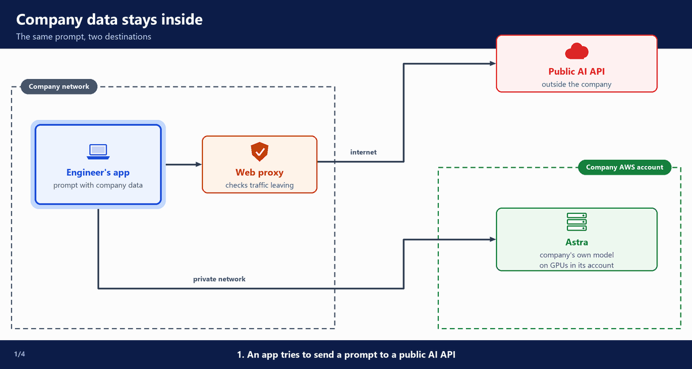
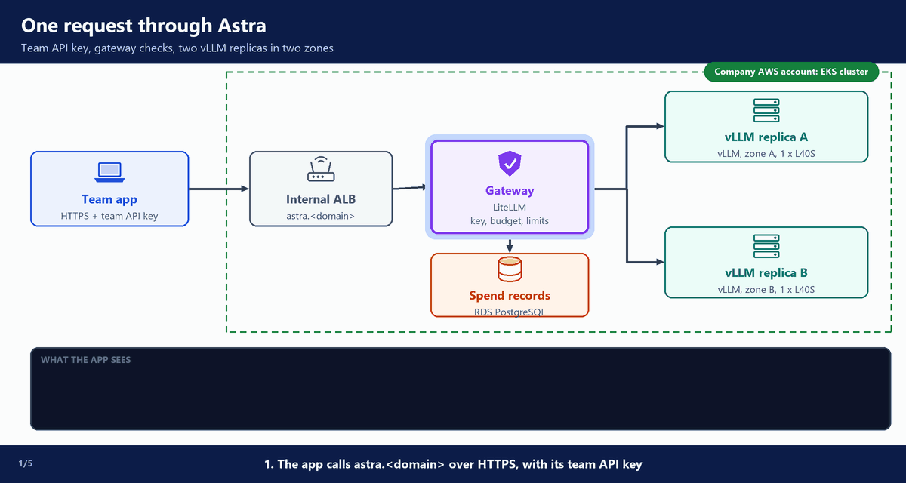

# 0. Why run your own inference?

This guide is for AI platform engineers. It answers one question with one real build: **how can we use AI in our company without sending our data to an outside AI provider?**

- **Inference** means using a trained model, here a large language model (**LLM**), to get answers. A prompt goes in, and text comes out.
- **Self-hosted inference** means we run the model ourselves, on servers we control. We do not send prompts to an AI provider's service.

> **What this guide follows:** our company, from the decision to use AI, to a running platform, to the teardown. We call the platform **Astra**.

---

## A. The decision: use AI, but keep our data inside

Our leaders decide: **we will use AI.** Our engineers should use it to build tools that help the business.

There is one condition: **our data must not be sent to an outside AI provider.**

- 🔒 Prompts would carry customer records, contracts, source code and employee data.
- 🔒 Laws (such as GDPR, HIPAA and PCI DSS) and customer contracts set rules for sending this data to another company. Each new provider needs contracts, reviews and proof for auditors.
- 🎛️ Later, teams may want to **fine-tune** a model: train an existing model further on our own examples, so it follows our formats, terms and tasks better. The base model's general skills stay.
  - The examples are our data, and the tuned **weights** (the numbers the model learned in training) are our asset.
  - With a hosted AI API, fine-tuning is offered only for some of the provider's models, and the tuned model can only be used on that provider's platform.
  - With our own inference, we choose the base model, keep the data and the weights in our account, and serve the tuned version on the same platform as everything else.
- 🛡️ Public AI websites and AI provider APIs stay blocked at our web proxy.

So we run the model ourselves, on GPU instances we rent in our own AWS account. Prompts and answers stay in our account. Our platform team builds it. (`02-tool-choices` lists the tools we picked.)

**What happens in the animation**

> The numbers match the step counter at the bottom left of the animation.

1. Engineer's app → web proxy: the app tries to send a prompt to a public AI API.
2. Web proxy → ❌ public AI API: the proxy blocks it.
3. Engineer's app → private network → Astra: the same prompt goes to Astra, in our AWS account.
4. Astra → private network → engineer's app: the answer comes back. Nothing left the account.

**Watch it run**

---

## B. Pilot: a minimum viable platform

The pilot holds only what engineers need to start using the model for real work:

- **One open-weight model.** An **open-weight model** is a model whose weights anyone may download and run, such as Qwen, Llama, Mistral or gpt-oss. This build uses Qwen3.8-27B (how to choose a model: `05-model-pipeline`, section C). Its weights are 28.8 GiB (about 31 GB), so it fits on one GPU with 48 GB of memory.
- **Two GPU nodes, in two different zones.** The model runs on Kubernetes (Amazon EKS).
  - One node is enough to run the model. The second one keeps the service working if one node or one zone fails.
- **One gateway in front of the model.** A **gateway** is the one endpoint that every app calls. Each team gets its own **team API key**: a secret key the team's apps send with each request, so the gateway knows which team is calling. Every request is counted from the first day, so the platform team can see who uses what.

What the pilot costs, at AWS on-demand prices in us-east-1:

- 💰 One GPU instance (g6e.xlarge, one NVIDIA L40S GPU) costs **$1.86 an hour**. Two cost **$3.72 an hour**, about **$2,716 a month** if they run all the time (730 hours).
- 💰 The cluster, the NAT gateway, the database and the small instances cost more on top.
- 💰 GPUs cost the same every hour, busy or not. So the busier they are, the cheaper each token. (A **token** is a small piece of text, about three quarters of a word.)
- ⚠️ 💰 So at low or uneven traffic, a hosted API that charges per token usually costs less. And our own model has a running cost in people too: our platform team owns the GPU capacity, the model upgrades, the scaling and the on-call.

---

## C. Onboard engineering teams

The platform team gives the engineering teams three things: an endpoint URL, a team API key and a model name. The API works like the OpenAI API. Code that uses an OpenAI library only needs to change these three values.

Engineers (developers and AI engineers) are encouraged to build proofs of concept. Business teams bring the problems. Engineers build the apps. For example:

- For HR: an assistant that answers employees' questions about our company rules.
- For support: an app that writes first drafts of replies to customers.
- For developers: help to write and review code.
- For operations: agents that read internal systems. (An **agent** is an AI app that can take steps on its own, such as reading a system and acting on it.)

Each engineering team starts with a small budget. The platform team watches a dashboard: which teams use the model, how many tokens they use, and how busy the GPUs are.

---

## D. Scale with demand

Some proofs of concept go to production, and demand grows. The platform team scales the platform, based on the metrics on the dashboard:

1. **Scale out** when requests wait too long for a GPU. The platform adds a vLLM replica on its own, up to a limit (`06-serving`). (**vLLM** is the open-source inference server: it loads the model on the GPU and answers requests.)
2. **Capacity planning:** combine today's usage with each team's forecast, and turn it into a number of GPUs.
3. **Cost allocation.** First showback, with the spend report (`09-operate`). Later, finance may move to chargeback.
4. **Production readiness:** stronger controls before go-live (`10-production`).
5. **A stronger model, if a task needs one.** The gateway can also offer a model from the cloud provider, for example from **Amazon Bedrock** (the AWS service that runs models from several AI companies), for data that security and legal allow there.
6. **Fine-tuning, if a use case needs it.** Real use cases show where the base model is not good enough, for example a fixed answer format, or internal terms it does not know. It is not the first step: we start with good prompts, and our own documents in the prompt.
   - Security and legal approve the training data first: personal data removed, and the right to use it.
   - Training needs more GPU memory than serving the same model. So training runs as separate jobs: SageMaker AI training jobs, SageMaker HyperPod, or GPU jobs on an EKS cluster. (**SageMaker AI** is the AWS machine learning service, and HyperPod is its GPU clusters for long training runs.)
   - The tuned version is a new model version. It goes through the same checks as a downloaded one, before it can serve (`05-model-pipeline`, `06-serving`).
   - This build does not fine-tune. It is explained, not built.

---

## E. The platform: Astra

The platform needs a name, so engineers know what to call. We call it **Astra**. Engineers use the model name `astra`.

**What happens in the animation**

> The numbers match the step counter at the bottom left of the animation.

1. Team app → internal ALB (`astra.<domain>`) → gateway: the app sends a request over HTTPS, with its team API key.
2. Gateway: it checks the API key, the team's budget and its rate limits (requests and tokens per minute).
3. Gateway → vLLM replica A → gateway → team app: the answer comes back. Gateway → spend records: the cost is saved. The app sees `HTTP 200` and the cost header.
4. Zone A fails → gateway → vLLM replica B: the next request goes to zone B, and the app still gets `HTTP 200`.
5. Team app → gateway → team app: a team that used up its budget gets an error of type `budget_exceeded`. The request never reaches a GPU.

The gateway is **LiteLLM**, an open-source AI gateway (`07-gateway`).

**Watch it run**

---

## F. How this guide is organised

The guide follows our steps in order: decide, build, use, run, then get ready for production. Each build doc ends with a "Validate" section. Do not start the next doc before its checks pass.

**📋 Why and design:**

- `00-why-own-inference` (this document): why we run our own inference.
- `01-design`: the design in five stages, and what is in the repository.
- `02-tool-choices`: the tool options for each part of the build, and the places on AWS where the model could run.

**🏗️ The build:**

- **Foundations** (`03-foundations`): the AWS base and the cluster.
- **Platform add-ons** (`04-platform-addons`): the shared tools in the cluster.
- **Model pipeline** (`05-model-pipeline`): one checked model version, ready to serve.
- **Serving** (`06-serving`): vLLM on the GPU nodes.
- **Gateway** (`07-gateway`): LiteLLM, the endpoint every app calls.

**🚀 Use and run:**

- **App team** (`08-k8s-assistant`): an **app team** (developers who build one app for the business) builds an app on the platform.
- **Operate** (`09-operate`): new model versions, the spend report and the runbooks.

**Production** (`10-production`): what we change before go-live.

**Appendix** (`11-aws-inventory-and-cost`): every AWS resource the build makes, and what it costs.

**Teardown** (`12-teardown`): delete everything after a session, and check that nothing is left.

### You follow it in your own copy of the repository

The guide uses one complete repository: [utrains/self-hosted-llm-qwen-27b](https://github.com/utrains/self-hosted-llm-qwen-27b).

- You fork it on GitHub, and you clone your fork to your laptop.
- You write the address of your fork in the build's settings file, `terraform.tfvars`.
- Argo CD, in the cluster, then syncs from your fork. It reads it without a login, which is why the fork must be public.
- When a step changes a file (for example the list of teams), you commit and push it to your fork. Argo CD applies the change.
- Each doc shows the files it uses, as exact parts copied from the repository, and explains them.

### Who does what in our company

- **The platform team** (you): the cluster, the gateway, the model pipeline, the unit cost calculation, and the master key (the gateway's admin key).
- **App teams** (developers and AI engineers): build apps with their team API key. They never touch the cluster or the GPUs.
- **Security and legal:** which data may go into prompts, approval of new models, and who can read API keys and logs.
- **Finance:** agrees the internal unit cost (the chargeback rate per million tokens) and each team's budget.

### Build it, or only read it

Every step in this guide is a command you run, and each doc shows the output you should see. So you can build your own platform with it, or only read it. Two things decide which:

- ⚠️ **GPU quota and capacity.** A new AWS account often has no quota for GPU instances, and a quota request can take days. Check it before you build (`03-foundations`, section C). Even with quota, AWS does not guarantee free g6e capacity in a zone at the moment you ask. The first GPU node can take half an hour or more of retries (`06-serving`).
- ⚠️ 💰 **Cost.** The build costs money every hour it runs. The two GPU nodes alone cost $3.72 an hour (section B). Run the teardown script, `scripts/teardown.sh`, when you stop (`12-teardown`).

Source: [Amazon EC2 instance type quotas](https://docs.aws.amazon.com/ec2/latest/instancetypes/ec2-instance-quotas.html)
