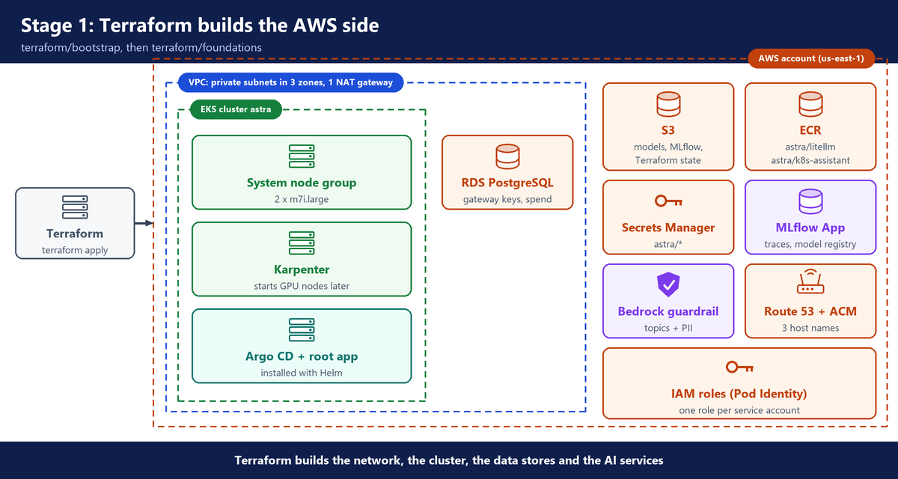
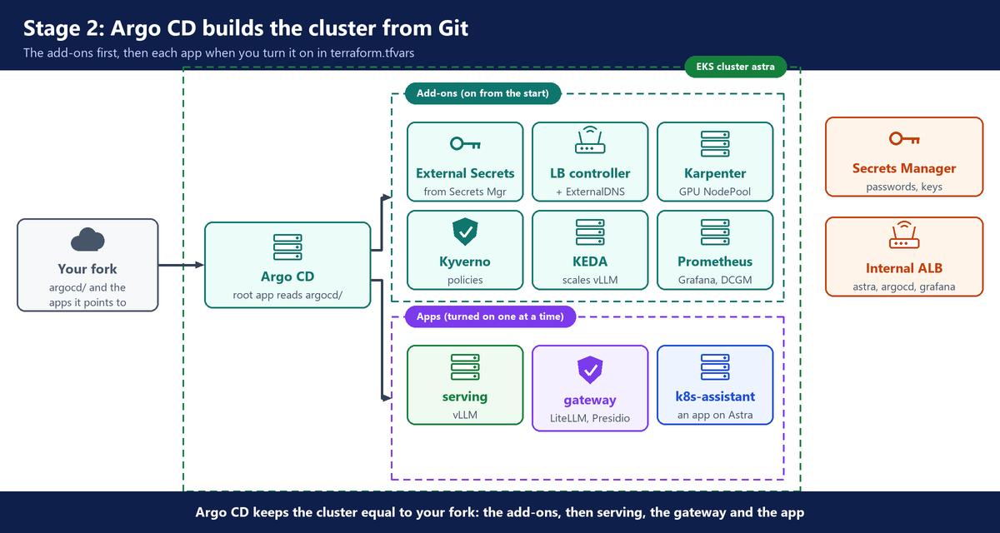
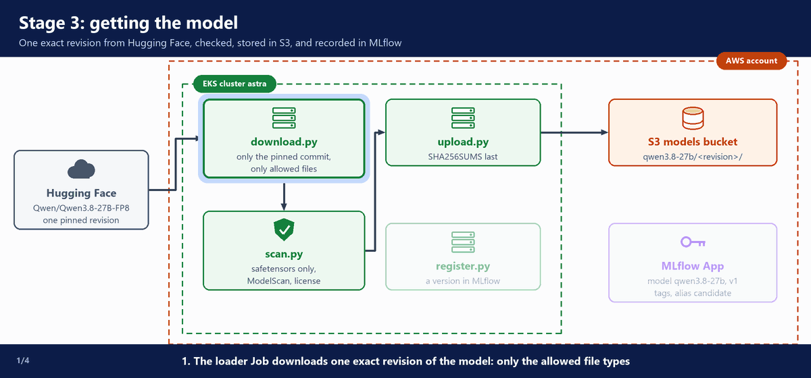
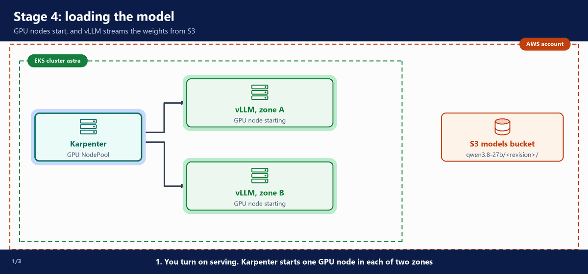
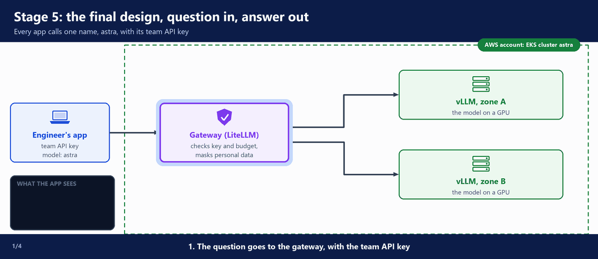

# 1. The full design

This document shows Astra in five stages, then where each part lives in the repository. The options for each tool are in `02-tool-choices`. The full steps are in each build document.

---

## A. The design in five stages

Astra is built in five stages. Terraform and Argo CD prepare the platform (stages 1 and 2). The three stages that matter for inference come after: getting the model, loading it, and answering a question.

### Stage 1: Terraform builds the AWS side

You run Terraform with your settings in `terraform.tfvars`: first `terraform/bootstrap`, then `terraform/foundations` (`03-foundations`). It builds the network, the EKS cluster and the data stores in the picture, and two AI services:

- The **MLflow App** on SageMaker AI: **MLflow** is an open-source tool that keeps a **trace** (a record) of every model call, and is also a **model registry**: a list of model versions, each with where its files are and its status. The MLflow App is a managed MLflow server that AWS runs in your account.
- The **Bedrock guardrail**: a **guardrail** checks a prompt or an answer, and blocks or changes it if it breaks a rule; the Bedrock guardrail is the AWS one.

### Stage 2: Argo CD builds the cluster from Git

Terraform hands Argo CD the cluster's values (bucket names, role ARNs, the domain) in the Argo CD cluster Secret: this is the **GitOps Bridge**. From then on, Argo CD keeps the cluster equal to your fork (`04-platform-addons`):

- the add-ons in the picture, on from the start;
- the apps, one at a time, when you turn each one on in `terraform.tfvars`: serving (vLLM), the gateway (LiteLLM, with **Presidio**: an open-source tool that finds personal data in a prompt and masks it) and the example app `k8s-assistant`.

### Stage 3: getting the model

**What happens in the animation**

> The numbers match the step counter at the bottom left of the animation.

1. Hugging Face → `download.py`: you run `kubectl apply -k model/`. The loader Job downloads one exact revision (one commit) of the model, and only the allowed file types. **Hugging Face** is the public site where model makers publish their models.
2. `download.py` → `scan.py`: the scan checks the files. A finding stops the Job here, and nothing reaches S3.
3. `scan.py` → `upload.py` → S3: the checked files go to the S3 models bucket, with `SHA256SUMS` written last.
4. `upload.py` → `register.py` → MLflow App: the Job records the version in the model registry, as a version of the model `qwen3.8-27b` whose source is that S3 folder, with its revision, license, scan result and checksums. The weights stay in S3: MLflow keeps the reference. The version is ready to serve (`05-model-pipeline`).

**Watch it run**

### Stage 4: loading the model

**What happens in the animation**

> The numbers match the step counter at the bottom left of the animation.

1. Karpenter → GPU nodes: you turn on serving in `terraform.tfvars`. Karpenter starts one GPU node in each of two zones.
2. S3 → vLLM: vLLM starts on each node and streams the weights from S3 into the GPU.
3. Both vLLM replicas are ready, and they serve the model under one name: `astra` (`06-serving`).

**Watch it run**

### Stage 5: the final design, question in, answer out

**What happens in the animation**

> The numbers match the step counter at the bottom left of the animation.

1. Engineer's app → gateway: the question goes to the gateway at `astra.<domain>`, with the team API key.
2. Gateway → vLLM: the gateway checks the key and the budget, masks personal data, and sends the question to vLLM.
3. vLLM → gateway → app: the model writes the answer, and it comes back through the gateway to the app.
4. The next question can go to the other replica. The app sees no difference.

Around each call, the gateway also records the team's spend, sends one trace to the MLflow App, and runs the guardrails on the answer (`07-gateway`).

> **In this guide:** there is no VPN. You reach the gateway, Argo CD and Grafana with `kubectl port-forward`.

**Watch it run**

---

## B. What is in the repository

Each folder has one job. The guide shows and explains the code in each one.

- `terraform/bootstrap/`: the S3 bucket that holds Terraform's state.
- `terraform/foundations/`: the AWS side from step 1, plus the certificate for HTTPS, the Bedrock guardrail, Argo CD and its root app, and the IAM roles.
- `argocd/addons/`: one ApplicationSet per add-on.
- `argocd/apps/`: one ApplicationSet per app: `serving`, `gateway` and `k8s-assistant`.
- `platform/`: small Helm charts the add-ons use: the cluster basics, the Karpenter NodePools, the Kyverno policies, the dashboards and the Job that creates the gateway's database.
- `model/`: the model spec, the loader Job (download, scan, upload, register), and who must approve a version (`approvals.yaml`).
- `serving/`: our own Helm chart for vLLM, and the values file that says which model version serves.
- `gateway/`: the LiteLLM and Presidio settings, the gateway image (`litellm/image`), the list of teams (`teams.yaml`) and `sync_teams.py`.
- `apps/hello-assistant/`: the smallest app that calls Astra. It runs on your laptop (`07-gateway`).
- `apps/k8s-assistant/`: the example app, with its tests, its Dockerfile and its Kubernetes files.
- `scripts/`: the approval scripts, the canary script, test traffic, the spend report, the MLflow UI link, the teardown, and a check that nothing is left in the AWS account after the teardown.
- `runbooks/`: short steps for common problems.
