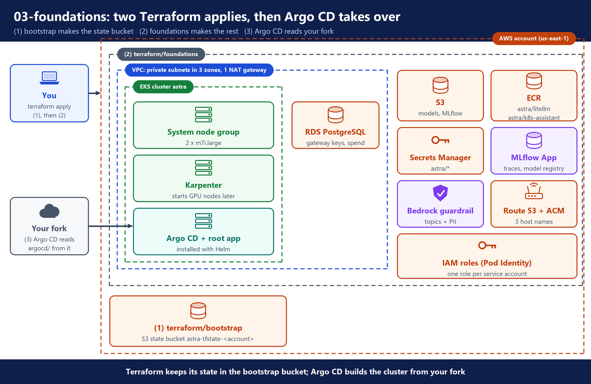
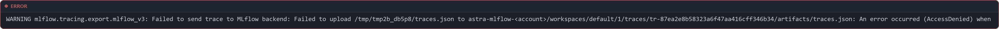

# 3. Foundations

**Repo folder:** `terraform/bootstrap/`, `terraform/foundations/`

This stage builds the AWS base of the platform with Terraform. It starts with your own copy of the repository on GitHub. It ends with a running EKS cluster, and Argo CD inside it, reading your repository.

---

## A. Why this stage exists

We want our own AI model API, inside our own AWS account. Before any model can run, it needs a network, a Kubernetes cluster, storage for model weights, an image registry, a database, a place for secrets, and a way to install software on the cluster from Git.

The cloud platform team builds this base once, with code, so it can be rebuilt the same way at any time.

---

## B. Architecture



1. **Bootstrap** makes the S3 bucket for Terraform's state.
2. **Foundations** makes everything else in the picture, and installs Argo CD.
3. **Argo CD** applies `argocd/` from your fork: the add-ons at once (`04-platform-addons`), and each app when its doc turns it on (section F).

---

## C. What you need

> **💰 Before you apply:** the build costs money every hour from this step on. Check the GPU quota first (`00-why-own-inference`, section F). The price of every resource is in `11-aws-inventory-and-cost`.

### Tools on your laptop

- Terraform 1.10 or newer (`versions.tf` asks for `>= 1.10`).
- AWS CLI v2, signed in to the AWS account with admin rights.
- `kubectl`, `jq`, `curl` and `git`.
- A GitHub account.
- A Hugging Face account. It is free. You use it in section L.
- Docker, later, to build the gateway image (`07-gateway`) and the app image (`08-k8s-assistant`).
- `yq` v4, later, for the canary script (`09-operate`).

> **On Windows:** the guide was run on Windows 11 in Git Bash. Install `yq` v4 with `winget install --id MikeFarah.yq -e`. Git Bash rewrites an argument that starts with `/` into a Windows path, for example `/app/...` becomes `C:/Program Files/Git/app/...`. Put `MSYS_NO_PATHCONV=1` in front of such a command, or write `//app/...`. In Git Bash, `python3` can be the Microsoft Store stub (a placeholder that only prints "Python was not found"). The repo scripts check that `python3 -c ""` runs, and use `python` if it does not.

```bash
terraform version
aws --version
aws sts get-caller-identity
kubectl version --client
jq --version
git --version
```

`aws sts get-caller-identity` shows the account and the user or role you are signed in as. Terraform makes that identity the first cluster admin.

### GPU quota

The `g6e` instances count against the quota "Running On-Demand G and VT instances", in vCPUs.

```bash
aws service-quotas list-service-quotas --service-code ec2 --region us-east-1 \
  --query "Quotas[?QuotaName=='Running On-Demand G and VT instances'].[QuotaCode,Value]" \
  --output text
```

- The GPU NodePool allows at most 4 GPU nodes. The NodePool also sets the instance types and the zones (`04-platform-addons` sets it up).
- A `g6e.xlarge` has 4 vCPUs, a `g6e.2xlarge` 8, a `g6e.4xlarge` 16.
- So you need at least 16 vCPUs for 4 of the smallest size.
- You need up to 64 if Karpenter has to pick the biggest size.
- If the value is too low, ask for more in the Service Quotas console. A new account often needs a quota request, and the answer can take days.

### A public Route 53 hosted zone

You need a domain name that you control in Route 53, for example `lab.example.com`. Terraform looks the zone up, so it must exist before you apply.

```bash
aws route53 list-hosted-zones-by-name --dns-name lab.example.com \
  --query "HostedZones[0].[Name,Config.PrivateZone]" --output text
```

Replace `lab.example.com` with your domain. The name must match, and the private flag must be `False`.

> **Tip:** the zone is public only so that AWS can check the certificate by DNS. The apps themselves sit behind an internal load balancer.

### Your public IP address

Only your IP address may reach the Kubernetes API from the internet.

```bash
curl -s https://checkip.amazonaws.com
```

Write it down. In the variables file it becomes `"<your-ip>/32"`.

---

## D. Fork and clone the repository

Argo CD installs everything from a Git repository. It must be your own copy, because later stages push small changes to it, and the cluster follows what you push.

1. Open the repository on GitHub: [utrains/self-hosted-llm-qwen-27b](https://github.com/utrains/self-hosted-llm-qwen-27b).
2. Click **Fork**, pick your account as the owner, and click **Create fork**.
3. Keep the fork **public**. Argo CD can then read it without a login.

Clone your fork, and work at its root from now on:

```bash
git clone https://github.com/<your-user>/self-hosted-llm-qwen-27b.git
cd self-hosted-llm-qwen-27b
ls
```

The folders and what each one holds are in `01-design`, section B.

The `.gitignore` keeps local files out of Git. For Terraform this is the `.terraform/` folders, state files (`*.tfstate`), your `terraform.tfvars`, saved plans (`tfplan`) and the generated `terraform/foundations/backend.hcl`. It also ignores `.env` files and `*.pem` keys.

---

## E. Create the state bucket (bootstrap)

This build keeps the Terraform state in an S3 bucket. The bucket must exist before the foundations stack can use it, so a tiny separate stack makes it first.

**File:** `terraform/bootstrap/versions.tf`

```hcl
# Versions checked on the Terraform Registry on 2026-10-28.
terraform {
  required_version = ">= 1.10" # use_lockfile (S3 native locking) needs 1.10+

  required_providers {
    aws = {
      source  = "hashicorp/aws"
      version = "~> 6.70" # 6.70.0, 2026-10-22
    }
    local = {
      source  = "hashicorp/local"
      version = "~> 2.9" # 2.9.1, 2026-09-10
    }
  }

  # No backend here: this stack creates the state bucket, so its own (tiny) state stays local.
  # Keep terraform.tfstate from this folder, or import the bucket again if you lose it.
}

provider "aws" {
  region = var.region

  default_tags {
    tags = {
      Project   = var.name
      Stage     = "bootstrap"
      ManagedBy = "terraform"
    }
  }
}
```

- `required_version = ">= 1.10"`: S3 native locking (below) needs Terraform 1.10 or newer.
- `required_providers` pins `aws`, and `local` to write a file on your laptop.
- There is no `backend` block. This stack creates the state bucket, so it cannot keep its own state there. Its small state file stays in `terraform/bootstrap/` on your laptop.
- `default_tags` puts the same tags on every resource, so Cost Explorer can show what Astra costs.

**File:** `terraform/bootstrap/variables.tf`

```hcl
variable "region" {
  description = "AWS region for the state bucket. Use the same region as the cluster."
  type        = string
  default     = "us-east-1"
}

variable "name" {
  description = "Name prefix for every resource."
  type        = string
  default     = "astra"
}
```

- The lock file `terraform/bootstrap/.terraform.lock.hcl` is in Git, with the exact provider versions that were checked.

`outputs.tf` gives back the bucket name as the output `state_bucket`. The important parts of `main.tf` are below. The full file is at `terraform/bootstrap/main.tf`.

**File:** `terraform/bootstrap/main.tf` (part)

```hcl
data "aws_caller_identity" "current" {}

locals {
  # Bucket names are global, so the account id makes the name unique.
  state_bucket = "${var.name}-tfstate-${data.aws_caller_identity.current.account_id}"
}

# --- State bucket: one per account, shared by every Terraform stack of the course -------------------

resource "aws_s3_bucket" "state" {
  bucket = local.state_bucket

  # The state is the only record of what Terraform built. Never delete it by accident.
  lifecycle {
    prevent_destroy = true
  }
}
```

- S3 bucket names are global, so the name ends with your account ID: `astra-tfstate-<account>`.
- `prevent_destroy = true`: the state is the only record of what Terraform built, so Terraform refuses to delete this bucket.
- The rest of the file turns on versioning, encryption, and a public-access block. It also adds a rule that deletes old versions after 90 days, and a bucket policy that refuses any request that is not HTTPS.

**File:** `terraform/bootstrap/main.tf` (the end of the file)

```hcl
  content         = <<-EOT
    bucket       = "${aws_s3_bucket.state.bucket}"
    key          = "foundations/terraform.tfstate"
    region       = "${var.region}"
    encrypt      = true
    use_lockfile = true
  EOT
```

- This writes a small file, `backend.hcl`, into `terraform/foundations/`. It tells the foundations stack where its state lives.
- `use_lockfile = true` turns on **S3 native locking**: a `.tflock` file in the bucket. Older setups needed a DynamoDB table for the lock. Terraform 1.10 and newer do it with S3 alone.
- `backend.hcl` is in `.gitignore`. It holds your bucket name, which is different in every account, so it stays out of Git.

### Run the bootstrap

```bash
cd terraform/bootstrap
terraform init
terraform apply
cd ../..
```

- `terraform/foundations/backend.hcl` now exists. It should show your bucket name, `astra-tfstate-<account>`, and `use_lockfile = true`.

```bash
cat terraform/foundations/backend.hcl
```

> **⚠️ Keep the bootstrap state:** the bootstrap stack keeps its small state file, `terraform/bootstrap/terraform.tfstate`, on your laptop. `.gitignore` keeps it out of Git. Do not delete it. If you lose it, you must import the bucket again.

---

## F. The foundations stack: settings, zones and network

The foundations stack is split into files by job. This section and the next four explain them. You apply them all at once in section K.

### Versions and providers

**File:** `terraform/foundations/versions.tf` (part)

```hcl
  # State lives in the bucket made by ../bootstrap. It wrote backend.hcl next to this file:
  #   terraform init -backend-config=backend.hcl
  backend "s3" {}
```

- The backend block is empty. The values come from `backend.hcl` when you run `init`.
- The same file pins the `aws`, `helm`, `kubernetes` and `random` providers.
- The `helm` and `kubernetes` providers call the new cluster's API from your laptop, with a short-lived token from `aws eks get-token`. So your IP must be in `admin_cidrs`.

### Variables

**File:** `terraform/foundations/variables.tf` (part)

```hcl
variable "domain" {
  description = "A public Route 53 hosted zone you own, for example lab.example.com. Host names are <app>.<domain>."
  type        = string
  # No default: Terraform looks the zone up, so a made-up name would fail.
}

variable "admin_cidrs" {
  description = "Public IP ranges allowed to reach the Kubernetes API, for example [\"203.0.113.7/32\"]. Include the machine that runs Terraform."
  type        = list(string)
  # No default: 0.0.0.0/0 would open the API to the whole internet.
}

variable "repo_url" {
  description = "Git repository that Argo CD reads: your copy (fork) of the repository. It must be public, or Argo CD needs a login for it."
  type        = string
  # No default: Argo CD must read your repository.
}

variable "repo_revision" {
  description = "Branch, tag or commit that Argo CD follows."
  type        = string
  default     = "main"
```

- `domain`, `admin_cidrs` and `repo_url` have no default on purpose.
- A made-up domain would fail the zone lookup. An open range (`0.0.0.0/0`) would put the Kubernetes API on the whole internet.
- `repo_url` must be **your** repository. Argo CD reads `argocd/` from it, so the cluster follows what you push.
- The other variables have defaults: `region` (`us-east-1`), `name` (`astra`, also the cluster name), `kubernetes_version` (`1.37`), `db_instance_class` (`db.t4g.micro`), `system_instance_types` (`m7i.large`) and `admin_principal_arns` (extra cluster admins).

**File:** `terraform/foundations/variables.tf` (part)

```hcl
variable "apps" {
  description = "Which apps in argocd/apps Argo CD deploys. All off at first; the guide turns each one on in its own step. Each key becomes the label enable_<key> on the cluster Secret."
  type = object({
    serving       = optional(bool, false) # vLLM (argocd/apps/serving.yaml), needs the model in S3 first
    gateway       = optional(bool, false) # LiteLLM, Redis, Presidio (argocd/apps/gateway.yaml)
    k8s_assistant = optional(bool, false) # the example app (argocd/apps/k8s-assistant.yaml)
  })
  default = {}
}

variable "addons" {
  description = "Add-ons Argo CD installs from argocd/addons. Each key becomes the label enable_<key> on the cluster Secret."
  type        = map(bool)
  default = {
    aws_load_balancer_controller = true
    external_dns                 = true
    external_secrets             = true
    karpenter_nodepools          = true
    kyverno                      = true
    keda                         = true
    kube_prometheus_stack        = true
    dcgm_exporter                = true
    db_init                      = true # the litellm database on RDS (platform/db-init)
  }
}
```

- Each key of `apps` and `addons` turns into a label on the Argo CD cluster Secret, for example `enable_keda: "true"` or `enable_serving: "false"` (section J).
- Each ApplicationSet in `argocd/` installs only where its label is `"true"`. So these two variables turn things on and off without a change in Git.
- `addons` are all on by default. Argo CD installs them right after the apply (`04-platform-addons`).
- `apps` are all off by default (`optional(bool, false)`). In this stage they stay off. vLLM, for example, needs the model in S3 first.
- A later stage turns one on in `terraform.tfvars`, for example `apps = { serving = true }`, and runs `terraform apply`. Terraform changes the label, and Argo CD deploys the app.

**File:** `terraform/foundations/terraform.tfvars.example`

```hcl
# Copy to terraform.tfvars (git-ignored) and fill in.

region = "us-east-1"
name   = "astra"

# A public Route 53 hosted zone in this account.
domain = "lab.example.com"

# Your public IP, from:  curl -s https://checkip.amazonaws.com
admin_cidrs = ["203.0.113.7/32"]

# Your copy (fork) of the repository. Argo CD reads argocd/ from here.
repo_url      = "https://github.com/<your-user>/self-hosted-llm-qwen-27b.git"
repo_revision = "main"

# Which apps Argo CD deploys. Leave this out at first; the guide turns them on one at a time:
# apps = { serving = true, gateway = true, k8s_assistant = true }
```

Copy it to `terraform.tfvars` and set your own values:

```bash
cp terraform/foundations/terraform.tfvars.example terraform/foundations/terraform.tfvars
```

Edit `terraform/foundations/terraform.tfvars`:

- `domain`: your Route 53 zone.
- `admin_cidrs`: your IP with `/32`.
- `repo_url`: the URL of **your fork** from section D, for example `https://github.com/<your-user>/self-hosted-llm-qwen-27b.git`.
- `repo_revision`: the branch Argo CD follows, `main`.
- Leave `apps` out for now.

`terraform.tfvars` is never committed: it is in `.gitignore`, so your values never go to Git. The `.example` file is in Git, so the next person knows which values to set.

### Only zones that sell the GPU

**File:** `terraform/foundations/main.tf`

```hcl
data "aws_caller_identity" "current" {}
data "aws_partition" "current" {}

# Only use Availability Zones that sell the GPU instance. GPU capacity is not in every zone.
data "aws_ec2_instance_type_offerings" "gpu" {
  location_type = "availability-zone"

  filter {
    name   = "instance-type"
    values = [local.gpu_zone_probe]
  }
}

# The zone that the certificate and external-dns use.
data "aws_route53_zone" "this" {
  name         = var.domain
  private_zone = false
}

locals {
  name       = var.name # cluster name `astra`
  account_id = data.aws_caller_identity.current.account_id
  partition  = data.aws_partition.current.partition

  # g6e.xlarge is the smallest GPU the model runs on. Zones that sell it usually sell the bigger g6e too.
  gpu_zone_probe = "g6e.xlarge"
  azs            = slice(sort(data.aws_ec2_instance_type_offerings.gpu.locations), 0, min(3, length(data.aws_ec2_instance_type_offerings.gpu.locations)))
  vpc_cidr       = "10.0.0.0/16"

  # Host names behind the one internal ALB. All three go on one ACM certificate.
  hosts = {
    gateway = "astra.${var.domain}"
    argocd  = "argocd.${var.domain}"
    grafana = "grafana.${var.domain}"
  }

  # Secrets Manager ARN prefix. Real ARNs end with a random 6-character suffix, hence the wildcard.
  secret_arn_prefix = "arn:${local.partition}:secretsmanager:${var.region}:${local.account_id}:secret:${var.name}"
}

check "enough_gpu_zones" {
  assert {
    condition     = length(local.azs) == 3
    error_message = "${local.gpu_zone_probe} is sold in fewer than 3 Availability Zones in ${var.region}. Pick another region."
  }
}
```

- Not every zone sells `g6e` instances. `aws_ec2_instance_type_offerings` asks AWS which zones sell `g6e.xlarge`. `azs` keeps the first 3 of them, and the network is built only there.
- The `check` block stops with a clear message if fewer than 3 zones sell it. Then pick another region.
- `aws_route53_zone` looks up your hosted zone. The certificate (section I) and ExternalDNS (`04-platform-addons`) write records into it.
- `hosts` are the three hostnames behind the one internal load balancer: `astra.<domain>` (the gateway), `argocd` and `grafana`. The MLflow UI has no hostname here: AWS serves it, and you open it with a signed link (section I).
- `secret_arn_prefix` is the start of every secret ARN under `astra/`. It is used to give read access to `astra/*` only.

### The network

**File:** `terraform/foundations/network.tf`

```hcl
module "vpc" {
  source  = "terraform-aws-modules/vpc/aws"
  version = "~> 6.7" # 6.7.3, 2026-09-18

  name = local.name
  cidr = local.vpc_cidr
  azs  = local.azs

  # Private subnets hold the nodes, pods and database: 10.0.0.0/20, 10.0.16.0/20, 10.0.32.0/20 (4,091 IPs each).
  # Public subnets only hold the NAT gateway: 10.0.240.0/24, ... at the top of the range.
  private_subnets = [for i, az in local.azs : cidrsubnet(local.vpc_cidr, 4, i)]
  public_subnets  = [for i, az in local.azs : cidrsubnet(local.vpc_cidr, 8, i + 240)]

  # One NAT gateway for the lab. Production uses one per zone, so one zone failing does not cut the others off.
  enable_nat_gateway = true
  single_nat_gateway = true

  enable_dns_hostnames = true
  enable_dns_support   = true

  public_subnet_tags = { "kubernetes.io/role/elb" = 1 }
  private_subnet_tags = {
    "kubernetes.io/role/internal-elb" = 1          # the internal ALB lands here
    "karpenter.sh/discovery"          = local.name # Karpenter EC2NodeClass finds the subnets by this tag
  }
}

# Model weights (about 31 GB per node start) come from S3 over the AWS network:
# free, fast, and not billed per GB through the NAT gateway.
resource "aws_vpc_endpoint" "s3" {
  vpc_id            = module.vpc.vpc_id
  service_name      = "com.amazonaws.${var.region}.s3"
  vpc_endpoint_type = "Gateway"
  route_table_ids   = module.vpc.private_route_table_ids
  tags              = { Name = "${local.name}-s3" }
}
```

- The VPC is `10.0.0.0/16`, with one private and one public subnet in each of the 3 zones.
- The private subnets are large (`/20`, about 4,091 IP addresses each), because every pod takes its own VPC IP address. Nodes, pods and the database live here.
- The public subnets are small (`/24`) and hold only the NAT gateway. The nodes reach Hugging Face through it.
- The subnet tags let the AWS Load Balancer Controller (`04-platform-addons`) find the subnets for the internal ALB, and let Karpenter find the subnets for new nodes.
- The **S3 gateway endpoint** keeps the model weights (about 31 GB) off the NAT gateway, which charges per GB.

> **In this course:** one NAT gateway for all zones keeps the cost down.

---

## G. The cluster and Karpenter

### EKS with a small system node group

**File:** `terraform/foundations/eks.tf` (part)

```hcl
  # The Kubernetes API is reachable from the internet only from admin_cidrs, and privately inside the VPC.
  endpoint_public_access       = true
  endpoint_public_access_cidrs = var.admin_cidrs
  endpoint_private_access      = true

  # Pods get AWS roles through EKS Pod Identity (pod-identity.tf), so no IAM OIDC provider for IRSA.
  enable_irsa = false

  # EKS already encrypts all Kubernetes API data (Secrets included) with an AWS owned key, at no cost
  # (Kubernetes 1.28 and later). So no customer managed KMS key: nothing to pay for, and nothing that
  # waits 7-30 days to be deleted after terraform destroy. Production may set its own key (10-production).
  create_kms_key    = false
  encryption_config = null

  # Control-plane logs in CloudWatch: only the audit log (who did what in the cluster), kept 7 days.
  # Lab setting. Production keeps api, audit and authenticator, for as long as your retention rules say.
  enabled_log_types                      = ["audit"]
  cloudwatch_log_group_retention_in_days = 7

  # Whoever runs `terraform apply` becomes cluster admin through an EKS access entry.
  # Terraform needs this itself, to install Karpenter and Argo CD below.
  enable_cluster_creator_admin_permissions = true
```

- The Kubernetes API is open only to your IP, plus the inside of the VPC.
- `enable_irsa = false`: no IAM OIDC provider. IRSA needs one. This build uses EKS Pod Identity instead (section H), which does not, so there is one less thing to create and delete.
- `create_kms_key = false` and `encryption_config = null`: no customer managed KMS key. EKS already encrypts all Kubernetes API data, Secrets included, with a key that AWS owns, at no cost. This is on by default for Kubernetes 1.28 and later ([AWS docs: envelope encryption](https://docs.aws.amazon.com/eks/latest/userguide/envelope-encryption.html)). An own key would cost money every month, and after `terraform destroy` it would wait 7 to 30 days before AWS deletes it.
- Control-plane logs go to CloudWatch Logs. Only the **audit** log is on, kept 7 days.
- You become cluster admin through an access entry, because you run the apply. Extra admins come from `admin_principal_arns`, as access entries too.

**File:** `terraform/foundations/eks.tf` (part)

```hcl
  # EKS-managed add-ons. vpc-cni and the Pod Identity agent must run before any node joins,
  # or the first pods start without networking or AWS credentials.
  addons = {
    coredns    = {}
    kube-proxy = {}
    vpc-cni = {
      before_compute = true
      # Without this, EKS stores NetworkPolicy objects but nothing enforces them
      # (the vLLM policy in serving/ would allow every namespace).
      configuration_values = jsonencode({ enableNetworkPolicy = "true" })
    }
```

- These are EKS managed add-ons: CoreDNS, kube-proxy, the VPC CNI, the Pod Identity agent (section H) and the EBS CSI driver. The EBS CSI driver makes the disks for Prometheus and for the model loader's work disk.
- `before_compute = true` installs the VPC CNI and the Pod Identity agent before any node joins. Otherwise the first pods would start without networking or AWS credentials.
- `configuration_values = jsonencode({ enableNetworkPolicy = "true" })` turns on NetworkPolicy enforcement in the VPC CNI. Without this line, EKS stores NetworkPolicy objects, but nothing enforces them: the CNI runs with `--enable-network-policy=false`.
- ⚠️ Without it, a pod in the `default` namespace reaches vLLM. It gets `HTTP 401` from vLLM itself (the API key check), not a dropped connection: the vLLM policy in `serving/` is ignored. With the line, the `aws-node` DaemonSet runs with `--enable-network-policy=true`, and the same call gets no answer (`06-serving` checks it).

**File:** `terraform/foundations/eks.tf` (part)

```hcl
  # A small fixed node group for the system pods: Karpenter cannot run on nodes it creates itself.
  # Every other node (CPU and GPU) is created by Karpenter from the NodePools in platform/karpenter.
  eks_managed_node_groups = {
    system = {
      ami_type       = "AL2023_x86_64_STANDARD"
      instance_types = var.system_instance_types

      min_size     = 2
      max_size     = 3
      desired_size = 2

      labels = {
        # Karpenter and Argo CD use this label to stay on nodes Karpenter does not manage.
        "karpenter.sh/controller" = "true"
      }
    }
  }
```

- Karpenter cannot start the node it runs on. So a small fixed group of 2 nodes (`m7i.large` by default) runs Karpenter, Argo CD and other system pods.
- The label `karpenter.sh/controller=true` marks these nodes. Karpenter and Argo CD use it as a `nodeSelector` to stay here.

The full file is at `terraform/foundations/eks.tf`.

### Karpenter

**File:** `terraform/foundations/karpenter.tf`

```hcl
# Karpenter IAM pieces from the eks module's own submodule: the controller role (Pod Identity on
# kube-system/karpenter), the node role with its access entry, and the SQS queue for Spot interruptions.
module "karpenter" {
  source  = "terraform-aws-modules/eks/aws//modules/karpenter"
  version = "~> 21.29" # 21.29.0, 2026-10-07

  cluster_name = module.eks.cluster_name

  # The EC2NodeClass in platform/karpenter names this role, so keep the name fixed (no random suffix).
  node_iam_role_use_name_prefix = false
  node_iam_role_name            = "${local.name}-karpenter-node"

  create_pod_identity_association = true
  namespace                       = "kube-system"
  service_account                 = "karpenter"

  # Lets you open a shell on a node with SSM Session Manager instead of SSH keys.
  node_iam_role_additional_policies = {
    AmazonSSMManagedInstanceCore = "arn:${local.partition}:iam::aws:policy/AmazonSSMManagedInstanceCore"
  }
}

# Chart 1.15.1 (GitHub releases, checked 2026-10-28). Karpenter 1.15.x is the line that supports Kubernetes 1.37.
resource "helm_release" "karpenter" {
  name       = "karpenter"
  namespace  = "kube-system"
  repository = "oci://public.ecr.aws/karpenter"
  chart      = "karpenter"
  version    = "1.15.1"
  wait       = true

  values = [
    yamlencode({
      serviceAccount = { name = "karpenter" }
      nodeSelector   = { "karpenter.sh/controller" = "true" }
      # Resolve DNS from the VPC, so Karpenter works even before CoreDNS has pods.
      dnsPolicy = "Default"
      settings = {
        clusterName       = module.eks.cluster_name
        clusterEndpoint   = module.eks.cluster_endpoint
        interruptionQueue = module.karpenter.queue_name
      }
      webhook = { enabled = false }
    })
  ]

  # The Pod Identity association must exist before the pod starts, or it gets no AWS credentials.
  depends_on = [module.karpenter, module.eks]
}
```

The `karpenter` submodule comes from the same EKS module. It makes the AWS pieces Karpenter needs:

- the **controller role**, which lets the Karpenter pod start and stop EC2 instances. It is linked to the service account `kube-system/karpenter` with Pod Identity (section H).
- the **node role** `astra-karpenter-node`: the role every new node gets. The name is fixed because the EC2NodeClass in `platform/karpenter` names it. The module gives it the standard node policies, including `AmazonEC2ContainerRegistryPullOnly`, so nodes can pull images from ECR (section I). The file adds `AmazonSSMManagedInstanceCore`, so you can open a shell on a node with SSM Session Manager.
- an access entry, so new nodes may join the cluster.
- an SQS queue for Spot interruption and other instance warnings, which Karpenter reads.

The `helm_release` installs the Karpenter controller, chart `1.15.1`:

- It runs on the system nodes (`nodeSelector`), and reads the warning queue (`interruptionQueue`).
- `dnsPolicy = "Default"` uses the VPC's DNS, so Karpenter works even before CoreDNS has pods.
- Terraform does not say which nodes Karpenter may start. That is the job of the NodePools in `platform/karpenter`, which Argo CD applies (`04-platform-addons`).

---

## H. Pod Identity: one AWS role per service account

Terraform links each service account that needs AWS to its own IAM role, so no pod holds AWS access keys. For example, the model loader writes the weights to S3, and vLLM only reads them.

**File:** `terraform/foundations/pod-identity.tf` (part)

```hcl
  # namespace / service account => S3 access per bucket, plus any extra statements.
  workloads = {
    model-loader = {
      # The Job in model/ that copies the model from Hugging Face to the models bucket,
      # then records it in the MLflow App (the model registry).
      namespace = "models"
      # mlflow: the MLflow client writes the run's evidence files straight to the MLflow bucket.
      s3 = { models = local.s3_write, mlflow = local.s3_write }
      extra = [
        {
          sid       = "ReadHfToken"
          actions   = ["secretsmanager:GetSecretValue", "secretsmanager:DescribeSecret"]
          resources = [aws_secretsmanager_secret.student["hf-token"].arn]
        },
        {
          # register.py finds the App by its name. A list call cannot be limited to one resource.
          sid       = "FindMlflowApp"
          actions   = ["sagemaker:ListMlflowApps"]
          resources = ["*"]
        },
        {
          # The run and the model version in the MLflow App (the sagemaker-mlflow plugin signs with this role).
          sid       = "RegisterModel"
          actions   = ["sagemaker:CallMlflowAppApi"]
          resources = [aws_sagemaker_mlflow_app.this.arn]
        },
      ]
    }
    vllm = {
      namespace = "serving"
      s3        = { models = local.s3_read }
      extra     = []
    }
    litellm = {
      namespace = "gateway"
      # The MLflow client writes each trace's body (traces.json) straight to the MLflow bucket with
      # this role; the App API call only registers the trace. Without it: AccessDenied, no traces.
      s3 = { mlflow = local.s3_write }
      extra = [
        {
          sid       = "ApplyGuardrail"
          actions   = ["bedrock:ApplyGuardrail"]
          resources = [aws_bedrock_guardrail.this.guardrail_arn]
        },
        {
          # Optional fallback model on Bedrock. Model access must also be enabled in the console.
          sid       = "InvokeFallbackModel"
          actions   = ["bedrock:InvokeModel", "bedrock:InvokeModelWithResponseStream"]
          resources = ["arn:${local.partition}:bedrock:*::foundation-model/*", "arn:${local.partition}:bedrock:*:${local.account_id}:inference-profile/*"]
        },
        {
          # One trace per request to the MLflow App (the sagemaker-mlflow plugin signs with this role).
          sid       = "WriteTraces"
          actions   = ["sagemaker:CallMlflowAppApi"]
          resources = [aws_sagemaker_mlflow_app.this.arn]
        },
      ]
    }
```

Each entry in the `workloads` map is one service account, with the namespace it lives in:

- `models/model-loader`: the loader Job in `model/` (`05-model-pipeline`). It may write to the models bucket, and read one secret, `astra/hf-token`, to download from Hugging Face. After the upload it records the version in the MLflow App, the model registry: it finds the App by its name (`FindMlflowApp`), calls it (`RegisterModel`), and writes the run's evidence files to the MLflow bucket.
- `serving/vllm`: read only on the models bucket. vLLM needs nothing else from AWS (`06-serving`).
- `gateway/litellm`: write on the MLflow bucket (`s3 = { mlflow = local.s3_write }`). It may also call the Bedrock guardrail (section I), call a Bedrock model as an optional fallback, and send its traces to the MLflow App (`WriteTraces`). `sagemaker:CallMlflowAppApi` is the IAM action for calls to an MLflow App, and the statement allows it on the one App `astra` only (section I, `07-gateway`).

The gateway needs both MLflow permissions, because a trace travels in two steps:

1. The MLflow client registers the trace through the App API (`sagemaker:CallMlflowAppApi`).
2. It then writes the trace body, a file `traces.json`, straight to the App's S3 bucket. It does this with the pod's own role, not the App's role.

⚠️ With only the App API permission and no S3 access, the gateway's log shows:



- A local Docker test of the gateway image does not show this when it runs with admin credentials.
- Lesson: test a workload with its own role, not with your admin login.

**File:** `terraform/foundations/pod-identity.tf` (part)

```hcl
  }
}

# Workloads with a custom policy (one role each).
module "workload_pod_identity" {
  source   = "terraform-aws-modules/eks-pod-identity/aws"
  version  = "~> 2.10" # 2.10.0, 2026-10-17
  for_each = local.workloads

  name            = "${local.name}-${each.key}"
  use_name_prefix = false

  attach_custom_policy = true
  policy_statements = concat(
    flatten([
      for bucket, perms in each.value.s3 : [
        { sid = "${title(bucket)}Bucket", actions = perms.list, resources = [local.bucket_arn[bucket]] },
        { sid = "${title(bucket)}Objects", actions = perms.object, resources = ["${local.bucket_arn[bucket]}/*"] },
      ]
    ]),
    each.value.extra,
  )

  associations = {
    this = {
      cluster_name    = module.eks.cluster_name
      namespace       = each.value.namespace
```

- `for_each` makes one role per workload, named `astra-<service-account>` (for example `astra-vllm`).
- `policy_statements` builds the permissions. There are two statements per bucket (one for the bucket, one for the files in it), plus the `extra` ones.
- `associations` is the Pod Identity association: cluster `astra`, namespace `serving`, service account `vllm` → role `astra-vllm`.
- The roles exist before the apps. When Argo CD later creates the service account, its pods get the role at once.

The add-on controllers use ready-made policies from the same module. For example:

**File:** `terraform/foundations/pod-identity.tf` (part)

```hcl
module "external_dns_pod_identity" {
  source  = "terraform-aws-modules/eks-pod-identity/aws"
  version = "~> 2.10"

  name                          = "${local.name}-external-dns"
  use_name_prefix               = false
  attach_external_dns_policy    = true
  external_dns_hosted_zone_arns = [data.aws_route53_zone.this.arn] # only the one zone

  associations = {
    this = {
      cluster_name    = module.eks.cluster_name
      namespace       = "external-dns"
      service_account = "external-dns"
    }
  }
}
```

- ExternalDNS may change only your one hosted zone.
- In the same way, External Secrets may only read secrets under `astra/`, the load balancer controller gets its standard policy, and the EBS CSI driver gets its own role (its association is in `eks.tf`).

The full file is at `terraform/foundations/pod-identity.tf`.

---

## I. Data, registry, secrets, certificate and guardrail

These files are short. Each one does one job.

### Storage

**File:** `terraform/foundations/storage.tf`

```hcl
# Two buckets, named <name>-<job>-<account> (bucket names are global).
#   models - model weights, prefix <model>/<revision>/ (written by the Job in model/)
#   mlflow - the artifact store of the MLflow App (mlflow.tf)
locals {
  buckets = {
    models = "${var.name}-models-${local.account_id}"
    mlflow = "${var.name}-mlflow-${local.account_id}"
  }
}

resource "aws_s3_bucket" "this" {
  for_each = local.buckets

  bucket        = each.value
  force_destroy = true # lab only: lets `terraform destroy` delete the buckets with their files (weights, MLflow artifacts)
}

resource "aws_s3_bucket_versioning" "this" {
  for_each = aws_s3_bucket.this

  bucket = each.value.id
  versioning_configuration {
    status = "Enabled"
  }
}

resource "aws_s3_bucket_server_side_encryption_configuration" "this" {
  for_each = aws_s3_bucket.this

  bucket = each.value.id
  rule {
    apply_server_side_encryption_by_default {
      sse_algorithm = "AES256"
    }
    bucket_key_enabled = true
  }
}

resource "aws_s3_bucket_public_access_block" "this" {
  for_each = aws_s3_bucket.this

  bucket                  = each.value.id
  block_public_acls       = true
  block_public_policy     = true
  ignore_public_acls      = true
  restrict_public_buckets = true
}
```

- Two S3 buckets. The map `buckets` and the `for_each` make both with the same settings.
- `astra-models-<account>` holds the model weights. The model loader writes each model under `<model>/<revision>/`. The serving chart builds the model URI from the bucket name, the model name and the revision (`06-serving`).
- `astra-mlflow-<account>` is the artifact store (the place where MLflow keeps its files) of the MLflow App (below).
- Both buckets are versioned, encrypted and closed to the public. `force_destroy = true` lets `terraform destroy` delete them with their files.

### The database

**File:** `terraform/foundations/database.tf`

```hcl
# One private PostgreSQL instance for LiteLLM (keys, teams, spend).
# Terraform creates the instance and the secrets. The `db-init` Job in platform/db-init reads
# astra/rds/master and creates the litellm database and user from astra/rds/litellm.

resource "random_password" "rds_master" {
  length  = 32
  special = false # avoids characters that break connection URLs
}

resource "aws_db_subnet_group" "this" {
  name       = local.name
  subnet_ids = module.vpc.private_subnets
}

resource "aws_security_group" "rds" {
  name        = "${local.name}-rds"
  description = "PostgreSQL, reachable only from the cluster"
  vpc_id      = module.vpc.vpc_id

  ingress {
    description = "PostgreSQL from the node security group (system and Karpenter nodes) and the cluster security group"
    from_port   = 5432
    to_port     = 5432
    protocol    = "tcp"
    security_groups = [
      module.eks.node_security_group_id,
      module.eks.cluster_primary_security_group_id,
    ]
  }
}

resource "aws_db_instance" "this" {
  identifier             = local.name
  engine                 = "postgres"
  engine_version         = "18" # major only: RDS picks the newest 18.x minor (18.6 on 2026-10-28)
  instance_class         = var.db_instance_class
  allocated_storage      = 20 # the gp3 minimum; LiteLLM's keys, teams and spend use a few MB
  storage_type           = "gp3"
  storage_encrypted      = true
  username               = "postgres"
  password               = random_password.rds_master.result
  db_subnet_group_name   = aws_db_subnet_group.this.name
  vpc_security_group_ids = [aws_security_group.rds.id]
  publicly_accessible    = false

  auto_minor_version_upgrade = true
  # Lab settings. Production: multi_az = true, deletion_protection = true, backups kept 7-35 days,
  # storage autoscaling (max_allocated_storage) and a final snapshot.
  backup_retention_period = 0 # no automated backups: the lab is deleted after each session
  multi_az                = false
  deletion_protection     = false
  skip_final_snapshot     = true
}
```

- One private RDS PostgreSQL instance, for the LiteLLM gateway: its keys, teams and spend.
- Only the cluster's security groups may reach port 5432. `publicly_accessible = false` keeps it off the internet.
- The size is `db.t4g.micro` (the default of the variable `db_instance_class`), the smallest class. LiteLLM's data is tiny, so this is enough for the lab.
- `allocated_storage = 20`: a fixed 20 GB disk, the smallest a `gp3` disk can be. LiteLLM's keys, teams and spend use a few MB. There is no storage autoscaling (`max_allocated_storage`), so the disk never grows by itself.
- `backup_retention_period = 0`: no automated backups. The lab is deleted after each session, so there is nothing to keep.
- The master user is `postgres`. The `db-init` Job (`04-platform-addons`) creates the `litellm` database and user later.

> **In this course:** one small instance in one zone, no backups, no delete protection, no final snapshot.

### The image registries (ECR)

Two images in this build are ones you build yourself: the gateway image (`07-gateway`) and the app in `08-k8s-assistant`. Each gets a private ECR repository.

**File:** `terraform/foundations/ecr.tf` (part)

```hcl
# Private image registries. You build each image on your laptop and push it here:
#   astra/k8s-assistant  the example app (apps/k8s-assistant/README.md)
#   astra/litellm        the gateway: the official LiteLLM image plus the MLflow client (gateway/litellm/image)
# The nodes pull with their own role: the Karpenter node role has AmazonEC2ContainerRegistryPullOnly.

resource "aws_ecr_repository" "app" {
  name                 = "${var.name}/k8s-assistant"
  image_tag_mutability = "IMMUTABLE" # a tag always means the same image
  force_delete         = true        # lab only: lets terraform destroy delete it with its images

  image_scanning_configuration {
    scan_on_push = true # basic scan for known vulnerabilities in each pushed image
  }

  encryption_configuration {
    encryption_type = "AES256"
  }
}

# Keep the last 10 images, so old ones do not pile up.
resource "aws_ecr_lifecycle_policy" "app" {
  repository = aws_ecr_repository.app.name
  policy = jsonencode({
    rules = [{
      rulePriority = 1
      description  = "keep the last 10 images"
      selection    = { tagStatus = "any", countType = "imageCountMoreThan", countNumber = 10 }
      action       = { type = "expire" }
    }]
  })
}
```

- The repository is `astra/k8s-assistant`. Its full URL is the output `app_image_repo`, and it is also an annotation on the cluster Secret (section J).
- `IMMUTABLE` tags: a tag in Git always means the same image.
- `scan_on_push = true`: basic scanning of every pushed image. On its own, this is not enough (the registry rule below).
- `force_delete = true` lets `terraform destroy` delete the repository with its images. This is a lab setting.
- The lifecycle policy keeps the last 10 images and expires older ones.
- The nodes pull from it with their own role: the Karpenter node role has `AmazonEC2ContainerRegistryPullOnly` (section G). No pull secret is needed.

The second repository, for the gateway, is built the same way:

**File:** `terraform/foundations/ecr.tf` (part)

```hcl
resource "aws_ecr_repository" "gateway" {
  name                 = "${var.name}/litellm"
  image_tag_mutability = "IMMUTABLE"
  force_delete         = true # lab only

  image_scanning_configuration {
    scan_on_push = true
  }

  encryption_configuration {
    encryption_type = "AES256"
  }
}

resource "aws_ecr_lifecycle_policy" "gateway" {
  repository = aws_ecr_repository.gateway.name
  policy     = aws_ecr_lifecycle_policy.app.policy # the same rule: keep the last 10 images
}
```

- The repository is `astra/litellm`. It holds the gateway image: the official LiteLLM image plus the MLflow client, which the official image does not have (`07-gateway` builds and pushes it).
- Its full URL is the output `gateway_image_repo`, and the cluster Secret annotation of the same name (section J). Argo CD puts it into the gateway's `image.repository`.
- It has the same settings as the app repository: immutable tags, scan on push, and the same lifecycle rule (`policy` reuses the app's policy).

The last part of the file is the registry scanning rule:

**File:** `terraform/foundations/ecr.tf` (part)

```hcl
# The account's registry scanning settings decide what ECR scans. With no rule there, ECR ignores
# scan_on_push on the repositories above. This rule scans
# every push to an astra/* repository (basic scanning: known CVEs in OS packages).
# ⚠️ This setting is account-wide: Terraform replaces any rules the account already has. In a shared
# account, add the rule in the console instead and delete this resource.
resource "aws_ecr_registry_scanning_configuration" "this" {
  scan_type = "BASIC"

  rule {
    scan_frequency = "SCAN_ON_PUSH"
    repository_filter {
      filter      = "${var.name}/*"
      filter_type = "WILDCARD"
    }
  }
}
```

- The registry's scanning settings decide what ECR scans. Without this rule, basic scanning does not run on push, even with `scan_on_push = true` on the repositories.
- `scan_type = "BASIC"` is basic scanning: known CVEs in the image's OS packages.
- `scan_frequency = "SCAN_ON_PUSH"` scans each image when it is pushed.
- `repository_filter` with `astra/*` and `WILDCARD` limits the rule to the two repositories of this build.

> **⚠️ Account-wide setting:** there is one registry scanning setting per account and region. This resource replaces any registry scanning setting already in the account. In a shared account, add the rule in the console instead, and delete this resource from `ecr.tf`.

Basic scanning checks OS packages only, not Python packages (`07-gateway` and `08-k8s-assistant` show what this means).

The full file is at `terraform/foundations/ecr.tf`.

### How MLflow is set up

This build uses MLflow for two things. The gateway sends one trace per model request, with the prompt, the answer, the user, tokens, cost, time and errors (`07-gateway`). And MLflow is the model registry: the loader Job records each model version it copies to S3 (`05-model-pipeline`).

The MLflow App is serverless: AWS runs the MLflow server and its database, so you size nothing and patch nothing. AWS adds three things to plain MLflow:

- IAM login: every call is signed with AWS credentials, and the UI opens with a presigned link.
- The App ARN as the tracking URI (the address an MLflow client sends to).
- The `sagemaker-mlflow` client plugin, which does the signing.

💰 AWS says serverless MLflow has no additional charge. You pay for the S3 storage of the traces. Source: [AWS blog: serverless MLflow in SageMaker AI](https://aws.amazon.com/blogs/aws/accelerate-ai-development-using-amazon-sagemaker-ai-with-serverless-mlflow).

This build has five MLflow parts:

- the **App** `astra`, made by `mlflow.tf` (below).
- the **bucket** `astra-mlflow-<account>`, the App's artifact store (section I, Storage).
- the **App role** `astra-mlflow-app`, which SageMaker takes on to read and write the bucket (below).
- the **gateway role** `astra-litellm`, which the gateway pods use to send traces (section H).
- the **loader role** `astra-model-loader`, which the loader Job uses to register model versions (section H).

**File:** `terraform/foundations/mlflow.tf`

```hcl
# MLflow on Amazon SageMaker AI: a serverless MLflow App, named `astra`, in your own AWS account.
# The gateway (LiteLLM) sends one trace per request to it: the request, the answer and what LiteLLM
# adds, plus a tag team:<name> (gateway/sync_teams.py sets it). The traces never leave your account.
# The same App is the model registry: the loader Job (model/) registers each model version it copies
# to S3, as a version of the model qwen3.8-27b whose source is the S3 folder.
# AWS runs the server and its metadata database. We own only the artifact bucket and one role.
#
# Clients use the app ARN as MLFLOW_TRACKING_URI. The sagemaker-mlflow plugin (in the gateway image,
# gateway/litellm/image) signs every call with the caller's own AWS credentials, so access is plain IAM:
# sagemaker:CallMlflowAppApi on this ARN (pod-identity.tf gives it to the gateway and the model loader).

# The app's own role. SageMaker uses it for as long as the app exists, to read and write the artifacts.
resource "aws_iam_role" "mlflow_app" {
  name = "${local.name}-mlflow-app"
  assume_role_policy = jsonencode({
    Version = "2012-10-17"
    Statement = [{
      Effect    = "Allow"
      Principal = { Service = "sagemaker.amazonaws.com" }
      Action    = "sts:AssumeRole"
    }]
  })
}

# The S3 actions the AWS docs list for the app role, but on the MLflow bucket only.
resource "aws_iam_role_policy" "mlflow_app" {
  name = "artifact-store"
  role = aws_iam_role.mlflow_app.id
  policy = jsonencode({
    Version = "2012-10-17"
    Statement = [{
      Effect   = "Allow"
      Action   = ["s3:Get*", "s3:Put*", "s3:List*"]
      Resource = [aws_s3_bucket.this["mlflow"].arn, "${aws_s3_bucket.this["mlflow"].arn}/*"]
    }]
  })
}

resource "aws_sagemaker_mlflow_app" "this" {
  name               = local.name
  role_arn           = aws_iam_role.mlflow_app.arn
  artifact_store_uri = "s3://${aws_s3_bucket.this["mlflow"].bucket}/"
  # No copy of each model version in the SageMaker Model Registry.
  model_registration_mode = "AutoModelRegistrationDisabled"

  # The app must be able to use its role and bucket from the first minute.
  depends_on = [aws_iam_role_policy.mlflow_app]
}
```

- `aws_sagemaker_mlflow_app` makes the App, named `astra`. There is no instance size and no node: it is serverless. AWS runs the MLflow server and the database behind it. We own only two things: the artifact bucket and one role.
- `aws_iam_role.mlflow_app` is the **App's own role**. SageMaker (`sagemaker.amazonaws.com`) takes it on to read and write the App's files. `aws_iam_role_policy.mlflow_app` allows the S3 actions the AWS docs list for this role, but only on `astra-mlflow-<account>`.
- `artifact_store_uri` points the App at that bucket.
- `model_registration_mode = "AutoModelRegistrationDisabled"`: a model version registered in MLflow is not also copied into the SageMaker Model Registry.
- `depends_on` makes the role policy exist before the App, so the App can use its bucket from the start.
- 🔒 **The App ARN is the tracking URI.** An MLflow client finds its server through `MLFLOW_TRACKING_URI`. Here that value is the App's ARN (`arn:aws:sagemaker:<region>:<account>:mlflow-app/...`), not a web address. The `sagemaker-mlflow` plugin, which is in the gateway image (`07-gateway`), turns the ARN into signed requests with the pod's own AWS role. So there is no MLflow password or token to store: access is plain IAM, the action `sagemaker:CallMlflowAppApi` on this ARN plus write on the MLflow bucket (section H gives both to the gateway).
- The ARN is the output `mlflow_tracking_arn`, and the cluster Secret annotation of the same name (section J). Argo CD sets it as the gateway's `MLFLOW_TRACKING_URI`.
- `terraform destroy` deletes the App, and the bucket with its files (`force_destroy`, above).
- The App takes about 5 minutes to create.

**Why MLflow is not in the console menu**

The SageMaker AI console menu has no MLflow entry. AWS shows MLflow inside SageMaker Studio, and Studio needs a SageMaker domain. This build creates no SageMaker domain. So the way in is a presigned link, made with your own AWS login, by the script below.

**File:** `scripts/mlflow-ui.sh` (part)

```bash
[ -d terraform/foundations ] || { echo "Run from the repository's main folder."; exit 1; }
ARN=$(terraform -chdir=terraform/foundations output -raw mlflow_tracking_arn)
URL=$(aws sagemaker create-presigned-mlflow-app-url --arn "$ARN" \
        --expires-in-seconds 300 --session-expiration-duration-in-seconds 43200 \
        --query AuthorizedUrl --output text)

echo "MLflow App: $ARN"
echo "Sign-in link (one use, valid 5 minutes):"
echo "$URL"
```

- The script must run from the main folder of the repository. It reads the App ARN from the Terraform output `mlflow_tracking_arn`.
- `create-presigned-mlflow-app-url` makes the link (the field `AuthorizedUrl`).
- `--expires-in-seconds 300`: the link works once, within 5 minutes (allowed: 5 to 300 seconds).
- `--session-expiration-duration-in-seconds 43200`: the browser session it opens lasts 12 hours (allowed: 1800 to 43200 seconds).
- The rest of the file opens the link in your default browser, on Windows Git Bash, macOS or a Linux desktop. The full file is at `scripts/mlflow-ui.sh`.
- Source: [AWS API reference, CreatePresignedMlflowAppUrl](https://docs.aws.amazon.com/sagemaker/latest/APIReference/API_CreatePresignedMlflowAppUrl.html).

You open the UI in `07-gateway`, section E, once traces exist.

> **Console alternative:** this guide does not use it. The AWS blog (source above) shows a console path. In the SageMaker AI console, open Domains, then Create domain ("Set up for single user"). A new Studio domain comes with a default MLflow App. Then Launch Studio, Applications, MLflow, and "Create MLflow App": give a name, and set the IAM role and the S3 bucket under Advanced settings. It takes about 2 minutes. Copy the ARN, then click "Open MLflow". The gateway connects the same way, with the ARN as `MLFLOW_TRACKING_URI`. ⚠️ A domain adds resources to delete at teardown, and `scripts/check-clean.sh` does not check domains.

### Secrets

Every secret of the platform lives in AWS Secrets Manager, under `astra/`. External Secrets (`04-platform-addons`) syncs them into the cluster, so no secret is ever written to Git.

Terraform makes random values for most secrets, and stores them:

- `astra/rds/master` and `astra/rds/litellm`: the database connection details (host, port, database, user, password).
- `astra/litellm/master-key`: the gateway's admin key. It starts with `sk-`, because LiteLLM checks that.
- `astra/litellm/salt-key`: encrypts provider credentials in the database. It must never change after the first start.
- `astra/vllm/api-key`: the key the gateway uses to call vLLM.

One value comes from outside AWS, so Terraform cannot make it. It creates only the empty secret:

- `astra/hf-token`: your Hugging Face read token, for the model loader Job.

The gateway's traces need no secret: the MLflow App takes the gateway's AWS role (above).

**File:** `terraform/foundations/secrets.tf` (part)

```hcl
  # Secrets you fill in by hand.
  student_secrets = toset(["hf-token"])
# ...
# No secret_version here on purpose: Terraform would overwrite the value the student set.
resource "aws_secretsmanager_secret" "student" {
  for_each = local.student_secrets

  name                    = "${var.name}/${each.key}"
  recovery_window_in_days = 0
}
```

- `student_secrets` holds one name, so this makes `astra/hf-token`.
- There is no `aws_secretsmanager_secret_version` for it. If there were, every `terraform apply` would overwrite the value you set by hand.
- You set the value in section L. Team API keys (`astra/teams/<team>`) are not here: `gateway/sync_teams.py` writes them (`07-gateway`).
- `recovery_window_in_days = 0` deletes a secret at once on destroy, so a rebuild can use the same name right away.

The full file is at `terraform/foundations/secrets.tf`.

### The certificate

**File:** `terraform/foundations/certificate.tf` (part)

```hcl
# DNS validation needs public records, so the zone is public even though the ALB is internal.
resource "aws_acm_certificate" "this" {
  domain_name               = local.hosts.gateway
  subject_alternative_names = [for k, h in local.hosts : h if k != "gateway"]
  validation_method         = "DNS"

  # A new certificate must exist before the old one is removed, or the ALB loses TLS.
  lifecycle {
    create_before_destroy = true
  }
}

resource "aws_route53_record" "acm_validation" {
  for_each = {
    for o in aws_acm_certificate.this.domain_validation_options : o.domain_name => {
      name   = o.resource_record_name
      type   = o.resource_record_type
      record = o.resource_record_value
    }
  }

  zone_id         = data.aws_route53_zone.this.zone_id
  name            = each.value.name
  type            = each.value.type
  records         = [each.value.record]
  ttl             = 60
  allow_overwrite = true
}

# Waits until ACM says ISSUED, so the ARN handed to Argo CD is usable.
resource "aws_acm_certificate_validation" "this" {
  certificate_arn         = aws_acm_certificate.this.arn
  validation_record_fqdns = [for r in aws_route53_record.acm_validation : r.fqdn]
}
```

- One ACM certificate for the three hostnames under your domain: `astra`, `argocd` and `grafana`.
- Terraform adds the DNS records that prove you own the domain. `aws_acm_certificate_validation` then waits until the certificate is issued, so the ARN handed to Argo CD works at once.
- `create_before_destroy` makes a new certificate before the old one is removed, so the load balancer never loses TLS.

### The guardrail

**File:** `terraform/foundations/guardrail.tf`

```hcl
# Bedrock guardrail called by LiteLLM (ApplyGuardrail) on prompts and answers.
# It works on text from any model, including our own vLLM: no Bedrock model is involved.
resource "aws_bedrock_guardrail" "this" {
  name                      = "${var.name}-guardrail"
  description               = "Anonymize personal data and refuse a minimal set of topics"
  blocked_input_messaging   = "Sorry, this request is not allowed by the Astra usage policy."
  blocked_outputs_messaging = "Sorry, the answer was blocked by the Astra usage policy."

  # Personal data is replaced by a tag such as {EMAIL}, not blocked, so the request still works.
  sensitive_information_policy_config {
    dynamic "pii_entities_config" {
      for_each = ["EMAIL", "PHONE", "NAME", "ADDRESS", "US_SOCIAL_SECURITY_NUMBER", "CREDIT_DEBIT_CARD_NUMBER", "AWS_ACCESS_KEY", "AWS_SECRET_KEY"]
      content {
        type   = pii_entities_config.value
        action = "ANONYMIZE"
      }
    }
  }

  # One denied topic, to show the feature. Add your own denied topics here.
  topic_policy_config {
    topics_config {
      name       = "investment-advice"
      type       = "DENY"
      definition = "Recommendations about which stocks, funds or cryptocurrencies to buy or sell."
      examples   = ["Which stock should I buy this week?"]
    }
  }
}

# A numbered, frozen version. LiteLLM calls this version, not the editable DRAFT.
resource "aws_bedrock_guardrail_version" "this" {
  guardrail_arn = aws_bedrock_guardrail.this.guardrail_arn
  description   = "Created by Terraform"
}
```

- A Bedrock guardrail, `astra-guardrail`. The gateway calls it with `ApplyGuardrail` on prompts and answers (`07-gateway`).
- It works on any text, including answers from our own vLLM. No Bedrock model is involved.
- Personal data (email, phone, names, card numbers, AWS keys and more) is replaced by a tag such as `{EMAIL}`, so the request still works.
- One denied topic, investment advice, shows the feature.
- `aws_bedrock_guardrail_version` freezes a numbered version. The gateway calls that version, not the editable draft.

---

## J. Argo CD and the GitOps Bridge

### Argo CD

**File:** `terraform/foundations/argocd.tf` (part)

```hcl
resource "helm_release" "argocd" {
  name             = "argo-cd"
  namespace        = "argocd"
  create_namespace = true
  repository       = "https://argoproj.github.io/argo-helm"
  chart            = "argo-cd"
  version          = "10.11.6" # Argo CD v3.5.6, chart released 2026-10-26
  wait             = true

  values = [
    yamlencode({
      global = {
        # Stay on the system node group, so Karpenter consolidation never moves Argo CD.
        nodeSelector = { "karpenter.sh/controller" = "true" }
      }
      configs = {
        params = {
          # TLS ends at the internal ALB (ACM certificate). The Ingress is made in platform/cluster-base.
          "server.insecure" = true
        }
      }
    })
  ]

  depends_on = [module.eks]
}
```

- Terraform installs Argo CD with Helm, in namespace `argocd`, on the system nodes.
- `server.insecure = true` means the Argo CD server serves plain HTTP inside the cluster. HTTPS ends at the load balancer, which holds the ACM certificate. The Ingress for it comes from `platform/cluster-base` (`04-platform-addons`).

### The cluster Secret (the GitOps Bridge)

Terraform knows things Argo CD needs: bucket names, the certificate ARN, the Karpenter role name, the ECR repository URLs, the MLflow App ARN. But Argo CD reads Git, not Terraform. The GitOps Bridge passes these values over in one place: the Argo CD cluster Secret.

**File:** `terraform/foundations/argocd.tf` (part)

```hcl
locals {
  # Values for Argo CD, all from this stack. The ApplicationSets read them by these exact names.
  gitops_annotations = {
    aws_region                = var.region
    aws_account_id            = local.account_id
    aws_cluster_name          = module.eks.cluster_name
    aws_vpc_id                = module.vpc.vpc_id
    domain                    = var.domain
    acm_certificate_arn       = aws_acm_certificate_validation.this.certificate_arn
    models_bucket             = aws_s3_bucket.this["models"].bucket
    rds_host                  = aws_db_instance.this.address
    bedrock_guardrail_id      = aws_bedrock_guardrail.this.guardrail_id
    bedrock_guardrail_version = aws_bedrock_guardrail_version.this.version
    karpenter_node_role       = module.karpenter.node_iam_role_name
    karpenter_queue           = module.karpenter.queue_name
    app_image_repo            = aws_ecr_repository.app.repository_url
    gateway_image_repo        = aws_ecr_repository.gateway.repository_url
    mlflow_tracking_arn       = aws_sagemaker_mlflow_app.this.arn # MLFLOW_TRACKING_URI of the gateway
    repo_url                  = var.repo_url
    repo_revision             = var.repo_revision
  }

  gitops_labels = merge(
    { for addon, on in var.addons : "enable_${addon}" => tostring(on) },
    { for app, on in var.apps : "enable_${app}" => tostring(on) },
    {
      "argocd.argoproj.io/secret-type" = "cluster" # makes Argo CD read this Secret as a cluster
      cluster_name                     = module.eks.cluster_name
    },
  )
}

# The cluster Secret for the cluster Argo CD runs in ("in-cluster").
resource "kubernetes_secret_v1" "gitops_bridge" {
  metadata {
    name        = "in-cluster"
    namespace   = "argocd"
    labels      = local.gitops_labels
    annotations = local.gitops_annotations
  }

  data = {
    name   = "in-cluster"
    server = "https://kubernetes.default.svc"
    config = jsonencode({ tlsClientConfig = { insecure = false } })
  }

  depends_on = [helm_release.argocd]
}
```

- The label `argocd.argoproj.io/secret-type: cluster` makes this a cluster Secret. It registers the cluster Argo CD runs in, at `https://kubernetes.default.svc`.
- **Labels** say what to install. The `addons` variable turns into 9 labels such as `enable_karpenter_nodepools: "true"`. The `apps` variable turns into 3 more: `enable_serving`, `enable_gateway` and `enable_k8s_assistant`, all `"false"` in this stage. There is also `cluster_name: astra`.
- **Annotations** carry the values: 17 keys such as `models_bucket`, `acm_certificate_arn`, `karpenter_node_role`, `app_image_repo`, `gateway_image_repo` and `mlflow_tracking_arn`.
- Each add-on and app reads these labels and annotations. How that works is in `04-platform-addons`, section C. Git then holds no account-specific values.

### The root app

**File:** `terraform/foundations/argocd.tf` (part)

```hcl
# The one root Application. Everything else comes from Git: it applies every file under argocd/
# in your repository (argocd/addons for the shared tools, argocd/apps for the model server, the
# gateway and the apps). Each file there is an ApplicationSet that reads the cluster Secret above.
# To add something to the cluster, you add a file under argocd/, commit and push.
# Chart argocd-apps 2.0.7, released 2026-10-16.
resource "helm_release" "argocd_root" {
  name       = "argocd-apps"
  namespace  = "argocd"
  repository = "https://argoproj.github.io/argo-helm"
  chart      = "argocd-apps"
  version    = "2.0.7"

  values = [
    yamlencode({
      applications = {
        platform = {
          namespace = "argocd"
          project   = "default"
          source = {
            repoURL        = var.repo_url
            targetRevision = var.repo_revision
            path           = "argocd"
            directory      = { recurse = true } # read argocd/addons and argocd/apps
          }
          destination = {
            server    = "https://kubernetes.default.svc"
            namespace = "argocd"
          }
          syncPolicy = {
            automated   = { prune = true, selfHeal = true }
            syncOptions = ["ServerSideApply=true"]
          }
        }
      }
    })
  ]

  # The ApplicationSets need the cluster Secret, and the add-ons need their Pod Identity roles.
  depends_on = [
    kubernetes_secret_v1.gitops_bridge,
    module.workload_pod_identity,
    module.aws_lb_controller_pod_identity,
    module.external_dns_pod_identity,
    module.external_secrets_pod_identity,
  ]
}
```

- This one, `platform`, reads the folder `argocd` of your repository. `recurse = true` makes it read the subfolders too: `argocd/addons` and `argocd/apps`. Each file there is an ApplicationSet, and each ApplicationSet installs its tool or app only where its `enable_<key>` label is `"true"`.
- It is the only Application Terraform makes. Everything else comes from Git. **To add something new to the cluster, you add a file under `argocd/`, commit and push.** To remove it, you delete the file and push. The files for this build are already there; you turn the apps on with the `apps` variable.
- `automated` with `prune` and `selfHeal`: a manual change in the cluster does not last. Change Git instead.
- `depends_on` makes Terraform create this Application last: after the cluster Secret, and after the Pod Identity roles.

### The outputs

`outputs.tf` gives back what later steps need. The full file is at `terraform/foundations/outputs.tf`. The most used ones:

- `configure_kubectl`: the command that points `kubectl` at the cluster (section M).
- `fill_hf_token`: the command that sets the Hugging Face token (section L).
- `gateway_image_repo`: the ECR repository URL for the gateway image, where its `docker push` goes (`07-gateway`).
- `mlflow_tracking_arn`: the ARN of the MLflow App, the gateway's tracking URI. `scripts/mlflow-ui.sh` also uses it to open the MLflow UI (`07-gateway`, section E).
- `app_image_repo`: the ECR repository URL for the app image, where its `docker push` goes (`08-k8s-assistant`).
- `buckets`: the names of the two buckets, models and MLflow artifacts.
- `route53_zone_id` and `domain`: your hosted zone. The teardown checks it for leftover records (`12-teardown`).
- `argocd_admin_password`: the command that shows the first Argo CD password.

---

## K. Apply the foundations

```bash
cd terraform/foundations
terraform init -backend-config=backend.hcl
terraform plan -out tfplan
terraform apply tfplan
```

- Read the saved plan before you apply it.
- The apply makes 151 resources. The longest parts: the EKS cluster about 11 minutes, the RDS instance about 5 minutes, and the MLflow App about 5 minutes.

> **Tip:** if the apply stops on the Helm or Kubernetes resources with a connection error, check your IP. It must still be the one in `admin_cidrs`, because the Helm and Kubernetes providers call the cluster API from your laptop.

When it finishes, look at the outputs:

```bash
terraform output
```

As soon as the root app exists, Argo CD starts reading `argocd/` in your fork. The add-ons are on, so Argo CD starts installing them at once (`04-platform-addons`). The apps stay off.

Nothing in this stage changes a file in Git. Run `git status` at the root of your repository: it must not list `terraform.tfvars`, `backend.hcl`, `tfplan`, a state file or a `.terraform/` folder. The `.gitignore` keeps them out, so they are never committed.

---

## L. Set the secret you fill by hand

One secret comes from outside AWS: `astra/hf-token`. Terraform made it empty (section I). You set its value once with the AWS CLI. Run this from `terraform/foundations`.

### The Hugging Face token

The model loader Job (`05-model-pipeline`) downloads the model from Hugging Face. The token comes from your own Hugging Face account.

- This build's model is public, so the token is optional: without one, the Job downloads anonymously.
- A gated model (one whose licence you must accept first, such as Llama or Gemma) needs it. Accept the licence on the model's page with the same account, then use that account's token.
- Hugging Face also allows more downloads with a token than without.

To create one:

1. Sign in at [huggingface.co](https://huggingface.co), or create a free account.
2. Open Settings, then Access Tokens. Create a token of type **Read**. It starts with `hf_`.
3. Print the command from the output `fill_hf_token`:

```bash
terraform output -raw fill_hf_token; echo
```

It looks like the command below. Run it with your token in place of `hf_xxx`:

```bash
aws secretsmanager put-secret-value --region us-east-1 --secret-id astra/hf-token --secret-string 'hf_xxx'
```

> **🛡️ Security:** the token lives only in Secrets Manager. Never put it in a file in your repository.

---

## M. Connect kubectl

```bash
aws eks update-kubeconfig --region us-east-1 --name astra
kubectl get nodes
```

This is the command the output `configure_kubectl` prints.

---

## N. Validate

Run these from `terraform/foundations`.

### The cluster and the nodes

```bash
kubectl get nodes -L karpenter.sh/controller
kubectl -n kube-system get pods -l app.kubernetes.io/name=karpenter
```

- Look for 2 nodes in status `Ready`, both with `true` in the `CONTROLLER` column. These are the system nodes. Karpenter nodes appear later, when pods need them.
- The Karpenter pods should be `Running`.

Check that the VPC CNI enforces NetworkPolicy (section G):

```bash
kubectl -n kube-system get daemonset aws-node -o yaml | grep enable-network-policy
```

- Look for `--enable-network-policy=true`. If it shows `false`, NetworkPolicy objects are stored but not enforced.

### Pod Identity associations

```bash
aws eks list-pod-identity-associations --cluster-name astra --region us-east-1 \
  --query "associations[].[namespace,serviceAccount]" --output text
```

Look for one line per service account: `karpenter`, `aws-load-balancer-controller`, `external-dns`, `external-secrets`, `ebs-csi-controller-sa`, `model-loader`, `vllm` and `litellm`.

### Secrets

```bash
aws secretsmanager list-secrets --region us-east-1 --filters Key=name,Values=astra/ \
  --query "SecretList[].Name" --output text
aws secretsmanager list-secret-version-ids --region us-east-1 --secret-id astra/hf-token \
  --query "Versions[].VersionStages" --output text
```

- The first command lists every `astra/` secret: the five Terraform made, plus `astra/hf-token`.
- The second shows `AWSCURRENT` once you have set the value. It does not print the value.

### Argo CD and the root app

```bash
kubectl -n argocd get pods
kubectl -n argocd get applications
kubectl -n argocd get applicationsets
```

- All Argo CD pods should be `Running`.
- The Application `platform` must be in the list. More Applications appear as Argo CD installs the add-ons, one per add-on (`04-platform-addons` checks them).
- There is one ApplicationSet per file under `argocd/`, including `serving`, `gateway` and `k8s-assistant`.
- There must be no Application named `serving`, `gateway` or `k8s-assistant` yet. Their labels are `"false"`, so their ApplicationSets make nothing.

### The cluster Secret

```bash
kubectl -n argocd get secret in-cluster --show-labels
kubectl -n argocd get secret in-cluster -o jsonpath='{.metadata.annotations}' | jq .
```

- The labels must include `argocd.argoproj.io/secret-type=cluster`, `cluster_name=astra`, the 9 `enable_<addon>=true` labels, and the 3 app labels (`enable_serving` and the others) with the value `false`.
- The annotations must include the 17 keys from section J, with real values: your domain, your bucket names, an ACM ARN, the ECR URLs in `app_image_repo` and `gateway_image_repo`, the MLflow App ARN in `mlflow_tracking_arn`, and your own repository in `repo_url`.

### The outputs later stages use

```bash
terraform output -raw app_image_repo; echo
terraform output -raw gateway_image_repo; echo
terraform output -raw mlflow_tracking_arn; echo
terraform output -raw route53_zone_id; echo
```

- `app_image_repo` looks like `<account>.dkr.ecr.us-east-1.amazonaws.com/astra/k8s-assistant`, and `gateway_image_repo` the same with `astra/litellm` at the end.
- `mlflow_tracking_arn` starts with `arn:aws:sagemaker:us-east-1:<account>:mlflow-app/`.
- `route53_zone_id` is the ID of your hosted zone. It must be the same ID as in the Route 53 console.

### The MLflow App

```bash
aws sagemaker list-mlflow-apps --region us-east-1 \
  --query "Summaries[?Name=='astra'].[Name,Status,MlflowVersion,Arn]" --output text
```

- Look for one line with the name `astra`, the status `Created`, its MLflow version, and the same ARN as the output `mlflow_tracking_arn`. While AWS is still making it, the status is `Creating`.
- Example: MLflow version `3.16.0`, the artifact store `s3://astra-mlflow-<account>/`, the role `arn:aws:iam::<account>:role/astra-mlflow-app` and `AutoModelRegistrationDisabled`.

### The Argo CD UI

To see the `platform` app in the Argo CD UI, open it through a `kubectl` port-forward on [http://localhost:8080](http://localhost:8080) and log in as `admin` (`04-platform-addons`, section O, has the steps). The `platform` app must point at your repository and the path `argocd`.
