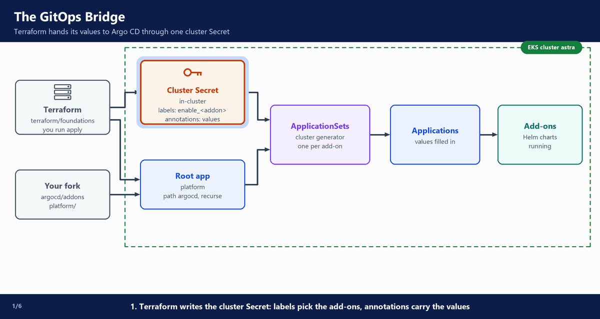
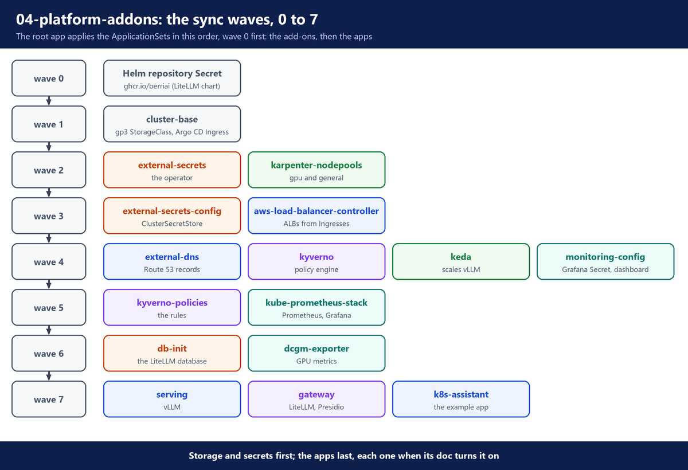
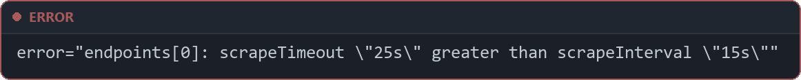

# 4. Platform add-ons

**Repo folders:** `argocd/addons/` and `platform/`

This stage adds the shared tools every later stage uses. The files are already in your fork, under `argocd/addons/` and `platform/`. Argo CD started installing them as soon as the `terraform apply` in `03-foundations` finished. It uses the values Terraform handed over there.

Nobody runs `helm install` or `kubectl apply` for an add-on. In this doc you read what Argo CD installs and why, watch it sync, and check the result.

---

## A. Why this stage exists

The cluster from `03-foundations` runs, but it cannot do much yet. It cannot start GPU nodes, read secrets from AWS, publish a hostname, or check pods against rules.

The platform team adds these tools once, from Git, so every cluster gets the same setup.

---

## B. Architecture

Terraform hands the values to Argo CD in the cluster Secret, the GitOps Bridge (`03-foundations`, section J). Argo CD then installs each add-on from `argocd/addons/`, in sync waves (section D).

**What happens in the animation**

> The numbers match the step counter at the bottom left of the animation.

1. Terraform → cluster Secret `in-cluster`: labels pick the add-ons, annotations carry the values.
2. Terraform → root Application `platform`, which reads `argocd/` in your fork.
3. Your fork (`argocd/addons`, `platform/`) → `platform` → the ApplicationSets, wave by wave.
4. Cluster Secret → each ApplicationSet: its cluster generator finds the Secret by an `enable_` label and reads the annotations.
5. ApplicationSet → one Application, with the bucket names and ARNs filled in.
6. Application → Argo CD sync → an upstream Helm chart or your `platform/` chart runs in the cluster.

**Watch it run**



The order in which the root app applies the add-ons and the apps (section D explains the waves and their limits):



> **Tip:** start the watch in section N first, and read the add-on sections while they arrive.

---

## C. How ApplicationSets read the cluster Secret

`argocd/addons` holds one file per add-on. Each file is an ApplicationSet with a template for its Application, and a cluster generator that says where to make it.

**File:** `argocd/addons/external-secrets.yaml` (part)

```yaml
  generators:
    - clusters:
        selector:
          matchExpressions:
            - key: enable_external_secrets
              operator: In
              values: ["true"]
```

- The generator looks at the cluster Secrets in namespace `argocd`.
- Only a Secret with the label `enable_external_secrets: "true"` matches. Terraform set that label from the `addons` variable.
- One match gives one Application. With the label set to `"false"`, there is no match and no Application.

The labels come from the Terraform variable `addons` (`03-foundations`, section F). Each key becomes a label `enable_<key>` on the cluster Secret, for example `enable_db_init: "true"`.

- To turn an add-on off, set its key to `false` and run `terraform apply`. Its ApplicationSet then matches nothing.
- A new add-on needs two changes: its file in `argocd/addons`, and a new key here (then `terraform apply`). Without the label, the new ApplicationSet matches no cluster.

The template then reads values from the matched Secret.

**File:** `argocd/addons/aws-load-balancer-controller.yaml` (part)

```yaml
          valuesObject:
            clusterName: '{{metadata.annotations.aws_cluster_name}}'
            region: '{{metadata.annotations.aws_region}}'    # set so the pod never needs the EC2 metadata service
            vpcId: '{{metadata.annotations.aws_vpc_id}}'
```

- `{{metadata.annotations.aws_vpc_id}}` is replaced by the annotation `aws_vpc_id` on the cluster Secret.
- `{{server}}` in the `destination` is the cluster API URL from the Secret.

So Git holds no account ID, no bucket name and no ARN. The same files work in any account.

Two kinds of source appear in these files:

- An **upstream chart**, such as `chart: external-secrets` from `https://charts.external-secrets.io`, at a pinned `targetRevision`.
- **Your own chart** in `platform/`, read from your repository: `repoURL: '{{metadata.annotations.repo_url}}'` and `path: platform/...`.

Every ApplicationSet also sets `preserveResourcesOnDeletion: true`. If someone deletes the ApplicationSet, the add-on keeps running. This protects the cluster from one bad change in Git.

---

## D. Sync waves and their limits

The waves of the add-on files run from `0` to `6`, and the three app files in `argocd/apps/` use wave `7`, after every add-on. The first file has the lowest wave:

**File:** `argocd/addons/helm-oci-repos.yaml`

```yaml
# Argo CD can pull a Helm chart from an OCI registry only if the registry is declared as a Helm
# repository with enableOCI. Public registry: no credentials.
# Wave 0: long before the gateway (argocd/apps/gateway.yaml) pulls the LiteLLM chart from it.
apiVersion: v1
kind: Secret
metadata:
  name: repo-ghcr-berriai
  namespace: argocd
  labels:
    argocd.argoproj.io/secret-type: repository
  annotations:
    argocd.argoproj.io/sync-wave: "0"
stringData:
  name: berriai-charts
  type: helm
  url: ghcr.io/berriai
  enableOCI: "true"
```

- One chart lives in an OCI registry: the LiteLLM chart, in `ghcr.io/berriai`. The gateway (`argocd/apps/gateway.yaml`, `07-gateway`) pulls it from there.
- Argo CD can pull from it only if the registry is declared as a Helm repository with `enableOCI`, in a Secret with the label `argocd.argoproj.io/secret-type: repository`.
- The registry is public, so there are no credentials.
- Wave `0` puts this Secret in place long before the gateway is turned on.

### The limits

- The waves order what the root Application `platform` applies: the repository Secret and the ApplicationSets.
- They do not wait for the add-on inside to be ready. Each ApplicationSet makes its own Application, and those Applications then sync on their own.
- The `sync-wave` annotation in each `template.metadata` is copied onto the Application. But no parent sync applies those Applications, so it does not order them.
- So the real safety comes from two settings in every ApplicationSet:
  - `retry` with a growing wait (`backoff`, from 30 seconds up to 5 minutes, 10 tries). An add-on that starts too early fails, waits, and tries again.
  - `SkipDryRunOnMissingResource=true` where an add-on uses a resource type that another add-on installs. An example is the secret store of External Secrets (section F): its type exists only after the External Secrets chart installs its CRD.
- Inside one Application, waves do work. The `db-init` chart uses them: the Secret its Job reads comes in wave 0, and the Job in wave 1 (section M).

> **Tip:** an add-on may show `Degraded` or a sync error for the first few minutes. Often it is waiting for another add-on. Look again after the retries before you debug.

---

## E. Wave 1: cluster-base

`cluster-base` holds two things every app needs: the default disk type and the Argo CD Ingress.

**File:** `argocd/addons/cluster-base.yaml`

```yaml
# Cluster basics every app needs (platform/cluster-base): the default gp3 StorageClass and the
# Argo CD Ingress (argocd.<domain>; Terraform installs Argo CD without one).
# Not an optional add-on, so it selects every cluster Terraform registered (label cluster_name).
# Wave 1: first of all.
apiVersion: argoproj.io/v1alpha1
kind: ApplicationSet
metadata:
  name: cluster-base
  namespace: argocd
  annotations:
    argocd.argoproj.io/sync-wave: "1"
spec:
  syncPolicy:
    preserveResourcesOnDeletion: true
  generators:
    - clusters:
        selector:
          matchExpressions:
            - key: cluster_name
              operator: Exists
  template:
    metadata:
      name: cluster-base
      annotations:
        argocd.argoproj.io/sync-wave: "1"
    spec:
      project: default
      source:
        repoURL: '{{metadata.annotations.repo_url}}'
        targetRevision: '{{metadata.annotations.repo_revision}}'
        path: platform/cluster-base
        helm:
          valuesObject:
            domain: '{{metadata.annotations.domain}}'
            certificateArn: '{{metadata.annotations.acm_certificate_arn}}'
      destination:
        server: '{{server}}'
        namespace: default
      syncPolicy:
        automated: {prune: true, selfHeal: true}
        retry:
          limit: 10
          backoff: {duration: 30s, factor: 2, maxDuration: 5m}
```

- `cluster-base` is not optional. Its generator selects any Secret that has the label `cluster_name` (`operator: Exists`), so it runs on every cluster Terraform registers.
- The source is your own chart: `repoURL` and `targetRevision` come from the annotations `repo_url` and `repo_revision`, and `path` is `platform/cluster-base`.
- `domain` and `certificateArn` go into the chart as Helm values.

The chart has four files:

**File:** `platform/cluster-base/Chart.yaml`

```yaml
apiVersion: v2
name: cluster-base
description: Default gp3 StorageClass and the Argo CD Ingress
type: application
version: 0.1.0
```

**File:** `platform/cluster-base/values.yaml`

```yaml
# Set by the ApplicationSet from the cluster Secret annotations domain and acm_certificate_arn.
domain: example.com
certificateArn: ""
```

- `values.yaml` holds placeholder values. The ApplicationSet replaces them with the real domain and certificate ARN.

**File:** `platform/cluster-base/templates/storageclass.yaml`

```yaml
# Terraform installs the EBS CSI driver but no StorageClass. This one becomes the cluster default.
apiVersion: storage.k8s.io/v1
kind: StorageClass
metadata:
  name: gp3
  annotations:
    storageclass.kubernetes.io/is-default-class: "true"
provisioner: ebs.csi.aws.com
volumeBindingMode: WaitForFirstConsumer   # create the disk in the zone where the pod lands
reclaimPolicy: Delete
allowVolumeExpansion: true
parameters:
  type: gp3
  encrypted: "true"
```

- This StorageClass makes encrypted EBS `gp3` disks, and it is the cluster default.
- `WaitForFirstConsumer` makes each disk in the zone where its pod lands.
- Prometheus (section L) and the model loader Job (`05-model-pipeline`) get their disks from it.

**File:** `platform/cluster-base/templates/argocd-ingress.yaml`

```yaml
# Argo CD UI at https://argocd.<domain> on the shared internal ALB. Terraform runs the server
# with server.insecure=true, so TLS ends at the ALB and the backend is plain HTTP (port 80).
# The argocd CLI needs --grpc-web through an ALB.
apiVersion: networking.k8s.io/v1
kind: Ingress
metadata:
  name: argocd
  namespace: argocd
  annotations:
    alb.ingress.kubernetes.io/scheme: internal
    alb.ingress.kubernetes.io/group.name: astra-internal
    alb.ingress.kubernetes.io/target-type: ip
    alb.ingress.kubernetes.io/listen-ports: '[{"HTTPS":443}]'
    alb.ingress.kubernetes.io/certificate-arn: {{ .Values.certificateArn | quote }}
    alb.ingress.kubernetes.io/healthcheck-path: /healthz
spec:
  ingressClassName: alb
  rules:
    - host: argocd.{{ .Values.domain }}
      http:
        paths:
          - path: /
            pathType: Prefix
            backend:
              service:
                name: argo-cd-argocd-server   # Terraform's Helm release "argo-cd"
                port:
                  number: 80
```

- This Ingress sends `argocd.<domain>` to the Argo CD server.
- The annotations put it on the shared internal ALB, with the ACM certificate on port 443. Every Ingress with the group `astra-internal` shares that one ALB.
- TLS ends at the ALB. Terraform runs the Argo CD server with `server.insecure=true`, so the ALB connects to it on plain HTTP, port 80.
- `argo-cd-argocd-server` is the Service of Terraform's Helm release `argo-cd`.

There are no namespaces in this chart. Each ApplicationSet that needs a namespace creates it with `CreateNamespace=true`.

---

## F. Wave 2 and 3: External Secrets

External Secrets comes as the External Secrets Operator (ESO). Wave 2 installs the operator. Wave 3 adds the store it reads from. Both are in one file.

**File:** `argocd/addons/external-secrets.yaml` (part of external-secrets, wave 2)

```yaml
      source:
        repoURL: https://charts.external-secrets.io
        chart: external-secrets
        targetRevision: 2.14.0            # latest stable, checked 2026-10-28
        helm:
          releaseName: external-secrets
          valuesObject:
            installCRDs: true
            serviceAccount:
              name: external-secrets      # Pod Identity is linked to this name (terraform/foundations/pod-identity.tf)
```

- The upstream chart, pinned to version `2.14.0`.
- `installCRDs: true` adds the object types `ExternalSecret` and `ClusterSecretStore`.
- The service account name must be `external-secrets`. Terraform linked that exact name to an AWS role (Pod Identity, `03-foundations`).
- The rest of this part sets small CPU and memory requests and limits for the three ESO pods.

**File:** `argocd/addons/external-secrets.yaml` (part of external-secrets-config, wave 3)

```yaml
      source:
        repoURL: '{{metadata.annotations.repo_url}}'
        targetRevision: '{{metadata.annotations.repo_revision}}'
        path: platform/external-secrets
        helm:
          valuesObject:
            region: '{{metadata.annotations.aws_region}}'
      destination:
        server: '{{server}}'
        namespace: external-secrets
      syncPolicy:
        automated: {prune: true, selfHeal: true}
        syncOptions: [SkipDryRunOnMissingResource=true]   # CRDs may still be installing
```

- The second ApplicationSet in the file reads your chart `platform/external-secrets`, with the region from the cluster Secret.
- `SkipDryRunOnMissingResource=true`: the `ClusterSecretStore` type may not exist yet while the operator from wave 2 installs its CRDs.

The small chart it reads:

**File:** `platform/external-secrets/Chart.yaml`

```yaml
apiVersion: v2
name: external-secrets-config
description: ClusterSecretStore for AWS Secrets Manager
type: application
version: 0.1.0
```

**File:** `platform/external-secrets/values.yaml`

```yaml
# Set by the ApplicationSet from the cluster Secret annotation aws_region.
region: us-east-1
```

**File:** `platform/external-secrets/templates/cluster-secret-store.yaml`

```yaml
# One store for the whole cluster. No auth block: the controller uses its own
# EKS Pod Identity (service account external-secrets), which may read astra/* only.
apiVersion: external-secrets.io/v1
kind: ClusterSecretStore
metadata:
  name: aws-secrets-manager
spec:
  provider:
    aws:
      service: SecretsManager
      region: {{ .Values.region | quote }}
```

- One ClusterSecretStore, `aws-secrets-manager`, serves every namespace. Every ExternalSecret in the course uses it.
- There is no key or password here. The ESO pod gets AWS access from Pod Identity (`03-foundations`). Its role may only read `astra/*`.
- The region comes from the annotation `aws_region`.

Each app then has its own ExternalSecret that points at this store. You see two in this doc (sections M and N).

---

## G. Wave 2: Karpenter NodePools

Terraform installed the Karpenter controller. This add-on tells it **which** nodes it may start: two NodePools and two EC2NodeClasses, `gpu` and `general`.

**File:** `argocd/addons/karpenter.yaml`

```yaml
# Karpenter NodePools and EC2NodeClasses (platform/karpenter).
# Terraform installs the Karpenter controller itself (on the system nodes); this only says
# WHICH machines it may start. Wave 2: GPU and extra nodes are needed by later add-ons.
# Sync waves order only what the root app "platform" applies (these ApplicationSets). The Applications
# they generate converge on their own: retry with backoff, plus SkipDryRunOnMissingResource where a CRD
# comes from another app.
apiVersion: argoproj.io/v1alpha1
kind: ApplicationSet
metadata:
  name: karpenter-nodepools
  namespace: argocd
  annotations:
    argocd.argoproj.io/sync-wave: "2"
spec:
  syncPolicy:
    preserveResourcesOnDeletion: true   # deleting the ApplicationSet does not delete the NodePools
  generators:
    - clusters:
        selector:
          matchExpressions:
            - key: enable_karpenter_nodepools
              operator: In
              values: ["true"]
  template:
    metadata:
      name: karpenter-nodepools
      annotations:
        argocd.argoproj.io/sync-wave: "2"
    spec:
      project: default
      source:
        repoURL: '{{metadata.annotations.repo_url}}'
        targetRevision: '{{metadata.annotations.repo_revision}}'
        path: platform/karpenter
        helm:
          valuesObject:
            clusterName: '{{metadata.annotations.aws_cluster_name}}'
            nodeRole: '{{metadata.annotations.karpenter_node_role}}'
      destination:
        server: '{{server}}'
        namespace: kube-system
      syncPolicy:
        automated: {prune: true, selfHeal: true}
        retry:
          limit: 10
          backoff: {duration: 30s, factor: 2, maxDuration: 5m}
```

- It reads your chart `platform/karpenter`, and passes two values from the cluster Secret: the cluster name and the name of the IAM role Karpenter gives its nodes.
- `destination.namespace: kube-system` is only a default. NodePools and EC2NodeClasses are cluster-scoped.

The chart:

**File:** `platform/karpenter/Chart.yaml`

```yaml
apiVersion: v2
name: karpenter-nodepools
description: Karpenter NodePools (gpu, general) and their EC2NodeClasses
type: application
version: 0.1.0
```

**File:** `platform/karpenter/values.yaml`

```yaml
# clusterName and nodeRole come from the cluster Secret annotations
# aws_cluster_name and karpenter_node_role (an IAM role NAME, not an ARN).
clusterName: astra
nodeRole: astra-karpenter-node

# Bottlerocket: small, read-only OS. Its NVIDIA variant has the driver and the
# NVIDIA device plugin built in, so no GPU Operator is needed.
# Pinned (not @latest) so a new AMI only arrives through a change in Git.
amiAlias: bottlerocket@v1.68.0          # latest Bottlerocket release, checked 2026-10-28
```

- On GPU nodes, Karpenter picks the NVIDIA version of Bottlerocket. It already has the NVIDIA driver and the **device plugin** (the part that tells Kubernetes "this node has 1 GPU"). So no NVIDIA GPU Operator (an add-on that installs these parts) is needed.
- The version is pinned. A new OS image arrives only through a change in Git, not by surprise.

The EC2NodeClasses:

**File:** `platform/karpenter/templates/ec2nodeclasses.yaml`

```yaml
# How Karpenter builds a node: OS image, IAM role, subnets, security groups, disks.
# Subnets and security groups are found by the tag karpenter.sh/discovery=<cluster name>.
apiVersion: karpenter.k8s.aws/v1
kind: EC2NodeClass
metadata:
  name: gpu
spec:
  role: {{ required "nodeRole is required" .Values.nodeRole | quote }}
  amiSelectorTerms:
    - alias: {{ .Values.amiAlias }}     # Karpenter picks the NVIDIA variant for GPU instances
  subnetSelectorTerms:
    - tags:
        karpenter.sh/discovery: {{ .Values.clusterName | quote }}
  securityGroupSelectorTerms:
    - tags:
        karpenter.sh/discovery: {{ .Values.clusterName | quote }}
  blockDeviceMappings:
    - deviceName: /dev/xvda             # Bottlerocket OS disk. The NVIDIA variant's image needs at least 6 GB
      ebs: {volumeSize: 8Gi, volumeType: gp3, encrypted: true}
    - deviceName: /dev/xvdb             # data disk: container images and the model cache
      ebs: {volumeSize: 200Gi, volumeType: gp3, iops: 6000, throughput: 500, encrypted: true}
  # Bottlerocket ignores NVIDIA_VISIBLE_DEVICES in unprivileged pods by default.
  # The DCGM exporter needs it to read GPU metrics without being privileged.
  # Only GPU nodes get this, and they are tainted, so only GPU pods land there.
  userData: |
    [settings.nvidia-container-runtime]
    visible-devices-envvar-when-unprivileged = true
  tags:
    Workload: llm-inference
---
apiVersion: karpenter.k8s.aws/v1
kind: EC2NodeClass
metadata:
  name: general
spec:
  role: {{ required "nodeRole is required" .Values.nodeRole | quote }}
  amiSelectorTerms:
    - alias: {{ .Values.amiAlias }}
  subnetSelectorTerms:
    - tags:
        karpenter.sh/discovery: {{ .Values.clusterName | quote }}
  securityGroupSelectorTerms:
    - tags:
        karpenter.sh/discovery: {{ .Values.clusterName | quote }}
  blockDeviceMappings:
    - deviceName: /dev/xvda
      ebs: {volumeSize: 4Gi, volumeType: gp3, encrypted: true}
    - deviceName: /dev/xvdb
      ebs: {volumeSize: 50Gi, volumeType: gp3, encrypted: true}
  tags:
    Workload: general
```

- `role` is the IAM role of the nodes. `required` stops the chart with an error if the value is missing.
- Subnets and security groups are found by the tag `karpenter.sh/discovery=astra`, which Terraform put on them.
- Bottlerocket has two disks: a small OS disk and a data disk. The GPU data disk is 200 GiB and fast. It holds the large vLLM image and the model cache. The `general` data disk is 50 GiB.
- The GPU OS disk is 8 GiB, twice the `general` one. The NVIDIA variant of Bottlerocket has a bigger image and needs at least 6 GB. With a 4 GiB OS disk, AWS refused to start the GPU nodes with `InvalidBlockDeviceMapping`, so no GPU node ever came up.
- `userData` changes one Bottlerocket setting on GPU nodes, so the DCGM exporter (section L) can read GPU metrics without running privileged.

The NodePools file has two NodePools:

**File:** `platform/karpenter/templates/nodepools.yaml` (the gpu NodePool)

```yaml
# Which GPU machines Karpenter may start, and the spend ceiling.
apiVersion: karpenter.sh/v1
kind: NodePool
metadata:
  name: gpu
spec:
  template:
    metadata:
      labels:
        workload: llm-inference
    spec:
      nodeClassRef:
        group: karpenter.k8s.aws
        kind: EC2NodeClass
        name: gpu
      requirements:
        # Three g6e sizes, each with ONE NVIDIA L40S 48 GB. Karpenter starts the cheapest one
        # in stock, so a zone out of g6e.xlarge gets a g6e.2xlarge instead of no node.
        #   g6e.xlarge $1.861/h   g6e.2xlarge $2.242/h   g6e.4xlarge $3.004/h   (us-east-1, October 2026)
        - key: node.kubernetes.io/instance-type
          operator: In
          values: ["g6e.xlarge", "g6e.2xlarge", "g6e.4xlarge"]
        - key: karpenter.sh/capacity-type
          operator: In
          values: ["on-demand"]           # a spot reclaim would stop serving mid-request
      taints:
        - key: nvidia.com/gpu
          effect: NoSchedule              # only pods that tolerate it land on a GPU node
      expireAfter: 336h                   # replace every node within 14 days: fresh, patched image
  limits:
    # 2 serving replicas + 1 surge pod in a rolling update + 1 canary. This is
    # also the spend ceiling: at most 4 GPU nodes. A pod over the limit waits (Pending).
    nvidia.com/gpu: 4
  disruption:
    consolidationPolicy: WhenEmpty        # never move a busy model server to save money
    consolidateAfter: 10m
    budgets:
      - nodes: "1"                        # voluntary changes take one GPU node at a time
```

- **Instance types:** three `g6e` sizes, each with one NVIDIA L40S GPU with 48 GB of memory. If the cheapest size is sold out in a zone, Karpenter takes the next size instead of no node.
- **On-demand only:** a spot reclaim would stop serving in the middle of a request.
- **Taint:** with `nvidia.com/gpu:NoSchedule`, only GPU pods with the matching toleration (vLLM and the DCGM exporter) land on these expensive nodes.
- **Limits:** `nvidia.com/gpu: 4` is the most GPUs this NodePool may run at once. That is 2 serving replicas, 1 extra pod during a rolling update, and 1 canary.
- 💰 The limit is also the spend ceiling. A pod over the limit stays `Pending`, and Karpenter starts no fifth GPU node.
- **Disruption:** Karpenter removes a GPU node only when it is empty for 10 minutes. It changes one GPU node at a time, and never moves a busy vLLM replica to save money.
- `expireAfter: 336h` replaces each node within 14 days, so nodes get new, patched images.

**File:** `platform/karpenter/templates/nodepools.yaml` (the general NodePool)

```yaml
# Everything else that does not fit on the system nodes: the model loader Job, the apps, add-ons.
apiVersion: karpenter.sh/v1
kind: NodePool
metadata:
  name: general
spec:
  template:
    spec:
      nodeClassRef:
        group: karpenter.k8s.aws
        kind: EC2NodeClass
        name: general
      requirements:
        - key: karpenter.k8s.aws/instance-category
          operator: In
          values: ["c", "m", "r"]
        - key: karpenter.k8s.aws/instance-generation
          operator: Gt
          values: ["5"]
        - key: karpenter.k8s.aws/instance-size
          operator: In
          values: ["large", "xlarge", "2xlarge"]
        - key: kubernetes.io/arch
          operator: In
          values: ["amd64"]
        - key: karpenter.sh/capacity-type
          operator: In
          values: ["spot", "on-demand"]   # spot first when it is cheaper; these pods can restart
      expireAfter: 336h
  limits:
    cpu: "32"                             # lab ceiling
    memory: 128Gi
  disruption:
    consolidationPolicy: WhenEmptyOrUnderutilized
    consolidateAfter: 2m
```

- The `general` NodePool covers the pods that do not fit on the small system nodes: the model loader Job (`05-model-pipeline`), the apps (the gateway, the k8s-assistant), and add-ons.
- It allows `c`, `m` and `r` instances newer than generation 5, sizes `large` to `2xlarge`.
- Spot or on-demand: Karpenter takes spot when it is cheaper. These pods can restart, so a spot reclaim is fine.
- 💰 At most 32 CPUs and 128 GiB of memory in total.
- `WhenEmptyOrUnderutilized`: Karpenter also packs pods onto fewer nodes when nodes are half empty, after 2 minutes.

---

## H. Wave 3: AWS Load Balancer Controller

The controller puts every Ingress of this build on one shared internal ALB.

**File:** `argocd/addons/aws-load-balancer-controller.yaml` (part)

```yaml
            serviceAccount:
              name: aws-load-balancer-controller   # Pod Identity is linked to this name (terraform/foundations/pod-identity.tf)
            replicaCount: 2               # its webhook blocks Service creation when it is down
            # IngressClass "alb" carries the shared settings, so every Ingress in every stage
            # lands on the same internal ALB even if it forgets the annotations.
            createIngressClassResource: true
            ingressClass: alb
            ingressClassParams:
              create: true
              name: alb
              spec:
                scheme: internal
                group:
                  name: astra-internal
```

- Every Ingress with class `alb` joins one load balancer, the group `astra-internal`. One ALB for all the hostnames costs less than one ALB each.
- `scheme: internal`: the ALB is reachable from inside the VPC or a network connected to it (for example a VPN), not from the internet.
- `replicaCount: 2`: the controller's webhook blocks new Services while it is down, so two copies run.
- The service account name matches the Pod Identity role Terraform made. That role may change load balancers and target groups.

---

## I. Wave 4: ExternalDNS

ExternalDNS writes a Route 53 record for each Ingress host, pointing at the ALB.

**File:** `argocd/addons/external-dns.yaml`

```yaml
# ExternalDNS: writes a Route 53 record for every Ingress host (grafana.<domain>, ...).
# Wave 4: after the load balancer controller, which gives the Ingress its ALB address.
# Sync waves order only what the root app "platform" applies (these ApplicationSets). The Applications
# they generate converge on their own: retry with backoff, plus SkipDryRunOnMissingResource where a CRD
# comes from another app.
apiVersion: argoproj.io/v1alpha1
kind: ApplicationSet
metadata:
  name: external-dns
  namespace: argocd
  annotations:
    argocd.argoproj.io/sync-wave: "4"
spec:
  syncPolicy:
    preserveResourcesOnDeletion: true
  generators:
    - clusters:
        selector:
          matchExpressions:
            - key: enable_external_dns
              operator: In
              values: ["true"]
  template:
    metadata:
      name: external-dns
      annotations:
        argocd.argoproj.io/sync-wave: "4"
    spec:
      project: default
      source:
        repoURL: https://kubernetes-sigs.github.io/external-dns
        chart: external-dns
        targetRevision: 1.23.0            # latest stable (app v0.23.0), checked 2026-10-28
        helm:
          releaseName: external-dns
          valuesObject:
            provider:
              name: aws
            env:
              - name: AWS_DEFAULT_REGION
                value: '{{metadata.annotations.aws_region}}'
            serviceAccount:
              name: external-dns          # Pod Identity is linked to this name (terraform/foundations/pod-identity.tf)
            sources: [ingress, service]
            domainFilters: ['{{metadata.annotations.domain}}']   # touch only our zone
            policy: sync                  # also deletes records when an Ingress is deleted
            registry: txt
            txtOwnerId: '{{metadata.annotations.aws_cluster_name}}'   # never touch records made by others
            resources:
              requests: {cpu: 20m, memory: 64Mi}
              limits: {memory: 128Mi}
      destination:
        server: '{{server}}'
        namespace: external-dns
      syncPolicy:
        automated: {prune: true, selfHeal: true}
        syncOptions: [CreateNamespace=true, ServerSideApply=true]
        retry:
          limit: 10
          backoff: {duration: 30s, factor: 2, maxDuration: 5m}
```

- Wave 4: after the load balancer controller, which gives each Ingress its ALB hostname.
- `sources: [ingress, service]`: it reads hostnames from Ingresses and Services.
- `domainFilters`: only your domain. Its Pod Identity role may also change only that one zone.
- `policy: sync`: when an Ingress goes away, ExternalDNS deletes its record too. The default policy only adds and updates.
- `registry: txt` with `txtOwnerId` set to the cluster name: ExternalDNS never changes records owned by someone else.

⚠️ Teardown depends on `policy: sync`. `scripts/teardown.sh` deletes the Ingresses, then waits until ExternalDNS has deleted the Route 53 records, before `terraform destroy` (`12-teardown`). Without it, old records would stay in your zone.

---

## J. Wave 4 and 5: Kyverno and its policies

Kyverno checks each new pod against three rules: one blocks (Deny), two only report (Audit). The engine comes in wave 4 and the rules in wave 5, because the rules need Kyverno's CRDs.

**File:** `argocd/addons/kyverno.yaml` (part of kyverno, wave 4)

```yaml
  template:
    metadata:
      name: kyverno
      annotations:
        argocd.argoproj.io/sync-wave: "4"
        # Kyverno's large CRDs show as OutOfSync with the default diff, though nothing differs.
        # The API server computes the diff instead (Argo CD server-side diff).
        argocd.argoproj.io/compare-options: ServerSideDiff=true
    spec:
      project: default
      source:
        repoURL: https://kyverno.github.io/kyverno
        chart: kyverno
        targetRevision: 3.9.2             # latest stable (Kyverno v1.19.2), checked 2026-10-28
        helm:
          releaseName: kyverno
          valuesObject:
            admissionController:
              replicas: 1                 # lab size; production runs 3
```

- The upstream chart, pinned. The rest of the values set small requests and limits for Kyverno's four controllers.
- `ServerSideApply=true` (in `syncOptions`): Kyverno's CRDs are too big for the default apply.
- `compare-options: ServerSideDiff=true`: with the default diff, the `kyverno` Application stayed `OutOfSync` on its CRDs, though nothing was different. With server-side diff, the app shows `Synced`.

> **In this course:** one admission controller replica keeps the cost down.

**File:** `argocd/addons/kyverno.yaml` (part of kyverno-policies, wave 5)

```yaml
      source:
        repoURL: '{{metadata.annotations.repo_url}}'
        targetRevision: '{{metadata.annotations.repo_revision}}'
        path: platform/policies         # plain YAML, nothing to template
```

- The second ApplicationSet reads `platform/policies` from your repository. The folder has no `Chart.yaml`, so Argo CD applies the files as they are.

There are three policies. The first one blocks:

**File:** `platform/policies/disallow-privileged.yaml`

```yaml
# A privileged container is root on the node: it can read every other pod's secrets.
# Enforce (Deny): no workload in this course needs it.
# ValidatingPolicy (CEL) replaces the deprecated kyverno.io/v1 ClusterPolicy.
apiVersion: policies.kyverno.io/v1
kind: ValidatingPolicy
metadata:
  name: disallow-privileged
  annotations:
    policies.kyverno.io/title: Disallow privileged containers
spec:
  validationActions: [Deny]
  failurePolicy: Ignore           # if Kyverno itself is down, pods still start
  matchConstraints:
    resourceRules:
      - apiGroups: [""]
        apiVersions: [v1]
        operations: [CREATE, UPDATE]
        resources: [pods]
    namespaceSelector:
      matchExpressions:
        - key: kubernetes.io/metadata.name
          operator: NotIn
          values: [kube-system, kyverno]   # AWS node agents (CNI, kube-proxy) run privileged
  variables:
    - name: allContainers
      expression: >-
        object.spec.containers +
        (has(object.spec.initContainers) ? object.spec.initContainers : []) +
        (has(object.spec.ephemeralContainers) ? object.spec.ephemeralContainers : [])
  validations:
    - expression: >-
        variables.allContainers.all(c,
          !has(c.securityContext) ||
          !has(c.securityContext.privileged) ||
          c.securityContext.privileged == false)
      message: "Privileged containers are not allowed. Remove securityContext.privileged."
```

- 🛡️ This rule blocks privileged containers (`Deny`) on every new or changed pod.
- `matchConstraints`: pods only, in every namespace except `kube-system` and `kyverno`. AWS node agents there need privileged mode.
- `variables` gathers all containers of the pod: normal, init and debug (ephemeral) containers.
- `validations` is a CEL expression. It is true when no container sets `privileged: true`.
- `failurePolicy: Ignore`: if Kyverno is down, pods still start. In this course, uptime wins over the check.

The other two only report (`Audit`). They start as Audit because some upstream charts break these rules.

**File:** `platform/policies/require-memory-limits.yaml`

```yaml
# A container with no memory limit can use all the node's memory and get its neighbours
# killed. Audit first: some upstream charts ship without limits.
apiVersion: policies.kyverno.io/v1
kind: ValidatingPolicy
metadata:
  name: require-memory-limits
  annotations:
    policies.kyverno.io/title: Require memory limits
spec:
  validationActions: [Audit]
  failurePolicy: Ignore
  matchConstraints:
    resourceRules:
      - apiGroups: [""]
        apiVersions: [v1]
        operations: [CREATE, UPDATE]
        resources: [pods]
    namespaceSelector:
      matchExpressions:
        - key: kubernetes.io/metadata.name
          operator: NotIn
          values: [kube-system, kyverno]
  variables:
    - name: containers
      expression: >-
        object.spec.containers +
        (has(object.spec.initContainers) ? object.spec.initContainers : [])
  validations:
    - expression: >-
        variables.containers.all(c,
          has(c.resources) && has(c.resources.limits) && 'memory' in c.resources.limits)
      message: "Every container needs resources.limits.memory."
```

- Every container, including init containers, needs `resources.limits.memory`.
- Without a memory limit, one container can use all the node's memory, and the node then stops its neighbours.

**File:** `platform/policies/require-pinned-image-tags.yaml`

```yaml
# ":latest" or no tag means the image can change without a change in Git.
# Audit: violations show up in PolicyReports (kubectl get policyreport -A); nothing is blocked.
apiVersion: policies.kyverno.io/v1
kind: ValidatingPolicy
metadata:
  name: require-pinned-image-tags
  annotations:
    policies.kyverno.io/title: Require pinned image tags
spec:
  validationActions: [Audit]
  failurePolicy: Ignore
  matchConstraints:
    resourceRules:
      - apiGroups: [""]
        apiVersions: [v1]
        operations: [CREATE, UPDATE]
        resources: [pods]
    namespaceSelector:
      matchExpressions:
        - key: kubernetes.io/metadata.name
          operator: NotIn
          values: [kube-system, kyverno]
  variables:
    - name: allContainers
      expression: >-
        object.spec.containers +
        (has(object.spec.initContainers) ? object.spec.initContainers : []) +
        (has(object.spec.ephemeralContainers) ? object.spec.ephemeralContainers : [])
  validations:
    # A tag after the last "/" (so "registry:5000/app" does not count), or a digest.
    - expression: >-
        variables.allContainers.all(c,
          c.image.matches('^.+(@sha256:[a-f0-9]{64}|:[^/:@]+)$') &&
          !c.image.endsWith(':latest'))
      message: "Every image needs a fixed tag (not :latest) or a digest."
```

- 🛡️ Every image needs a fixed tag (not `:latest`) or a digest (`@sha256:...`).
- The regular expression looks for the tag after the last `/`, so a registry port such as `registry:5000/app` does not count as a tag.
- A pinned image changes only through a change in Git. That is one of the supply-chain measures of this build (`05-model-pipeline`).

---

## K. Wave 4: KEDA

The serving stage uses KEDA to scale vLLM on the number of waiting requests (`06-serving`). Here it is only installed.

**File:** `argocd/addons/keda.yaml`

```yaml
# KEDA: scales workloads on any metric (used later to scale vLLM on queue length).
# Wave 4: no dependencies beyond the base cluster.
apiVersion: argoproj.io/v1alpha1
kind: ApplicationSet
metadata:
  name: keda
  namespace: argocd
  annotations:
    argocd.argoproj.io/sync-wave: "4"
spec:
  syncPolicy:
    preserveResourcesOnDeletion: true
  generators:
    - clusters:
        selector:
          matchExpressions:
            - key: enable_keda
              operator: In
              values: ["true"]
  template:
    metadata:
      name: keda
      annotations:
        argocd.argoproj.io/sync-wave: "4"
    spec:
      project: default
      source:
        repoURL: https://kedacore.github.io/charts
        chart: keda
        targetRevision: 2.21.0            # latest stable, checked 2026-10-28
        helm:
          releaseName: keda
          valuesObject:
            resources:
              operator:
                requests: {cpu: 100m, memory: 128Mi}
                limits: {memory: 512Mi}
              metricServer:
                requests: {cpu: 100m, memory: 128Mi}
                limits: {memory: 512Mi}
              webhooks:
                requests: {cpu: 20m, memory: 64Mi}
                limits: {memory: 256Mi}
      destination:
        server: '{{server}}'
        namespace: keda
      syncPolicy:
        automated: {prune: true, selfHeal: true}
        syncOptions: [CreateNamespace=true, ServerSideApply=true]
        retry:
          limit: 10
          backoff: {duration: 30s, factor: 2, maxDuration: 5m}
```

- The upstream chart, pinned to `2.21.0`, in its own namespace `keda`.
- KEDA's three parts, the operator, the metrics server and the webhooks, each get small requests and limits.
- No Pod Identity: KEDA reads Prometheus inside the cluster, not AWS.

---

## L. Waves 4 to 6: monitoring and DCGM

Monitoring comes in three parts, all in one file:

- wave 4, `monitoring-config`: the Grafana admin Secret and the Astra dashboard (your chart `platform/monitoring`).
- wave 5, `kube-prometheus-stack`: Prometheus, Grafana, Alertmanager, and node and cluster metrics.
- wave 6, `dcgm-exporter`: GPU metrics. It needs the ServiceMonitor CRD from wave 5.

**File:** `argocd/addons/monitoring.yaml` (part of kube-prometheus-stack)

```yaml
            prometheus:
              prometheusSpec:
                # Pick up monitors and rules from every namespace, not only this chart's.
                podMonitorSelectorNilUsesHelmValues: false
                serviceMonitorSelectorNilUsesHelmValues: false
                ruleSelectorNilUsesHelmValues: false
                retention: 7d
                storageSpec:              # 20 GiB EBS disk: metrics survive a pod restart
                  volumeClaimTemplate:
                    spec:
                      storageClassName: gp3   # made by cluster-base (platform/cluster-base)
                      accessModes: ["ReadWriteOnce"]
                      resources:
                        requests:
                          storage: 20Gi
```

- By default, Prometheus only reads ServiceMonitors from its own chart.
- The three `false` settings make it read them from every namespace. So vLLM and LiteLLM can add their own later.
- Metrics are kept 7 days, on a 20 GiB `gp3` disk.

**File:** `argocd/addons/monitoring.yaml` (part of kube-prometheus-stack, Grafana)

```yaml
            grafana:
              admin:
                existingSecret: grafana-admin   # made by monitoring-config (random password, ESO generator)
                userKey: admin-user
                passwordKey: admin-password
              grafana.ini:
                server:
                  root_url: 'https://grafana.{{metadata.annotations.domain}}'
              ingress:
                enabled: true
                ingressClassName: alb
                hosts: ['grafana.{{metadata.annotations.domain}}']
```

- Grafana takes its admin login from the Secret `grafana-admin`, which `monitoring-config` makes one wave earlier. Section P shows how to read it and log in.
- Its Ingress puts `grafana.<domain>` on the shared internal ALB. The annotations below it in the file are the same as the Argo CD Ingress.

**File:** `argocd/addons/monitoring.yaml` (part of dcgm-exporter)

```yaml
            nodeSelector:
              karpenter.k8s.aws/instance-gpu-manufacturer: nvidia
            tolerations:
              - key: nvidia.com/gpu
                operator: Exists
                effect: NoSchedule
            serviceMonitor:
              enabled: true
              interval: 15s
              # The chart default is 25s; the operator rejects a timeout longer than the interval.
              scrapeTimeout: 10s
```

- The DCGM exporter reports GPU use, GPU memory and temperature.
- It runs only on NVIDIA nodes (`nodeSelector`), and tolerates the GPU taint.
- It runs as a DaemonSet on those nodes. Its ServiceMonitor makes Prometheus read it every 15 seconds (`interval`).
- The chart default for `scrapeTimeout` is 25 seconds. That is longer than the 15-second interval, so the Prometheus operator refused the ServiceMonitor, and Prometheus had no GPU metrics. This was the operator's message:



- With `scrapeTimeout: 10s`, the timeout is shorter than the interval, and the GPU metrics (names starting with `DCGM_`) arrive in Prometheus.

The chart `platform/monitoring` has a `Chart.yaml`, two templates and the dashboard JSON:

**File:** `platform/monitoring/Chart.yaml`

```yaml
apiVersion: v2
name: monitoring-config
description: Grafana admin Secret and the Astra Grafana dashboard
type: application
version: 0.1.0
```

**File:** `platform/monitoring/templates/dashboard.yaml`

```yaml
# Grafana dashboard: GPU serving health and spend by team.
# The Grafana sidecar loads every ConfigMap with label grafana_dashboard=1.
# The JSON lives in dashboards/ and is read with .Files.Get, so Grafana's own legend braces are not read by Helm.
apiVersion: v1
kind: ConfigMap
metadata:
  name: astra-dashboard
  labels:
    grafana_dashboard: "1"
data:
  astra.json: |-
{{ .Files.Get "dashboards/astra.json" | indent 4 }}
```

- The Grafana sidecar loads every ConfigMap with the label `grafana_dashboard: "1"`, in every namespace.
- `.Files.Get` puts the JSON file in as it is. Grafana's own `{{ }}` legend text is not read as a Helm template.

This chart is the only owner of the dashboard. Each object in the cluster should belong to one Argo CD Application only: two Applications on one object show a `SharedResourceWarning`, and one of them stays `OutOfSync`.

The dashboard JSON (`platform/monitoring/dashboards/astra.json`, 321 lines) is called **Astra: serving and team spend**. It shows GPU serving health and spend by team. Its panels fill in once vLLM and LiteLLM run (`06-serving`, `07-gateway`). Each panel has a PromQL query and a legend.

**File:** `platform/monitoring/dashboards/astra.json` (part: the first panel's query)

```json
      "targets": [
        {
          "expr": "sum by (pod) (vllm:num_requests_running{namespace=\"serving\"})",
          "legendFormat": "{{pod}}",
          "refId": "A"
        }
      ]
```

- `namespace="serving"`: every vLLM panel reads only the vLLM pods in the namespace `serving`.
- `legendFormat`: the vLLM panels name each line by pod (`{{pod}}`). The team panels name each line by team (`{{team_alias}}`).

**File:** `platform/monitoring/dashboards/astra.json` (part: the "Budget left by team" query)

```json
      "targets": [
        {
          "expr": "min by (team_alias) (last_over_time(litellm_remaining_team_budget_metric[1d]))",
          "legendFormat": "{{team_alias}}",
          "refId": "A"
        }
      ]
```

- `litellm_remaining_team_budget_metric` is a gauge with the budget each team has left.
- LiteLLM updates this gauge only when the team sends a request. With the plain metric name as the query, the panel showed nothing after a few quiet minutes.
- `last_over_time(...[1d])` takes the last value seen in the past day. So a quiet team still shows its budget left.
- `min by (team_alias)` gives one line per team. If several series report the same team, it keeps the lowest value.

**File:** `platform/monitoring/templates/grafana-admin.yaml`

```yaml
# Grafana admin password. Terraform makes no Secrets Manager entry for it, so External Secrets
# generates a random one inside the cluster (the chart default would be "prom-operator").
# Read it with:
#   kubectl -n monitoring get secret grafana-admin -o jsonpath='{.data.admin-password}' | base64 -d
apiVersion: generators.external-secrets.io/v1alpha1
kind: Password
metadata:
  name: grafana-admin
spec:
  length: 24
  digits: 4
  symbols: 0                     # no symbols: easy to paste into a login form
  noUpper: false
  allowRepeat: true
---
apiVersion: external-secrets.io/v1
kind: ExternalSecret
metadata:
  name: grafana-admin
spec:
  refreshPolicy: CreatedOnce     # generate once; a new password on every refresh would lock you out
  target:
    name: grafana-admin
    template:
      data:
        admin-user: admin
        admin-password: {{ `"{{ .password }}"` }}   # ESO template, kept literal by Helm
  dataFrom:
    - sourceRef:
        generatorRef:
          apiVersion: generators.external-secrets.io/v1alpha1
          kind: Password
          name: grafana-admin
```

- The Grafana admin password is not in Secrets Manager. The ESO Password generator (not related to the Argo CD generators) makes a random one inside the cluster. The chart default would be a well-known password.
- The ExternalSecret uses `refreshPolicy: CreatedOnce`, so the password is made once and does not change.
- The `` {{ `"{{ .password }}"` }} `` line keeps the ESO template text away from Helm. Helm writes `"{{ .password }}"`, and ESO fills in the password.

---

## M. Wave 6: db-init

Terraform made the RDS instance and the passwords, but not the database. The `db-init` Job creates the user and the database `litellm` for the gateway (`07-gateway`).

**File:** `argocd/addons/db-init.yaml`

```yaml
# db-init Job (platform/db-init): makes the litellm user and database on RDS.
# Wave 6: after External Secrets (wave 2-3). LiteLLM finds its database ready.
# Gated on enable_db_init (Terraform variable addons).
# Sync waves order only what the root app "platform" applies (these ApplicationSets). The Applications
# they generate converge on their own: retry with backoff, plus SkipDryRunOnMissingResource where a CRD
# comes from another app.
apiVersion: argoproj.io/v1alpha1
kind: ApplicationSet
metadata:
  name: db-init
  namespace: argocd
  annotations:
    argocd.argoproj.io/sync-wave: "6"
spec:
  syncPolicy:
    preserveResourcesOnDeletion: true
  generators:
    - clusters:
        selector:
          matchExpressions:
            - key: enable_db_init
              operator: In
              values: ["true"]
  template:
    metadata:
      name: db-init
      annotations:
        argocd.argoproj.io/sync-wave: "6"
    spec:
      project: default
      source:
        repoURL: '{{metadata.annotations.repo_url}}'
        targetRevision: '{{metadata.annotations.repo_revision}}'
        path: platform/db-init
      destination:
        server: '{{server}}'
        namespace: platform-jobs
      syncPolicy:
        automated: {prune: true, selfHeal: true}
        syncOptions: [CreateNamespace=true]
        retry:
          limit: 10
          backoff: {duration: 30s, factor: 2, maxDuration: 5m}
```

- Gated on the label `enable_db_init` (the `db_init` key of the Terraform variable `addons`).
- Wave 6: External Secrets and its store (waves 2 and 3) come first. The Job reads its logins through them.
- It runs in its own namespace, `platform-jobs`.

The chart:

**File:** `platform/db-init/Chart.yaml`

```yaml
apiVersion: v2
name: db-init
description: Creates the litellm database and user on RDS (idempotent)
type: application
version: 0.1.0
```

**File:** `platform/db-init/values.yaml`

```yaml
# psql client only. A newer client talks to an older server without problems.
image: postgres:18.6-alpine3.24        # latest stable PostgreSQL, checked 2026-10-28

# One entry per application database. Each Secrets Manager secret is JSON with
# host, port, dbname, username, password (terraform/foundations/secrets.tf). Terraform made the passwords;
# this Job makes the users and databases that match them.
databases:
  - name: litellm
    secret: astra/rds/litellm

masterSecret: astra/rds/master
```

- `image`: only the `psql` client is used, pinned to a fixed tag.
- `databases`: one entry per app database. Today only `litellm`, from the secret `astra/rds/litellm`.
- `masterSecret`: the RDS master login, which can create users and databases.

**File:** `platform/db-init/templates/external-secret.yaml`

```yaml
# Copies the RDS master login and each app's login into one Secret for the Job.
apiVersion: external-secrets.io/v1
kind: ExternalSecret
metadata:
  name: db-init
  annotations:
    argocd.argoproj.io/sync-wave: "0"    # before the Job (wave 1)
spec:
  refreshInterval: 1h
  secretStoreRef:
    kind: ClusterSecretStore
    name: aws-secrets-manager
  target:
    name: db-init
  data:
    {{- range $k := list "host" "port" "username" "password" }}
    - secretKey: master_{{ $k }}
      remoteRef: {key: {{ $.Values.masterSecret }}, property: {{ $k }}}
    {{- end }}
    {{- range $db := .Values.databases }}
    {{- range $k := list "dbname" "username" "password" }}
    - secretKey: {{ $db.name }}_{{ $k }}
      remoteRef: {key: {{ $db.secret }}, property: {{ $k }}}
    {{- end }}
    {{- end }}
```

- One ExternalSecret syncs the master login (`master_host`, `master_port`, ...) and each app's login (`litellm_dbname`, `litellm_username`, `litellm_password`) into one Secret, `db-init`.
- The two `range` loops write those lines from `values.yaml`. A second database in the list adds three more keys.
- Wave 0 inside this Application: the Secret must exist before the Job starts.

**File:** `platform/db-init/templates/configmap.yaml`

```yaml
# Safe to run again and again: each step checks first, and the password is always reset
# to the value in Secrets Manager (so a rotated secret is picked up on the next sync).
# psql fills :'name' variables in as quoted SQL text, so passwords need no escaping.
apiVersion: v1
kind: ConfigMap
metadata:
  name: db-init
data:
  init.sql: |
    \set ON_ERROR_STOP on
    SELECT format('CREATE ROLE %I LOGIN', :'app_user')
      WHERE NOT EXISTS (SELECT 1 FROM pg_roles WHERE rolname = :'app_user') \gexec
    SELECT format('ALTER ROLE %I WITH LOGIN PASSWORD %L', :'app_user', :'app_password') \gexec
    -- RDS master is not a superuser: it must be a member of a role to make it a database owner.
    SELECT format('GRANT %I TO CURRENT_USER', :'app_user') \gexec
    SELECT format('CREATE DATABASE %I OWNER %I', :'app_db', :'app_user')
      WHERE NOT EXISTS (SELECT 1 FROM pg_database WHERE datname = :'app_db') \gexec
    SELECT format('ALTER DATABASE %I OWNER TO %I', :'app_db', :'app_user') \gexec
    -- Other users may not connect to this app's database.
    SELECT format('REVOKE ALL ON DATABASE %I FROM PUBLIC', :'app_db') \gexec
  run.sh: |
    set -eu
    export PGHOST="$master_host" PGPORT="$master_port" PGUSER="$master_username" \
           PGPASSWORD="$master_password" PGDATABASE=postgres PGSSLMODE=require
    until pg_isready -q; do echo "waiting for RDS"; sleep 5; done
    {{- range .Values.databases }}
    echo "database {{ .name }}"
    psql -X -q -f /scripts/init.sql \
      -v app_db="${{ .name }}_dbname" \
      -v app_user="${{ .name }}_username" \
      -v app_password="${{ .name }}_password"
    {{- end }}
    echo "done"
```

- `init.sql` is idempotent: each step checks first, so a second run changes nothing.
- The password is always set again from Secrets Manager. A rotated password is picked up on the next sync.
- `REVOKE ALL ... FROM PUBLIC`: other database users cannot connect to the `litellm` database. This matters when a second app database is added to the list.
- `run.sh` waits until RDS answers (`pg_isready`), then runs `init.sql` once per database, with `PGSSLMODE=require`. It prints `database litellm`, then `done`.

**File:** `platform/db-init/templates/job.yaml`

```yaml
# An Argo CD Sync hook: runs on every sync, the old Job is deleted first (Jobs cannot be changed).
apiVersion: batch/v1
kind: Job
metadata:
  name: db-init
  annotations:
    argocd.argoproj.io/hook: Sync
    argocd.argoproj.io/hook-delete-policy: BeforeHookCreation
    argocd.argoproj.io/sync-wave: "1"    # after the ExternalSecret is healthy
spec:
  backoffLimit: 6
  activeDeadlineSeconds: 900
  template:
    metadata:
      annotations:
        checksum/script: {{ include (print $.Template.BasePath "/configmap.yaml") . | sha256sum }}
    spec:
      restartPolicy: OnFailure
      automountServiceAccountToken: false   # talks only to RDS, never to the Kubernetes API
      securityContext:
        runAsNonRoot: true
        runAsUser: 70                    # the postgres user in the alpine image
        runAsGroup: 70
        seccompProfile: {type: RuntimeDefault}
      containers:
        - name: psql
          image: {{ .Values.image }}
          command: ["sh", "/scripts/run.sh"]
          envFrom:
            - secretRef:
                name: db-init
          securityContext:
            allowPrivilegeEscalation: false
            readOnlyRootFilesystem: true
            capabilities: {drop: [ALL]}
          resources:
            requests: {cpu: 50m, memory: 64Mi}
            limits: {memory: 128Mi}
          volumeMounts:
            - name: scripts
              mountPath: /scripts
      volumes:
        - name: scripts
          configMap:
            name: db-init
```

- The Job is an Argo CD Sync hook, so it runs on every sync. A Job's pod template cannot be changed, so `BeforeHookCreation` deletes the old Job first.
- Wave 1 inside this Application: the ExternalSecret (wave 0) must be ready first.
- `checksum/script`: a hash of the ConfigMap. When the SQL changes, the pod template changes too.
- 🛡️ The Job runs as a non-root user with a read-only file system, and has no Kubernetes API token. It only connects to RDS.

---

## N. Watch Argo CD sync

The root app `platform` already reads `argocd/` from your fork. Argo CD checks Git about every 3 minutes. To make it look now:

```bash
kubectl -n argocd annotate application platform argocd.argoproj.io/refresh=normal --overwrite
```

Watch the add-ons arrive:

```bash
kubectl -n argocd get applicationsets
kubectl -n argocd get applications -w
```

- The ApplicationSets appear wave by wave. Each add-on ApplicationSet makes one Application, which then syncs its chart.
- The whole set takes several minutes. Karpenter may start a `general` node for the pods that do not fit on the system nodes.
- The list also shows the app ApplicationSets from `argocd/apps` (`serving`, `gateway`, `k8s-assistant`). They make no Application yet: their `enable_` labels come from the Terraform variable `apps`, which is all off until later docs turn each one on.

You can also watch it in the Argo CD UI (section O, "Open the UIs").

To change an add-on, you change its file in your fork, commit and push. Argo CD applies the change on its next check.

---

## O. Validate

### Every Application is Synced and Healthy

```bash
kubectl -n argocd get applications
```

Every Application should show `Synced` and `Healthy`. Expect 14 in total: `platform` and the 13 add-on Applications (`cluster-base`, `external-secrets`, `external-secrets-config`, `karpenter-nodepools`, `aws-load-balancer-controller`, `external-dns`, `kyverno`, `kyverno-policies`, `keda`, `monitoring-config`, `kube-prometheus-stack`, `dcgm-exporter`, `db-init`).

If one is not healthy, look at its conditions and the sync result:

```bash
kubectl -n argocd get application <name> -o jsonpath='{.status.conditions}' | jq .
kubectl -n argocd get application <name> -o jsonpath='{.status.operationState.message}'; echo
```

> **Tip:** `dcgm-exporter` has no pods until a GPU node exists. That is expected.

### Disks and secrets

```bash
kubectl get storageclass
kubectl get clustersecretstore aws-secrets-manager
kubectl get externalsecrets -A
```

- `gp3` should be listed and marked `(default)`.
- The store and every ExternalSecret (`grafana-admin` in `monitoring`, `db-init` in `platform-jobs`) should show `Ready` as `True`.

### Karpenter NodePools

```bash
kubectl get nodepools
kubectl get ec2nodeclasses
```

Both `gpu` and `general` should be listed, and the EC2NodeClasses should be `Ready`. No GPU node starts yet: no pod asks for a GPU.

### Load balancer and DNS

```bash
kubectl -n kube-system get deployment aws-load-balancer-controller
kubectl get ingressclass alb
kubectl get ingress -A
kubectl -n external-dns logs deploy/external-dns --tail=20
```

- The controller Deployment should show 2 of 2 pods ready, and the IngressClass `alb` should exist.
- The Argo CD and Grafana Ingresses should both show the same ALB hostname.
- The ExternalDNS log should show records being changed for `argocd.<domain>` and `grafana.<domain>`.

### Policies

```bash
kubectl get validatingpolicies
kubectl get policyreport -A
```

The three policies should be listed. Policy reports show which pods break the Audit rules.

### KEDA

```bash
kubectl -n keda get pods
```

All pods should be `Running`.

### The litellm database

```bash
kubectl -n platform-jobs get jobs
kubectl -n platform-jobs logs job/db-init
```

The Job should be complete. The log should show `database litellm`, then `done` (the lines `run.sh` prints).

### Open the UIs

The real hostnames, `argocd.<domain>` and `grafana.<domain>`, are on the internal ALB. They work only from inside the VPC.

> **In this course:** you open the UIs with a `kubectl` port-forward.

Each UI gets its own local port, so several tunnels can run at the same time: 8080 for Argo CD, 3000 for Grafana. Later docs use 9090 (Prometheus), 4000 (gateway), 8000 and 8001 (vLLM) and 8081 (k8s-assistant). Start each port-forward in its own terminal.

**Argo CD**

Argo CD makes a random first admin password when it is installed, and stores it in the Secret `argocd-initial-admin-secret`, key `password`. The build does not set its own Argo CD password: Terraform installs the chart with no password setting (`terraform/foundations/argocd.tf`). The Terraform output `argocd_admin_password` (`03-foundations`) prints the same command as below, not the password.

Read the password:

```bash
kubectl -n argocd get secret argocd-initial-admin-secret -o jsonpath='{.data.password}' | base64 -d; echo
```

Open the tunnel:

```bash
kubectl -n argocd port-forward svc/argo-cd-argocd-server 8080:80
```

- Open [http://localhost:8080](http://localhost:8080) and log in as `admin` with that password.
- Plain HTTP is correct here. The Argo CD server runs with `server.insecure=true` (section E), because TLS ends at the ALB.
- What to look for: every Application is `Synced` and `Healthy`, the same 14 as in the `kubectl` check above. Click an app to see each object it manages and its sync result.

**Grafana**

The login comes from the Secret `grafana-admin` (section L). The user is `admin`. The password is random: the ESO Password generator made it inside the cluster, once.

Read the password:

```bash
kubectl -n monitoring get secret grafana-admin -o jsonpath='{.data.admin-password}' | base64 -d; echo
```

Open the tunnel:

```bash
kubectl -n monitoring port-forward svc/kube-prometheus-stack-grafana 3000:80
```

- Open [http://localhost:3000](http://localhost:3000). Grafana sends you to its login page. Log in as `admin` with that password.
- What to look for: under Dashboards, the dashboard **Astra: serving and team spend** is listed. Its GPU and vLLM panels stay empty until vLLM runs (`06-serving`). The team panels fill in once the gateway runs (`07-gateway`).

> **⚠️ Security:** never put these passwords in Git, a ticket or a chat. Read them from the cluster when you need them.
