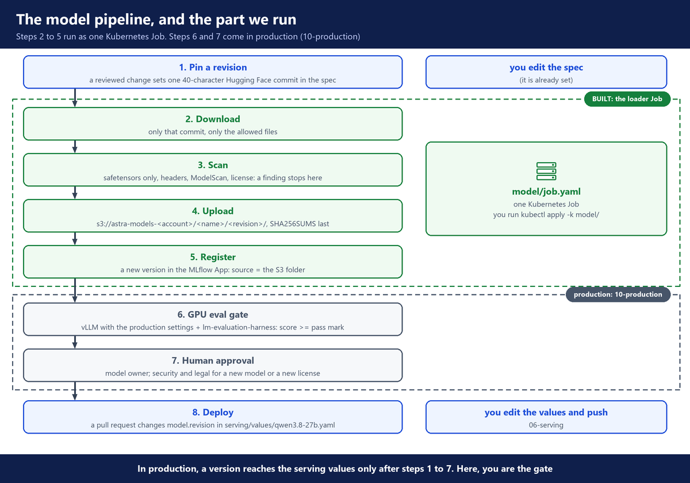
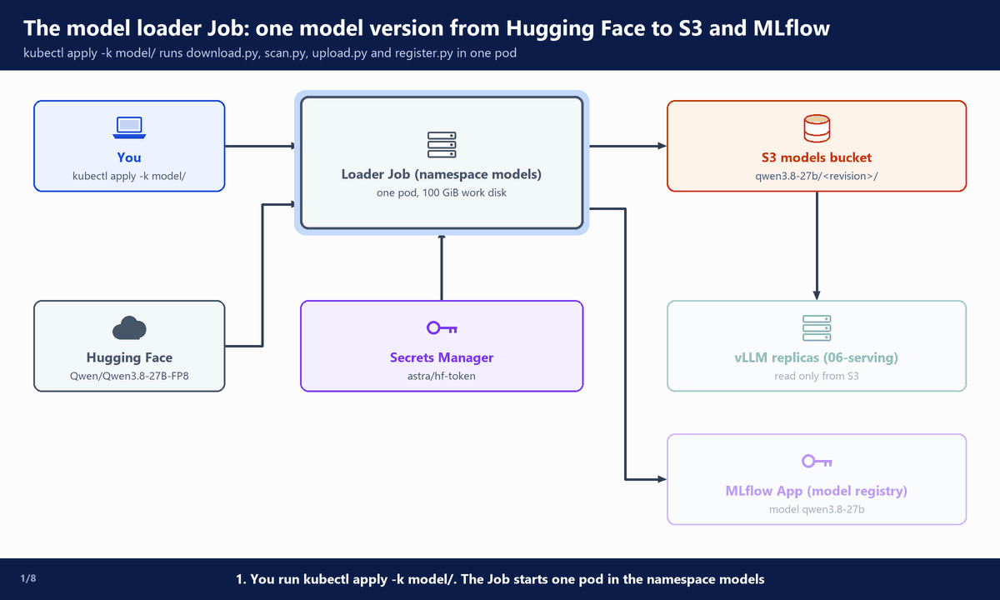
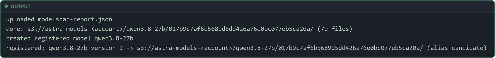
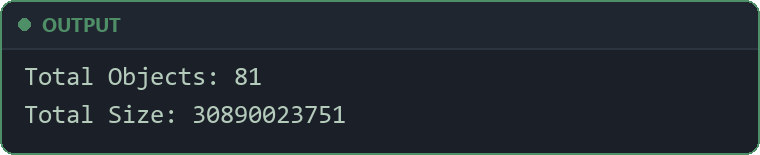

# 5. Model pipeline and supply chain

**Repo folder:** `model/`

This stage chooses the model, copies one checked version of it from Hugging Face to S3, and records that version in the model registry.

---

## A. Why this stage exists

The cluster from `04-platform-addons` can start GPU nodes, but it has no model yet. vLLM does not download from Hugging Face. It loads the model weights from our own S3 bucket (`06-serving`). So someone must put them there first.

- 🛡️ Model weights from the internet can hide code that runs when a program loads them.
- 🔒 Security and legal teams must know which exact version runs, where it came from, and under which license.
- A new version must prove it still answers well before it serves real users.

So we never serve a model we have not checked. We do not let a server fetch "the latest" model when it starts. One exact version goes through a fixed list of checks, and only a version that passed them can be named in the serving values.

---

## B. Architecture

### The model pipeline, and the part we run

We run steps 2 to 5 as one Kubernetes Job that you start by hand. Steps 6 and 7, the GPU eval gate and the approval, come in production (`10-production`, section D).



- ✅ The weights only ever come from S3, and only the loader Job writes to S3.
- ✅ Loading a version (this stage) is separate from serving it (`06-serving`). A version in S3 serves nothing until the serving values name its revision.
- ✅ The model registry knows every version that passed the scan: where it is in S3, what it is, and its evidence (section E).
- ⚠️ In this build no GPU test or recorded approval sits between the registry and the serving values. You are the gate. Production puts steps 6 and 7 there.

### The loader Job

**What happens in the animation**

> The numbers match the step counter at the bottom left of the animation.

1. You run `kubectl apply -k model/` → the Job starts one pod in the namespace `models`.
2. Secrets Manager → the pod reads `astra/hf-token` with its Pod Identity role, if a token is set (a public model downloads without one) → no keys in Git or in the pod spec.
3. Hugging Face → `download.py` → only the pinned commit, only the allowed file types, onto a 100 GiB work disk.
4. `scan.py` → safetensors only, valid headers, modelscan, the license matches the spec.
5. `upload.py` → S3 `qwen3.8-27b/<revision>/` → `SHA256SUMS` written last.
6. `register.py` → the MLflow App → version 1 of the model `qwen3.8-27b`, whose source is that S3 folder, with its tags, marked `candidate`: loaded, not serving yet (section E) → the Job is Complete.
7. S3 → vLLM loads this folder once the serving values name the same revision (`06-serving`).
8. A new revision fails the scan → the Job stops → `upload.py` and `register.py` never run → nothing reaches S3 or MLflow, and vLLM keeps the revision it serves.

**Watch it run**



---

## C. Choosing the model

The model comes first: the GPU, the cost and the quality of the answers all depend on it. We compare open-weight models on the points below, keep the few that pass our checks, and then test those on our own questions.

### Size: parameters

- A model's **parameters** are the numbers it learned in training. The weights store them. "27B" means 27 billion.
- More parameters usually means better answers, more GPU memory and slower answers.
- A **dense** model uses all its parameters for every token. A **mixture-of-experts** (MoE) model has many smaller blocks, the experts, and uses only a few of them for each token. gpt-oss-120b has about 117 billion parameters and uses about 5 billion per token. All of them must still fit in GPU memory: MoE saves time, not memory.

### Tokens in and out

- **Input tokens** are everything one request sends: the instructions, the examples, the documents and the conversation so far.
- **Output tokens** are the answer. With a **thinking mode**, the model first writes out its reasoning, which helps with harder questions and adds output tokens.
- The context length is the most tokens one request can hold, input plus output. Qwen3.8-27B allows 262,144. This build serves 32,768 per request, because every token of every running request takes GPU memory (`06-serving`).
- The model reads the input in one pass, which is fast. It writes the output one token at a time, so the length of the answer sets most of the wait (`06-serving`). That is why hosted APIs charge more for output tokens. On your own GPUs, long answers and long reasoning cost you too: fewer requests per GPU.

### Licence

- **Permissive licences**, such as Apache-2.0 and MIT, allow business use, changes and fine-tuning. You keep the licence text and the notices.
- **A model's own licence**, such as Llama's or Gemma's: you sign in on Hugging Face and accept its terms before the download. These terms can forbid some uses, and the Llama licence asks companies with more than 700 million monthly users for a separate licence. Legal reviews them before the model is allowed.
- **Open-weight is not open source**: you get the weights, not the training data or the training code.
- A licence can change between versions. So the model spec names the licence, and the loader stops if Hugging Face reports another one (section G).

### File format and precision

- **The file format** is how the weights are stored on disk:
  - **safetensors** holds only numbers. It is the only format this build accepts (section D).
  - `.bin`, `.pt` and other pickle files can run code when they are loaded.
  - **GGUF** is one file per model, made for llama.cpp and Ollama on a laptop. Most GGUF files are quantized.
- **The precision** is how many bytes each parameter takes:
  - BF16 and FP16: 2 bytes. Most models are trained and published in BF16. A 27B model needs about 54 GB: two 48 GB GPUs, or one 80 GB GPU.
  - FP8 and INT8: 1 byte. The 27B model takes 28.8 GiB: one 48 GB GPU, with room left for the running requests.
  - INT4: half a byte, about 15 GB for 27B: one 24 GB GPU. Common INT4 formats are AWQ and GPTQ. gpt-oss is published in MXFP4, another 4-bit format.
- **Quantization** means storing the weights in fewer bytes than the original. The answers can get a little worse, so a quantized version goes through the same tests as any other version (`10-production`, section D).
- The GPU must support the precision: FP8 runs at full speed on NVIDIA GPUs from the L40S and H100 generation on.

### What the model can do

- **Tool calling**: the model asks the app to run a function, then uses the result. The app in `08-k8s-assistant` needs it.
- **Structured output**: answers in a fixed JSON shape, for apps that read the answer with code.
- Languages, thinking mode, and images for the models that also read pictures.
- The **model card** on Hugging Face (the model's main page) lists all this, with the recommended settings.

### Prompting: zero-shot and few-shot

- **Zero-shot**: the prompt only gives the instructions and the question.
- **Few-shot**, also called multi-shot: the prompt also shows a few worked examples, questions with the answers you want, so the model copies their format and style.
- Few-shot helps smaller models a lot. But the examples are input tokens in every request: more cost, more GPU memory per request, and less room left in the context.
- So compare the models with the prompts the apps will really send. If a model needs long examples in every request, a bigger model, or a fine-tuned one (below), can cost less overall.

### Fine-tuned versions

A fine-tuned version is a new model version: tuned weights in S3 that go through the same checks as a downloaded version. Where the training runs and who approves its data: `10-production`, section O.

- **Two forms.** **LoRA** (Low-Rank Adaptation) is a common way to fine-tune. It gives an **adapter**: a small set of extra weights, much smaller than the model, that leaves the base model unchanged. After the checks, there are two choices:
  - merge the adapter into the base model. That makes a new full model version: one more revision in S3, which serves like any other (`06-serving`);
  - keep the adapter as it is, and serve it next to the base model. vLLM needs extra settings for that (`06-serving`).

### Generation settings

- The app sends these with each request:
  - **temperature**: how random the choice of each next token is. 0 gives the most predictable answers.
  - **top_p**: the model picks only from the most likely tokens, up to this share of probability.
  - **max_tokens**: the longest answer allowed.
- The model card gives recommended values. Keep the same values when you compare models.

### Measure quality and speed

- Public leaderboards are only a first filter. Run the candidates on our own questions, with the same prompts and settings: the eval gate (`10-production`, section D).
- Measure the speed on the real GPU: the **time to first token** (how long a user waits for the first token of the answer), the tokens per second, and how many requests one GPU serves at once (`09-operate` shows how).

### The four checks, and this build's pick

This build narrows the list with four checks, in this order:

1. **The licence allows business use**, with no separate agreement to sign.
2. **It fits on one 48 GB GPU**, with room left for the running requests. One GPU per replica keeps serving simple and cheap.
3. **It can call tools.**
4. **vLLM can serve it.**

- The candidates:
  - **Qwen3.8-27B**: Apache-2.0, fits in FP8.
  - gpt-oss-20b: Apache-2.0, fits.
  - Mistral Small 3.2 24B: Apache-2.0, fits.
  - DeepSeek-R1-Distill-Qwen-32B: MIT, fits in FP8.
  - Gemma 3 27B: Google's own terms, fits in FP8.
  - gpt-oss-120b: Apache-2.0, does not fit (it needs an 80 GB GPU).
  - Llama 3.3 70B: Meta's own licence, does not fit.
- Out after check 1: Gemma 3 27B and Llama 3.3 70B, whose own terms must be reviewed and accepted first.
- Out after check 2: gpt-oss-120b.
- ✅ Pick: **Qwen3.8-27B in FP8**, as `Qwen/Qwen3.8-27B-FP8`. It passes all four checks, Qwen publishes the FP8 version itself (we convert nothing), and it has a thinking mode.
- Several models pass the four checks. Which one answers our questions best is decided by tests on our own questions: the eval gate (`10-production`, section D).

---

## D. The model supply chain

The **supply chain** of a model is every place the weights pass through, from the publisher to your GPU. Each measure below protects one part of it. ✅ means this build does it. ⚠️ means production needs it, but this build does not do it (`10-production` shows how).

### Where the weights come from

We download from the **Hugging Face Hub**, the main public place where model makers publish open-weight models. Each model there is a Git repository of files, with a model card, and every change is a commit. Other places to get a model:

- **ModelScope**: Alibaba's model hub. The Qwen models are published there too.
- **The model maker's own site**: for example Meta for Llama, after you accept the licence there.
- **NVIDIA NGC**: NVIDIA's catalog of models, and of NIM containers that package a model with an inference server tuned for NVIDIA GPUs.
- **Kaggle Models**: Google publishes Gemma there too.
- **Cloud model catalogs**: Amazon SageMaker JumpStart and Amazon Bedrock Marketplace on AWS. They mainly deploy a model into the cloud's own serving service, instead of giving you files for your own server.
- **The Ollama library**: GGUF models for a laptop, not for vLLM on a GPU server.

Wherever a model comes from, the same rules apply: one pinned version, safetensors only, the licence checked, and checksums kept.

- ✅ **Pinned revision.** The spec names one exact Hugging Face commit: a 40-character hash. A branch such as `main` can move to new files at any time. A commit cannot. `spec.py` refuses any revision that is not 40 characters long. So the weights you check are the weights you serve.
- ✅ **Only the files vLLM needs.** `allow_patterns` in the spec downloads weights, JSON config, tokenizer and chat template files, and the license. Nothing else. (The **chat template** says how chat messages are turned into the model's input text.)
- ⚠️ **A private model mirror or proxy with scanning.** The Job downloads straight from Hugging Face over the internet. In production a proxy sits in between: the only place the cluster may download models from (`10-production`, section I).

### What is inside the files

- ✅ **Safetensors only.** Many weight formats (`.bin`, `.pt`, `.pkl` and others) use **pickle**, a Python save format that can hold code, and that code runs when the file is loaded. `download.py` and `scan.py` refuse any weight file that is not safetensors.
- ✅ **Header check.** `scan.py` reads the JSON header at the start of every `.safetensors` file. A pickle file that was only renamed to `.safetensors` fails here.
- ✅ **modelscan** (from Protect AI) is a second line of defence: if a pickle-type file ever slipped past the first checks, modelscan reports it.
- ✅ **License check.** `scan.py` asks Hugging Face for the license of that commit. If it is not the license in the spec, the Job stops.
  - ⚠️ This only compares one label. Legal still reads the license text and any use terms of the model before the first version is approved.

### What lands in S3

- ✅ **Checksums, written last.** `upload.py` computes a SHA-256 checksum for every file. It writes the list as `SHA256SUMS` after every other file is uploaded. So `SHA256SUMS` in a folder means the upload finished, and anyone can check later that the files in S3 are the files that were scanned.
  - ⚠️ Nothing in this build checks the list again when vLLM loads the model. Production signs the files and checks the signature before serving (`10-production`, section J).
- ✅ **Who may write.** Only the `model-loader` role may write the models bucket. The vLLM role may only read it (`03-foundations`). The bucket is private, encrypted, and has versioning on.
- ✅ **No keys.** The Job gets AWS access through EKS Pod Identity, on its service account `model-loader`. The Hugging Face token, when you need one, is in AWS Secrets Manager, not in Git.

### Who decides

- ✅ **Approval of each model version.** No version serves before the people who must approve it have done so. Who that is differs in every company, so the list is a file: `model/approvals.yaml`. This build lists three roles:
  - `security`: the source, the scan results, the file formats;
  - `legal`: the licence and the use terms;
  - `model-owner`: the test results.
- Each role approves with `scripts/approve.sh`, which records the approval as a Git commit. You approve the first version before it serves (`06-serving`), and `canary.sh start` refuses a revision that is not approved by every role (`09-operate`). In this build you play all three roles. How production enforces it in Git: `10-production`, section D.

### The containers that run all this

The weights are not the only thing that can be changed by someone else. The container images can be too.

- ✅ **Pinned image tags.** `job.yaml` uses `python:3.12.16-slim`, and serving uses `vllm/vllm-openai:v0.32.0`, never `latest`. The Kyverno policy `require-pinned-image-tags` reports any pod with `:latest` or no tag (`04-platform-addons`).
- ⚠️ **The loader's Python packages.** The Job installs its pinned packages from PyPI each time it starts, not checked by hash. Production runs the loader from a scanned image, and pins outside images by digest from a private mirror (`10-production`, section H).

---

## E. Register the version

The fourth step of the loader Job, `register.py` (section G), records each version it loads.

The model registry keeps a record of each version, not a copy. The weights stay in S3. The record says where they are and what they are.

This build uses the MLflow App on Amazon SageMaker AI, in your own AWS account (`terraform/foundations/mlflow.tf`), as its model registry. The same App holds the gateway's traces (`07-gateway`), so there is no second tool to run.

What the Job records for each version it loads:

- **A run** in the **experiment** (a named folder in MLflow) `astra-model-loader`. An MLflow **run** is the record of one piece of work: its parameters, its numbers (metrics) and its files (artifacts). This run holds the Hugging Face repo, the revision and the license, the number of files, and three evidence files: `SHA256SUMS`, the modelscan report and the model spec as loaded.
- **A version of the registered model `qwen3.8-27b`.** A **registered model** is one name in the registry, with numbered versions: 1, 2, 3… Each version is linked to the run that made it. Its **source** is the S3 folder, for example `s3://astra-models-<account>/qwen3.8-27b/017b9c7a…/`. Its tags say what it is: `hf_repo`, `revision`, `license`, `scan=passed`, `files`, `sha256sums` (one hash of the whole checksum list) and `s3_uri`.
- **An alias.** An **alias** is a name that points at one version, and that you can move to another version. This build uses two:
  - `candidate`: the version the Job just loaded and scanned. It does not serve yet. The Job sets it.
  - `champion`: the version that serves. You move it by hand in the MLflow UI, after the first deploy (`06-serving`) and after a canary promote (`09-operate`). A rollback does not move it. (The approval itself is `scripts/approve.sh`, section D.)

✅ Git still decides what runs: vLLM serves the revision named in `serving/values/qwen3.8-27b.yaml`. The registry is the record next to it: every version that passed the scan, where it is, its evidence, and which one is approved to serve.

Production also adds the GPU eval score as a tag, and records the approval (`10-production`, section D).

---

## F. The model spec: one file describes one version

**File:** `model/qwen3.8-27b.yaml`

```yaml
# One model version. The loader Job (model/job.yaml) copies exactly these files to
# s3://astra-models-<account>/<name>/<revision>/. To load a new version: change `revision`,
# then run the Job again (model/README.md).
name: qwen3.8-27b                     # the folder in the models bucket
hf_repo: Qwen/Qwen3.8-27B-FP8
# One exact Hugging Face commit, so the weights we test are the weights we serve.
revision: 017b9c7af6b5689d5dd426a76e0bc077eb5ca20a   # checked 2026-10-28
license: apache-2.0                   # scan.py stops if Hugging Face reports a different license

# Only what vLLM needs. Weights must be .safetensors: download.py refuses any other weight file.
allow_patterns:
  - "*.safetensors"
  - "*.json"
  - "*.txt"
  - "*.jinja"
  - "LICENSE"
```

- `name` → the folder in the models bucket. The serving values use the same name.
- `hf_repo` → the model on Hugging Face, in its FP8 version (section C).
- `revision` → one exact commit on Hugging Face (40 characters). This is the pin.
- `license` → the licence you expect. `scan.py` stops if Hugging Face shows another one.
- `allow_patterns` → only these file types are downloaded.

The spec in the repository is already set to a checked revision, so you do not need to change it for the first run.

---

## G. The loader scripts

Four scripts run one after the other. A fifth file, `spec.py`, holds the shared helpers. The full files are in `model/loader/`.

### spec.py: read the spec, build the names

**File:** `model/loader/spec.py`

```python
# Weight formats that can run code when loaded (pickle and friends). Only safetensors is allowed.
UNSAFE_WEIGHT_SUFFIXES = (
    ".bin", ".pt", ".pth", ".ckpt", ".pkl", ".pickle",
    ".h5", ".keras", ".pb", ".msgpack", ".npy", ".npz", ".gguf", ".onnx",
)


def load(path):
    with open(path, encoding="utf-8") as f:
        spec = yaml.safe_load(f)
    for key in ("name", "hf_repo", "revision", "license", "allow_patterns"):
        if key not in spec:
            sys.exit(f"{path}: missing key '{key}'")
    # A branch name like "main" can move; only a full commit hash is a real pin.
    if len(str(spec["revision"])) != 40:
        sys.exit(f"{path}: revision must be a full 40-character commit hash")
    return spec
# ...
def models_bucket():
    return os.environ.get("MODELS_BUCKET") or f"astra-models-{account_id()}"


def model_prefix(spec):
    return f"{spec['name']}/{spec['revision']}/"
```

- `UNSAFE_WEIGHT_SUFFIXES` → the weight file types that can run code when loaded.
- `load()` → stops if a key is missing, or if `revision` is not a full 40-character commit hash.
- `models_bucket()` → `astra-models-<account>`. It finds the account number from the Job's own AWS identity, so nothing is copied in by hand.
- `model_prefix()` → `<name>/<revision>/`, for example `qwen3.8-27b/017b9c7af6b5689d5dd426a76e0bc077eb5ca20a/`. The serving chart builds the same path (`06-serving`).

### download.py: step 1

**File:** `model/loader/download.py`

```python
def hf_token():
    """The Hugging Face token from Secrets Manager (the Job reads it with its Pod Identity role).

    Optional: this model is public. Without a token the download is anonymous, with lower rate limits.
    A gated or private model needs one.
    """
    if os.environ.get("HF_TOKEN"):
        return os.environ["HF_TOKEN"]
    sm = boto3.client("secretsmanager")
    try:
        value = sm.get_secret_value(SecretId="astra/hf-token")["SecretString"].strip()
    except sm.exceptions.ResourceNotFoundException:  # the secret exists but has no value yet
        value = ""
    if not value:
        print("no Hugging Face token in astra/hf-token: downloading without one")
    return value or None


def check_weights(folder):
    """Stop if any weight file is not safetensors, or if there are no weights at all."""
    files = [p for p in pathlib.Path(folder).rglob("*") if p.is_file() and ".cache" not in p.parts]
    unsafe = [p.name for p in files if p.suffix.lower() in specs.UNSAFE_WEIGHT_SUFFIXES]
    if unsafe:
        sys.exit(f"refused: non-safetensors weight files {unsafe}")
    if not any(p.suffix == ".safetensors" for p in files):
        sys.exit("refused: no .safetensors files were downloaded")
    print(f"{len(files)} files, all weights are safetensors")
```

```python
    s = specs.load(args.spec)
    print(f"downloading {s['hf_repo']}@{s['revision']}")
    snapshot_download(
        repo_id=s["hf_repo"],
        revision=s["revision"],          # exact commit, never a branch
        allow_patterns=s["allow_patterns"],
        local_dir=args.out,
        token=hf_token(),
        max_workers=16,
    )
    check_weights(args.out)
```

- `hf_token()` → reads `astra/hf-token` with the Job's role. If the secret is empty, it prints `no Hugging Face token in astra/hf-token: downloading without one` and downloads without a token.
- `snapshot_download(...)` → downloads one commit (`revision`), only the files that match `allow_patterns`, with 16 downloads at once.
- `check_weights()` → ❌ stops if any weight file is not `.safetensors`, or if there is no `.safetensors` file at all. The `.cache` folder is Hugging Face's own bookkeeping, so it is skipped.

### scan.py: step 2

**File:** `model/loader/scan.py`

```python
def check_safetensors_headers(folder):
    """A real safetensors file starts with an 8-byte length and a JSON header.
    This catches a pickle file that was only renamed to .safetensors."""
    for p in sorted(pathlib.Path(folder).glob("*.safetensors")):
        with open(p, "rb") as f:
            (size,) = struct.unpack("<Q", f.read(8))
            if size > 100_000_000:
                sys.exit(f"{p.name}: not a safetensors file (header size {size})")
            json.loads(f.read(size))
    print("safetensors headers are valid")


def run_modelscan(folder):
    # Exit codes: 0 clean, 1 issues found, 2 scan error, 3 no file type it scans.
    # 3 is the normal result for a safetensors-only folder: nothing in it can run code.
    rc = subprocess.run(
        ["modelscan", "scan", "-p", folder, "--show-skipped",
         "-r", "json", "-o", "modelscan-report.json"],
        check=False,
    ).returncode
    if rc not in (0, 3):
        sys.exit(f"modelscan failed with exit code {rc}, see modelscan-report.json")
    print(f"modelscan passed (exit code {rc})")


def check_license(s):
    info = HfApi().model_info(s["hf_repo"], revision=s["revision"])
    found = (info.card_data or {}).get("license")
    if found != s["license"]:
        sys.exit(f"license is '{found}' on Hugging Face, spec says '{s['license']}': review it first")
    print(f"license {found} matches the spec")
```

```python
    s = specs.load(args.spec)
    check_weights(args.dir)
    check_safetensors_headers(args.dir)
    run_modelscan(args.dir)
    check_license(s)
```

- It runs `check_weights()` again first, on the files that are really on disk.
- `check_safetensors_headers()` → the first 8 bytes give the header size, and the header must be valid JSON. A header over 100 MB means it is not a real safetensors file.
- `run_modelscan()` → runs modelscan on the folder. 0 means clean. 3 means "no file type I scan", which is normal here. Any other code stops the Job. The JSON report is written to the work disk.
- `check_license()` → asks Hugging Face for the license of that commit and compares it with the spec.

### upload.py: step 3

**File:** `model/loader/upload.py`

```python
    # SHA256SUMS is written last, so if it is there, this revision is already complete in S3.
    complete = bool(s3.list_objects_v2(Bucket=bucket, Prefix=prefix + "SHA256SUMS").get("KeyCount"))
    if args.check:
        print(f"already complete: s3://{bucket}/{prefix}" if complete else f"not in S3 yet: s3://{bucket}/{prefix}")
        sys.exit(0 if complete else 1)
    if complete:
        print(f"already complete: s3://{bucket}/{prefix}")
        return
    if not args.dir:
        sys.exit("--dir is required")
    root = pathlib.Path(args.dir)

    sums = []
    for p in sorted(root.rglob("*")):
        if not p.is_file() or ".cache" in p.parts:   # .cache is Hugging Face bookkeeping
            continue
        rel = p.relative_to(root).as_posix()
        sums.append(f"{sha256(p)}  {rel}\n")
        s3.upload_file(str(p), bucket, prefix + rel, Config=CONFIG)
        print(f"uploaded {rel}")

    # The scan report stays next to the weights: the record of what was checked. Not in SHA256SUMS.
    if args.report and pathlib.Path(args.report).is_file():
        s3.upload_file(args.report, bucket, prefix + "modelscan-report.json")
        print("uploaded modelscan-report.json")

    s3.put_object(Bucket=bucket, Key=prefix + "SHA256SUMS", Body="".join(sums).encode())
    print(f"done: s3://{bucket}/{prefix} ({len(sums)} files)")
```

- If `SHA256SUMS` is already in the folder, this revision is complete, and the script does nothing.
- For each file: compute its SHA-256 checksum, upload it to `s3://astra-models-<account>/<name>/<revision>/`, print its name. Big files go up in 64 MB parts, 16 at once (`CONFIG` at the top of the file).
- `SHA256SUMS` goes last: one line per file, the checksum and the file name. If the upload stops half-way, there is no `SHA256SUMS`, and the next run uploads the folder again.

### register.py: step 4

**File:** `model/loader/register.py`

```python
def tracking_uri():
    """The MLflow App's ARN. The sagemaker-mlflow plugin signs each call with the pod's role."""
    if os.environ.get("MLFLOW_TRACKING_URI"):
        return os.environ["MLFLOW_TRACKING_URI"]
    name = os.environ.get("MLFLOW_APP_NAME") or "astra"
    sm = boto3.client("sagemaker")
    for page in sm.get_paginator("list_mlflow_apps").paginate():
        for app in page["Summaries"]:
            if app["Name"] == name:
                return app["Arn"]

# ...

    # Only a complete upload is registered: SHA256SUMS is written last (upload.py).
    sums = read_from_s3(s3, bucket, prefix + "SHA256SUMS")
    if sums is None:
        sys.exit(f"not complete in S3 (no SHA256SUMS): {source}")
    report = read_from_s3(s3, bucket, prefix + "modelscan-report.json")

    mlflow.set_tracking_uri(tracking_uri())
    client = MlflowClient()
    name = s["name"]

    if not client.search_registered_models(filter_string=f"name = '{name}'"):
        client.create_registered_model(name, description=f"{s['hf_repo']}, copied to S3 by the model loader Job.")
        print(f"created registered model {name}")

    for v in client.search_model_versions(filter_string=f"name = '{name}'"):
        if v.tags.get("revision") == s["revision"]:
            print(f"already registered: {name} version {v.version} -> {v.source}")
            return

    lines = sums.decode().splitlines()
    tags = {
        "hf_repo": s["hf_repo"],
        "revision": s["revision"],
        "license": s["license"],
        "scan": "passed" if report is not None else "no report",
        "files": str(len(lines)),
        "sha256sums": hashlib.sha256(sums).hexdigest(),   # one hash for the whole file list
        "s3_uri": source,
    }

    mlflow.set_experiment(EXPERIMENT)
    with mlflow.start_run(run_name=f"{name}@{s['revision'][:8]}") as run:
        mlflow.set_tags(tags)
        mlflow.log_params({"hf_repo": s["hf_repo"], "revision": s["revision"], "license": s["license"]})
        mlflow.log_metric("files", len(lines))
        with tempfile.TemporaryDirectory() as tmp:
            (pathlib.Path(tmp) / "SHA256SUMS").write_bytes(sums)
            if report is not None:
                (pathlib.Path(tmp) / "modelscan-report.json").write_bytes(report)
            mlflow.log_artifacts(tmp, artifact_path="evidence")
            # The spec, as loaded, so the run shows exactly what was asked for.
            mlflow.log_text(json.dumps(s, indent=2), "evidence/model-spec.json")

    v = client.create_model_version(
        name, source=source, run_id=run.info.run_id, tags=tags,
        description=f"{s['hf_repo']} at {s['revision']}",
    )
    client.set_registered_model_alias(name, "candidate", v.version)
```

- `tracking_uri()` → finds the MLflow App by its name, `astra` (`MLFLOW_APP_NAME` in `job.yaml`), and uses its ARN as the MLflow address. The `sagemaker-mlflow` plugin signs every call with the pod's own role, so there is no MLflow password.
- Only a complete upload is registered: no `SHA256SUMS` in S3, no version. The script reads `SHA256SUMS` and the modelscan report from S3, so it also works when the Job skipped the upload (the revision was already in S3).
- The first time, it creates the registered model `qwen3.8-27b`.
- A version with the same `revision` tag already exists → it prints `already registered` and stops. So running the Job again changes nothing.
- `mlflow.start_run(...)` → one run in the experiment `astra-model-loader`, named `qwen3.8-27b@` plus the first 8 characters of the revision. `log_params`, `log_metric` and `log_artifacts` record the inputs, the file count and the evidence files under `evidence/`. The MLflow client writes those files straight to the MLflow App's S3 bucket, with the pod's role.
- `create_model_version(...)` → the new version: its source is the S3 folder, it is linked to the run, and it carries the tags.
- `set_registered_model_alias(..., "candidate", ...)` → the alias `candidate` now points at this version.

### requirements.txt

**File:** `model/loader/requirements.txt`

```text
# Pinned to the latest release on PyPI, checked 2026-10-28.
# Use Python 3.12: modelscan 0.8.8 does not install on 3.13.
boto3==1.43.120
huggingface_hub==2.3.0
modelscan==0.8.8
PyYAML==6.0.3
# register.py: the MLflow client and AWS's plugin that signs calls to the MLflow App with the pod's role.
# The same versions as the gateway image (gateway/litellm/image/Dockerfile), checked 2026-11-04.
mlflow-skinny==3.18.0
sagemaker-mlflow==0.5.0
```

- Every version is pinned, so each run installs the same code.
- Python 3.12, because modelscan 0.8.8 does not install on 3.13. That is why the Job uses a 3.12 image.
- `mlflow-skinny` is the MLflow client without the server. `sagemaker-mlflow` is AWS's plugin that lets it call the MLflow App with AWS credentials. The gateway image uses the same two packages (`07-gateway`).

---

## H. The Job and the Kustomization

### job.yaml

**File:** `model/job.yaml`

```yaml
# The model loader: one Kubernetes Job that copies one model version from Hugging Face to S3
# and records it in MLflow.
#   1. download.py  the exact revision in qwen3.8-27b.yaml, only the file types it allows
#   2. scan.py      safetensors only, valid safetensors headers, modelscan, the license matches
#   3. upload.py    every file to s3://astra-models-<account>/<name>/<revision>/, the scan report,
#                   then SHA256SUMS last
#   4. register.py  the model registry in the MLflow App: one run with the evidence, and a version
#                   of the model qwen3.8-27b whose source is that S3 folder, with the alias candidate
# If that revision is already complete in S3 (SHA256SUMS is there), the Job only runs step 4,
# which does nothing if the version is already registered.
# It runs inside the cluster, so the 31 GB never pass through your laptop, and it uses the
# model-loader role (EKS Pod Identity): write the models bucket, read astra/hf-token, call the
# MLflow App and write its bucket. No keys.
#
# Start it:   kubectl apply -k model/
# Watch it:   kubectl -n models logs -f job/model-loader
# Run again (a new revision):  kubectl -n models delete job model-loader, then apply again.
apiVersion: v1
kind: Namespace
metadata:
  name: models
---
apiVersion: v1
kind: ServiceAccount
metadata:
  name: model-loader       # Terraform links this name to the model-loader IAM role (pod-identity.tf)
  namespace: models
---
apiVersion: batch/v1
kind: Job
metadata:
  name: model-loader
  namespace: models
spec:
  backoffLimit: 0                  # no automatic retry: a failed check would fail again. Read the log, fix, run again.
  activeDeadlineSeconds: 10800     # stop after 3 hours, whatever happens
  ttlSecondsAfterFinished: 86400   # the finished Job and its logs stay for one day
  template:
    metadata:
      annotations:
        karpenter.sh/do-not-disrupt: "true"   # Karpenter must not move this pod to save money mid-download
    spec:
      serviceAccountName: model-loader
      restartPolicy: Never
      securityContext:
        runAsUser: 1000
        runAsGroup: 1000
        fsGroup: 1000              # lets user 1000 write to the work disk
      containers:
        - name: loader
          image: python:3.12.16-slim   # Python 3.12: modelscan 0.8.8 does not install on 3.13. Checked 2026-10-28.
          workingDir: /work            # modelscan writes its report here
          command: ["/bin/sh", "-c"]
          args:
            - |
              set -e
              export HOME=/work PATH="/work/.local/bin:$PATH"
              pip install --quiet --user --no-warn-script-location -r /loader/requirements.txt
              if ! python /loader/upload.py --spec /loader/model.yaml --check; then
                python /loader/download.py --spec /loader/model.yaml --out /work/model
                python /loader/scan.py     --spec /loader/model.yaml --dir /work/model
                python /loader/upload.py   --spec /loader/model.yaml --dir /work/model --report /work/modelscan-report.json
              fi
              python /loader/register.py --spec /loader/model.yaml
          env:
            # Same as region in terraform.tfvars. boto3 needs it to find Secrets Manager and S3.
            - name: AWS_DEFAULT_REGION
              value: us-east-1
            # Empty: use astra-models-<account> (Terraform's default name "astra").
            # If you changed name in terraform.tfvars, put the bucket name from `terraform output buckets` here.
            - name: MODELS_BUCKET
              value: ""
            - name: HF_HUB_DISABLE_PROGRESS_BARS
              value: "1"               # plain log lines instead of progress bars
            # register.py finds the MLflow App by this name (Terraform's default name "astra").
            - name: MLFLOW_APP_NAME
              value: astra
            - name: MLFLOW_DISABLE_AGENT_HINT
              value: "1"               # MLflow prints a hint line at import; keep the log clean
          resources:
            requests: {cpu: "2", memory: 8Gi}
            limits: {memory: 8Gi}
          volumeMounts:
            - name: loader
              mountPath: /loader
              readOnly: true
            - name: work
              mountPath: /work
      volumes:
        - name: loader                 # the scripts and the model spec, from kustomization.yaml
          configMap:
            name: model-loader
        - name: work                   # a 100 GiB disk for this pod only; deleted with the pod
          ephemeral:
            volumeClaimTemplate:
              spec:
                accessModes: [ReadWriteOnce]
                storageClassName: gp3
                resources:
                  requests:
                    storage: 100Gi
```

- `Namespace` `models` and `ServiceAccount` `model-loader` → the names Terraform linked to the `model-loader` role. Its permissions are in `03-foundations`, section H.
- `backoffLimit: 0` → no automatic retry. A failed check would only fail again after another 31 GB download. You read the log, fix the cause, and run the Job again.
- `karpenter.sh/do-not-disrupt: "true"` → Karpenter does not move this pod to another node to save money (consolidation) while it runs. Without it, the download could stop half-way, and the work disk would be lost.
- The `args` script:
  - `set -e` → if `scan.py` fails, `upload.py` and `register.py` never run.
  - `upload.py --check` first: if this revision is already complete in S3, the Job skips the download, the scan and the upload.
  - otherwise the three scripts, each reading the spec from `/loader/model.yaml`. `--report` makes `upload.py` keep the modelscan report in S3, next to the weights: the record of what was checked.
  - `register.py` always runs last. It records the version in MLflow, or does nothing if it is already there.
- `AWS_DEFAULT_REGION` → the AWS region for boto3. Change it if you built in another region.
- `MODELS_BUCKET` → empty means `astra-models-<account>`, the name Terraform makes with its default `name = "astra"`. If you changed `name` in `terraform.tfvars`, put the bucket name from `terraform output buckets` here.
- `MLFLOW_APP_NAME` → the name of the MLflow App, `astra` by default. If you changed `name` in `terraform.tfvars`, use the same value here.
- **Where it runs:** not on a GPU node. The Job only downloads, checks and uploads files, so it needs no GPU. GPU nodes carry the taint `nvidia.com/gpu`, and the Job does not tolerate it (`04-platform-addons`). 2 CPUs and 8Gi do not fit on the small system nodes, so Karpenter starts a node from the `general` NodePool, and removes it once it is empty.
  - ⚠️ The `general` NodePool may use a spot instance. If AWS takes it back, the Job fails: run it again.
- `volumes`:
  - `loader` → the ConfigMap with the scripts and the spec, mounted read-only at `/loader`.
  - `work` → a 100 GiB `gp3` disk for this pod only, deleted with the pod.

### kustomization.yaml

**File:** `model/kustomization.yaml`

```yaml
# kubectl apply -k model/  builds the ConfigMap below from these files and applies job.yaml.
apiVersion: kustomize.config.k8s.io/v1beta1
kind: Kustomization
resources:
  - job.yaml
configMapGenerator:
  - name: model-loader
    namespace: models
    files:
      - model.yaml=qwen3.8-27b.yaml        # the model spec, mounted as /loader/model.yaml
      - loader/spec.py
      - loader/download.py
      - loader/scan.py
      - loader/upload.py
      - loader/register.py
      - loader/requirements.txt
generatorOptions:
  disableNameSuffixHash: true   # a fixed name, so job.yaml can point at it
```

- `configMapGenerator` → makes the ConfigMap `model-loader` from the files listed. `model.yaml=qwen3.8-27b.yaml` gives the spec the key `model.yaml`. So the pod sees `/loader/model.yaml`, `/loader/spec.py` and so on.
- `disableNameSuffixHash: true` → no hash suffix on the ConfigMap name, so `job.yaml` can point at it.

> **⚠️ Argo CD does not apply `model/`.** Argo CD applies only what `argocd/` points at, and nothing there points at `model/`. The files live in Git so changes are reviewed and recorded. You start the Job yourself.

---

## I. Run the loader Job

### Set the region, if you are not in us-east-1

If you built in another region, change `AWS_DEFAULT_REGION` in `model/job.yaml`, then commit and push, so your repository matches what runs:

```bash
git add model/job.yaml
git commit -m "Model loader: use my AWS region"
git push
```

### Set the Hugging Face token (optional)

This model is public, so the token is optional. Without it, the Job downloads anonymously (section G, `download.py`). The token is a **Read** token from your own Hugging Face account: how to create it is in `03-foundations`, section L. If you have one and did not set it there, set it now. Replace `hf_xxx` with your token, and `us-east-1` with your region:

```bash
aws secretsmanager put-secret-value --region us-east-1 \
  --secret-id astra/hf-token --secret-string 'hf_xxx'
```

`terraform -chdir=terraform/foundations output -raw fill_hf_token` prints the same command with your region filled in.

### Start the Job

```bash
kubectl apply -k model/
kubectl -n models get job,pods
```

- The pod may stay `Pending` for a minute or two. Karpenter starts a node from the `general` NodePool, and the EBS disk is made in its zone.

### Follow the logs

```bash
kubectl -n models logs -f job/model-loader
```

Each script prints one line per check: `download.py` the file count and `all weights are safetensors`, `scan.py` `safetensors headers are valid`, `modelscan passed (exit code 3)` and the licence, `upload.py` one `uploaded <file>` line per file, and `register.py` the version it registered. The download takes the longest. MLflow also prints a link to the run: it opens only through `scripts/mlflow-ui.sh` (section J).

The last lines of the log, with the spec as it is:



- `79 files` → the files in `SHA256SUMS`: the weights, config, tokenizer, template and license files.
- modelscan found 0 issues, and the checksums matched.
- `version 1` → the first version of `qwen3.8-27b` in the registry. A second revision becomes version 2.

To wait until it ends, in another terminal:

```bash
kubectl -n models wait --for=condition=complete job/model-loader --timeout=3h
```

The whole Job takes about 10 minutes.

### If a check fails

- The script prints the reason, for example `refused: non-safetensors weight files [...]`, or `license is '...' on Hugging Face, spec says '...'`.
- See the pod and its log:

```bash
kubectl -n models get pods -l job-name=model-loader
kubectl -n models logs -l job-name=model-loader --tail=50
```

❌ Do not change the scan to make it pass. A failed scan is a finding: a person decides what happens to that revision.

If the upload itself fails half-way (a network error), some files are in S3 but `SHA256SUMS` is not. That folder is not complete. Run the Job again.

If only `register.py` fails, the weights are already complete in S3. Fix the cause and run the Job again: it skips the download and only registers.

- `AccessDenied` on `ListMlflowApps`, `CallMlflowAppApi` or the MLflow bucket → the `model-loader` role is missing a permission. Check that `03-foundations` was applied with the current `pod-identity.tf`.
- `no MLflow App named 'astra' in this account and region` → you changed `name` in `terraform.tfvars`, or the region in `job.yaml` is not the region of the build. Set `MLFLOW_APP_NAME` or `AWS_DEFAULT_REGION` in `model/job.yaml`.

### Load a new revision

1. Change `revision` in `model/qwen3.8-27b.yaml` (and `license`, if it changed). Commit and push.
2. Delete the old Job and apply again:

```bash
kubectl -n models delete job model-loader --ignore-not-found
kubectl apply -k model/
kubectl -n models logs -f job/model-loader
```

- `apply -k` also updates the ConfigMap with the new spec.
- The new revision becomes the next version in MLflow, with the alias `candidate` (section E).
- Serving the new revision is a separate step: change `model.revision` in the serving values (`06-serving`), or start a canary (`09-operate`).

---

## J. Validate

### The Job is Complete

```bash
kubectl -n models get job model-loader
```

Look for `1/1` under COMPLETIONS. The Job and its logs stay for one day.

### S3 has the files and SHA256SUMS

```bash
ACCOUNT=$(aws sts get-caller-identity --query Account --output text)
REV=$(awk '/^revision:/ {print $2}' model/qwen3.8-27b.yaml)
aws s3 ls --summarize s3://astra-models-$ACCOUNT/qwen3.8-27b/$REV/
aws s3 cp s3://astra-models-$ACCOUNT/qwen3.8-27b/$REV/SHA256SUMS - | head
```

- `REV` → the revision from the spec, so you check the folder of the version you loaded.
- The listing shows the `.safetensors` files, the JSON files, the tokenizer files, the license, `modelscan-report.json` (the scan's record) and `SHA256SUMS`. No `.bin` or `.pt` file.
- `--summarize` adds a count and a total size at the end. You should see, for each revision:



- 81 objects = the 79 files in `SHA256SUMS`, plus `modelscan-report.json`, plus `SHA256SUMS` itself. 30890023751 bytes is about 30.89 GB.
- The second command prints the first lines of the checksum list: one hash and one file name per line.

Check one small file against its checksum:

```bash
aws s3 cp s3://astra-models-$ACCOUNT/qwen3.8-27b/$REV/config.json /tmp/config.json
sha256sum /tmp/config.json
aws s3 cp s3://astra-models-$ACCOUNT/qwen3.8-27b/$REV/SHA256SUMS - | grep ' config.json$'
```

The two hashes must be the same. (On macOS, use `shasum -a 256` instead of `sha256sum`.)

### MLflow has the model version

Open the MLflow UI:

```bash
bash scripts/mlflow-ui.sh
```

The script prints a sign-in link and opens it in your browser (it works once, within 5 minutes). Then:

1. Choose the workspace `default`.
2. Open **Models** in the menu.
3. Open `qwen3.8-27b`. Look for: version 1, with the alias `candidate`.
4. Open **Version 1**. Look for:
   - **Source**: `s3://astra-models-<account>/qwen3.8-27b/017b9c7af6b5689d5dd426a76e0bc077eb5ca20a/`, the folder you checked above;
   - **Tags**: `revision` = the revision in the spec, `license` = `apache-2.0`, `scan` = `passed`, `files` = `79`, and `sha256sums`;
   - **Aliases**: `candidate`.
5. Open the source run from the version page (the run `qwen3.8-27b@017b9c7a`, in the experiment `astra-model-loader`). Look for:
   - **Parameters**: `hf_repo`, `revision`, `license`;
   - **Metrics**: `files` = 79;
   - **Artifacts**: the folder `evidence` with `SHA256SUMS`, `modelscan-report.json` and `model-spec.json`.

The alias `champion` is not set yet. You set it in `06-serving`, once vLLM serves this version.

### The serving values name the same revision

```bash
grep -E '^\s*(name|revision):' model/qwen3.8-27b.yaml serving/values/qwen3.8-27b.yaml
```

`name` and `revision` must be the same in both files. If they are not, vLLM looks for a folder that does not exist in S3 (`06-serving`).

**File:** `serving/values/qwen3.8-27b.yaml` (part)

```yaml
model:
  name: qwen3.8-27b # same as name in model/qwen3.8-27b.yaml
  revision: 017b9c7af6b5689d5dd426a76e0bc077eb5ca20a
  servedName: astra
```
