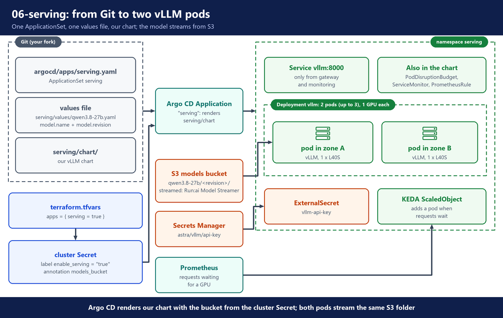
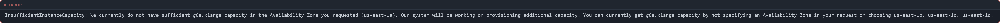
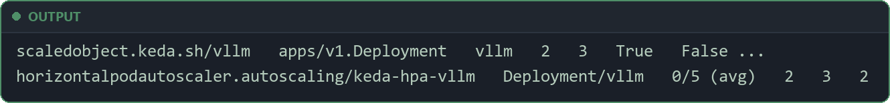
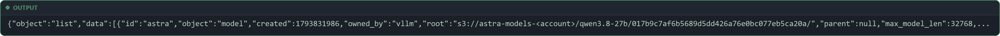
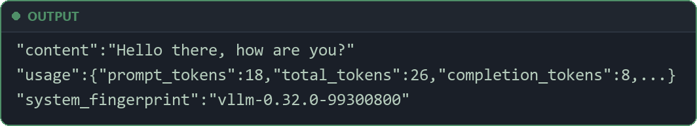
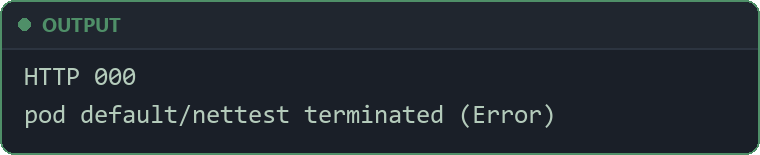
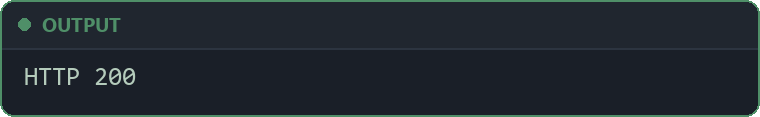

# 6. Serving

**Repo folder:** `serving/` and `argocd/apps/serving.yaml`

This stage runs the model version from S3 on GPUs with vLLM, under the name `astra`.

---

## A. Why this stage exists

The loader Job (`05-model-pipeline`) put one model version in S3: downloaded, scanned and checked. Nothing serves it yet. We need an inference server that:

- runs only the checked files from S3,
- keeps answering when one zone or one node fails,
- grows when requests wait, and shrinks back,
- can be reached only by the gateway.

vLLM does the serving, with an OpenAI-compatible API. Our own Helm chart describes how it runs. Argo CD deploys it from Git.

---

## B. Architecture



- Three parts of the repository work together: the chart, one values file and one ApplicationSet. You turn serving on with one Terraform variable. Argo CD does the rest.
- Two GPU nodes (`g6e`, one NVIDIA L40S each). Karpenter starts them because the pods ask for a GPU.
- The model answers at `http://vllm.serving.svc:8000/v1` as `astra`, with an API key.

💰 This is where the bill grows: the two GPU nodes are most of the cost (`00-why-own-inference`, section B).

---

## C. Why our own Helm chart

The vLLM project publishes a Helm chart in its [production-stack](https://github.com/vllm-project/production-stack) repository. It adds its own router and more parts around vLLM. Another option is KServe.

✅ **Our own small chart.** It holds exactly what this build needs:

- the S3 streamer,
- the Pod Identity service account,
- one pod per zone,
- KEDA on the waiting queue,
- a NetworkPolicy,
- the key from Secrets Manager.

It is ten short templates that you can read in a few minutes.

⚠️ You maintain it. When vLLM changes a flag, you change the chart.

❌ **Not here:** a second router. The LiteLLM gateway (`07-gateway`) already sends requests to the vLLM replicas.

The chart is in `serving/chart/`. Its defaults are in `serving/chart/values.yaml`. The model file `serving/values/qwen3.8-27b.yaml` changes only what is different per model.

---

## D. The chart

The chart is in `serving/chart/`:

- `Chart.yaml` → the chart's name and version.
- `values.yaml` → the defaults (section E).
- `templates/_helpers.tpl` → names, labels and the model URI (below).
- `templates/deployment.yaml` → the vLLM pods (section F).
- `templates/service.yaml`, `serviceaccount.yaml`, `externalsecret.yaml`, `networkpolicy.yaml`, `pdb.yaml`, `scaledobject.yaml`, `servicemonitor.yaml`, `prometheusrule.yaml` → the other parts (section G).

The Grafana dashboard is not in this chart. It has one owner, the chart `platform/monitoring` (`04-platform-addons`, section L).

**File:** `serving/chart/Chart.yaml`

```yaml
apiVersion: v2
name: vllm
description: vLLM OpenAI-compatible server for Astra. Streams weights from S3, scales with KEDA.
type: application
version: 0.1.0
# The vLLM image this chart was written against (checked 2026-10-28). The image tag itself is set in values.
appVersion: "v0.32.0"
```

- `name: vllm` is the chart name. The resource names come from the Helm release name.
- `appVersion` is only a note. The image tag that runs is set in the model values file (section E).

### The model URI: built from three values

vLLM needs one S3 URL for the weights. Nobody writes that URL by hand. The chart builds it:

**File:** `serving/chart/templates/_helpers.tpl`

```yaml
{{/* Where the weights are: s3://<models bucket>/<model name>/<revision>/ (written by the Job in model/). */}}
{{- define "vllm.modelUri" -}}
{{- printf "s3://%s/%s/%s/" (required "modelsBucket is required" .Values.modelsBucket) (required "model.name is required" .Values.model.name) (required "model.revision is required" .Values.model.revision) -}}
{{- end -}}
```

- `vllm.modelUri` gives back `s3://<modelsBucket>/<model.name>/<model.revision>/`. This is the same folder the loader Job writes to (`05-model-pipeline`).
- `required` → if one of the three values is empty, Helm stops with that message, for example `model.revision is required`. Argo CD then shows the Application with a render error, and no pod starts with a wrong path.
- `modelsBucket` is in no file in Git. Argo CD sets it from the cluster Secret, through the serving ApplicationSet. So Git holds no AWS account number.
- `model.name` and `model.revision` come from the model values file (section E).

---

## E. The values: what changes per model

The model values file is short. It is the file you change to serve another version:

**File:** `serving/values/qwen3.8-27b.yaml`

```yaml
# The version of Qwen3.8-27B that serves. A change to this file, pushed to Git, is the deployment:
# Argo CD rolls the vLLM pods to it one at a time.
# The revision must already be in S3: run the loader Job in model/ for it first.

image:
  # Latest stable vLLM, checked 2026-10-28. The flags were proven on v0.31.0:
  # if v0.32.0 misbehaves, set v0.31.0 here and push.
  tag: v0.32.0
model:
  name: qwen3.8-27b # same as name in model/qwen3.8-27b.yaml
  revision: 017b9c7af6b5689d5dd426a76e0bc077eb5ca20a
  servedName: astra
```

- `image.tag` → the vLLM version. It is a fixed tag, so every pod runs the same image.
- `model.name` → the folder in the models bucket. It must be the same as `name` in `model/qwen3.8-27b.yaml`.
- `model.revision` → the Hugging Face commit. It must be the revision you loaded with the loader Job. It also becomes a pod label, so you can see which version each pod runs.
- `servedName: astra` → the name apps use. They never see the real model name, so the model can change without changing apps.
- ⚠️ The revision must already be in S3. If it is not, vLLM finds no weights at that path, and the new pod never becomes Ready.

The chart's defaults hold the empty model fields, the model loader and the vLLM flags.

**File:** `serving/chart/values.yaml`

```yaml
# The weights to serve: s3://<modelsBucket>/<model.name>/<model.revision>/.
# The Job in model/ puts them there. Argo CD sets modelsBucket from the cluster Secret.
modelsBucket: ""
model:
  name: ""                # the folder in the bucket, for example qwen3.8-27b
  revision: ""            # the Hugging Face commit; also shown as a pod label
  servedName: astra       # the name apps and the gateway use; never the real model name

# Run:ai Model Streamer reads safetensors from S3 straight into GPU memory, no copy to disk.
loader:
  format: runai_streamer
  concurrency: 16         # parallel S3 connections
  memoryLimitBytes: 5368709120   # 5 GiB CPU buffer; without a limit the buffer can pass the pod memory limit

# Flags after the model. Proven with this model on one L40S (vLLM v0.31.0).
args:
  - --max-model-len=32768
  - --gpu-memory-utilization=0.92
  - --max-num-seqs=128
  - --language-model-only
  - --reasoning-parser=qwen3
  - --enable-auto-tool-choice
  - --tool-call-parser=qwen3_coder
  - '--default-chat-template-kwargs={"enable_thinking": false}'
```

- `modelsBucket`, `model.name` and `model.revision` are empty here on purpose. If one is not set, the `required` check in `vllm.modelUri` stops the render.
- `loader.format: runai_streamer` → the Run:ai Model Streamer reads the safetensors files from S3 straight into GPU memory. It uses 16 connections at once. There is no copy on a local disk.
- `memoryLimitBytes` → a 5 GiB memory buffer for the streamer. Without a limit, the buffer can grow past the pod's memory limit.
- `args` → the vLLM flags for this model on one L40S. Section G explains each one.

> **Tip:** if you have the Helm CLI, you can render the chart on your laptop and read what Argo CD will apply: `helm template vllm serving/chart -f serving/values/qwen3.8-27b.yaml --set modelsBucket=$BUCKET`. Leave out `--set modelsBucket=...` once to see the `required` message.

---

## F. The Deployment

### The vLLM container

**File:** `serving/chart/templates/deployment.yaml`

```yaml
      containers:
        - name: vllm
          image: "{{ .Values.image.repository }}:{{ required "image.tag is required" .Values.image.tag }}"
          imagePullPolicy: {{ .Values.image.pullPolicy }}
          command: ["vllm", "serve"]
          args:
            - {{ include "vllm.modelUri" . | quote }}
            - --served-model-name={{ .Values.model.servedName }}
            - --load-format={{ .Values.loader.format }}
            - --model-loader-extra-config={{ dict "concurrency" (int .Values.loader.concurrency) "memory_limit" (int64 .Values.loader.memoryLimitBytes) | toJson }}
            - --port={{ .Values.service.port }}
            {{- range .Values.args }}
            - {{ . | quote }}
            {{- end }}
```

- `required "image.tag is required"` → Helm stops if the image tag is empty. There is no `latest` by accident.
- `include "vllm.modelUri"` → the first argument is the S3 folder from section D.
- `--served-model-name=astra` → the model name in every request.
- `--load-format` and `--model-loader-extra-config` → the streamer settings from section E.
- `range .Values.args` → adds each proven flag.

The proven flags, one by one:

- `--max-model-len=32768` → the longest request, prompt plus answer, in tokens. Longer requests are refused.
- `--gpu-memory-utilization=0.92` → vLLM may use 92% of GPU memory. The rest is a safety margin.
- `--max-num-seqs=128` → at most 128 requests in progress per server. More wait in vLLM's queue.
- `--language-model-only` → load only the text part of the model, not its image and video parts.
- `--reasoning-parser=qwen3` → moves the model's "thinking" text into its own field, so apps get a clean answer.
- `--enable-auto-tool-choice` and `--tool-call-parser=qwen3_coder` → turn the model's tool calls into the OpenAI `tool_calls` format.
- `--default-chat-template-kwargs={"enable_thinking": false}` → thinking is off unless a request turns it on. 💰 Thinking writes many extra tokens.

```yaml
          env:
            # vLLM reads the key from this variable, so it never shows in the process arguments.
            - name: VLLM_API_KEY
              valueFrom:
                secretKeyRef:
                  name: {{ .Values.apiKey.secretName }}
                  key: api-key
            # The streamer finds the bucket region here; credentials come from EKS Pod Identity.
            - name: AWS_REGION
              value: {{ .Values.region }}
            - name: AWS_DEFAULT_REGION
              value: {{ .Values.region }}
            # Config and tokenizer come from the same S3 folder; never reach out to Hugging Face.
            - name: HF_HUB_OFFLINE
              value: "1"
            {{- with .Values.extraEnv }}
            {{- toYaml . | nindent 12 }}
            {{- end }}
```

- 🛡️ `VLLM_API_KEY` → vLLM answers only requests with this key. It comes from the Kubernetes Secret `vllm-api-key`, which External Secrets fills from Secrets Manager.
- `AWS_REGION` → the streamer needs the bucket's region. Argo CD sets `region` from the cluster Secret. AWS access comes from EKS Pod Identity on the service account `vllm`: read only, models bucket only.
- 🛡️ `HF_HUB_OFFLINE: "1"` → vLLM never contacts Hugging Face. The config and tokenizer come from the same S3 folder.

### How vLLM uses the GPU

The three flags above decide how much work one GPU can take. To set them, and to read the serving dashboard, you need to know what vLLM keeps in GPU memory and how it runs many requests at once.

**GPU memory holds two things: the weights and the KV cache.**

- **The weights.** Their size is the number of parameters times the bytes per parameter: 2 bytes in BF16 or FP16, 1 byte in FP8, 0.5 bytes in INT4. A 7B model in BF16 needs about 14 GB. This build's model has 27B parameters in FP8, so about 27 GB. This is quantization (`05-model-pipeline`, section C). FP8 halves the memory of BF16, which is why this model fits on one 48 GB L40S. The answers can get a little worse, so a quantized version goes through the same GPU eval gate as any other version (`05-model-pipeline`).
- **The KV cache.** While the model writes an answer, each attention layer keeps a key and a value for every token so far, so it does not compute them again for the next token. This memory is the **KV cache**. It grows with the number of tokens in each request, times the number of requests in progress:

**KV cache per token** = 2 (key and value) × layers that keep keys and values × KV heads × head size × bytes per value

- This model is a **hybrid**: of its 64 layers, only 16 (every 4th one) use full attention and keep keys and values. The other 48 use linear attention, which keeps one fixed-size state per request, whatever its length. vLLM calls that state the Mamba cache. (Values from the model's `config.json`: `num_hidden_layers` 64, `full_attention_interval` 4, `num_key_value_heads` 4, `head_dim` 256.)
- So one token costs 2 × 16 × 4 × 256 × 2 bytes (BF16) = **64 KiB**, and one request at the full 32,768 tokens holds **2 GiB**. If all 64 layers kept keys and values, it would be four times more.
- `--gpu-memory-utilization=0.92` → at start, vLLM takes 92% of the GPU memory, loads the weights, and gives what is left to the KV cache. The numbers of this build are in "GPU sizing" below.
- `--max-model-len` caps the KV cache one request can hold. `--max-num-seqs` caps how many requests share it.
- When the KV cache is full, new requests wait. This build's alert `AstraKVCacheFull` fires when it stays above 95% full for 10 minutes.
- `--kv-cache-dtype=fp8` would store the KV cache in 1 byte per value (32 KiB per token), so about twice as many tokens fit. This build does not set it: the KV cache uses the model's BF16. Like any quantization, check the answers with the eval before you turn it on.

**vLLM packs many requests onto one GPU.**

- **PagedAttention.** vLLM stores the KV cache in small fixed-size blocks, like memory pages, and gives a request a new block only when it needs one. It does not reserve 32,768 tokens for every request up front. Little memory is wasted, so more requests fit. Requests that start with the same text can share blocks.
- **Continuous batching.** The GPU works on all running requests together, one generation step at a time. At every step, vLLM adds waiting requests to the batch and removes the ones that finished. A short answer does not wait for a long one. The dashboard's "requests running" and "requests waiting for a GPU" panels show this, and KEDA scales on the waiting ones.

**Two phases, two latencies.**

- **Prefill**: vLLM reads the whole prompt in one pass. It is limited by GPU compute, and it sets the time to first token. Long prompts make it slower.
- **Decode**: vLLM then writes one token per step for every running request. It is limited by GPU memory speed, and it sets the time between tokens. Long answers and many requests at once make it slower.
- Measure both, and the time for the full answer, at percentiles: **p50** (half the requests are faster), **p95** and **p99**. An average hides the slow requests. Set the targets (SLOs) on percentiles: this build's alert `AstraSlowFirstToken` fires when the p95 time to first token stays above 5 seconds for 10 minutes (section G). At low load it is well under a tenth of a second.

**When one GPU is not enough.**

- **A bigger model.** First see whether a quantized version fits. If not, **tensor parallelism** splits each layer across the GPUs of one node (`--tensor-parallel-size`), for example the 4 L40S of a `g6e.12xlarge`. The GPUs talk at every layer, so they must sit in one node. **Pipeline parallelism** puts groups of layers on different nodes. Use it only when one node is not enough, because it adds latency. This build needs neither: 27 GB fits on one 48 GB GPU.
- **More traffic.** Add replicas, as KEDA does here (section G).

**Two features worth knowing.**

- **Prefix caching** (`--enable-prefix-caching`, off with `--no-enable-prefix-caching`): vLLM keeps the KV cache of a prompt start it has seen, such as a long system prompt, and reuses it for the next request with the same start. That cuts the time to first token. Put the fixed part of a prompt first and the changing part last. This build does not set the flag, so check your vLLM version's default. For hybrid models like this one, a cache hit can only resume at a block boundary of the linear-attention state ([vLLM docs](https://docs.vllm.ai/en/latest/features/automatic_prefix_caching.html)).
- **Speculative decoding**: a small draft model, or a method such as n-gram or EAGLE, guesses several tokens ahead, and the big model checks them in one pass. When the guesses are right, you get several tokens for the cost of one step. It helps most at low load. This build does not use it.

### Where the pods run

```yaml
    spec:
      serviceAccountName: {{ .Values.serviceAccount.name }}
      terminationGracePeriodSeconds: {{ .Values.terminationGracePeriodSeconds }}
      # Without this, Kubernetes injects VLLM_PORT=tcp://... for the Service named "vllm",
      # and vLLM reads it as its own setting and refuses to start.
      enableServiceLinks: false
      {{- with .Values.nodeSelector }}
      nodeSelector:
        {{- toYaml . | nindent 8 }}
      {{- end }}
      {{- with .Values.tolerations }}
      tolerations:
        {{- toYaml . | nindent 8 }}
      {{- end }}
      topologySpreadConstraints:
        - maxSkew: 1
          topologyKey: topology.kubernetes.io/zone
          whenUnsatisfiable: DoNotSchedule    # the replicas must be in different zones
          labelSelector:
            matchLabels:
              {{- include "vllm.selectorLabels" . | nindent 14 }}
```

- `enableServiceLinks: false` → by default Kubernetes adds variables such as `VLLM_PORT=tcp://...` for each Service. vLLM reads any `VLLM_*` variable as its own setting, and with these variables it refuses to start.
- `nodeSelector` (`karpenter.sh/nodepool: gpu`) and `tolerations` (`nvidia.com/gpu`) → the pods run only on the GPU nodes, which carry the `nvidia.com/gpu` taint.
- `topologySpreadConstraints` → spread the pods across zones.
  - `maxSkew: 1` with `DoNotSchedule` means: never two pods in one zone while another zone has none.
  - So one zone can fail, and the other pod keeps serving.

### Updates, probes and shutdown

```yaml
  {{- if not $useKeda }}
  replicas: {{ ternary 1 .Values.replicas .Values.canary }}
  {{- end }}
  revisionHistoryLimit: 5
  progressDeadlineSeconds: 3600     # a new GPU node plus the weights takes longer than the 600s default
  strategy:
    type: RollingUpdate
    rollingUpdate:
      maxSurge: 1                   # one new replica (one new GPU node) before an old one stops
      maxUnavailable: 0             # never drop below the serving count during a change
  selector:
    matchLabels:
      {{- include "vllm.selectorLabels" . | nindent 6 }}
```

- `maxSurge: 1`, `maxUnavailable: 0` → an update first starts one new pod (on a new GPU node). An old pod stops only when the new one is Ready. Serving never drops below the current count. This is how a new revision rolls out one pod at a time.
- `progressDeadlineSeconds: 3600` → a new GPU node plus the model load takes longer than the 600-second default. One hour is allowed.
- With KEDA on, the template sets no `replicas`. KEDA owns the count (the ScaledObject below).

```yaml
          startupProbe:
            httpGet:
              path: /health
              port: http
            periodSeconds: {{ .Values.probes.startup.periodSeconds }}
            failureThreshold: {{ .Values.probes.startup.failureThreshold }}
          readinessProbe:
            httpGet:
              path: /health
              port: http
            periodSeconds: {{ .Values.probes.readiness.periodSeconds }}
            failureThreshold: {{ .Values.probes.readiness.failureThreshold }}
          livenessProbe:
            httpGet:
              path: /health
              port: http
            periodSeconds: {{ .Values.probes.liveness.periodSeconds }}
            failureThreshold: {{ .Values.probes.liveness.failureThreshold }}
          lifecycle:
            preStop:
              exec:
                command: ["/bin/sh", "-c", "sleep {{ .Values.preStopSleepSeconds }}"]
      volumes:
        - name: shm
          emptyDir:
            medium: Memory
            sizeLimit: {{ .Values.shmSize }}
```

All three probes call `/health`:

- **Startup probe** → every 15 seconds, up to 80 failures: up to 20 minutes to load the weights and warm up.
- **Readiness probe** → every 10 seconds, 3 failures.
- **Liveness probe** → every 30 seconds, 3 failures (about 90 seconds). ⚠️ A restart drops every answer in progress.
- `preStop: sleep 30` → when a pod stops, it first leaves the Service. Then answers in progress get 30 seconds to finish. The whole stop may take up to 120 seconds (`terminationGracePeriodSeconds`).
- `/dev/shm` → shared memory for vLLM's worker processes, 2 GiB in RAM. The container default is only 64Mi.

### GPU sizing: what fits on one L40S

These settings run this model on one L40S (proven on vLLM `v0.31.0`).

**File:** `serving/chart/values.yaml`

```yaml
resources:
  requests:
    cpu: "3"
    memory: 24Gi
    nvidia.com/gpu: 1
  limits:
    memory: 28Gi
    nvidia.com/gpu: 1

shmSize: 2Gi              # NCCL and PyTorch workers use /dev/shm; the container default is 64Mi
```

- **One GPU per pod.** Each `g6e` instance has one NVIDIA L40S with 48 GB of memory. The FP8 model fits on one.
- **The weights.** The FP8 weights take 28.8 GiB.
- **The KV cache** gets what is left of the 92%: 135,168 tokens (about 8.3 GiB at 64 KiB per token). That is about 4 requests at the full 32,768 tokens, or many more short ones.
- **Why 128 requests, not vLLM's default 256.** The linear-attention layers keep one fixed memory block per request in progress (the Mamba cache). Only 189 such blocks fit, so with the default vLLM refuses to start with `max_num_seqs (256) exceeds available Mamba cache blocks (189)`. 128 fits.
- **CPU 3, memory 24Gi, limit 28Gi.** A `g6e.xlarge` has 4 vCPUs and 32 GiB of memory. The pod takes most of it and leaves room for the node's own agents.
- **Instance sizes and the 4-GPU limit.** The `gpu` NodePool accepts three `g6e` sizes and at most 4 GPUs (`04-platform-addons`). When `us-east-1` has no `g6e.xlarge`, Karpenter starts the next size.

> **Load time:** vLLM streams the 31 GB of weights from S3 in about 5 minutes once the GPU node is ready.

---

## G. The other parts of the chart

### Service

**File:** `serving/chart/templates/service.yaml`

```yaml
apiVersion: v1
kind: Service
metadata:
  name: {{ include "vllm.fullname" . }}
  labels:
    {{- include "vllm.labels" . | nindent 4 }}
spec:
  selector:
    {{- include "vllm.selectorLabels" . | nindent 4 }}
  ports:
    - name: http
      port: {{ .Values.service.port }}
      targetPort: http
```

- The name is the Helm release name. Release `vllm` gives the endpoint `vllm.serving.svc:8000`.
- The selector uses the release name too. So a canary release never gets the stable Service's traffic:

**File:** `serving/chart/templates/_helpers.tpl`

```yaml
{{/* Selector labels include the release, so the stable Service never sends traffic to canary pods. */}}
{{- define "vllm.selectorLabels" -}}
app.kubernetes.io/name: vllm
app.kubernetes.io/instance: {{ .Release.Name }}
{{- end -}}
```

### PodDisruptionBudget

**File:** `serving/chart/templates/pdb.yaml`

```yaml
{{- if and .Values.pdb.enabled (not .Values.canary) }}
# Node expiry, upgrades and drains take at most one replica away at a time.
apiVersion: policy/v1
kind: PodDisruptionBudget
metadata:
  name: {{ include "vllm.fullname" . }}
  labels:
    {{- include "vllm.labels" . | nindent 4 }}
spec:
  minAvailable: {{ .Values.pdb.minAvailable }}
  selector:
    matchLabels:
      {{- include "vllm.selectorLabels" . | nindent 6 }}
{{- end }}
```

- `minAvailable: 1` → a node drain or Karpenter replacing an old node never takes the last vLLM replica.
- A canary release gets no PDB (`not .Values.canary`).

### ServiceMonitor and alerts

**File:** `serving/chart/templates/servicemonitor.yaml`

```yaml
{{- if .Values.serviceMonitor.enabled }}
apiVersion: monitoring.coreos.com/v1
kind: ServiceMonitor
metadata:
  name: {{ include "vllm.fullname" . }}
  labels:
    {{- include "vllm.labels" . | nindent 4 }}
spec:
  selector:
    matchLabels:
      {{- include "vllm.selectorLabels" . | nindent 6 }}
  endpoints:
    # vLLM serves /metrics without the API key; the NetworkPolicy is the lock.
    - port: http
      path: /metrics
      interval: {{ .Values.serviceMonitor.interval }}
{{- end }}
```

- This ServiceMonitor tells Prometheus to read vLLM's `/metrics` endpoint every 15 seconds.
- `/metrics` needs no key. The NetworkPolicy (below) is the lock.

The chart also has `templates/prometheusrule.yaml` with four alerts:

- fewer than 2 replicas,
- a long queue,
- a slow first token,
- a full KV cache.

Alerts and on-call are explained in `09-operate`.

### KEDA ScaledObject

**File:** `serving/chart/templates/scaledobject.yaml`

```yaml
{{- if and .Values.autoscaling.enabled (not .Values.canary) }}
# Scale on the queue, not CPU: a full GPU shows as requests waiting for a slot.
apiVersion: keda.sh/v1alpha1
kind: ScaledObject
metadata:
  name: {{ include "vllm.fullname" . }}
  labels:
    {{- include "vllm.labels" . | nindent 4 }}
spec:
  scaleTargetRef:
    name: {{ include "vllm.fullname" . }}
  minReplicaCount: {{ .Values.autoscaling.minReplicas }}
  maxReplicaCount: {{ .Values.autoscaling.maxReplicas }}
  pollingInterval: {{ .Values.autoscaling.pollingInterval }}
  cooldownPeriod: {{ .Values.autoscaling.cooldownPeriod }}
  advanced:
    horizontalPodAutoscalerConfig:
      behavior:
        scaleDown:
          stabilizationWindowSeconds: {{ .Values.autoscaling.cooldownPeriod }}
          policies:
            - type: Pods
              value: 1
              periodSeconds: 600
  triggers:
    - type: prometheus
      metadata:
        serverAddress: {{ .Values.autoscaling.prometheusAddress }}
        # Only this release's pods, so a canary never makes the stable release grow.
        query: sum(vllm:num_requests_waiting{namespace="{{ .Release.Namespace }}", service="{{ include "vllm.fullname" . }}"})
        threshold: {{ .Values.autoscaling.waitingPerReplica | quote }}
        ignoreNullValues: "true"
{{- end }}
```

**File:** `serving/chart/values.yaml`

```yaml
autoscaling:
  enabled: true
  minReplicas: 2          # one per zone, always
  maxReplicas: 3          # GPU NodePool limit is 4: 3 here + 1 surge pod or 1 canary
  # Requests waiting for a GPU, per replica. Above this KEDA adds a replica.
  waitingPerReplica: "5"
  pollingInterval: 30
  cooldownPeriod: 900     # a new GPU node takes 10+ minutes; do not drop it right after
  # kube-prometheus-stack Prometheus service in the monitoring namespace (argocd/addons/monitoring.yaml).
  prometheusAddress: http://kube-prometheus-stack-prometheus.monitoring.svc:9090
```

- KEDA asks Prometheus every 30 seconds (`pollingInterval`), and sets the replica count from the answer.
- The metric is `vllm:num_requests_waiting`: requests that wait because the GPU is full. CPU use says little about a GPU server.
- `threshold: 5` per replica → when more than 5 requests per replica wait, KEDA adds a replica, up to 3.
- `minReplicaCount: 2` → never fewer than 2, one per zone.
- `maxReplicas: 3` → the `gpu` NodePool allows 4 GPUs. 3 replicas leave room for one surge pod during an update, or one canary.
- Scale down is slow on purpose: one pod per 10 minutes, after 15 minutes of calm. A new GPU node takes many minutes to start. Dropping it too early wastes that time.
- The query filters on `service="vllm"`, so a canary's queue never makes the stable release grow.

### NetworkPolicy

**File:** `serving/chart/templates/networkpolicy.yaml`

```yaml
{{- if .Values.networkPolicy.enabled }}
# Only the gateway and Prometheus reach the model servers. An app that skips the gateway
# skips its budget, so the network blocks it.
apiVersion: networking.k8s.io/v1
kind: NetworkPolicy
metadata:
  name: {{ include "vllm.fullname" . }}
  labels:
    {{- include "vllm.labels" . | nindent 4 }}
spec:
  podSelector:
    matchLabels:
      {{- include "vllm.selectorLabels" . | nindent 6 }}
  policyTypes:
    - Ingress
  ingress:
    - from:
        {{- range .Values.networkPolicy.allowNamespaces }}
        - namespaceSelector:
            matchLabels:
              kubernetes.io/metadata.name: {{ . }}
        {{- end }}
      ports:
        - protocol: TCP
          port: {{ .Values.service.port }}
{{- end }}
```

**File:** `serving/chart/values.yaml`

```yaml
# Only these namespaces can open port 8000. Apps must go through the gateway.
networkPolicy:
  enabled: true
  allowNamespaces:
    - gateway
    - monitoring
```

- 🛡️ Only pods in the namespaces `gateway` and `monitoring` can open port 8000.
- `gateway` is LiteLLM (`07-gateway`). `monitoring` is Prometheus, which reads `/metrics`.
- An app that tries to skip the gateway also skips its team budget. The network blocks it.
- ⚠️ The policy works only because the VPC CNI enforces NetworkPolicy, set in `terraform/foundations/eks.tf` (`03-foundations`, section G). Without it, EKS stores the policy, but nothing blocks the traffic.

### ExternalSecret for the vLLM key

**File:** `serving/chart/templates/externalsecret.yaml`

```yaml
{{- if and .Values.apiKey.createExternalSecret (not .Values.canary) }}
# Only the gateway holds this key too, so nothing else can call vLLM directly.
apiVersion: external-secrets.io/v1
kind: ExternalSecret
metadata:
  name: {{ .Values.apiKey.secretName }}
  labels:
    {{- include "vllm.labels" . | nindent 4 }}
spec:
  refreshInterval: {{ .Values.apiKey.refreshInterval }}
  secretStoreRef:
    kind: ClusterSecretStore
    name: {{ .Values.apiKey.secretStore }}
  target:
    name: {{ .Values.apiKey.secretName }}
  data:
    - secretKey: api-key
      remoteRef:
        key: {{ .Values.apiKey.remoteKey }}
{{- end }}
```

- External Secrets syncs `astra/vllm/api-key` from AWS Secrets Manager to the Kubernetes Secret `vllm-api-key`, key `api-key`.
- Terraform made a random value for it in `03-foundations`.
- It checks for changes every hour (`refreshInterval: 1h`).
- 🛡️ Two places hold this key: the vLLM replicas and the gateway.

### Service account

- `templates/serviceaccount.yaml` → the service account `vllm`. Terraform linked it to an AWS role with S3 read on the models bucket (`terraform/foundations/pod-identity.tf`).

---

## H. The serving ApplicationSet

Argo CD's root app `platform` reads every file under `argocd/` (`03-foundations`). So the ApplicationSet `serving` is already in the cluster. It makes no Application yet, because it waits for a label on the cluster Secret.

**File:** `argocd/apps/serving.yaml`

```yaml
# vLLM in namespace "serving": one Helm release named "vllm" from serving/chart.
# Argo CD applies this file because it is under argocd/ (the root app reads that folder).
# An ApplicationSet with the cluster generator makes one Application named "serving". It reads
# repo_url, repo_revision, aws_region and models_bucket from the cluster Secret that Terraform made
# (GitOps Bridge), so this file needs no editing. The model and its revision are in
# serving/values/qwen3.8-27b.yaml.
# A canary is a copy of this file (scripts/canary.sh start writes it): name "serving-canary",
# release "vllm-canary", the canary values file, and "canary: true".
apiVersion: argoproj.io/v1alpha1
kind: ApplicationSet
metadata:
  name: serving
  namespace: argocd
  annotations:
    argocd.argoproj.io/sync-wave: "7"   # after every add-on (waves 0 to 6)
spec:
  goTemplate: true
  goTemplateOptions: ["missingkey=error"]
  generators:
    - clusters:
        selector:
          matchLabels:
            argocd.argoproj.io/secret-type: cluster
            enable_serving: "true"     # turned on by the Terraform variable apps (terraform.tfvars)
  template:
    metadata:
      name: serving
    spec:
      project: default
      source:
        repoURL: '{{ .metadata.annotations.repo_url }}'
        targetRevision: '{{ .metadata.annotations.repo_revision }}'
        path: serving/chart
        helm:
          releaseName: vllm             # Service "vllm" -> vllm.serving.svc:8000
          valueFiles:
            - ../values/qwen3.8-27b.yaml
          valuesObject:
            region: '{{ .metadata.annotations.aws_region }}'
            modelsBucket: '{{ .metadata.annotations.models_bucket }}'
      destination:
        server: https://kubernetes.default.svc
        namespace: serving
      ignoreDifferences:
        # KEDA owns the replica count.
        - group: apps
          kind: Deployment
          jsonPointers:
            - /spec/replicas
      syncPolicy:
        automated:
          prune: true
          selfHeal: true
        syncOptions:
          - CreateNamespace=true
          - ServerSideApply=true
```

- Its cluster generator reads the cluster Secret that Terraform made (the GitOps Bridge, `03-foundations`; how ApplicationSets read it is in `04-platform-addons`). So you do not edit this file.
- `enable_serving: "true"` → the generator picks the cluster only when its Secret has this label. Terraform sets the label from the variable `apps`. Until then, the label is `"false"` and there is no Application.
- It makes one Argo CD Application, `serving`, from `serving/chart` with the model values file `../values/qwen3.8-27b.yaml` (the path is relative to the chart folder).
- `valuesObject` → two values that belong to your AWS account, taken from the cluster Secret's annotations:
  - `region` from `aws_region`,
  - `modelsBucket` from `models_bucket`. The chart builds the model URI from it (section D).
- `goTemplateOptions: ["missingkey=error"]` → if the cluster Secret has no `models_bucket` annotation, the ApplicationSet fails at once instead of rendering an empty bucket name.
- `releaseName: vllm` → the Service is `vllm`.
- `ignoreDifferences` on `/spec/replicas` → KEDA changes the replica count. Argo CD must not reset it.
- `automated` with `prune` and `selfHeal` → Git is the only way to change serving: manual edits are undone.
- The header comment describes the canary copy of this file.

---

## I. Deploy: turn serving on, and Argo CD rolls it out

### Approve the version

No version serves before every role in `model/approvals.yaml` has approved it (`05-model-pipeline`, section D, "Who decides").

**File:** `model/approvals.yaml`

```yaml
# Who must approve a model version before it serves. scripts/check-approval.sh reads this list.
# Every company has its own approvers: change the roles to yours, then commit and push.
# Record an approval:  bash scripts/approve.sh <revision> <role> "<your name>"
required:
  - security      # the source, the scan results, the file formats
  - legal         # the licence and the use terms
  - model-owner   # the test results
```

- `required` lists the roles that must approve. Change it to your own approvers, then commit and push.

In this build you play every role. Approve the serving revision once per role, with your own name, then check it:

```bash
bash scripts/approve.sh 017b9c7af6b5689d5dd426a76e0bc077eb5ca20a security "Jordan Lee"
bash scripts/approve.sh 017b9c7af6b5689d5dd426a76e0bc077eb5ca20a legal "Jordan Lee"
bash scripts/approve.sh 017b9c7af6b5689d5dd426a76e0bc077eb5ca20a model-owner "Jordan Lee"
git push
bash scripts/check-approval.sh 017b9c7af6b5689d5dd426a76e0bc077eb5ca20a
```

- Each `approve.sh` adds one line to `model/approvals/017b9c7af6b5689d5dd426a76e0bc077eb5ca20a.yaml` (the role, the name, the time) and makes one Git commit. The Git history shows who approved what, and when.
- An unknown role is refused, a role cannot approve twice, and only committed approvals count.

Look for: `Approved: 017b9c7af6b5689d5dd426a76e0bc077eb5ca20a`. A role that shows `MISSING` has not approved yet.

### Turn on the serving app

Each app under `argocd/apps/` is off until you turn it on with the Terraform variable `apps`. Add this line to `terraform/foundations/terraform.tfvars`:

```hcl
apps = { serving = true }
```

Then apply:

```bash
terraform -chdir=terraform/foundations apply
```

- Read the plan before you type `yes`. It must show one change only: an update in place of the cluster Secret `kubernetes_secret_v1.gitops_bridge`, where the label `enable_serving` goes from `"false"` to `"true"`.
- Nothing else in AWS changes.

The ApplicationSet `serving` sees the label and creates the Application `serving`. Argo CD then renders the chart and applies it.

### Watch the rollout

```bash
kubectl -n argocd get applicationset serving
kubectl -n argocd get application serving
kubectl -n serving get pods -o wide -w
```

- The Application `serving` appears within a few minutes.
- The application goes to `Synced`. It shows `Progressing` until the pods are Ready.
- Each pod is `Pending` while Karpenter starts a GPU node. Then it is `Running` with `READY 0/1` while the weights stream from S3. Then `1/1`.

To see the model load:

```bash
kubectl -n serving logs -f deploy/vllm
```

`deploy/vllm` picks one pod. Use a pod name from `get pods` to follow the other one.

If the Application shows an error such as `model.revision is required` or `modelsBucket is required`, a value is missing. Check the values file and the cluster Secret annotation `models_bucket`.

### When AWS has no GPU: the pod stays Pending

AWS does not always have a free GPU instance in every zone. Then Karpenter cannot start the node, and the pod stays `Pending`. See why:

```bash
kubectl get nodeclaims
kubectl describe nodeclaim <name>
```

The NodeClaim's events say why AWS refused it.

AWS can answer this for `g6e` in some zones for a long time. Example:



What to expect when this happens:

- The first GPU node can come only after about half an hour of retries, and maybe as a bigger size, such as a `g6e.4xlarge`. The NodePool allows three `g6e` sizes, so Karpenter can start a bigger one.
- The second replica can wait longer, for example 45 minutes. The zone spread rule (`DoNotSchedule`, section F) needs a different zone, and the other zones may have no capacity.
- Karpenter retries by itself. There is nothing to do but wait.

The runbook `runbooks/gpu-capacity-shortage.md` lists the options: wait, reserve capacity, raise the quota (if the error is `VcpuLimitExceeded`), or allow another GPU family.

### Serve a new model version later

From now on, the values file in Git decides which version serves. To change the version:

1. Load the new revision into S3 with the loader Job (`05-model-pipeline`).
2. Change `model.revision` in `serving/values/qwen3.8-27b.yaml`.
3. Commit and push.

```bash
git add serving/values/qwen3.8-27b.yaml
git commit -m "Serving: Qwen3.8-27B revision <new revision>"
git push
```

Argo CD checks Git every 3 minutes by default. It renders the new model URI, and the rolling update replaces the pods one at a time (section F, "Updates, probes and shutdown").

💰 When an old pod stops, its GPU node is empty. Karpenter removes an empty GPU node about 10 minutes after its last pod left (`consolidationPolicy: WhenEmpty`, `consolidateAfter: 10m` in the `gpu` NodePool, `04-platform-addons`).

To roll back, change `model.revision` back to the old value and push. The old revision is still in S3.

### Serving a fine-tuned version

> **In this course:** explained, not built. This build serves no fine-tuned version and no adapter.

A fine-tuned version reaches S3 through the same checks as a downloaded one (`05-model-pipeline`, section C). How it serves depends on its form.

- **Merged weights.** The tuned model is one more model revision in S3. It serves with the steps above: the values file names its revision, and you push. A canary works the same way (`09-operate`).
- **An adapter, next to the base model.** vLLM serves it with two flags:
  - `--enable-lora` turns adapter serving on;
  - `--lora-modules {name}={path}` gives each adapter a name and says where its files are.
  - Settings such as `--max-loras` and `--max-lora-rank` apply too.
- The adapter appears in `/v1/models` next to its base model. A client picks it with the `model` field, like any other model. So the gateway can give it its own model name, and teams call it the way they call `astra` (`07-gateway`).
- ⚠️ This build's base model is FP8. The vLLM LoRA page says nothing about LoRA on an FP8 base model. Check that vLLM supports adapters for your base model's format before you plan on it.
- ⚠️ vLLM can also load adapters at runtime, with `/v1/load_lora_adapter` and the variable `VLLM_ALLOW_RUNTIME_LORA_UPDATING=True`. The vLLM docs warn that this "should not be used in production unless it is an isolated, fully trusted environment."

Source: [vLLM docs: LoRA adapters](https://docs.vllm.ai/en/latest/features/lora.html).

---

## J. A canary release (pointer)

A change to `model.revision` moves all the traffic to the new version. A canary is safer: a second release, `vllm-canary`, with the new revision and a small share of the traffic.

The full canary steps are in `09-operate`.

---

## K. Validate

### Argo CD and the key

```bash
kubectl -n argocd get application serving
kubectl -n serving get externalsecret vllm-api-key
```

- The application shows `Synced` and `Healthy`.
- The ExternalSecret shows `SecretSynced` and `READY True`.

### Two pods Ready, in two zones

```bash
kubectl -n serving get pods -o wide -L astra/model-revision
kubectl get nodes -l karpenter.sh/nodepool=gpu \
  -L topology.kubernetes.io/zone -L node.kubernetes.io/instance-type
```

- Two `vllm-...` pods, `READY 1/1`, on two different nodes.
- The `MODEL-REVISION` column shows `017b9c7af6b5689d5dd426a76e0bc077eb5ca20a` on both.
- The two GPU nodes are in two different zones, each a `g6e` size. Which zones and sizes depends on where AWS had capacity (section I).

### The pods load the right S3 folder

```bash
kubectl -n serving get deploy vllm -o jsonpath='{.spec.template.spec.containers[0].args[0]}'; echo
```

Look for `s3://astra-models-<account>/qwen3.8-27b/017b9c7af6b5689d5dd426a76e0bc077eb5ca20a/`: the bucket from the cluster Secret, the name and the revision from your values file.

### KEDA

```bash
kubectl -n serving get scaledobject,hpa
```

You should see:



- The ScaledObject `vllm`: min 2, max 3, `READY True`. `ACTIVE False` means no requests are waiting now.
- KEDA made the HPA `keda-hpa-vllm`. `0/5 (avg)` → 0 requests waiting per replica, against the threshold of 5. Then min 2, max 3, and 2 replicas now.

### A request with the vLLM key

Port-forward the Service, and keep it running:

```bash
kubectl -n serving port-forward svc/vllm 8000:8000
```

In a second terminal:

```bash
KEY=$(kubectl -n serving get secret vllm-api-key -o jsonpath='{.data.api-key}' | base64 -d)
curl -s http://localhost:8000/v1/models -H "Authorization: Bearer $KEY"
curl -s http://localhost:8000/v1/chat/completions \
  -H "Authorization: Bearer $KEY" -H "Content-Type: application/json" \
  -d '{"model": "astra", "messages": [{"role": "user", "content": "Say hello in five words."}], "max_tokens": 50}'
curl -s -o /dev/null -w "HTTP %{http_code}\n" http://localhost:8000/v1/models
```

Example answers, call by call. `/v1/models` (the start of the answer):



- One model, `"id":"astra"`. `root` is the S3 folder it loaded, and `max_model_len` is the `--max-model-len` flag.

The chat call (parts of the answer; it took 0.56 s):



- `content` is the answer. `usage` counts the tokens. `system_fingerprint` shows the vLLM version that answered.

The call with no key:


### Mark the serving version in MLflow

Version 1 of the model `qwen3.8-27b` now serves, so give it the alias `champion` (what the aliases mean: `05-model-pipeline`, section E). The alias does not change the pods: Git decides what runs.

1. Open the MLflow UI: `bash scripts/mlflow-ui.sh`, then the workspace `default`.
2. Open **Models**, then `qwen3.8-27b`, then **Version 1**.
3. Check its tag `revision`: it is the revision in `serving/values/qwen3.8-27b.yaml`.
4. Under **Aliases**, click **Add** (or the pencil), type `champion`, and save.

Look for: the model page lists `@champion` and `@candidate`, both on version 1.

### The network blocks other namespaces

From `default`, a namespace that is not allowed:

```bash
kubectl -n default run nettest --rm -i --restart=Never --image=curlimages/curl:8.16.0 -- \
  curl -s -m 10 -o /dev/null -w "HTTP %{http_code}\n" http://vllm.serving.svc:8000/v1/models
```

You should see:



- No answer: curl gives up after 10 seconds and prints `HTTP 000`. The NetworkPolicy dropped the connection from `default`.
- ⚠️ If you see `HTTP 401` here, the connection was not blocked: vLLM itself answered. That happens when the VPC CNI does not enforce NetworkPolicies (`03-foundations`, section G).
- (The port-forward above still works: it does not use the pod network.)

From `monitoring`, an allowed namespace, with the key (`KEY` from the step above):

```bash
kubectl -n monitoring run nettest --rm -i --restart=Never --image=curlimages/curl:8.16.0 -- \
  curl -s -m 10 -o /dev/null -w "HTTP %{http_code}\n" -H "Authorization: Bearer $KEY" \
  http://vllm.serving.svc:8000/v1/models
```

You should see:



> **Tip:** on Windows, Git Bash changes arguments that start with `/` before it passes them to `kubectl` (for example `/app/...` becomes `C:/Program Files/Git/app/...`). If a path inside a `kubectl run` or `kubectl exec` command is changed, put `MSYS_NO_PATHCONV=1` in front of the command, or write `//app/...`.

### Open Prometheus

Port-forward Prometheus, and keep it running:

```bash
kubectl -n monitoring port-forward svc/kube-prometheus-stack-prometheus 9090:9090
```

Open [http://localhost:9090](http://localhost:9090). It sends you to the query page. Paste a query, and click Execute. Try these queries:

```promql
sum by (pod) (increase(vllm:request_success_total{namespace="serving"}[10m]))
histogram_quantile(0.95, sum by (le, pod) (rate(vllm:time_to_first_token_seconds_bucket{namespace="serving"}[10m])))
max by (pod) (vllm:kv_cache_usage_perc{namespace="serving"})
DCGM_FI_DEV_GPU_UTIL
DCGM_FI_DEV_FB_USED
```

- The first → finished requests per vLLM pod in the last 10 minutes.
- The second → the p95 time to first token per pod.
- The third → how full the KV cache is on each pod (0 to 1).
- `DCGM_FI_DEV_GPU_UTIL` → how busy each GPU is, in percent, from the DCGM exporter (`04-platform-addons`).
- `DCGM_FI_DEV_FB_USED` → GPU memory used, in MiB. Expect `NVIDIA L40S` and about 39,756 MiB used for the vLLM pod.
- Prometheus uses local port 9090. Argo CD uses 8080 and Grafana 3000, so the port-forwards can run together.

### Grafana dashboard

```bash
kubectl -n monitoring get secret grafana-admin -o jsonpath='{.data.admin-password}' | base64 -d; echo
kubectl -n monitoring port-forward svc/kube-prometheus-stack-grafana 3000:80
```

Open [http://localhost:3000](http://localhost:3000), log in as `admin` with the password from the first command, and open the dashboard Astra: serving and team spend (from `platform/monitoring`, `04-platform-addons`, section L).

- The serving panels show data: requests running and waiting, KV cache used, output tokens per second, time to first token.
- Send a few chat requests with the `curl` above and watch the panels move.
- The team panels stay empty until the gateway runs (`07-gateway`).
