# 7. Gateway

**Repo folder:** `gateway/` and `argocd/apps/gateway.yaml`

## A. Why this stage exists

vLLM now serves the model `astra` inside the cluster (`06-serving`). It has one shared API key, and it does not know who is calling.

Before many teams can use it, Astra needs more:

- 🛡️ each team gets its own API key (LiteLLM calls these **virtual keys**), so you can turn off a leaked key and the other teams keep working
- 💰 each team gets a budget and a rate limit
- 💰 each team's spend is counted
- 🔒 personal data is masked (hidden), in one place for every app
- 🔒 some topics are refused, in the same place
- 🎛️ every request leaves a trace with who sent it, which model, tokens, cost, time and errors, so you can see what happened

The gateway does all of this. This guide uses **LiteLLM**. It has the same API as OpenAI, so apps use the normal OpenAI SDK (the library that calls OpenAI) with a different base URL and key.

---

## B. Architecture

- ✅ **LiteLLM** in namespace `gateway`: two pods, Service `litellm:4000`, and the URL `https://astra.<domain>/v1` on the internal load balancer.
- ✅ **Redis** in namespace `gateway`: shared counters for budgets and rate limits.
- ✅ **Presidio** in namespace `gateway`: its analyzer finds personal data, and its anonymizer masks it.
- ✅ **MLflow tracing** in the MLflow App `astra` on Amazon SageMaker AI, inside your own AWS account (Terraform made it in `03-foundations`): one trace per request, with the prompt, the answer and the numbers, and a web UI (section E).
- ✅ **Our gateway image** in ECR: the official LiteLLM image plus the MLflow client, which the official image does not have (section F).
- ✅ **Teams as code**: the file `gateway/teams.yaml` and the script `gateway/sync_teams.py`, which you run to turn it into teams and keys.

Who applies what:

- Argo CD deploys LiteLLM, Redis and Presidio from Git, through one ApplicationSet, `argocd/apps/gateway.yaml`. You turn it on with the Terraform variable `apps`.
- You build the gateway image with `docker` and push it to ECR, once per LiteLLM version (section F).
- You run `sync_teams.py` from your laptop after each change to `teams.yaml`. Argo CD does not read that file.

The gateway also uses parts built earlier:

- from `03-foundations`: the `litellm` database on RDS, the secrets in AWS Secrets Manager, the Bedrock guardrail `astra-guardrail`, the ECR repository `astra/litellm` and the MLflow App `astra`
- from `04-platform-addons`: External Secrets and the AWS Load Balancer Controller

**What happens in the animation**

> The numbers match the step counter at the bottom left of the animation.

1. Team app → gateway: a chat request with the team API key and the model name `astra`.
2. Gateway → RDS PostgreSQL → gateway: the key exists, belongs to a team, and may call `astra`.
3. Gateway → Redis → gateway: the team is under its budget and its requests and tokens per minute.
4. Gateway → Presidio → gateway → Bedrock guardrail → gateway: personal data is masked, and the topic is checked.
5. Gateway → vLLM → gateway: the cleaned prompt goes to the model, and the answer comes back.
6. Gateway → Bedrock guardrail → gateway: the answer is checked before the app sees it.
7. Gateway → team app, and gateway → RDS PostgreSQL: the answer goes back, and the cost is saved as the team's spend.
8. Gateway → MLflow (SageMaker AI): one trace with the prompt, the answer, the user, the tokens, the cost and the time goes to the MLflow App in your own AWS account. Nothing leaves the account.

**Watch it run**

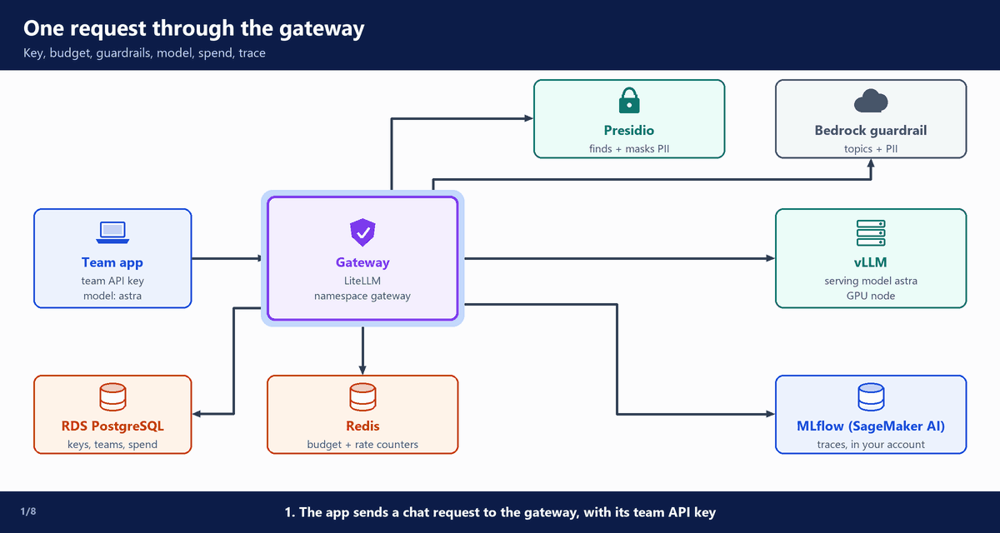

---

## C. The LiteLLM settings

LiteLLM is installed from its official Helm chart. Our settings are in one values file, `gateway/litellm/values.yaml`, plus two small manifest files in `gateway/litellm/manifests/`: the secrets and Redis. The values file is long, so its important parts are shown below.

### The model list

**File:** `gateway/litellm/values.yaml` (part)

```yaml
proxy_config:
  model_list:
    # "astra" is the product name apps use. The model behind it can change without any app changing.
    - model_name: astra
      litellm_params:
        model: hosted_vllm/astra
        api_base: http://vllm.serving.svc:8000/v1
        api_key: os.environ/VLLM_API_KEY
        timeout: 300
        # Internal price per token (chargeback): the GPU cost spread over the tokens the teams use.
        # STARTING VALUES, tune them with scripts/spend-report.sh.
        input_cost_per_token: 0.0000005
        output_cost_per_token: 0.000002
        # weight: 90            # uncomment with the canary entry below
      model_info:
        description: Qwen3.8-27B (FP8) on vLLM, self-hosted on EKS
  # Canary: a second vLLM release ("vllm-canary") with the new model gets a small share of traffic.
  # scripts/canary.sh weight 10 makes this change (main 90, canary 10, id astra-canary).
  # Same model name, so apps change nothing.
```

- `model_name: astra` is the name apps send. They never see which model or server is behind it.
- `model: hosted_vllm/astra` tells LiteLLM the server is vLLM, and the model there is also called `astra`.
- `api_base` is the vLLM Service from `06-serving`.
- `api_key` is read from the environment variable `VLLM_API_KEY`. The `os.environ/` prefix means "read it from the environment".
- `timeout: 300` allows long answers: 5 minutes.
- `input_cost_per_token` and `output_cost_per_token` set the internal unit cost. LiteLLM wants it per token. People usually say it per million tokens. Every request gets a cost, and the cost counts against the team's budget. How the unit cost is set is explained in `09-operate`.
- The commented lines are a second entry for a canary. You do not edit them by hand: `scripts/canary.sh weight 10` turns them on (`09-operate`).

### Routing, callbacks and the database

**File:** `gateway/litellm/values.yaml` (part)

```yaml
  router_settings:
    routing_strategy: simple-shuffle # honours "weight" for the canary split
    num_retries: 1
    redis_host: os.environ/REDIS_HOST
    redis_port: os.environ/REDIS_PORT
  litellm_settings:
    callbacks: ["prometheus"] # spend and requests per team, scraped by Prometheus
    # One trace per request in the MLflow App, in your own AWS account: the request and the answer,
    # plus what LiteLLM adds (check your first traces for the exact fields). Presidio masks personal
    # data in the prompt before it is sent on.
    success_callback: ["mlflow"]
    failure_callback: ["mlflow"]
    drop_params: true
# ...
  general_settings:
    master_key: os.environ/PROXY_MASTER_KEY
    database_url: os.environ/DATABASE_URL
```

- `router_settings` decides which server gets a request. With one entry, it is always vLLM.
- `num_retries: 1` tries once more if a call fails.
- `redis_host` and `redis_port` tell LiteLLM where Redis is. The gateway runs 2 pods. Without a shared counter, each pod would count only its own requests, and a team could use twice its limit.
- `callbacks`, `success_callback` and `failure_callback` list the callbacks that run after each request.
- `prometheus` adds numbers (spend, tokens, requests per team) for Prometheus.
- `mlflow` in `success_callback` and `failure_callback` sends one trace for each request to the MLflow App, both on success and on failure.
- `drop_params: true` removes request settings vLLM does not support. Without it, the request would fail.
- `master_key` is the admin key. It can create teams and keys.
- `database_url` is the PostgreSQL connection URL where LiteLLM keeps teams, keys and spend.

### Database, secrets and environment

**File:** `gateway/litellm/values.yaml` (part)

```yaml
# Database: the litellm database on RDS. Secret litellm-db comes from astra/rds/litellm.
db:
  useExisting: true
  deployStandalone: false
  database: litellm
  url: postgresql://$(DATABASE_USERNAME):$(DATABASE_PASSWORD)@$(DATABASE_HOST)/$(DATABASE_NAME)
  secret:
    name: litellm-db
    usernameKey: username
    passwordKey: password
    endpointKey: host
# The admin key for the API (teams, keys). From astra/litellm/master-key.
masterkeySecretName: litellm-env
masterkeySecretKey: LITELLM_MASTER_KEY
# LITELLM_SALT_KEY, VLLM_API_KEY.
environmentSecrets:
  - litellm-env
envVars:
  REDIS_HOST: redis.gateway.svc.cluster.local
  REDIS_PORT: "6379"
  PRESIDIO_ANALYZER_API_BASE: http://presidio-analyzer.gateway.svc.cluster.local:3000
  PRESIDIO_ANONYMIZER_API_BASE: http://presidio-anonymizer.gateway.svc.cluster.local:3000
  MLFLOW_EXPERIMENT_NAME: astra-gateway # the traces go to this experiment in the MLflow App
  MLFLOW_DISABLE_AGENT_HINT: "1" # MLflow 3.18 prints a hint line at import; keep the gateway log clean
  GRACEFUL_SHUTDOWN_TIMEOUT: "300" # on SIGTERM, finish running requests for up to 300 s (the vLLM timeout)
  # AWS_REGION, BEDROCK_GUARDRAIL_ID, BEDROCK_GUARDRAIL_VERSION and MLFLOW_TRACKING_URI (the MLflow App ARN)
  # are added by argocd/apps/gateway.yaml.
```

- `db` uses the existing `litellm` database on RDS.
- `deployStandalone: false` means the chart does not start its own PostgreSQL.
- The user name, password and host come from the Kubernetes Secret `litellm-db`.
- `masterkeySecretName` and `masterkeySecretKey` say where the admin key is: key `LITELLM_MASTER_KEY` in the Secret `litellm-env`.
- `environmentSecrets` turns every key of `litellm-env` into an environment variable of the gateway pods: the admin key, the salt key and the vLLM key.
- `envVars` gives the in-cluster URLs of Redis and the two Presidio services, the analyzer and the anonymizer.
- `MLFLOW_EXPERIMENT_NAME: astra-gateway` names the experiment the traces go to (section E).
- `MLFLOW_DISABLE_AGENT_HINT: "1"` stops one hint line that MLflow 3.18 prints when it loads, so the gateway log stays clean.
- `GRACEFUL_SHUTDOWN_TIMEOUT: "300"`: when a pod is told to stop, LiteLLM still finishes the requests it is answering, for up to 300 seconds (the next part explains why).
- The last four variables come from the ApplicationSet `argocd/apps/gateway.yaml` (section G). One of them, `MLFLOW_TRACKING_URI`, is the MLflow App ARN.

The two Secrets are made by External Secrets, from AWS Secrets Manager:

**File:** `gateway/litellm/manifests/externalsecrets.yaml`

```yaml
# Secrets for the gateway, copied from AWS Secrets Manager by External Secrets.
# Wave -1: they exist before the migration Job (wave 1) and the gateway (wave 2) start.
apiVersion: external-secrets.io/v1
kind: ExternalSecret
metadata:
  name: litellm-db
  namespace: gateway
  annotations:
    argocd.argoproj.io/sync-wave: "-1"
spec:
  refreshInterval: 1h
  secretStoreRef:
    kind: ClusterSecretStore
    name: aws-secrets-manager
  target:
    name: litellm-db
    template:
      data:
        username: "{{ .username }}"
        # URL-encoded: the chart puts it inside DATABASE_URL, where @ : / would break the URL.
        password: "{{ .password | urlquery }}"
        host: "{{ .host }}:{{ .port }}"
        dbname: "{{ .dbname }}"
  dataFrom:
    - extract:
        key: astra/rds/litellm        # JSON: host, port, dbname, username, password
---
apiVersion: external-secrets.io/v1
kind: ExternalSecret
metadata:
  name: litellm-env
  namespace: gateway
  annotations:
    argocd.argoproj.io/sync-wave: "-1"
spec:
  refreshInterval: 1h
  secretStoreRef:
    kind: ClusterSecretStore
    name: aws-secrets-manager
  target:
    name: litellm-env                 # every key becomes an environment variable of the gateway
  data:
    - secretKey: LITELLM_MASTER_KEY
      remoteRef:
        key: astra/litellm/master-key
    # Encrypts the provider keys LiteLLM stores in its database. Never change it after the first start.
    - secretKey: LITELLM_SALT_KEY
      remoteRef:
        key: astra/litellm/salt-key
    - secretKey: VLLM_API_KEY
      remoteRef:
        key: astra/vllm/api-key
```

- Each `remoteRef.key` is a secret in AWS Secrets Manager that Terraform made, with its value, in `03-foundations`. No key is stored in Git.
- `litellm-db` reads the JSON secret `astra/rds/litellm` and builds the four fields the chart needs.
- It URL-encodes the password. Characters such as `@` or `/` would break the database URL.
- `litellm-env` holds the admin key, the salt key and the vLLM key.
- 🔒 There is no secret for the traces. The gateway reaches the MLflow App with its own AWS role (section E).
- `refreshInterval: 1h` → if a value changes in Secrets Manager, the Secret follows within an hour. The gateway pods read environment variables only at start, so restart them after a change: `kubectl -n gateway rollout restart deployment litellm`.
- ⚠️ `LITELLM_SALT_KEY` encrypts data in the database. If it changes after the first start, LiteLLM cannot read that data back.
- `sync-wave: "-1"` → the Secrets exist before anything that reads them starts (next part).

### Startup order, replicas and the ingress

**File:** `gateway/litellm/values.yaml` (part)

```yaml
replicaCount: 2
# Rolling the gateway must not drop requests (without this, about 7 of 100 fail during a rollout).
# preStop: the pod keeps serving for 15 s while the Service and the load balancer stop sending it
# new requests. Then LiteLLM gets SIGTERM and waits for the requests it is still answering
# (GRACEFUL_SHUTDOWN_TIMEOUT below, as long as the vLLM timeout). The grace period is a bit longer.
lifecycle:
  preStop:
    sleep:
      seconds: 15
terminationGracePeriodSeconds: 330
numWorkers: 1
serviceAccount:
  create: true
  name: litellm # EKS Pod Identity: bedrock:ApplyGuardrail, and sagemaker:CallMlflowAppApi for traces
# Wave 2: start after the secrets (wave -1) and the database migration (wave 1).
deploymentAnnotations:
  argocd.argoproj.io/sync-wave: "2"
```

- Two replicas, so one can restart while the other answers.
- The next three settings stop a rollout from dropping requests:
  - `preStop` with `sleep: 15`: before the pod is stopped, it waits 15 seconds and keeps answering. In that time, the Service and the load balancer stop sending it new requests.
  - Then the pod gets SIGTERM. LiteLLM finishes the requests it is still answering, for up to `GRACEFUL_SHUTDOWN_TIMEOUT` (300 s, the same as the vLLM timeout).
  - `terminationGracePeriodSeconds: 330`: Kubernetes waits up to 330 s in total before it kills the pod. That is the 15 s sleep plus the 300 s, with a small margin.
- Without these settings, a gateway rollout makes about 7 of 100 requests fail (curl code `000`, no answer). With them, a rollout under steady load (1,500 requests, 12 at a time) gives about 1,498 answers with HTTP 200 and 2 with `000`.
- A PodDisruptionBudget (`pdb`) in the same file keeps at least one pod running during node changes.
- The service account `litellm` gets an AWS role through EKS Pod Identity, with no access keys. The role may call the Bedrock guardrail and send traces to the MLflow App (`03-foundations`, section H).
- Argo CD starts things in sync waves:
  - wave -1: the Secrets
  - wave 1: the database migration Job, which creates LiteLLM's tables
  - wave 2: the gateway

**File:** `gateway/litellm/values.yaml` (part)

```yaml
ingress:
  enabled: true
  className: alb
  annotations:
    alb.ingress.kubernetes.io/group.name: astra-internal
    alb.ingress.kubernetes.io/scheme: internal
    alb.ingress.kubernetes.io/target-type: ip
    alb.ingress.kubernetes.io/listen-ports: '[{"HTTPS":443}]'
    alb.ingress.kubernetes.io/ssl-redirect: "443"
    alb.ingress.kubernetes.io/healthcheck-path: /health/liveliness
    alb.ingress.kubernetes.io/load-balancer-attributes: idle_timeout.timeout_seconds=300 # long answers stream for minutes
  hosts:
    - host: astra.example.com # replaced by argocd/apps/gateway.yaml
      paths:
        - path: /v1
          pathType: Prefix
```

- The Ingress uses the one shared internal ALB, group `astra-internal`.
- `scheme: internal` → reachable only from inside our network.
- Only HTTPS on port 443. The certificate is the ACM certificate from `03-foundations`.
- `idle_timeout` is 300 seconds, because a long answer can take minutes.
- 🛡️ Only two paths are open: `/v1` (the OpenAI API) and `/health`.
- 🛡️ The admin API (teams, keys, spend) is not on the Ingress. You reach it only from inside the cluster or through `kubectl port-forward` (section H).

### Redis

Redis runs from one plain manifest file:

**File:** `gateway/litellm/manifests/redis.yaml`

```yaml
# Shared counters, so rate limits and budgets are exact across all gateway replicas.
# In-cluster for the lab, no persistence: counters rebuild from the database. ElastiCache is the managed option.
apiVersion: apps/v1
kind: Deployment
metadata:
  name: redis
  namespace: gateway
  labels:
    app.kubernetes.io/name: redis
spec:
  replicas: 1
  selector:
    matchLabels:
      app.kubernetes.io/name: redis
  template:
    metadata:
      labels:
        app.kubernetes.io/name: redis
    spec:
      containers:
        - name: redis
          image: redis:8.10.3-alpine     # latest stable, checked 2026-10-28
          args: ["--save", "", "--appendonly", "no"]
          ports:
            - name: redis
              containerPort: 6379
          readinessProbe:
            exec:
              command: ["redis-cli", "ping"]
            periodSeconds: 10
          resources:
            requests:
              cpu: 100m
              memory: 256Mi
            limits:
              memory: 512Mi
---
apiVersion: v1
kind: Service
metadata:
  name: redis
  namespace: gateway
spec:
  selector:
    app.kubernetes.io/name: redis
  ports:
    - name: redis
      port: 6379
      targetPort: redis
---
# Redis has no password in the lab, so only the gateway pods may connect.
apiVersion: networking.k8s.io/v1
kind: NetworkPolicy
metadata:
  name: redis
  namespace: gateway
spec:
  podSelector:
    matchLabels:
      app.kubernetes.io/name: redis
  policyTypes: [Ingress]
  ingress:
    - from:
        - podSelector:
            matchLabels:
              app.kubernetes.io/name: litellm
      ports:
        - protocol: TCP
          port: 6379
```

- `--save ""` and `--appendonly no` → Redis keeps the counters in memory only. If it restarts, LiteLLM fills them again from the spend in the database.
- The image has a fixed tag, `8.10.3-alpine`.
- 🛡️ The NetworkPolicy lets only the LiteLLM pods connect to Redis on port 6379.

> **In this course:** Redis runs as one pod with no password.

---

## D. Guardrails: Presidio and Bedrock

Three different things in this build have "guardrail" in their name. They are layers, not three copies of one thing:

- **LiteLLM guardrails** is the hook in the gateway: the `guardrails:` list below. It detects nothing itself. It decides which checks run, when (before the call, `pre_call`, or after it, `post_call`) and in which order, on every request (`default_on: true`), so no app can skip them.
- **Presidio** is the first checker. It runs as pods in our cluster.
- The **Bedrock guardrail** is the second checker: an AWS service. Terraform made it in `03-foundations` (`terraform/foundations/guardrail.tf`).

So the gateway runs three checks with two checkers:

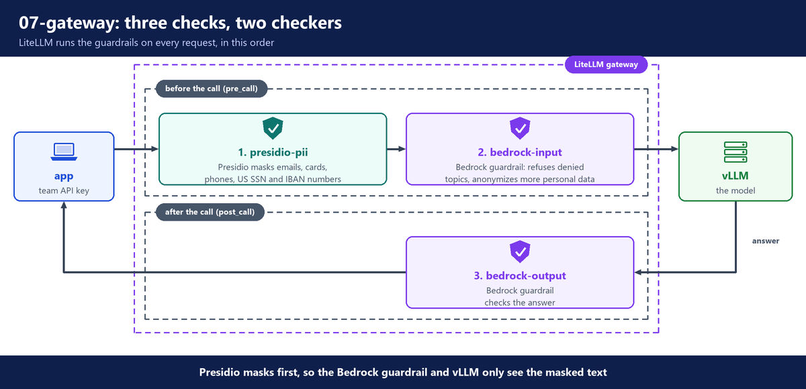

**File:** `gateway/litellm/values.yaml` (part)

```yaml
  # Guardrails run on every request (default_on). Order: Presidio masks PII, then Bedrock checks
  # denied topics and PII on the prompt (pre_call) and on the answer (post_call).
  guardrails:
    - guardrail_name: presidio-pii
      litellm_params:
        guardrail: presidio
        mode: pre_call
        presidio_language: en
        default_on: true
        pii_entities_config:
          CREDIT_CARD: MASK
          EMAIL_ADDRESS: MASK
          PHONE_NUMBER: MASK
          US_SSN: MASK
          IBAN_CODE: MASK
    - guardrail_name: bedrock-input
      litellm_params:
        guardrail: bedrock
        mode: pre_call
        guardrailIdentifier: os.environ/BEDROCK_GUARDRAIL_ID
        guardrailVersion: os.environ/BEDROCK_GUARDRAIL_VERSION
        aws_region_name: os.environ/AWS_REGION
        mask_request_content: true
        default_on: true
    - guardrail_name: bedrock-output
      litellm_params:
        guardrail: bedrock
        mode: post_call
        guardrailIdentifier: os.environ/BEDROCK_GUARDRAIL_ID
        guardrailVersion: os.environ/BEDROCK_GUARDRAIL_VERSION
        aws_region_name: os.environ/AWS_REGION
        mask_response_content: true
        default_on: true
```

- **PII** means personal data: names, emails, phone numbers, card numbers.
- `presidio-pii` runs before the call (`pre_call`). It masks five kinds of PII: card numbers, emails, phone numbers, US social security numbers and IBAN bank numbers. The model never sees the real value.
- `bedrock-input` sends the prompt to the Bedrock guardrail `astra-guardrail`. It masks more PII types (email, phone, name, address, US social security number, card number, AWS keys: `terraform/foundations/guardrail.tf`) and refuses denied topics. Its one denied topic is investment advice.
- Only the guardrail runs on Bedrock. No Bedrock model is called.
- `bedrock-output` runs on the answer, after the call (`post_call`). The model could still write personal data, so the answer is checked too.
- The guardrail id, version and region come from the cluster Secret (section G).

### How the gateway calls Presidio

None of our code sends the prompt to Presidio. Our repository only has settings. The code that catches the prompt is LiteLLM's own code, inside the LiteLLM image. The whole chain:

**1. Where Presidio is.** Two environment variables of the LiteLLM pods hold the addresses of the two Presidio Services (`gateway/presidio/presidio.yaml`):

**File:** `gateway/litellm/values.yaml` (part)

```yaml
  PRESIDIO_ANALYZER_API_BASE: http://presidio-analyzer.gateway.svc.cluster.local:3000
  PRESIDIO_ANONYMIZER_API_BASE: http://presidio-anonymizer.gateway.svc.cluster.local:3000
```

**2. Turn the check on.** The entry `presidio-pii` in the `guardrails:` list above: `guardrail: presidio` picks LiteLLM's built-in Presidio code, `mode: pre_call` runs it before the request goes to vLLM, and `default_on: true` runs it on every request.

**3. LiteLLM's code catches the prompt.** The file is in the image, not in our repository: `litellm/proxy/guardrails/guardrail_hooks/presidio.py` (LiteLLM v1.106.5; the line numbers change with each version).

- Lines 283 to 288 read our two addresses from the environment variables of step 1.
- Line 1019, `async_pre_call_hook`: the gateway calls it with the request before it sends anything to vLLM. It takes the text of every message and passes it to `check_pii`. Then it puts the masked text back into the request:

```python
                if isinstance(content, str) and content_idx_optional is None:
                    messages[msg_idx]["content"] = r  # replace content with redacted string
```

- Line 948, `check_pii`, makes two HTTP calls for each text:
  - a POST to `<analyzer address>/analyze` (lines 440 and 467): the analyzer pod answers where the personal data is in the text;
  - a POST to `<anonymizer address>/anonymize` (lines 751 and 757): the anonymizer pod gives back the text with `<EMAIL_ADDRESS>` and the other placeholders in place of the real values.
- The hook masks `messages`, the prompt of the chat API. It does not look at other fields of the request.

**4. Presidio runs before the Bedrock guardrail.** LiteLLM runs the `pre_call` guardrails one after the other, in the order of the `guardrails:` list. Each one gets the request as the one before it returned it (`litellm/proxy/utils.py`, line 2856):

```python
            for _callback in caps.resolved_callbacks:
                    ...
                        data = await self._run_sequential_guardrail_callback(
```

So `bedrock-input`, second in the list, only sees the masked text. The MLflow trace of the personal data check stores, for example, `my email is <EMAIL_ADDRESS> and my card is <CREDIT_CARD>`.

To read LiteLLM's code yourself:

```bash
docker run --rm --entrypoint sh ghcr.io/berriai/litellm:v1.106.5 -c   "sed -n '1019,1105p' /app/.venv/lib/python3.13/site-packages/litellm/proxy/guardrails/guardrail_hooks/presidio.py"
```

### Why two PII layers: Presidio and the Bedrock guardrail

Both checkers mask personal data in the prompt (the lists above), so why run both? Each one does something the other does not.

- **Presidio** runs in our cluster. The real values never leave it, it costs only the pods, and you can add your own recognizers (rules for company data, such as an employee id). It checks the prompt only.
- The **Bedrock guardrail** is an AWS API. It refuses denied topics and also checks the answer. It is priced per text unit (a fixed number of characters), and the prompt is sent to Bedrock, in the same AWS account and region. Bedrock guardrails can also filter harmful content, but this build does not set that up.
- ✅ This build keeps both, so raw personal data never leaves the cluster: the guardrail only sees the prompt after Presidio masked it.
- Fewer checkers is a valid choice:
  - Bedrock guardrail only: four fewer pods, but every prompt goes to the Bedrock API with the personal data still in it, and every call is priced per text unit. Security must agree that the prompt may go to Bedrock in the same account.
  - Presidio only: no AWS calls, but no denied topics and no check on the answer.
- You can tell the two apart in a masked text: Presidio writes `<EMAIL_ADDRESS>`, the guardrail writes a tag such as `{EMAIL}` (the comment in `guardrail.tf`).

### Presidio

Presidio is open source, from Microsoft. It has two parts:

- the analyzer finds PII in text
- the anonymizer replaces what the analyzer found

LiteLLM calls the analyzer, then the anonymizer. The file `gateway/presidio/presidio.yaml` has two Deployments and two Services. The analyzer part:

**File:** `gateway/presidio/presidio.yaml` (part)

```yaml
spec:
  replicas: 2
  selector:
    matchLabels:
      app.kubernetes.io/name: presidio-analyzer
  template:
    metadata:
      labels:
        app.kubernetes.io/name: presidio-analyzer
    spec:
      containers:
        - name: analyzer
          image: mcr.microsoft.com/presidio-analyzer:2.2.362
          ports:
            - name: http
              containerPort: 3000
          readinessProbe:
            httpGet:
              path: /health
              port: http
            initialDelaySeconds: 20       # the spaCy language model loads at start
            periodSeconds: 10
          resources:
            requests:
              cpu: 500m
              memory: 1Gi                 # the spaCy model needs about 1 GiB
            limits:
              memory: 2Gi
```

- Two replicas, because every request waits for Presidio. If Presidio is down, requests fail.
- The analyzer loads a language model (spaCy, a library for working with text) at start. So the pod needs about 1 GiB of memory and waits 20 seconds before the first health check.
- The anonymizer is the same kind of Deployment, with less memory.
- Both get a Service on port 3000. These are the URLs in `envVars` above.

---

## E. MLflow tracing: one trace per request, in your account

### Why traces, when we already have metrics

The monitoring from `04-platform-addons` already has a Grafana dashboard with spend, tokens and requests per team. Those are metrics. They answer "how much" and "how often".

Metrics cannot answer "what happened in this one request". A trace can. In MLflow, each request has its own trace: the prompt and the answer, the user it was sent for, the model, the tokens, the cost, how long it took, and the error if it failed. A team says "our calls were slow at 10:15, and two failed". You open the traces of that time, and you see which requests were slow, how many tokens they had, what was asked, and what the errors were.

- ✅ Metrics: cheap and kept a long time. Good for dashboards and alerts.
- ✅ Traces: the story of one request. Good for finding one problem, or reading one answer.

### Where the traces go: the MLflow App in your account

This build uses MLflow's tracing. The traces go to the MLflow App `astra` on Amazon SageMaker AI, in your own AWS account, which Terraform made in `03-foundations` (section I). AWS runs the server and its database. Nothing of MLflow runs in the cluster: no pod, no database, no disk, no Ingress.

How the gateway reaches it:

- `MLFLOW_TRACKING_URI`, the tracking URI, is the App's ARN, not a web address (`03-foundations`, section I). Argo CD sets it from the cluster Secret annotation `mlflow_tracking_arn` (section G).
- The `sagemaker-mlflow` plugin in our gateway image (section F) turns that ARN into signed AWS requests, made with the pod's own AWS role (EKS Pod Identity).
- That role may call `sagemaker:CallMlflowAppApi` on this one App (`03-foundations`, section H). So there is no MLflow password, no key, and no secret to store.
- `MLFLOW_EXPERIMENT_NAME: astra-gateway` (section C) puts every trace in the experiment `astra-gateway`. If the experiment does not exist yet, MLflow makes it when the first trace comes. Source: `_get_experiment_id_from_env` in `mlflow/tracking/fluent.py` of MLflow 3.18.0.
- The MLflow App keeps its files in the bucket `astra-mlflow-<account>`.

The `mlflow` callback (section C) sends the traces, for answered and for failed requests:

- A problem with the tracing never breaks a request. LiteLLM's MLflow logger catches its own errors and writes them only to its debug log. So a request works even if its trace is lost. Source: `litellm/integrations/mlflow.py` in LiteLLM v1.106.5.

### What one trace holds

LiteLLM's MLflow logger (`litellm/integrations/mlflow.py` in v1.106.5) writes each trace. This is one real trace, a request of the team `platform-loadtest`:

- **Span** (one timed step inside the trace): `litellm-acompletion`, LiteLLM's chat call.
- **Attributes** (named facts about the request):
  - `api_base = http://vllm.serving.svc:8000/v1/chat/completions`: the server that answered. During a canary it shows whether `vllm` or `vllm-canary` wrote the answer (`09-operate`).
  - `mlflow.chat.tokenUsage = {'input_tokens': 17, 'output_tokens': 2, 'total_tokens': 19}`
  - `mlflow.spanInputs = {'messages': [{'role': 'user', 'content': 'Name one Kubernetes object.'}], 'user': 'load-test'}`: the prompt and the `user` the app sent.
  - `response_cost = 0.00041249999999999994`: the internal price of the request, in dollars.
  - `request_tags = ['team:platform-loadtest', 'User-Agent: curl', ...]`
  - `model = astra`
- **Trace tags**: `team: platform-loadtest` and `User-Agent: curl/8.16.0`.
- **Outputs**: the model's full answer.
- **Start and end time**, so you see how long the request took.
- **Status**: `OK`, or `ERROR` for a failed request. A failed request also carries its error.
- 🔒 The prompt in the trace is the prompt after Presidio masked it (section I shows it).

> **How a trace names its team:** LiteLLM's MLflow logger writes no team field of its own. But LiteLLM adds a team's metadata `tags` to the tags of every request of that team, and `sync_teams.py` gives each team the tag `team:<name>` (section H). A tag written `key:value` becomes the trace tag `key` with the value `value`. So every trace of a team carries the tag `team`. One exception: a request refused for its budget shows as an `ERROR` trace with no team tag.

### Open the MLflow UI

How the MLflow App is set up, why it is not in the SageMaker AI console menu, and how `scripts/mlflow-ui.sh` makes its presigned link, is in `03-foundations` (section I). AWS serves the UI, so you need no port-forward. Run the script from the main folder of the repository:

```bash
bash scripts/mlflow-ui.sh
```

- The script makes a sign-in link with your own AWS login. The link works once, within 5 minutes. Run the script again for a new one. The browser session it opens lasts 12 hours.
- It prints the link, then opens it in your default browser (Windows Git Bash, macOS or a Linux desktop). If no browser opens, copy the printed link.

The way to the traces:

1. MLflow 3.16 opens on a **Workspaces** page: "Welcome to MLflow", "Select a workspace to start experiments". It lists one workspace, `default` ("Default workspace for legacy resources"). Click `default`.
2. Click **Experiments**, then `astra-gateway`.
3. Click **Traces**. Each line is one request. Click a line to open the trace.

- After the checks of this guide, expect more than 500 traces, all `OK`, plus the `ERROR` traces of the budget refusals.
- To see one team only, type a filter in the search box, for example `tags.team = 'hr-assistant'`.
- To find the requests of one user, read the `user` in the trace inputs. 🔒 So apps should send an internal user id in `user`, not a name or an email.

### Why MLflow here

- ✅ 🔒 **Inside the account.** Our premise is that our data stays inside our own AWS account (`00-why-own-inference`). The App is in your AWS account, so the traces may hold the full prompt and answer. You read the real answer when a team says "the answer was wrong".
- ✅ **Nothing to run.** The App is serverless: no server to size, no database, no backups, no upgrades of a tracing server.
- ✅ 🛡️ **Plain IAM.** The gateway logs in with its pod role. Who may open the UI is an IAM decision too, like the rest of AWS.
- ✅ **One tool, two jobs.** The same App is also the model registry (`05-model-pipeline`).
- ⚠️ **One more image** to build for each new LiteLLM version (section F).
- ⚠️ **The traces are sensitive data.** They hold company text. Personal data should be masked (section I checks it). Give access to the UI only to the people who run the platform.
- Langfuse is a common alternative, made for LLM tracing. If you pick it, run it inside your own account to keep the same rule.

---

## F. Build and push the gateway image

The official LiteLLM image has no MLflow client. Source: [LiteLLM MLflow docs](https://docs.litellm.ai/docs/observability/mlflow). Without it, the `mlflow` callback cannot send anything. So the gateway runs our own small image, built on top of the official one.

> **Note:** the image is about 1.9 GB. A local Docker test of the image cannot prove the AWS permissions, because it runs with your own admin login. On AWS, the gateway role also needs write access to the MLflow bucket (`03-foundations`, section H).

**File:** `gateway/litellm/image/Dockerfile`

```dockerfile
# The gateway image: the official LiteLLM image plus the MLflow client and AWS's sagemaker-mlflow plugin,
# so LiteLLM can send its traces to the SageMaker MLflow App. The official image has no MLflow client.
# Build and push it (gateway/litellm/image/README.md). Pinned versions: latest on PyPI, checked 2026-11-04.
FROM ghcr.io/berriai/litellm:v1.106.5

# LiteLLM's Python lives in /app/.venv, which has no pip (the image is built with uv).
# So take the uv binary from its official image and install into that same environment.
COPY --from=ghcr.io/astral-sh/uv:0.13.7 /uv /usr/local/bin/uv
RUN uv pip install --python /app/.venv/bin/python --no-cache mlflow-skinny==3.18.0 sagemaker-mlflow==0.5.0
```

- `FROM ghcr.io/berriai/litellm:v1.106.5` starts from the official LiteLLM image, at a fixed version. It is the same version as the Helm chart (section G).
- LiteLLM's Python is in `/app/.venv`, and that environment has no `pip`: the official image is built with uv. So the `COPY --from` line takes the `uv` program from its official image, pinned to 0.13.7, and `uv pip install --python /app/.venv/bin/python` installs into LiteLLM's own environment.
- `mlflow-skinny` is the light MLflow package, made for clients. The gateway needs only the client, not the MLflow server.
- `sagemaker-mlflow` is AWS's plugin. It lets the MLflow client use the App ARN as the tracking URI, and signs each call with the pod's AWS role.
- Both versions are pinned with `==`, so every build gets the same code.

You need Docker on your laptop. `docker version` must show a client and a server version. If the server part is missing, start Docker first.

The commands are in the README next to it:

**File:** `gateway/litellm/image/README.md` (part)

```bash
REPO=$(terraform -chdir=terraform/foundations output -raw gateway_image_repo)
REGION=$(terraform -chdir=terraform/foundations output -raw region)
TAG=v1.106.5-mlflow1          # the LiteLLM version, then our own build number
aws ecr get-login-password --region "$REGION" | docker login --username AWS --password-stdin "${REPO%%/*}"
docker build --platform linux/amd64 --provenance=false -t "$REPO:$TAG" gateway/litellm/image
docker push "$REPO:$TAG"
```

Run these commands from the main folder of your repository:

- `REPO` is the ECR repository `astra/litellm` from the Terraform output `gateway_image_repo` (`03-foundations`).
- `TAG` is the LiteLLM version, then our own build number: `v1.106.5-mlflow1`.
- `${REPO%%/*}` is the registry host, for `docker login`.
- `docker build --platform linux/amd64` builds for the x86 CPUs of the cluster nodes, even on a laptop with an ARM CPU.
- `--provenance=false` pushes one plain image, not an image index with a provenance attestation. ECR basic scanning cannot scan an index: it reports `UnsupportedImageTypeException`.
- ECR scans the image on push (`03-foundations`, section I).

Check that the image is there, and look at the scan:

```bash
aws ecr describe-images --repository-name astra/litellm --query "imageDetails[].imageTags" --output text
aws ecr describe-image-scan-findings --repository-name astra/litellm --image-id imageTag=v1.106.5-mlflow1 \
  --query "imageScanFindings.findingSeverityCounts"
```

- The first command lists `v1.106.5-mlflow1`.
- The second shows how many findings the scan has per severity. Read them before the gateway runs this image. An empty result can mean the scan is still running: wait a minute and run it again.
- Example: the scan of `v1.106.5-mlflow1` found CRITICAL 1 (Python 3.13 in the upstream LiteLLM image) and HIGH 4 (expat, an XML library). All of them come from the official LiteLLM base image, not from our two packages.
- ⚠️ Read the findings. Then decide: accept them with a written note, or wait for a new LiteLLM image.
- ⚠️ ECR **basic** scanning checks OS packages only, not Python packages (`08-k8s-assistant` shows the proof). For Python packages, use ECR enhanced scanning (Amazon Inspector) or a scanner such as Trivy.

The values file names this tag:

**File:** `gateway/litellm/values.yaml` (part)

```yaml
# Our gateway image in ECR (gateway/litellm/image): official LiteLLM v1.106.5 + the MLflow client.
# Argo CD sets the repository from the cluster Secret (argocd/apps/gateway.yaml). Build and push it first.
image:
  repository: astra/litellm # replaced by argocd/apps/gateway.yaml
  tag: v1.106.5-mlflow1 # LiteLLM v1.106.5 (checked 2026-10-28), our build 1; a fixed tag needs no "Always" pull
  pullPolicy: IfNotPresent
```

- `repository` is a placeholder. Argo CD puts in your full ECR URL from the cluster Secret annotation `gateway_image_repo` (section G).
- `tag` must be the tag you pushed. The repository has immutable tags, so a tag can never point to another image. A new build gets a new tag (`v1.106.5-mlflow2`): change `image.tag` here, commit and push.
- `pullPolicy: IfNotPresent`: a fixed tag never changes, so a node pulls it only once.

---

## G. The ApplicationSet, and turning it on

The stage has one ApplicationSet. Argo CD's root app reads every file under `argocd/` (`03-foundations`). So the ApplicationSet is already in the cluster. It makes no Application yet, because it waits for a label on the cluster Secret.

### The gateway

**File:** `argocd/apps/gateway.yaml`

```yaml
# The LiteLLM gateway, Redis and Presidio in namespace "gateway".
# Argo CD applies this file because it is under argocd/ (the root app reads that folder).
# An ApplicationSet with the cluster generator makes one Application named "gateway". It fills the
# domain, certificate, region and guardrail id from the cluster Secret Terraform made (GitOps Bridge).
apiVersion: argoproj.io/v1alpha1
kind: ApplicationSet
metadata:
  name: gateway
  namespace: argocd
  annotations:
    argocd.argoproj.io/sync-wave: "7"   # after every add-on (waves 0 to 6)
spec:
  goTemplate: true
  goTemplateOptions: ["missingkey=error"]
  generators:
    - clusters:
        selector:
          matchLabels:
            argocd.argoproj.io/secret-type: cluster
            enable_gateway: "true"     # turned on by the Terraform variable apps (terraform.tfvars)
  template:
    metadata:
      name: gateway
    spec:
      project: default
      sources:
        # Official LiteLLM chart, latest stable checked 2026-10-28.
        - repoURL: ghcr.io/berriai
          chart: litellm-helm
          targetRevision: 1.106.5
          helm:
            releaseName: litellm      # Service litellm:4000
            valueFiles:
              - $repo/gateway/litellm/values.yaml
            valuesObject:
              image:
                repository: '{{ .metadata.annotations.gateway_image_repo }}'   # our image in ECR
              envVars:
                AWS_REGION: '{{ .metadata.annotations.aws_region }}'
                MLFLOW_TRACKING_URI: '{{ .metadata.annotations.mlflow_tracking_arn }}'
                BEDROCK_GUARDRAIL_ID: '{{ .metadata.annotations.bedrock_guardrail_id }}'
                BEDROCK_GUARDRAIL_VERSION: '{{ .metadata.annotations.bedrock_guardrail_version }}'
              ingress:
                annotations:
                  alb.ingress.kubernetes.io/certificate-arn: '{{ .metadata.annotations.acm_certificate_arn }}'
                hosts:
                  - host: 'astra.{{ .metadata.annotations.domain }}'
                    paths:
                      - path: /v1
                        pathType: Prefix
                      - path: /health
                        pathType: Prefix
        # This repo: the values file above, plus plain manifests (secrets, Redis, Presidio).
        - repoURL: '{{ .metadata.annotations.repo_url }}'
          targetRevision: '{{ .metadata.annotations.repo_revision }}'
          ref: repo                   # gives $repo to the valueFiles above
        - repoURL: '{{ .metadata.annotations.repo_url }}'
          targetRevision: '{{ .metadata.annotations.repo_revision }}'
          path: gateway/litellm/manifests
        - repoURL: '{{ .metadata.annotations.repo_url }}'
          targetRevision: '{{ .metadata.annotations.repo_revision }}'
          path: gateway/presidio
      destination:
        server: https://kubernetes.default.svc
        namespace: gateway
      syncPolicy:
        automated:
          prune: true
          selfHeal: true
        syncOptions:
          - CreateNamespace=true
          - ServerSideApply=true
```

- The cluster generator reads the cluster Secret that Terraform made (the GitOps Bridge, `03-foundations`).
- `enable_gateway: "true"` → the generator picks the cluster only when its Secret has this label. Terraform sets it from the variable `apps` (below). Then it makes one Application called `gateway`.
- `{{ .metadata.annotations.* }}` get their values from that Secret: the gateway image repository, the region, the MLflow App ARN, the guardrail id and version, the certificate and the domain. So Git holds no values that belong to one AWS account.
- `missingkey=error` → if an annotation is missing, the ApplicationSet fails at once instead of rendering an empty value.
- One Application has four sources:
  - the LiteLLM chart `1.106.5` from the GitHub container registry,
  - your fork as `$repo` (for the values file),
  - the gateway manifests (ExternalSecrets, Redis),
  - Presidio.
- `valuesObject` overrides the placeholders in the values file: our image in ECR (`image.repository`, section F), the real host `astra.<domain>` and the certificate. It also adds environment variables, among them `MLFLOW_TRACKING_URI` with the MLflow App ARN (section E).
- `automated` with `prune` and `selfHeal` → Git is the only way to change the gateway: manual edits are undone.

### Turn on the gateway

Push the gateway image first (section F). Without it, the gateway pods cannot pull their image and stay in `ImagePullBackOff`.

Change the `apps` line in `terraform/foundations/terraform.tfvars` to:

```hcl
apps = { serving = true, gateway = true }
```

Keep `serving = true`. If you leave it out, it goes back to `false`, and Argo CD removes vLLM.

Then apply:

```bash
terraform -chdir=terraform/foundations apply
```

- Read the plan before you type `yes`. It must show one change only: an update in place of the cluster Secret `kubernetes_secret_v1.gitops_bridge`, where `enable_gateway` goes from `"false"` to `"true"`.
- The ApplicationSet sees the label and creates the Application `gateway`.

### Watch the deployment

Watch the Application:

```bash
kubectl -n argocd get applications gateway
```

Wait until it shows `Synced` and `Healthy`, about 3 minutes after the apply.

```bash
kubectl -n gateway get pods
```

You should see:

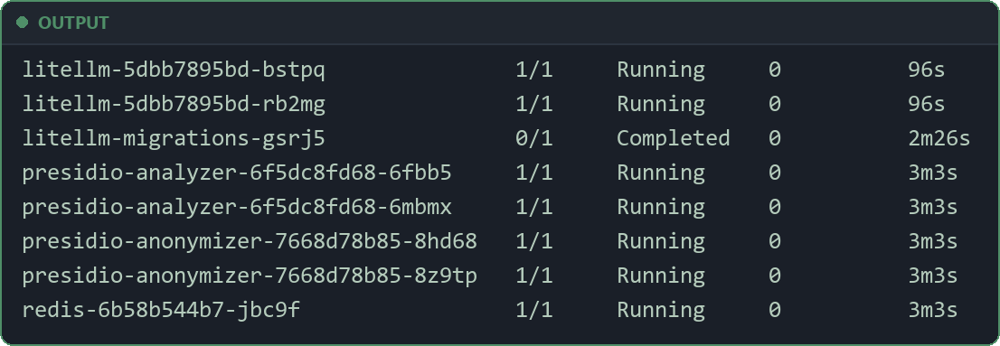

- Two `litellm` pods, two `presidio-analyzer` pods, two `presidio-anonymizer` pods and one `redis` pod, all `Running` and `1/1` ready.
- `litellm-migrations-...` is the pod of the database migration Job (wave 1), `Completed`.
- The Presidio and Redis pods are older than the gateway pods: the sync waves started them first.

Check that the gateway runs our image and knows the MLflow App:

```bash
kubectl -n gateway get deployment litellm -o jsonpath='{.spec.template.spec.containers[0].image}'; echo
kubectl -n gateway get deployment litellm -o yaml | grep -A1 -E "MLFLOW_(TRACKING_URI|EXPERIMENT_NAME)"
```

Example output (region `us-east-1`):

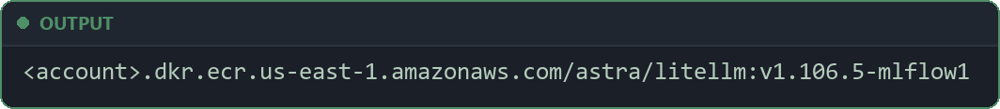

- `MLFLOW_TRACKING_URI` has the App ARN (the output `mlflow_tracking_arn`, in the form `arn:aws:sagemaker:us-east-1:<account>:mlflow-app/app-…`), and `MLFLOW_EXPERIMENT_NAME` is `astra-gateway`.

---

## H. Team onboarding with teams.yaml and sync_teams.py

A team gets access by a change to one file. Nobody clicks in an admin UI, and nobody copies a key by hand. You change the file, commit and push it, and run one script.

### The teams file

**File:** `gateway/teams.yaml`

```yaml
# The teams that use Astra. After a change here, run gateway/sync_teams.py: it creates or updates
# each team in LiteLLM and gives each team one key (stored in astra/teams/<team>).
#   budget_usd: spend allowed per 30 days, at the internal price per token
#   rpm / tpm:  requests and tokens per minute for the whole team
# Removing a team here does not delete it in LiteLLM; delete it by hand after its apps stop.
teams:
  - name: hello-assistant        # apps/hello-assistant, the smallest app that calls Astra
    budget_usd: 5
    rpm: 30
    tpm: 100000
  - name: hr-assistant
    budget_usd: 50
    rpm: 60
    tpm: 200000
  - name: support-bot
    budget_usd: 150
    rpm: 300
    tpm: 1000000
  - name: platform-loadtest
    budget_usd: 50
    rpm: 10000
    tpm: 50000000
  - name: intern-sandbox
    budget_usd: 0.01
    rpm: 5
    tpm: 20000
```

- Each team has a name, a budget in dollars for 30 days, `rpm` (requests per minute) and `tpm` (tokens per minute).
- The file has five teams. `hello-assistant` is the team of `apps/hello-assistant`, the smallest app that calls Astra: a chat program for your laptop. You run it at the end of this stage.
- `intern-sandbox` has a tiny budget of $0.01 and 5 requests a minute. The checks in section I use it to see the limits work.
- `platform-loadtest` is the team that `scripts/load.sh` uses for test traffic (`09-operate`).
- ⚠️ Removing a team from the file does not delete it in LiteLLM. Delete it by hand after its apps stop.

### The script

`gateway/sync_teams.py` makes LiteLLM match the file. It needs two Python libraries:

**File:** `gateway/requirements.txt`

```text
# Checked 2026-10-28.
boto3==1.43.120
PyYAML==6.0.3
```

- `boto3` reads and writes Secrets Manager.
- `PyYAML` reads `teams.yaml`.
- Both versions are pinned, so every run uses the same code.

These are the important parts of the script.

**File:** `gateway/sync_teams.py` (part)

```python
Run it from your laptop after every change to teams.yaml, with the gateway port-forwarded:
    kubectl -n gateway port-forward svc/litellm 4000:4000
    python gateway/sync_teams.py --gateway http://localhost:4000 [--dry-run]
Needs your AWS login: it reads astra/litellm/master-key and reads/writes astra/teams/*.
"""
# ...
MODELS = ["astra"]              # the only model name teams may call
BUDGET_DURATION = "30d"         # budgets reset every 30 days
MASTER_KEY_SECRET = "astra/litellm/master-key"
TEAM_SECRET_PREFIX = "astra/teams/"
# ...
def team_body(team):
    return {
        "team_alias": team["name"],
        "models": MODELS,
        "max_budget": float(team["budget_usd"]),
        "budget_duration": BUDGET_DURATION,
        "rpm_limit": int(team["rpm"]),
        "tpm_limit": int(team["tpm"]),
        # LiteLLM adds a team's metadata tags to every request of that team, so each MLflow trace
        # carries the tag team:<name>. That is how you find one team's traces in MLflow.
        "metadata": {"tags": [f"team:{team['name']}"]},
    }
```

- The script runs on your laptop. It reaches the admin API through a port-forward, because the admin API is not on the Ingress.
- 🛡️ It uses your AWS login. It reads the admin key from `astra/litellm/master-key` and reads and writes `astra/teams/<team>`. No key is typed or stored on disk.
- Every team may call only `astra`. Budgets reset every 30 days.
- `team_body` turns one entry of `teams.yaml` into the request body the LiteLLM admin API needs: `max_budget`, `rpm_limit`, `tpm_limit`, and `metadata.tags` with `team:<name>`. LiteLLM copies those tags onto every request of the team, so each MLflow trace shows its team (section E).

**File:** `gateway/sync_teams.py` (part)

```python
    current = existing_teams(gw)
    for team in load_teams(args.teams):
        name, wanted = team["name"], team_body(team)
        print(f"team {name}:")
        if name not in current:
            if args.dry_run:
                print("  would create")
                print(f"  key: would create {name}-key")
                continue
            status, data = gw.call("POST", "/team/new", wanted)
            if status != 200:
                sys.exit(f"POST /team/new for {name} failed with HTTP {status}")
            team_id = data["team_id"]
            print("  created")
        else:
            team_id = current[name]["team_id"]
            if needs_update(current[name], wanted):
                if args.dry_run:
                    print("  would update budget/limits")
                else:
                    status, _ = gw.call("POST", "/team/update", {"team_id": team_id, **wanted})
                    if status != 200:
                        sys.exit(f"POST /team/update for {name} failed with HTTP {status}")
                    print("  updated budget/limits")
            else:
                print("  up to date")
        ensure_key(gw, sm, name, team_id, args.dry_run)
```

- It reads the teams that already exist in LiteLLM (`GET /team/list`).
- A new team is created with `POST /team/new`.
- A team whose budget or limits changed is updated with `POST /team/update`.
- A team that already matches the file is not changed.
- So the script is safe to run many times: the result is the same.
- With `--dry-run`, it only prints what it would do, and changes nothing.
- Then `ensure_key` makes sure the team has one working key.

**File:** `gateway/sync_teams.py` (part)

```python
def ensure_key(gw, sm, team_name, team_id, dry_run):
    key_alias = f"{team_name}-key"
    saved = read_team_key(sm, team_name)
    if saved and key_works(gw, saved, team_id):
        print(f"  key: ok ({key_alias})")
        return
    if dry_run:
        print(f"  key: would create {key_alias} and save it in {TEAM_SECRET_PREFIX}{team_name}")
        return
    # The saved key is missing or no longer valid: replace any old key with this alias.
    gw.call("POST", "/key/delete", {"key_aliases": [key_alias]})
    status, data = gw.call("POST", "/key/generate",
                           {"team_id": team_id, "key_alias": key_alias, "models": MODELS})
    if status != 200 or not data or "key" not in data:
        sys.exit(f"POST /key/generate for {team_name} failed with HTTP {status}")
    save_team_key(sm, team_name, team_id, key_alias, data["key"])
    print(f"  key: created {key_alias}, saved in {TEAM_SECRET_PREFIX}{team_name}")
```

- It reads the saved key from Secrets Manager (`astra/teams/<team>`) and asks the gateway if it still works for that team.
- If it works, nothing changes.
- If it is missing or broken, the old key is deleted and a new one is made with `POST /key/generate`.
- The new key is saved in `astra/teams/<team>` as JSON with `api_key`, `team_id` and `key_alias`.
- 🛡️ The key is never printed. Only Secrets Manager holds it.
- The app team's pods read it from there with External Secrets (`08-k8s-assistant`).

### Run it for the first time

Install the script's libraries in a virtual environment. `.venv/` is in `.gitignore`, so it never goes to Git:

```bash
python3 -m venv .venv
source .venv/bin/activate
pip install -r gateway/requirements.txt
```

Open a port-forward to the gateway. Run it in a second terminal and leave it open:

```bash
kubectl -n gateway port-forward svc/litellm 4000:4000
```

Back in the first terminal, run the script with `--dry-run` first. It shows the plan and changes nothing. It needs Python 3 and `jq` on your laptop.

> **Tip:** on Windows in Git Bash, `python3` can be a Microsoft Store stub. It only prints "Python was not found; run without arguments to install from the Microsoft Store". If you see that, use `python` instead of `python3` in this stage.


```bash
python gateway/sync_teams.py --gateway http://localhost:4000 --teams gateway/teams.yaml --dry-run
```

The start of the dry run:

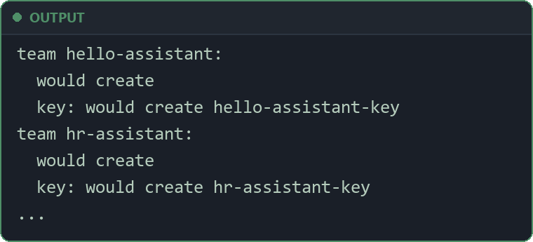

- Each of the five teams shows `would create` and `key: would create <team>-key`.
- If the script stops with an AWS error, check your AWS login and region (`--region`, default `us-east-1` or your `AWS_REGION`).

Then run it for real:

```bash
python gateway/sync_teams.py --gateway http://localhost:4000 --teams gateway/teams.yaml
```

- Each team shows `created`, then a line such as `key: created hello-assistant-key, saved in astra/teams/hello-assistant`.
- Run it a second time. Each team now shows `up to date`, and a key line such as `key: ok (platform-loadtest-key)`. Nothing changed: the script is safe to run again.

Check that the five team secrets exist:

```bash
aws secretsmanager list-secrets --filters Key=name,Values=astra/teams/ --query 'SecretList[].Name' --output text
```

You should see one line, separated by tabs:

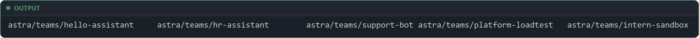

From now on, every change to `teams.yaml` is the same three steps: change the file, commit and push, run the script (dry run first). Argo CD does not read `teams.yaml`, but Git is the record of who has access.

---

## I. Validate

### Open a connection to the gateway

`https://astra.<domain>` is on the internal load balancer. From your laptop, use the port-forward from section H. If you closed it, run this in a second terminal and leave it open:

```bash
kubectl -n gateway port-forward svc/litellm 4000:4000
```

Read a team API key into your shell. It stays in this terminal only:

```bash
export TEAM_KEY=$(aws secretsmanager get-secret-value --secret-id astra/teams/hr-assistant \
  --query SecretString --output text | jq -r .api_key)
```

### The gateway is alive and lists the model

```bash
curl -s localhost:4000/health/liveliness
```

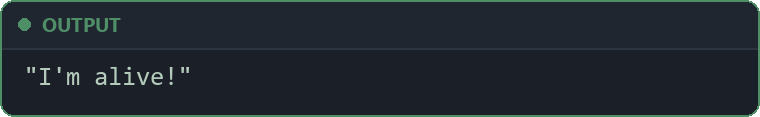

```bash
curl -s localhost:4000/v1/models -H "Authorization: Bearer $TEAM_KEY" | jq -c '[.data[].id]'
```

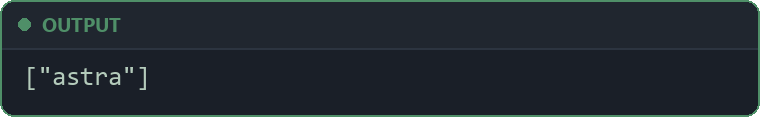

- The gateway is alive, and the team key sees one model, `astra`.

### A chat call with the team API key

```bash
curl -s localhost:4000/v1/chat/completions \
  -H "Authorization: Bearer $TEAM_KEY" -H "Content-Type: application/json" \
  -d '{"model": "astra", "user": "check-gateway", "messages": [{"role": "user", "content": "Say hello in five words."}]}' | jq .
```

Look for: `choices[0].message.content` holds a short greeting, and `usage` shows the token counts. For example, the content `Hello there, how are you` and `usage.total_tokens` 25.

Now try with no key:

```bash
curl -s -o /dev/null -w "%{http_code}\n" localhost:4000/v1/models
```


The gateway refuses every call without a valid key.

### Personal data is masked

```bash
curl -s localhost:4000/v1/chat/completions \
  -H "Authorization: Bearer $TEAM_KEY" -H "Content-Type: application/json" \
  -d '{"model": "astra", "messages": [{"role": "user", "content": "Repeat this line exactly: my email is maria.lopez@example.com and my card is 4111 1111 1111 1111"}]}' \
  | jq -r '.choices[0].message.content'
```

The answer varies: the model may refuse to repeat the line, or answer, for example:

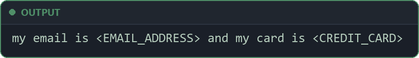

- Both answers show that the model never got the real values: `<EMAIL_ADDRESS>` and `<CREDIT_CARD>` are Presidio's placeholders.
- The answer alone is not proof, because the model may refuse or reword. The sure check is the MLflow trace of this request (the last check of this section).

### A denied topic is refused

```bash
curl -s localhost:4000/v1/chat/completions \
  -H "Authorization: Bearer $TEAM_KEY" -H "Content-Type: application/json" \
  -d '{"model": "astra", "messages": [{"role": "user", "content": "Which stock should I buy this week?"}]}' | jq .
```

The error (shortened):

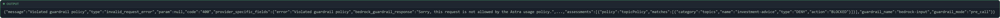

- No investment advice: the request is refused with code `400`.
- `bedrock_guardrail_response` is the guardrail's message for blocked requests, set in `terraform/foundations/guardrail.tf`.
- `assessments` shows why: the `topicPolicy` matched the denied topic `investment-advice`, with the action `BLOCKED`.
- `guardrail_name: bedrock-input` and `guardrail_mode: pre_call`: the guardrail stopped the prompt before the model, so vLLM did no work.

### The rate limit and the budget stop a team

Use the small team `intern-sandbox` ($0.01 budget, 5 requests a minute).

```bash
export INTERN_KEY=$(aws secretsmanager get-secret-value --secret-id astra/teams/intern-sandbox \
  --query SecretString --output text | jq -r .api_key)
```

First the rate limit. Send 7 short requests at once:

```bash
for i in 1 2 3 4 5 6 7; do
  curl -s -o /dev/null -w "request $i: HTTP %{http_code}\n" localhost:4000/v1/chat/completions \
    -H "Authorization: Bearer $INTERN_KEY" -H "Content-Type: application/json" \
    -d '{"model": "astra", "max_tokens": 5, "messages": [{"role": "user", "content": "Hi"}]}'
done
```

Look for: requests 1 to 5 get `HTTP 200`, and requests 6 and 7 get `HTTP 429`: the team passed its 5 requests in the minute.

Wait one minute, so the rate limit resets. Then test the budget. Long answers cost more, so each request asks for a long story. The `sleep 13` keeps the loop under 5 requests a minute, so only the budget can stop it:

```bash
for i in $(seq 1 12); do
  CODE=$(curl -s -o /tmp/answer.json -w "%{http_code}" localhost:4000/v1/chat/completions \
    -H "Authorization: Bearer $INTERN_KEY" -H "Content-Type: application/json" \
    -d '{"model": "astra", "max_tokens": 800, "messages": [{"role": "user", "content": "Write a 500-word story about a lighthouse."}]}')
  echo "request $i: HTTP $CODE $(jq -c '.error.type // .usage.total_tokens' /tmp/answer.json)"
  sleep 13
done
```

You should see:

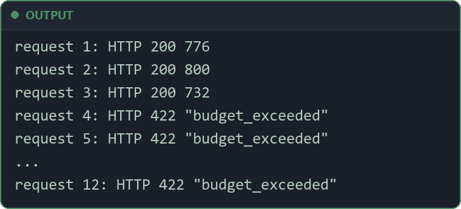

- The first three answers pass, with their token count.
- From request 4, the gateway refuses with HTTP `422` and the error type `budget_exceeded`. The refusal comes before the request reaches vLLM, so the GPUs do no work for it.

> **⚠️ Check the type, never the status:** in LiteLLM v1.106.5 (this build), a used-up budget gives HTTP `422` and a rate limit gives HTTP `429`. Older LiteLLM versions answered `429` for both. So the status code can change with the version, and it can mean two things. Only the error `type` is sure: `budget_exceeded` means the budget. The app in `08-k8s-assistant` and the runbook `runbooks/budget-exceeded.md` check the `type`.

The spend ends a little over $0.01, because the gateway checks the budget before each request, not during it. For example, the spend report shows `intern-sandbox` at 0.010336 of its 0.01 budget (103.4%). The report itself is in `09-operate`, section F.

> **Tip:** to use `intern-sandbox` again, raise its `budget_usd` in `gateway/teams.yaml`, commit and push, then run `sync_teams.py` again (dry run first). It shows `updated budget/limits` for that team.

### A trace appears in the experiment astra-gateway

Open the MLflow UI as in section E:

```bash
bash scripts/mlflow-ui.sh
```

Then `default` → **Experiments** → `astra-gateway` → **Traces**. The experiment exists: MLflow made it with the first trace. Three traces are worth opening:

1. **The chat call.** Its inputs hold the prompt "Say hello in five words." and `'user': 'check-gateway'`. Its attributes show `mlflow.chat.tokenUsage`, `response_cost`, and an `api_base` that points to `http://vllm.serving.svc:8000/v1/chat/completions`. Its tags show `team: hr-assistant`.
2. 🔒 **The personal data check.** This is the sure check for Presidio. Its input reads:

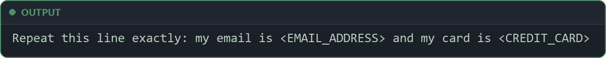

If you see `maria.lopez@example.com` in that trace instead, personal data is stored in the traces: stop and find out why before any team uses the gateway.
3. **A budget refusal of `intern-sandbox`.** It has the status `ERROR` and no team tag. So a filter on `tags.team` does not show budget refusals: look for `ERROR` traces at the time of the test.

If no trace appears after a few minutes:

- Check the image and the two `MLFLOW_` variables (section G, "Watch the deployment").
- Check that the role `astra-litellm` has `sagemaker:CallMlflowAppApi` on the App, and write access to the bucket `astra-mlflow-<account>` (`03-foundations`, section H). The client writes each trace body (`traces.json`) straight to that bucket. Without the bucket access, the gateway log shows `WARNING mlflow.tracing.export.mlflow_v3: Failed to send trace to MLflow backend: Failed to upload ...` with `AccessDenied`.
- LiteLLM's MLflow logger writes its errors only at debug level. To see them, set `LITELLM_LOG: DEBUG` in `envVars` for a short time (commit, push), and read `kubectl -n gateway logs deployment/litellm`. Take it out again afterwards: a debug log is long.

### Spend per team in Grafana

Open the dashboard "Astra: serving and team spend" in Grafana (`06-serving`). After a few minutes, the panels "Spend by team" and "Tokens by team" show `hr-assistant` and `intern-sandbox`. These are the metrics for the same requests.

### Open the gateway admin UI

LiteLLM has its own admin UI (web pages for teams, keys and spend). Like the admin API, it is not on the Ingress. Open it through the port-forward from section H: [http://localhost:4000/ui](http://localhost:4000/ui).

- User name: `admin`.
- Password: the gateway master key (the admin key). It is the key `LITELLM_MASTER_KEY` of the Kubernetes Secret `litellm-env` (section C), synced from `astra/litellm/master-key`. Read it into your clipboard or your terminal only, never into a file or a chat:

```bash
kubectl -n gateway get secret litellm-env -o jsonpath='{.data.LITELLM_MASTER_KEY}' | base64 -d; echo
```

What to look for:

- **Teams**: the five teams of `gateway/teams.yaml`, each with its budget and its rpm and tpm limits.
- **Virtual keys**: one key per team, named `<team>-key`.
- **Spend**: the spend per team. `intern-sandbox` is over its $0.01 budget.

- ⚠️ The master key can create and delete teams and keys. Give it only to the people who run the platform.
- Use the UI to look. Change teams in `teams.yaml` and run `sync_teams.py`, so Git stays the record of who has access.
- [http://localhost:4000](http://localhost:4000) shows the Swagger API docs of the gateway.

When all the checks pass, the gateway is ready for apps.

---

## J. hello-assistant: the smallest app that uses Astra

The checks above call the gateway with `curl`. Teams call it from apps. `apps/hello-assistant` is the smallest real app that uses Astra: a chat program for your laptop. It uses the normal OpenAI SDK with three changes: a base URL, the team API key of `hello-assistant`, and the model name `astra`.

**File:** `apps/hello-assistant/assistant.py` (part)

```python
from openai import OpenAI

MODEL = "astra"  # the only model name teams may call; the gateway knows which model is behind it
SYSTEM = "You are a helpful assistant for the engineers of our company. Answer briefly and plainly."
USER_ID = os.environ.get("ASSISTANT_USER", "hello-assistant-cli")  # an internal id, never a name or an email


def ask(client, history):
    """Send the whole conversation, print the answer as it arrives, and return it."""
    stream = client.chat.completions.create(model=MODEL, messages=history, user=USER_ID, stream=True)
    parts = []
    for chunk in stream:
        if chunk.choices and chunk.choices[0].delta.content:
            text = chunk.choices[0].delta.content
            parts.append(text)
            print(text, end="", flush=True)
    print()
    return "".join(parts)
```

- `MODEL = "astra"` is the name the gateway knows. The app never sees which model or server is behind it.
- `SYSTEM` is the **system prompt**: the rules for the model, sent as the first message (role `system`) of every conversation.
- `USER_ID` is sent as `user` with each request, so it shows in the MLflow trace. 🔒 It is an internal id, never a name or an email.
- `stream=True` → the answer comes in small parts (chunks) while the model writes it. The loop prints each part at once, so the user does not wait for the full answer.
- `ask` sends the whole `history`: the model keeps no memory between requests, so the app sends the conversation each time.

**File:** `apps/hello-assistant/assistant.py` (part)

```python
    client = OpenAI()  # reads OPENAI_BASE_URL and OPENAI_API_KEY
    history = [{"role": "system", "content": SYSTEM}]

    if len(sys.argv) > 1:  # one question from the command line
        history.append({"role": "user", "content": " ".join(sys.argv[1:])})
        ask(client, history)
        return

    print(f"Chat with {MODEL}. An empty line ends it.")
    try:
        while True:
            question = input("you> ").strip()
            if not question:
                break
            history.append({"role": "user", "content": question})
            print("astra> ", end="", flush=True)
            history.append({"role": "assistant", "content": ask(client, history)})
    except (KeyboardInterrupt, EOFError):
        print()
```

- `OpenAI()` reads the gateway address and the key from the environment variables `OPENAI_BASE_URL` and `OPENAI_API_KEY`. No key is in the code.
- With a question on the command line, the app asks once and stops.
- Without one, it is a chat. Each question and each answer is added to `history`. An empty line ends the chat.
- The full file is at `apps/hello-assistant/assistant.py`.

### Run it

You need the gateway from this stage and the team `hello-assistant` synced (section H). Run from the main folder of the repository.

In a second terminal, keep a port-forward to the gateway open (the one from section H is fine):

```bash
kubectl -n gateway port-forward svc/litellm 4000:4000
```

Read the team key from Secrets Manager, and set the gateway address:

```bash
export OPENAI_API_KEY=$(aws secretsmanager get-secret-value --secret-id astra/teams/hello-assistant \
  --query SecretString --output text | jq -r .api_key)
export OPENAI_BASE_URL=http://localhost:4000/v1
```

Install the OpenAI SDK (`openai==3.40.0`, pinned in `apps/hello-assistant/requirements.txt`) in its own virtual environment, and ask one question:

```bash
python3 -m venv .venv-hello && . .venv-hello/bin/activate
pip install -r apps/hello-assistant/requirements.txt
python apps/hello-assistant/assistant.py "In two sentences: what is a GPU node?"
```

On Windows PowerShell, activate the virtual environment with `.venv-hello\Scripts\Activate.ps1`. Example answer (about 4 seconds):

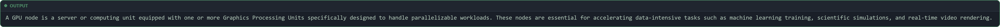

Now start a chat:

```bash
python apps/hello-assistant/assistant.py
```

An example chat. The user typed the two questions after `you>`, then an empty line:

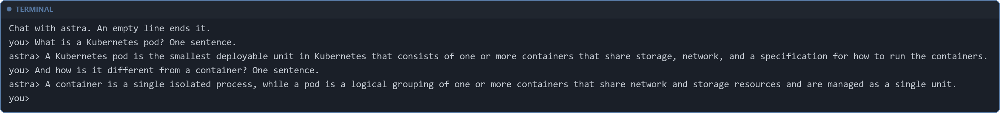

- The second answer uses the first ("it" means the pod): the app sends the whole conversation each time.
- Each request counts against the budget of `hello-assistant` ($5) and shows in MLflow as a trace with the tag `team: hello-assistant` and the user `hello-assistant-cli`.

When the app answers, the stage is done.
