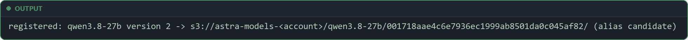
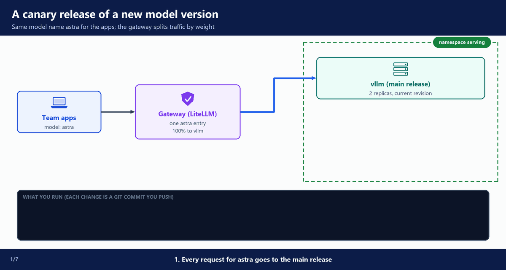
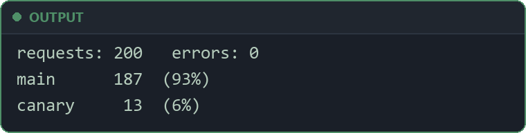
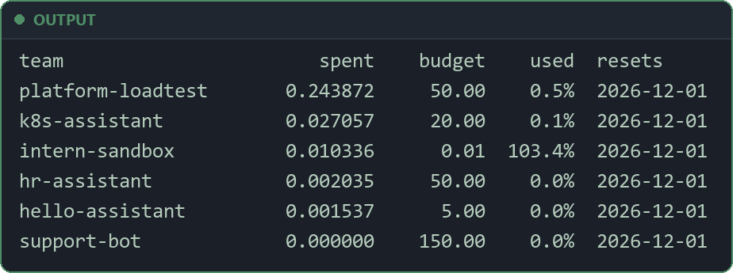
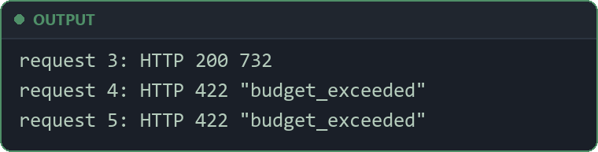

# 9. Operate

**Repo folders:** `scripts/` and `runbooks/`

Astra now serves teams through the gateway. This stage covers the work after the build. You change the model safely, report spend and fix the usual problems. Deleting everything at the end is in `12-teardown`.

---

## A. Why this stage exists

Teams now depend on Astra, so every change carries risk. A new model version can give worse answers. A team can use up its budget. A GPU node can die. The platform team and on-call own this work, and they need tested steps.

---

## B. Architecture

Nothing new runs in the cluster. This stage uses four scripts and five runbooks.

**Scripts** in `scripts/`:

- `canary.sh` → starts a new model version, moves its traffic weight 10 → 25 → 50, then promotes it or rolls it back. Every step is a Git commit you push; Argo CD applies it.
- `load.sh` → sends test requests through the gateway and counts how many answers came from main and how many from the canary.
- `mlflow-ui.sh` → opens the MLflow UI (traces and model registry) with a sign-in link.
- `spend-report.sh` → shows what each team spent against its budget, from the gateway admin API.

**Runbooks** in `runbooks/`: `model-upgrade.md`, `gpu-capacity-shortage.md`, `budget-exceeded.md`, `node-failure.md`, `rotate-team-key.md`.

Who does what:

- You run the scripts from your laptop, in the repository's main folder.
- `canary.sh` only changes files and makes a Git commit. You push it. Argo CD applies what Git says.
- `load.sh`, `mlflow-ui.sh` and `spend-report.sh` call the cluster and AWS directly.

---

## C. All the UIs

Each UI opens in your browser through a `kubectl port-forward` that you leave running in its own terminal (MLflow is the exception: AWS hosts it). Each tunnel uses its own local port, so several can run together. The full steps are in each UI's home doc:

- **Argo CD:** `http://localhost:8080`, after `kubectl -n argocd port-forward svc/argo-cd-argocd-server 8080:80` (`04-platform-addons`, section O, "Open the UIs").
- **Grafana:** `http://localhost:3000`, after `kubectl -n monitoring port-forward svc/kube-prometheus-stack-grafana 3000:80` (`04-platform-addons`, section O, "Open the UIs").
- **Prometheus:** `http://localhost:9090`, after `kubectl -n monitoring port-forward svc/kube-prometheus-stack-prometheus 9090:9090` (`06-serving`).
- **LiteLLM admin UI:** `http://localhost:4000/ui`, after `kubectl -n gateway port-forward svc/litellm 4000:4000` (`07-gateway`).
- **MLflow:** `bash scripts/mlflow-ui.sh` prints and opens a sign-in link; no port-forward (`03-foundations` for the setup, `07-gateway` for reading traces).

---

## D. Upgrade the model with a canary

This build upgrades the model with a canary release: a second vLLM release with the new revision, and a traffic split in the gateway.

### What a canary tests that an eval cannot

The eval gate (`10-production`, section D) checks answer quality before a model serves. A canary checks the model under real requests:

- **Errors:** requests that fail or time out with the new version.
- **Tool calls:** the gateway and the app must parse the model's tool calls. A new version can format them a little differently.
- **Long prompts:** real prompts are longer and more varied than test questions.
- **Speed under load:** time to the first token and tokens per second when many requests arrive at once.
- **GPU memory:** the KV cache can fill up sooner with a new version.

### The whole flow

Every step below changes files in Git. You push the commit, and Argo CD applies it. So every step is recorded and can be reverted with Git.

1. **Choose, load and approve.** Pick a revision that really has other files, load it into S3 with the loader Job, and have every role approve it (`06-serving`, "Approve the version").
2. **Start.** `canary.sh start <revision>` and push: Argo CD starts a second vLLM release, `vllm-canary`, on its own GPU node. It gets no traffic.
3. **Route 10%.** `canary.sh weight 10` and push: the gateway sends weight 90 to the main release and 10 to the canary.
4. **Test traffic.** `load.sh 200` sends requests and counts which release answered.
5. **Compare.** Grafana for errors, latency and GPU memory. MLflow traces (experiment `astra-gateway`) for the answers: each trace shows which release answered.
6. **Raise the share.** `canary.sh weight 25`, then `weight 50`, with a push and a check each time.
7. **Decide.** `canary.sh promote` or `canary.sh rollback`, and push.
   - Promote: the main release rolls to the new revision, one pod at a time. The canary is removed in the same commit. Then you move the alias `champion` to the new version in MLflow.
   - Rollback: the main release stays as it is. The canary is removed. `champion` stays on the old version.

The short version of these steps is in `runbooks/model-upgrade.md`.

### Why there is room for a canary

**File:** `serving/chart/values.yaml` (part)

```yaml
# A canary is a second release (for example "vllm-canary") with a new model.
# It runs one replica, and the gateway sends it a small weight of the traffic.
# It reuses the stable release's service account and API key Secret, so it creates neither.
canary: false

replicas: 2               # used only when autoscaling is off

autoscaling:
  enabled: true
  minReplicas: 2          # one per zone, always
  maxReplicas: 3          # GPU NodePool limit is 4: 3 here + 1 surge pod or 1 canary
```

**File:** `platform/karpenter/templates/nodepools.yaml` (part)

```yaml
  limits:
    # 2 serving replicas + 1 surge pod in a rolling update + 1 canary. This is
    # also the spend ceiling: at most 4 GPU nodes. A pod over the limit waits (Pending).
    nvidia.com/gpu: 4
```

- `canary: false` is the default for the main release.
- A release with `canary: true` runs exactly one replica. It has no KEDA autoscaler, no PodDisruptionBudget, no alert rules and no dashboard of its own.
- Every pod gets the label `astra/role` (`stable` or `canary`) and the label `astra/model-revision`. You use them to tell the pods apart.
- The GPU NodePool (`04-platform-addons`) allows at most 4 GPUs. The main release can grow to 3 replicas. The canary takes the fourth GPU.

> **⚠️ GPU capacity:** the canary needs one more GPU node while it runs. 💰 It costs one more g6e instance per hour. If us-east-1 has no free g6e instances, the canary pod stays `Pending`. See section G.

### Step 1: choose a revision and load it into S3

A new revision is not always a new model. Many commits change only the README or the license.

The history of `Qwen/Qwen3.8-27B-FP8` shows this:

- The weights were uploaded on 2026-08-13, in one commit ("Upload folder using huggingface_hub").
- Every later commit changed only the README, the LICENSE or small config files (`generation_config.json`, `chat_template.jinja`, `tokenizer_config.json`).
- `017b9c7af6b5689d5dd426a76e0bc077eb5ca20a` is the newest commit (2026-08-14, "Update README.md"). `main` serves it.
- `001718aae4c6e7936ec1999ab8501da0c045af82` is the commit before it (also "Update README.md").
- In S3, the `SHA256SUMS` files of the two revisions are byte for byte the same (79 lines each). So the weights are the same.

So there is no newer model to test today. ⚠️ Compare the checksums before you plan a canary: a canary of identical files costs a GPU node and tests nothing. `canary.sh start` checks this for you (step 2).

> **In this course:** practise with `001718aae4c6e7936ec1999ab8501da0c045af82` and `FORCE=1`. It has the same weights as the serving revision. So the canary tests the mechanics (a second release, its weights, the traffic split, the metrics, promote and rollback), not a better model. A real canary is for a revision with new weights.

The canary serves weights from S3, like the main release. So the revision must be in S3 first. Change `revision` in `model/qwen3.8-27b.yaml` to the 40-character commit, commit and push, and run the loader Job again (`05-model-pipeline`, section I, "Load a new revision"). It downloads, scans, uploads and registers. If the scan fails, nothing reaches S3 and nothing is registered. The Job takes 9 to 10 minutes for 81 objects (30.89 GB).

The last log line names the new version in MLflow:



- Version 2 is the new revision. The alias `candidate` moved to it: loaded and scanned, not serving yet.
- Version 1 keeps `champion`: it still serves.

Then every role in `model/approvals.yaml` approves the new revision. For the practice run, approve it as all three roles:

```bash
bash scripts/approve.sh 001718aae4c6e7936ec1999ab8501da0c045af82 security "Jordan Lee"
bash scripts/approve.sh 001718aae4c6e7936ec1999ab8501da0c045af82 legal "Jordan Lee"
bash scripts/approve.sh 001718aae4c6e7936ec1999ab8501da0c045af82 model-owner "Jordan Lee"
git push
```

The third `approve.sh` prints `Approved: 001718aae4c6e7936ec1999ab8501da0c045af82`. Without it, `canary.sh start` refuses the revision.

The canary works the same way for a fine-tuned version that is merged into a full model: its weights are one more model revision in S3 (`05-model-pipeline`).

### Step 2: start the canary

`canary.sh` needs `yq` version 4.

Check the tools:

```bash
git --version
yq --version
kubectl get nodes
aws sts get-caller-identity
```

`yq --version` must show version 4 (from [github.com/mikefarah/yq](https://github.com/mikefarah/yq)). The script was written against v4.54.1. Another tool with the same name exists (a Python wrapper of jq). It does not work here.

On Windows, install yq v4 with winget:

```bash
winget install --id MikeFarah.yq -e
```

Run from the repository's main folder, on an up-to-date `main`:

```bash
git switch main
git pull
bash scripts/canary.sh start <revision>
```

For the practice run, with the same weights as the serving revision:

```bash
FORCE=1 bash scripts/canary.sh start 001718aae4c6e7936ec1999ab8501da0c045af82
```

**File:** `scripts/canary.sh` (the `start` step)

```bash
start() {
  local rev=${1:-}
  [ ${#rev} = 40 ] || { echo "Usage: canary.sh start <40-character revision>"; exit 1; }
  [ ! -f "$CANARY_APP" ] || { echo "A canary already exists: $CANARY_APP"; exit 1; }
  local cur
  cur=$(yq '.model.revision' "$MAIN_VALUES")
  [ "$rev" != "$cur" ] || { echo "The main release already serves $rev."; exit 1; }
  clean_tree

  # Every role in model/approvals.yaml must have approved this revision (scripts/approve.sh).
  bash scripts/check-approval.sh "$rev" || { echo "canary.sh: no canary before every approval is in."; exit 1; }

  # The new revision must be in S3 (the loader writes SHA256SUMS last), and it must hold other files.
  # Two Hugging Face commits can have the same weights (a commit that only changes the README);
  # a canary of identical files costs a GPU node and tests nothing. FORCE=1 skips this check.
  local base new old
  base="s3://astra-models-$(aws sts get-caller-identity --query Account --output text)/$(yq '.model.name' "$MAIN_VALUES")"
  new=$(aws s3 cp --quiet "$base/$rev/SHA256SUMS" - 2>/dev/null) || { echo "$rev is not in S3 yet: run the loader Job first (model/)."; exit 1; }
  old=$(aws s3 cp --quiet "$base/$cur/SHA256SUMS" - 2>/dev/null) || old=""
  if [ "$new" = "$old" ] && [ "${FORCE:-0}" != 1 ]; then
    echo "$rev has the same files as the serving revision $cur (SHA256SUMS match)."
    echo "Nothing to test. To run the canary anyway (for practice): FORCE=1 bash scripts/canary.sh start $rev"
    exit 1
  fi

  # The canary values: the main values with the new revision.
  REV=$rev yq '.model.revision = strenv(REV)' "$MAIN_VALUES" > "$CANARY_VALUES"
  # The canary ApplicationSet: a copy of the main one. canary: true makes the chart run one replica
  # and skip what the main release already owns (service account, API key Secret, autoscaler).
  yq '
    .metadata.name = "serving-canary"
    | .spec.template.metadata.name = "serving-canary"
    | .spec.template.spec.source.helm.releaseName = "vllm-canary"
    | .spec.template.spec.source.helm.releaseName line_comment = "Service \"vllm-canary\" -> vllm-canary.serving.svc:8000"
    | .spec.template.spec.source.helm.valueFiles = ["../values/qwen3.8-27b-canary.yaml"]
    | .spec.template.spec.source.helm.valuesObject.canary = true
    | . head_comment = "Canary of a model upgrade, made by scripts/canary.sh start. Removed by promote or rollback."
  ' "$MAIN_APP" > "$CANARY_APP"

  git add "$CANARY_VALUES" "$CANARY_APP"
  git commit -q -m "canary: vllm-canary with revision $rev (no traffic yet)"
  done_msg "Wait until the vllm-canary pod is Ready (a GPU node starts, then the weights load):
  kubectl -n serving get pods -L astra/role,astra/model-revision -w
Then send it traffic:  bash scripts/canary.sh weight 10"
}
```

What it does:

- It checks the revision: it must be 40 characters (a full Git commit id), no canary may exist yet, and the main release must not already serve it.
- `clean_tree` stops if you have changes that are not committed. So the commit holds only this step.
- `check-approval.sh` stops the script if a role in `model/approvals.yaml` has not approved the revision.
- `base` is the model's folder in the models bucket: `s3://astra-models-<account>/qwen3.8-27b`.
- The first `aws s3 cp` reads the new revision's `SHA256SUMS`. The loader writes that file last, so if it is missing, the revision is not (fully) in S3, and the script stops: "run the loader Job first".
- The second `aws s3 cp` reads the serving revision's `SHA256SUMS`. If the two files are the same, the files are the same, and the script refuses. `FORCE=1` skips only this check.
- The first `yq` command copies `serving/values/qwen3.8-27b.yaml` to `serving/values/qwen3.8-27b-canary.yaml` with the new `model.revision`. The chart builds the S3 path from the bucket, the model name and the revision (`06-serving`), so the revision is the only change.
- The second `yq` command copies `argocd/apps/serving.yaml` to `argocd/apps/serving-canary.yaml`. In the copy:
  - the name becomes `serving-canary`
  - the Helm release becomes `vllm-canary`. The chart names the Service after the release, so the canary answers at `vllm-canary.serving.svc:8000`.
  - the values file becomes the canary file, and `canary: true` is set
  - the cluster selector stays the same (`enable_serving`), so the canary runs wherever serving runs
- `git commit` saves both files. Nothing changes in the cluster yet.

Push the commit:

```bash
git push
```

Argo CD's root app reads everything under `argocd/` (`03-foundations`), so it finds the new ApplicationSet by itself. No `kubectl apply` is needed. Watch the canary start:

```bash
kubectl -n serving get pods -L astra/role,astra/model-revision -w
```

Wait until the `vllm-canary` pod is `Ready`. Karpenter first starts a GPU node for it, then vLLM loads the weights from S3. Expect the pod to be Ready about 10 minutes after the push, on a new GPU node. If no GPU capacity is free, it can take much longer (section G). The `astra/role` column shows `canary` for the new pod and `stable` for the others.

### Wait for Argo CD before you check a rollout

Steps 3 to 7 each end with `git push`, then `kubectl rollout status`. Do not run the two right after each other.

- Argo CD applies a pushed commit only after it reads Git again. Until then, the Deployment still has the old spec.
- `kubectl rollout status` checks the Deployment as it is now. Right after the push, it can find the old, finished rollout, and it returns at once.
- So you would test the old config while you think it is the new one: the 10% change can reach the gateway pods while the load test is already running.

First wait until Argo CD shows your pushed commit as synced. Compare the commit you pushed with the commit Argo CD applied:

```bash
git rev-parse HEAD
kubectl -n argocd get application gateway -o jsonpath='{.status.sync.revisions}'; echo
kubectl -n argocd get application gateway
```

- The `gateway` Application has several sources (the LiteLLM chart and this repo), so its commits are in `.status.sync.revisions`, a list. Your commit must be in it.
- An Application with one source, such as `serving`, has one commit in `.status.sync.revision`:

```bash
kubectl -n argocd get application serving -o jsonpath='{.status.sync.revision}'; echo
```

- The last command shows `Synced` in the `SYNC STATUS` column when the cluster matches that commit. Run the commands again until both are true.
- You can also watch the Application in the Argo CD UI (section C, "All the UIs"): it shows the commit it synced.

Only then check the rollout:

```bash
kubectl -n gateway rollout status deployment litellm
```

### Step 3: send 10% of the traffic to the canary

The canary runs, but no request reaches it yet. The gateway decides where requests go. Here is the gateway's entry for the model `astra` before the change.

**File:** `gateway/litellm/values.yaml` (part)

```yaml
proxy_config:
  model_list:
    # "astra" is the product name apps use. The model behind it can change without any app changing.
    - model_name: astra
      litellm_params:
        model: hosted_vllm/astra
        api_base: http://vllm.serving.svc:8000/v1
        api_key: os.environ/VLLM_API_KEY
        timeout: 300
        # Internal price per token (chargeback): the GPU cost spread over the tokens the teams use.
        # STARTING VALUES, tune them with scripts/spend-report.sh.
        input_cost_per_token: 0.0000005
        output_cost_per_token: 0.000002
        # weight: 90            # uncomment with the canary entry below
      model_info:
        description: Qwen3.8-27B (FP8) on vLLM, self-hosted on EKS
# ...
  router_settings:
    routing_strategy: simple-shuffle # honours "weight" for the canary split
```

- `model_name: astra` is the name apps send. It stays the same, so apps change nothing.
- `api_base` is the main vLLM Service.
- `input_cost_per_token` and `output_cost_per_token` set the internal unit cost (section F).
- `simple-shuffle` is LiteLLM's routing rule: for each request it picks one entry at random, in proportion to the weights.
- The file also has a commented-out canary example. Do not edit it by hand: `canary.sh weight` makes the same change for you.

Run:

```bash
bash scripts/canary.sh weight 10
```

**File:** `scripts/canary.sh` (the `weight` step)

```bash
weight() {
  local w=${1:-}
  [[ "$w" =~ ^[0-9]+$ ]] && [ "$w" -ge 1 ] && [ "$w" -le 99 ] || { echo "Usage: canary.sh weight <1-99>"; exit 1; }
  [ -f "$CANARY_VALUES" ] || { echo "No canary. Run start first."; exit 1; }
  clean_tree
  local routed
  routed=$(ID=$CANARY_ID yq '[.proxy_config.model_list[] | select(.model_info.id == strenv(ID))] | length' "$GATEWAY_VALUES")
  if [ "$routed" = 0 ]; then
    # Add the canary entry: a copy of the main entry with the canary's address.
    # Key, timeout and price stay the same, so apps and budgets see no difference.
    ID=$CANARY_ID BASE=$CANARY_API_BASE yq -i '
      .proxy_config.model_list += [
        .proxy_config.model_list[] | select(.model_name == "astra")
        | .litellm_params.api_base = strenv(BASE)
        | .model_info.id = strenv(ID)
      ]' "$GATEWAY_VALUES"
  fi
  # LiteLLM's simple-shuffle routing picks an entry at random for each request, by weight.
  # env() reads the variable as a YAML value, so the weights are written as numbers.
  ID=$CANARY_ID MAIN_W=$((100 - w)) CANARY_W=$w yq -i '
    (.proxy_config.model_list[] | select(.model_name == "astra" and .model_info.id != strenv(ID)) | .litellm_params.weight) = env(MAIN_W)
    | (.proxy_config.model_list[] | select(.model_info.id == strenv(ID)) | .litellm_params.weight) = env(CANARY_W)
  ' "$GATEWAY_VALUES"
  git add "$GATEWAY_VALUES"
  git commit -q -m "canary: $w% of astra traffic to the canary"
  done_msg "Argo CD rolls the gateway pods with the new weights. Then compare the two releases:
  bash scripts/load.sh 200
Next step: a higher weight (canary.sh weight 25, then 50), or promote, or rollback."
}
```

What it does:

- The weight must be a whole number from 1 to 99, and a canary must exist.
- `routed` counts the entries with the id `astra-canary` (`CANARY_ID`).
- The first time (`routed` is 0), it adds a copy of the main `astra` entry. The copy has `api_base: http://vllm-canary.serving.svc:8000/v1` and `model_info.id: astra-canary`. Key, timeout and unit cost stay the same.
- Every time, it sets the weights: `100 - w` on the main entry, `w` on the canary entry. With `weight 10` that is 90 and 10.
- `env()` (not `strenv()`) writes the weights as numbers, not as text.
- A second call, for example `weight 25`, finds the canary entry and only changes the two weights.

Push the commit. Argo CD then restarts the gateway pods with the new config:

```bash
git push
```

Wait until the `gateway` Application shows your commit as synced (see "Wait for Argo CD before you check a rollout" above). Then:

```bash
kubectl -n gateway rollout status deployment litellm
```

While the gateway pods are replaced, the old pods finish their open requests before they stop (`07-gateway`).

**What happens in the animation**

> The numbers match the step counter at the bottom left of the animation.

1. Team apps → gateway → `vllm` main release: every request goes to the main release.
2. `canary.sh start` → `git push` → Argo CD starts `vllm-canary` on its own GPU node, with no traffic.
3. `canary.sh weight 10` → `git push` → gateway: weight 90 → main release, weight 10 → canary (about 1 request in 10 goes orange to the canary).
4. `load.sh 200` → counts the answers of each release → compare errors and latency in Grafana.
5. `canary.sh weight 25` → `git push` → about 1 request in 4 goes to the canary.
6. `canary.sh weight 50` → `git push` → about half the requests go to the canary.
7. `canary.sh promote` → `git push` → the main release rolls to the new revision → `vllm-canary` is removed → 100% to the main release.

**Watch it run**



### Step 4: send test traffic with load.sh

Real traffic may be low in a lab. `load.sh` sends test requests through the gateway and counts which release answered each one:

```bash
bash scripts/load.sh 200
```

**File:** `scripts/load.sh` (part)

```bash
N=${1:-100}
TEAM=${2:-platform-loadtest}
PORT=${PORT:-4000}
REGION=${AWS_REGION:-us-east-1}
PY=python3; python3 -c "" >/dev/null 2>&1 || PY=python   # on Windows, "python3" can be a Microsoft Store stub that does not run

KEY=$(aws secretsmanager get-secret-value --region "$REGION" --secret-id "astra/teams/$TEAM" \
        --query SecretString --output text | $PY -c 'import json,sys; print(json.load(sys.stdin)["api_key"])')
# ...
  # 000 means no answer at all (the port-forward dropped, or the 120 s limit passed).
  code=$(curl -s --max-time 120 -o /dev/null -D "$HEADERS" -w '%{http_code}' "http://localhost:$PORT/v1/chat/completions" \
           -H "Authorization: Bearer $KEY" -H 'Content-Type: application/json' -d "$body") || code=000
  if [ "$code" != 200 ]; then
    errors=$((errors + 1)); echo "request $i: HTTP $code"; continue
  fi
  # LiteLLM names the backend it used in this response header.
  base=$(tr -d '\r' < "$HEADERS" | awk -F': ' 'tolower($1)=="x-litellm-model-api-base" {print $2}')
  case "$base" in
    *vllm-canary*) canary=$((canary + 1)) ;;
    *vllm.serving*) main=$((main + 1)) ;;
    *) other=$((other + 1)) ;;   # the header was missing
  esac
```

- The first argument is the number of requests (here 200). The second is the team, `platform-loadtest` by default (a team in `gateway/teams.yaml`).
- It reads that team's key from Secrets Manager, so the requests count against that team's budget, like real traffic.
- It opens its own port-forward to the gateway on port 4000. Close any other port-forward on that port first, or run `PORT=4400 bash scripts/load.sh 200`.
- It sends five different questions in turn, each with `"user": "load-test"`. So each release answers the same questions, and the answers are worth comparing in MLflow (step 5).
- For each answer, it reads the response header `x-litellm-model-api-base`. LiteLLM puts the `api_base` of the entry it used there. `vllm-canary` in it means the canary answered.
- Each request may take at most 120 seconds. A request with no answer at all counts as an error with code `000`.
- At the end it prints the number of requests and errors, and the count and percent for `main` and `canary`.

Look for: with weight 10, about 10% from the canary. The gateway picks at random for each request, so the share is close to 10%, not exactly 10%. Errors should be 0.

Example output at weight 10 (200 requests, one at a time, about 12.5 minutes):



> **Tip:** if a port-forward on port 4000 is already open, `load.sh` prints "Unable to listen on port 4000 ... Only one usage of each socket address" and uses the open one. That is harmless.

### Step 5: compare the two releases

Compare the canary with the main release:

- **Errors** in the `load.sh` result and in Grafana.
- **Speed** in Grafana. Prometheus collects the metrics of the vLLM pods of both releases. The `pod` label tells them apart.
- **GPU memory** in Grafana: the KV cache use per pod.
- **Answers** in the MLflow traces: the answers of both releases to the same questions (below).

Open Prometheus in a second terminal:

```bash
kubectl -n monitoring port-forward svc/kube-prometheus-stack-prometheus 9090:9090
```

Leave it running. Open `http://localhost:9090` in a browser and run these queries.

The p95 time to first token per pod. The metric is the one the `06-serving` alert rules use:

```promql
histogram_quantile(0.95, sum by (le, pod) (rate(vllm:time_to_first_token_seconds_bucket{namespace="serving"}[10m])))
```

Example at weight 10: the p95 time to the first token is 0.059 s on the main release and 0.076 s on the canary. Both are well under a tenth of a second.

The KV cache use per pod (0 to 1):

```promql
max by (pod) (vllm:kv_cache_usage_perc{namespace="serving"})
```

The `vllm-canary-…` pod should be close to the `vllm-…` pods. A clear gap is a reason to roll back. The canary gets fewer requests, so compare it at the same load: raise the weight before you trust a speed number.

### Compare the answers in MLflow

The gateway sends one trace per request to the MLflow App, with the prompt and the full answer (`07-gateway`, section E).

Open the MLflow UI from the repository's main folder, as in `07-gateway`, section E:

```bash
bash scripts/mlflow-ui.sh
```

- In the workspace `default`, open the experiment `astra-gateway`, then **Traces**. The `load.sh` traces have `"user": "load-test"` in their inputs.
- Open a trace, then its span `litellm-acompletion`. Its attribute `api_base` names the server that answered. For example, a main release trace shows `api_base = http://vllm.serving.svc:8000/v1/chat/completions`. `vllm-canary` in it means the canary answered. This is the same value `load.sh` counts from the response header.
- Pick one question from `load.sh`. Open a trace of it from each release, and read the two answers side by side.
- Look for: the canary's answers are as correct and as complete as the main release's. A worse answer, a broken format, or a refusal the main release does not give is a reason to roll back.
- The traces also show the tokens and the time of each request, so you can see if the canary writes much longer answers.

> **⚠️ Not the same settings:** `load.sh` sends no `temperature`, so the model may word the same answer a little differently each time. Compare meaning and format, not exact words.

### Step 6: raise the share to 25, then 50

If the canary looks good, give it more traffic. Each step is a commit and a push, then a new check:

```bash
bash scripts/canary.sh weight 25
git push
```

Wait until the `gateway` Application shows your commit as synced (section D, "Wait for Argo CD before you check a rollout"). Then:

```bash
kubectl -n gateway rollout status deployment litellm
bash scripts/load.sh 200
```

Check again as in step 5. Then:

```bash
bash scripts/canary.sh weight 50
git push
```

Wait for the sync again, then:

```bash
kubectl -n gateway rollout status deployment litellm
bash scripts/load.sh 200
```

At weight 50 the canary serves about half the requests with one replica, while the main release has two or three. Watch its queue and its latency: the canary may slow down because it has fewer replicas, not because the model is worse.

### Step 7: promote or roll back

If the canary is good:

```bash
bash scripts/canary.sh promote
git push
```

If it is not:

```bash
bash scripts/canary.sh rollback
git push
```

**File:** `scripts/canary.sh` (the `unroute`, `promote` and `rollback` steps)

```bash
# Takes the canary out of the gateway and its files out of Git. Argo CD then deletes the
# ApplicationSet, and its Application's finalizer deletes the canary pod: the GPU node is freed.
unroute() {
  ID=$CANARY_ID yq -i '
    del(.proxy_config.model_list[] | select(.model_info.id == strenv(ID)))
    | del(.proxy_config.model_list[] | select(.model_name == "astra") | .litellm_params.weight)' "$GATEWAY_VALUES"
  git rm -q "$CANARY_VALUES" "$CANARY_APP"
  git add "$GATEWAY_VALUES" "$MAIN_VALUES"
}

promote() {
  [ -f "$CANARY_VALUES" ] || { echo "No canary to promote."; exit 1; }
  clean_tree
  local rev
  rev=$(yq '.model.revision' "$CANARY_VALUES")
  # The main release now loads the canary's revision, one replica at a time (maxSurge 1, maxUnavailable 0).
  REV=$rev yq -i '.model.revision = strenv(REV)' "$MAIN_VALUES"
  unroute
  git commit -q -m "canary: promote revision $rev to the main release"
  done_msg "Argo CD rolls the main release to $rev and removes the canary. Watch:
  kubectl -n serving get pods -L astra/role,astra/model-revision -w
Then, in MLflow (bash scripts/mlflow-ui.sh): Models, qwen3.8-27b, the version with the tag
revision = $rev: move the alias champion to it."
}

rollback() {
  [ -f "$CANARY_VALUES" ] || { echo "No canary to roll back."; exit 1; }
  clean_tree
  # The main release keeps its version. It served the rest of the traffic the whole time.
  unroute
  git commit -q -m "canary: roll back, all traffic to the main release"
  done_msg "Argo CD removes the canary. All traffic goes to the main release again."
}
```

What it does:

- `unroute` is shared by both. It deletes the `astra-canary` entry and the `weight` on the main entry, so the gateway is back to one entry. It also removes the canary values file and the canary ApplicationSet file from Git.
- `promote` copies the canary's `model.revision` into the main values file. Promote and the removal of the canary are one commit. Its last message reminds you to move the alias `champion` in MLflow.
- After the push, the main release rolls with `maxSurge: 1` and `maxUnavailable: 0` (in the chart), so serving capacity never drops.
- `rollback` changes only the gateway and removes the canary files. The main release never changed.

Nothing else to clean up. The root app has `prune: true`: a file removed from Git is removed from the cluster. So Argo CD deletes the `serving-canary` ApplicationSet. Its Application has the Argo CD resources finalizer, so the canary pod and Service go too. Karpenter removes the empty GPU node about 10 minutes after its last pod left (`consolidationPolicy: WhenEmpty`, `consolidateAfter: 10m` in the GPU NodePool).

Before you watch, wait until Argo CD shows your commit as synced (section D, "Wait for Argo CD before you check a rollout"). A promote changes both the `serving` and the `gateway` Application, a rollback only the `gateway` one:

```bash
git rev-parse HEAD
kubectl -n argocd get application serving -o jsonpath='{.status.sync.revision}'; echo
kubectl -n argocd get application gateway -o jsonpath='{.status.sync.revisions}'; echo
```

Then watch the result:

```bash
kubectl -n gateway rollout status deployment litellm
kubectl -n serving get pods -L astra/role,astra/model-revision -w
```

**After a promote:** the new pods show the new `astra/model-revision`, one at a time, and the `vllm-canary` pod goes. The main release rolls to the new revision in about 9 minutes, one pod at a time, and the canary is removed in the same commit.

Then record the decision in the registry, as in `06-serving` (section K, "Mark the serving version in MLflow"):

1. `bash scripts/mlflow-ui.sh`, the workspace `default`, then **Models** and `qwen3.8-27b`.
2. Open the version whose tag `revision` is the promoted revision (version 2 here).
3. Under **Aliases**, add `champion`. MLflow moves it from version 1, because an alias names one version at a time.

Look for: `@champion` and `@candidate` both on version 2, and version 1 with no alias.

**After a rollback:** the `vllm-canary` pod goes, and the main pods do not change. In MLflow, `champion` stays on the old version: nothing to change there.

Look for: the `serving-canary` ApplicationSet is gone, the gateway config has no canary entry, and the main Deployment keeps its generation and its revision.

To check the generation yourself, before and after:

```bash
kubectl -n serving get deployment vllm -o jsonpath='{.metadata.generation}'; echo
```

---

## E. Production rollout patterns

This build uses one pattern. There are three common ones. They differ in how many GPUs they need while the change runs, and in how fast you can go back.

### In-place rollout after a canary (this build)

A canary with one replica takes a share of the traffic. After the promote, the main release rolls to the new version in place, one pod at a time.

- ✅ 💰 Fewest GPUs: one extra GPU for the canary, and one surge GPU during the rollout.
- ✅ Simple: one main release, one canary, one gateway change per step.
- ⚠️ The canary has one replica. At a high weight it can be slower because it is small, not because the model is worse.
- ⚠️ Rollback before promote is fast: the gateway stops sending traffic to the canary.
- ⚠️ Rollback after promote is slow: it is another rollout, and each pod loads the old weights again. The promote rollout takes about 9 minutes for the main release.

### Progressive canary

The new version gets its own full release. As the weights move from 10 to 25, 50 and 100, the new side scales up and the old side scales down. At 100 the old side stays for a soak period, then it is deleted.

- ✅ At every weight, each side has the replicas its share needs, so speed numbers are fair.
- ✅ Rollback is fast during the soak period: move the weight back, the old replicas still run.
- ⚠️ 💰 More GPUs during the change, about one side and a part of the other.
- ⚠️ More steps to run and to check, so it is usually automated.

### Blue/green

A full-size green release of the new version runs next to blue. Traffic moves, often in one step, after green passes its checks.

- ✅ The safest: rollback is a switch back to blue, which still runs at full size.
- ✅ Green is tested at full size before it takes traffic.
- ⚠️ 💰 Doubles the GPUs while both sets run. With large models and scarce GPUs, the capacity may not be there.

### A different model gets a new name

The patterns above are for a new revision of the same model. A different model (a new family or a new size) is a bigger change:

- The chat template can differ.
- The tool-call parser in vLLM can differ.
- The context length can differ.
- The style of the answers differs.

So we do not split `astra` between two different models without telling anyone. It serves the new model under a new model name, for example `astra-next`. Teams opt in: they test their app against `astra-next` (for example with promptfoo, `08-k8s-assistant`) and switch when they are ready. Later, `astra` can point at the new model, with a date the teams know.

In this build `gateway/sync_teams.py` allows only the model name `astra` for every team (`MODELS = ["astra"]`). A new name needs a new entry in the gateway's `model_list`, its own vLLM release, and the teams' allowed models.

---

## F. The monthly spend report

Every request through the gateway records its cost for the team that sent it. You can see that spend in two places:

- **Grafana**, dashboard "Astra: serving and team spend" (`04-platform-addons`): the panels "Spend by team", "Tokens by team" and "Budget left by team". LiteLLM sends these metrics to Prometheus on port 4001. Use it to watch spend live and to spot a team that suddenly spends fast.
- **The spend report**, below. It asks the gateway's admin API, which reads the spend from the gateway's database, with each team's budget and reset date. Use it for the monthly number: Prometheus keeps only 7 days of metrics in this build (`retention: 7d`), so it cannot show a whole month.

```bash
bash scripts/spend-report.sh
```

**File:** `scripts/spend-report.sh` (part)

```bash
PORT=${PORT:-4000}
PY=python3; python3 -c "" >/dev/null 2>&1 || PY=python   # on Windows, "python3" can be a Microsoft Store stub that does not run

# The master key is in the gateway's Secret (synced from astra/litellm/master-key).
MASTER=$(kubectl -n gateway get secret litellm-env -o jsonpath='{.data.LITELLM_MASTER_KEY}' | base64 -d)

kubectl -n gateway port-forward svc/litellm "$PORT:4000" >/dev/null &
PF=$!
trap 'kill $PF 2>/dev/null' EXIT
for _ in $(seq 30); do   # up to 30 s for the port-forward to open
  curl -s -o /dev/null "http://localhost:$PORT/health/liveliness" && break
  sleep 1
done

curl -sf "http://localhost:$PORT/team/list" -H "Authorization: Bearer $MASTER" | $PY -c "
import json, sys
teams = json.load(sys.stdin)
teams.sort(key=lambda t: t.get('spend') or 0, reverse=True)   # biggest spender first
print(f\"{'team':<20}{'spent':>12}{'budget':>10}{'used':>8}  resets\")
for t in teams:
    spend, budget = t.get('spend') or 0, t.get('max_budget')
    used = f'{100 * spend / budget:7.1f}%' if budget else '       -'   # a team without a budget has no percent
    print(f\"{t.get('team_alias') or t['team_id']:<20}{spend:>12.6f}{(budget or 0):>10.2f}{used}  {(t.get('budget_reset_at') or '')[:10]}\")
"
```

The full file, with its header comments, is at `scripts/spend-report.sh`.

- `MASTER=…` reads the gateway's master key from the Secret `litellm-env`. External Secrets synced it there from `astra/litellm/master-key`.
- The admin API is not on the Ingress (`07-gateway`). So the script opens a port-forward while it runs, and waits up to 30 seconds for `/health/liveliness`.
- `/team/list` gives back every team with its spend, budget and reset date. The Python part sorts by spend and prints one line per team.

What to look for: one line per team in `gateway/teams.yaml`. The columns are `team`, `spent` (in USD at the internal unit cost), `budget`, `used` (percent of the budget) and `resets` (the date the budget starts again). A team close to 100% will soon be refused (section H).

Example report:



- `platform-loadtest` spent the most: `load.sh` and the parallel tests use its key.
- `intern-sandbox` is over its budget of 0.01 (103.4%), so the gateway refuses its requests until the reset date.
- `k8s-assistant` is the team you add in `08-k8s-assistant`.

> **Tip:** if port 4000 is busy on your laptop, run `PORT=4400 bash scripts/spend-report.sh`.

### Showback and chargeback

- This report is the showback (`00-why-own-inference`).
- Chargeback uses the same numbers, at a rate finance agrees first.

### The internal unit cost per million tokens

The GPUs cost the same every hour, busy or not. The gateway counts tokens. An internal unit cost turns the fixed hourly cost into a cost per token (people usually say it per million tokens), so it can be shared out by use.

**Price per token** = platform cost per month ÷ tokens all teams use per month

- 💰 GPU part of the cost: 2 replicas x g6e.xlarge at $1.861 an hour (us-east-1, on-demand, October 2026, from `platform/karpenter/templates/nodepools.yaml`) x 730 hours in an average month = $2,717.06.
- Example only: if all teams used 1,000 million tokens in a month, the GPU part is $2,717.06 / 1,000 = about $2.72 per million tokens.
- The repo starts with $0.50 per million input tokens and $2.00 per million output tokens (`input_cost_per_token: 0.0000005`, `output_cost_per_token: 0.000002`). The file marks them as starting values.
- Output costs more because the GPU makes output tokens one at a time, while it reads the input in one pass.
- Tune the unit cost with real token counts from the spend data, and add the other costs (cluster, NAT gateway, database). Change it in `gateway/litellm/values.yaml`, commit and push.

---

## G. Runbook: no GPU capacity

The runbook is `runbooks/gpu-capacity-shortage.md`.

**Signs:** a vLLM pod stays `Pending`. Karpenter cannot start a GPU node.

Find the reason:

```bash
kubectl -n serving get pods
kubectl get nodeclaims
kubectl describe nodeclaim <name>          # look for InsufficientInstanceCapacity
kubectl -n kube-system logs deploy/karpenter | grep -i -m 20 insufficient
```

- The NodeClaim's events say why AWS refused it, usually `InsufficientInstanceCapacity` for g6e in that zone.

**File:** `platform/karpenter/templates/nodepools.yaml` (part)

```yaml
        # Three g6e sizes, each with ONE NVIDIA L40S 48 GB. Karpenter starts the cheapest one
        # in stock, so a zone out of g6e.xlarge gets a g6e.2xlarge instead of no node.
        #   g6e.xlarge $1.861/h   g6e.2xlarge $2.242/h   g6e.4xlarge $3.004/h   (us-east-1, October 2026)
        - key: node.kubernetes.io/instance-type
          operator: In
          values: ["g6e.xlarge", "g6e.2xlarge", "g6e.4xlarge"]
```

What to do:

1. Find the reason with the commands above.
2. The NodePool already allows all three g6e sizes, in every zone of the VPC. Karpenter takes a bigger size when the small one is out. So if AWS has none of them, choose one of these:
   - **Wait.** Karpenter keeps trying by itself, with a short pause between tries. Capacity often comes back within hours.
   - **Reserve capacity.** Create an On-Demand Capacity Reservation for g6e.
     - 💰 You pay for it from the start, used or not.
     - Karpenter uses it after two changes in Git (`platform/karpenter`, `04-platform-addons`). Add it to `capacityReservationSelectorTerms` in the `gpu` EC2NodeClass. Add `reserved` to `karpenter.sh/capacity-type` in the `gpu` NodePool.
     - EC2 Capacity Blocks do not list g6e (only P and Trn types).
   - **Raise the quota** "Running On-Demand G and VT instances" if the error says `VcpuLimitExceeded`. A g6e.4xlarge needs 16 vCPUs.
   - **Allow another GPU family** in the `gpu` NodePool, in Git. First check that the model fits in one GPU: the FP8 weights are close to 30 GB, plus the KV cache for 32768 tokens (`06-serving`). A 24 GB GPU (g5, g6) is too small. ⚠️ A bigger GPU costs more per hour, so move back when g6e capacity returns.
3. While you wait, the gateway still serves from the replicas that run. Tell the teams that answers may be slower.

Any NodePool change is a commit you push, and Argo CD applies it.

---

## H. Runbook: a team's budget is used up

The runbook is `runbooks/budget-exceeded.md`.

**Signs:** the team's app gets an error from the gateway, and the error body has `"type": "budget_exceeded"`. The team asks why Astra stopped working.

- Look at the `type` field, not the status code: this LiteLLM version answers HTTP 422 for a used-up budget, and 429 for a rate limit (`07-gateway`).

The budget test in `07-gateway` showed it (part):



1. See every team's spend:

```bash
bash scripts/spend-report.sh
```

2. Find what used the budget. Open MLflow with `bash scripts/mlflow-ui.sh`, then the workspace `default`, the experiment `astra-gateway` and its Traces. Search the traces with the team tag, for example `tags.team = 'hr-assistant'`, and look at the cost (the `response_cost` attribute). The `user` field shows which person or job sent the requests. Refused requests show as `ERROR` traces without a team tag, so the search finds only the requests that were served.

3. Decide with the team:
   - **A mistake** (a loop, a test against the real gateway): the team fixes its code. The budget resets on the date in the report.
   - **Real need:** raise `budget_usd` for the team in `gateway/teams.yaml`. The team's manager approves it first, because the money comes from their budget. Then sync the teams, with the gateway port-forwarded, and commit:

```bash
kubectl -n gateway port-forward svc/litellm 4000:4000 &
python gateway/sync_teams.py --gateway http://localhost:4000
git add gateway/teams.yaml
git commit -m "Raise the budget of <team>"
git push
```

4. ❌ Do not give the team another team's key. Spend must stay with the team that caused it.

**File:** `gateway/teams.yaml` (part)

```yaml
# The teams that use Astra. After a change here, run gateway/sync_teams.py: it creates or updates
# each team in LiteLLM and gives each team one key (stored in astra/teams/<team>).
#   budget_usd: spend allowed per 30 days, at the internal price per token
#   rpm / tpm:  requests and tokens per minute for the whole team
# Removing a team here does not delete it in LiteLLM; delete it by hand after its apps stop.
teams:
  - name: hello-assistant        # apps/hello-assistant, the smallest app that calls Astra
    budget_usd: 5
    rpm: 30
    tpm: 100000
  - name: hr-assistant
    budget_usd: 50
    rpm: 60
    tpm: 200000
```

**Why budgets:** the GPUs cost the same every hour. A budget stops one team from using the capacity that the other teams pay for.

---

## I. Runbook: a node fails

The runbook is `runbooks/node-failure.md`.

**Signs:** a node shows `NotReady`. Pods on it are stuck in `Terminating` or `Unknown`. The alert `AstraCapacityDegraded` fires when fewer than 2 vLLM replicas are available.

1. Find the node and what ran on it:

```bash
kubectl get nodes
kubectl describe node <name>                       # Conditions and Events
kubectl get pods -A -o wide --field-selector spec.nodeName=<name>
```

2. For a GPU node, check the GPU. The NVIDIA DCGM panels in Grafana show XID errors (error codes the GPU driver reports) or a GPU that went away.
3. Replace the node. For a Karpenter node, delete its NodeClaim, and Karpenter starts a new one:

```bash
kubectl get nodeclaims -o wide                     # find the claim for this node
kubectl delete nodeclaim <claim>
```

4. Watch the vLLM pod start on the new node. Once the node is ready, vLLM loads the 31 GB of weights from S3 in about 5 minutes. The other replica serves meanwhile (the PodDisruptionBudget keeps one up).

```bash
kubectl -n serving get pods -w
```

5. If the same instance type fails again and again, write it down and tell AWS support.

**Why delete the NodeClaim and not the pod:** a broken node stays broken. Karpenter gives you a fresh one.

---

## J. Runbook: rotate a team API key

The runbook is `runbooks/rotate-team-key.md`.

**When:** a key leaked (in a log, a chat, a Git commit), a person left the team, or on the regular schedule.

`gateway/sync_teams.py` owns the keys. Each team has one API key with the alias `<team>-key`, saved in `astra/teams/<team>` in Secrets Manager. The script makes a new key only when the saved key no longer works (`07-gateway`). So you rotate by deleting the old key first. Apps read the key with an ExternalSecret, so a rotation needs no change in the app's code.

1. Delete the old key at the gateway. The admin API is not on the Ingress, so use a port-forward:

```bash
kubectl -n gateway port-forward svc/litellm 4000:4000 &
MASTER=$(kubectl -n gateway get secret litellm-env -o jsonpath='{.data.LITELLM_MASTER_KEY}' | base64 -d)
curl -sf localhost:4000/key/delete -H "Authorization: Bearer $MASTER" \
  -H 'Content-Type: application/json' -d '{"key_aliases": ["<team>-key"]}'
```

From now on the team's app gets HTTP 401 until step 3 is done. Pick a quiet time, unless the key leaked.

2. Run the sync. The port-forward from step 1 is still open. It sees the dead key, makes a new one and saves it in `astra/teams/<team>`:

```bash
python gateway/sync_teams.py --gateway http://localhost:4000
```

3. Make the app pick up the new key now, not at the next refresh: force the ExternalSecret sync, then restart the pods, which read the key from their environment:

```bash
kubectl -n <app namespace> annotate externalsecret <name> force-sync=$(date +%s) --overwrite
kubectl -n <app namespace> rollout restart deployment <app>
```

For `k8s-assistant`: namespace `k8s-assistant`, ExternalSecret `k8s-assistant-gateway-key`, deployment `k8s-assistant`.

4. Check that the app works (for `k8s-assistant`: the validation in `08-k8s-assistant`).
5. If the key leaked: look in MLflow (`bash scripts/mlflow-ui.sh`, workspace `default`, experiment `astra-gateway`) for traces with the team tag (for example `tags.team = '<name>'`) from before step 1 that you cannot explain. Look at the `user` values and the User-Agent tags for ones you do not know.

**Why delete first:** 🛡️ a leaked key must stop working at once. A short outage for one team is better than a stranger using its budget.

---

## K. Validate

**Canary.** After a promote or a rollback, and after Argo CD shows the pushed commit as synced (section D, "Wait for Argo CD before you check a rollout"):

```bash
kubectl -n argocd get applicationset serving-canary
kubectl -n serving get pods -L astra/role,astra/model-revision
bash scripts/load.sh 20
```

- The first command says the ApplicationSet is not found.
- Every pod shows `astra/role` `stable`. After a promote, `astra/model-revision` shows the new revision on every pod. After a rollback, it shows the old one.
- `load.sh` counts 0 answers from the canary.
- `serving/values/qwen3.8-27b.yaml` on `main` has the revision the pods show.
- In MLflow, the version with the alias `champion` has that same revision in its tag `revision`.
