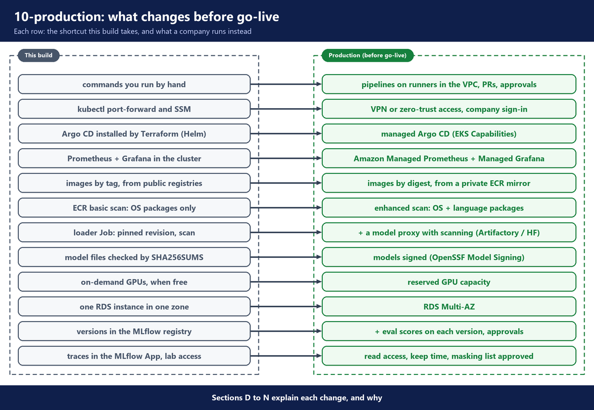

# 10. Production

This build takes shortcuts so it is cheap, quick to build, and easy to follow by hand. We change them before go-live. This document builds nothing. It lists each change, with the reason, and closes with a conclusion for the whole guide.

---

## A. Why this stage exists

The build proves that the design works, but some of its shortcuts are not safe or strong enough for production. Before go-live, architects and security review each one and replace it.

---

## B. Architecture

The picture shows what changes, from this build to production.



---

## C. Before you start

- `03-foundations` to `09-operate` are read (or done), so you know each part that changes.
- Nothing here is run in this guide. Each block links its sources, so you can read more.

---

## D. CI/CD: automate the steps this guide does by hand

- **Lab:** you run every step yourself. GitHub only holds the repository that Argo CD reads.
- **Production:** each manual step becomes a pipeline. A change starts as a pull request, and the right people approve it.
- **Why:** 🛡️ 🔒 every change is reviewed, logged and repeatable, and no person needs admin access to the cluster or AWS for daily work.

### Runners inside the VPC

- The jobs that touch the platform run on self-hosted runners inside our VPC, for example on the EKS cluster or on EC2.
- ✅ They reach private services (the gateway admin API, the cluster API) with no tunnel.
- ✅ They get AWS access from an IAM role (EKS Pod Identity, or OIDC from the CI system), so no AWS keys are stored in the CI system.
- ⚠️ The runners are one more system to run, patch and scale. A model download needs a large disk.

### The model pipeline

Today you change `model/qwen3.8-27b.yaml`, run `kubectl apply -k model/`, and move the alias `champion` by hand. In production, a pull request that changes the model spec starts a pipeline:

1. **Pin a revision in a reviewed change.** The pull request changes `revision` (and `license`, if it changed) in the model spec. A reviewer checks where the new commit comes from. The merge starts the pipeline.
2. **Download, scan, upload.** The same loader scripts, on a runner inside the VPC, with the download through the model proxy (section I). A finding at the scan stops the pipeline: nothing reaches S3, and nothing is registered. The pipeline signs the scanned files (section J).
3. **Register** the version in the model registry, as the loader Job does today (section M).
4. **The GPU eval gate** (below).
5. **Human approval** (below).
6. **The deploy pull request** (below).

### The GPU eval gate

In the pipeline, the eval gate runs before a person even looks at the new version. It runs on a GPU, because only a real inference server shows how the version really behaves.

How it runs:

- A Kubernetes Job starts one GPU node and runs vLLM with the candidate weights from S3, with the same image and the same settings as production (`06-serving`). The same settings matter: a wrong setting breaks answers even when the weights are fine.
- lm-evaluation-harness (its command is `lm-eval`) sends test questions to that vLLM through its OpenAI-compatible chat API, and scores the answers.
- A starting set: **GSM8K** (a public set of school maths word problems), 250 questions, **5-shot** (5 solved examples are placed before each question). The score is the share of questions with the right final number.
- A gate script compares the score with a **pass mark**. 0.80 is a starting value. After the first run, set it a few points under the score of the version that serves today.
- Expect about 15 minutes for the questions on one `g6e` GPU, and about 25 minutes with a new node and the model load (estimates).

What this gate really catches:

- ✅ broken or incomplete weights: the server does not start, or the answers are nonsense;
- ✅ a wrong chat template or a wrong vLLM setting: the answers come back in the wrong form, and the score drops;
- ✅ a revision that is clearly worse than the one that serves.

Why one public test set is a weak gate:

- ⚠️ It tests one skill (maths), not our own tasks.
- ⚠️ Public questions may be in the model's training data, so a high score can mean the model has seen them.
- ⚠️ 250 questions is a small sample. At a score near 0.85, one standard error is about ±2 points, so a small drop can be chance. That is why the pass mark sits a few points under today's score.

What to add:

- their own test questions from real use cases, with answers that the business teams approved, scored by exact match or by a second model with a checked marking guide;
- safety tests: refusals of harmful requests, prompt injection, no personal data in answers (the app tests in `08-k8s-assistant` use promptfoo for this kind of test);
- tool-calling tests, if apps use tools;
- speed and capacity tests: the time to first token and the tokens per second at the expected number of users at once, so the new version still fits the GPUs we pay for.

A failed gate stops the pipeline. The version stays in the registry with its score, so anyone can see why it was stopped.

### Human approval and the deploy pull request

The build already records approvals: `model/approvals.yaml` lists the roles, `scripts/approve.sh` commits each approval, and `canary.sh start` refuses a revision that is not approved (`06-serving`). In production, Git itself enforces it: the same roles are required reviewers (for example in a `CODEOWNERS` file) on a protected branch, so the change cannot merge without them. The pipeline waits for the people who approve a new model version ("Who approves what", below; `05-model-pipeline`, section D). The tool records who approved, when, and which version. In GitHub this is an environment with required reviewers. In SageMaker Model Registry it is the approval status.

After the approval the pipeline does not deploy anything itself. It opens a pull request that changes `model.revision` in `serving/values/qwen3.8-27b.yaml` to the approved revision. A person reviews and merges it. The merge is the deployment: Argo CD rolls the vLLM replicas to the new revision (`06-serving`), or a canary starts first (`09-operate`).

✅ So the servers never run a version that skipped the checks, and every change of the model is one commit in Git.

### Team onboarding

- Today you edit `gateway/teams.yaml`, push, and run `python gateway/sync_teams.py` over a port-forward.
- In production, a team asks for access with a pull request to `teams.yaml`. The platform team reviews it, and finance agrees the budget. After the merge, a pipeline on a runner inside the VPC runs `sync_teams.py`.
- ✅ The budget and limits of every team are in Git, with who approved them.

### App CI

- Today you run the app's tests, `docker build` and `docker push`, set the tag in `argocd/apps/k8s-assistant.yaml` (under `kustomize.images`), and push.
- In production, every pull request to the app runs lint, unit tests and the promptfoo tests against the gateway. After the merge, the pipeline builds the image, pushes it to ECR (scan on push), and opens a pull request that changes that tag.

### GitOps changes

- Every change under `argocd/`, `platform/`, `serving/` and `gateway/` goes through a pull request with review. Protect the main branch, so nobody pushes to it directly.
- `scripts/canary.sh` already makes one commit per step. In production, each of those commits is a pull request that someone reviews.
- During a canary, watch real traffic for at least one busy hour at each weight, not only test traffic. Check the answers with a fixed set of questions with known good answers, scored the same way as the GPU eval gate (above), not only by a person reading them.
- The GitOps repository is private. Argo CD reads it with a read-only deploy key or a GitHub App credential, stored as an Argo CD repository secret.
- Renovate (or a similar bot) keeps the pinned chart versions from going stale.
- Terraform changes run as a pipeline too: the plan is shown on the pull request, and the apply runs after approval.

### Who approves what

- 🔒 **A new model or a new model version:** security and legal (data, license), the platform team (scores, GPU sizing).
- 💰 **A new team or a new budget:** the platform team and finance.
- 🛡️ **Platform changes** (add-ons, policies, Terraform): the platform team, with a second reviewer. Security reviews changes to access and policies.
- **App changes:** the app team. The platform team only sees them when they need a new budget or new access.

---

## E. Access: VPN or zero-trust instead of port-forward and SSM

- **Lab:** you reach internal services with `kubectl port-forward`. Examples: `gateway/sync_teams.py` and `scripts/spend-report.sh` reach the gateway admin API through a port-forward. Nodes allow a shell through SSM Session Manager.
- **Production:** a VPN or zero-trust access, with company sign-in. One example is AWS Verified Access.
- **Why:** 🛡️ every person is checked and logged, and no laptop needs cluster credentials.
- ✅ Verified Access evaluates each request against identity and device trust data, logs every attempt, and needs no VPN client.
- ⚠️ 💰 It is charged per application per hour, and per amount of data.

Source: [What is AWS Verified Access?](https://docs.aws.amazon.com/verified-access/latest/ug/what-is-verified-access.html)

---

## F. Managed Argo CD through EKS Capabilities

- **Lab:** Terraform installs Argo CD with Helm in the cluster. It also makes the cluster Secret that the GitOps Bridge uses (`03-foundations`).
- **Production:** the Argo CD capability of EKS, run by AWS.
- **Why:** 🎛️ AWS runs, upgrades and secures Argo CD, so the platform team does not.
- ✅ Argo CD runs on the AWS side, not on your worker nodes.
- ✅ Sign-in can use AWS IAM Identity Center groups, mapped to Argo CD roles.
- ⚠️ The Terraform in `terraform/foundations/argocd.tf` changes. The Helm installs of Argo CD and the root app go. Instead, you create the capability, an IAM role for it, repository access and the cluster registration. The files under `argocd/` stay as they are.

Source: [Continuous Deployment with Argo CD (EKS user guide)](https://docs.aws.amazon.com/eks/latest/userguide/argocd.html)

---

## G. Amazon Managed Service for Prometheus and Amazon Managed Grafana

- **Lab:** kube-prometheus-stack runs Prometheus and Grafana inside the cluster (`04-platform-addons`), with their data on EBS disks.
- **Production:** Amazon Managed Service for Prometheus stores the metrics, and Amazon Managed Grafana shows the dashboards.
- **Why:** metrics survive the cluster, and nobody has to size or back up Prometheus.
- ✅ It keeps metrics 150 days by default, up to 3 years.
- ✅ It uses the same PromQL queries, so the alert rules and dashboards keep working.
- ✅ Managed Grafana sign-in can use SAML 2.0 or IAM Identity Center.
- ⚠️ 💰 Prometheus is charged for the metrics it takes in and stores. Grafana is charged per active user.

Sources: [What is Amazon Managed Service for Prometheus?](https://docs.aws.amazon.com/prometheus/latest/userguide/what-is-Amazon-Managed-Service-Prometheus.html), [What is Amazon Managed Grafana?](https://docs.aws.amazon.com/grafana/latest/userguide/what-is-Amazon-Managed-Service-Grafana.html)

---

## H. 🛡️ Supply chain: image digests, scanning and a private ECR mirror

- **Lab:** images are pinned by tag (for example `vllm/vllm-openai` with tag `v0.32.0`) and pulled from public registries. The Kyverno policy `require-pinned-image-tags` only reports an image with no tag or with `:latest`. Our two images go to ECR with scan on push (`03-foundations`).
- **Production:** images pinned by digest, pulled through an ECR pull-through cache.
- **Why:** 🛡️ a digest cannot be moved to other code, and a public registry outage cannot stop a deploy.
- ✅ ECR supports pull-through cache for Docker Hub, GitHub Container Registry, Quay, the Kubernetes registry, ECR Public and others.
- ⚠️ Docker Hub and GitHub Container Registry need credentials, stored in a Secrets Manager secret whose name starts with `ecr-pullthroughcache/`.
- ⚠️ The first pull of each image needs a route to the internet.
- 🛡️ Scan every image, not only our own images: turn on scanning for the mirrored images too. Switch the Kyverno policy from audit to enforce once every image is pinned.
- 🛡️ A scan with CRITICAL or HIGH findings blocks the deploy, unless security accepts the findings with a written note.
- 🛡️ A pipeline builds, scans and pushes our own images (the gateway, the app, the loader), and their Python packages come through a private package mirror with scanning.
- Kyverno runs 3 admission controller replicas (the build runs 1), so the checks keep working when one pod restarts.

### Enhanced scanning for language packages

- **Lab:** ECR basic scanning checks OS packages only, not Python packages. For example, the Alpine app image without the pip removal gets no ECR findings (`{}`), but Trivy finds 5 HIGH, all Python packages inside `pip/_vendor` (`08-k8s-assistant`).
- **Production:** ECR enhanced scanning (Amazon Inspector), which covers language packages too. Trivy in the image pipeline is another way.
- ✅ The findings show in both ECR and Amazon Inspector.
- ⚠️ 💰 ECR adds no cost for it, but Amazon Inspector charges to scan the images.
- ⚠️ When enhanced scanning is on, repositories that match no scan filter are not scanned at all.

Sources: [Sync an upstream registry with an Amazon ECR private registry](https://docs.aws.amazon.com/AmazonECR/latest/userguide/pull-through-cache.html), [Scan images for OS and programming language package vulnerabilities in Amazon ECR](https://docs.aws.amazon.com/AmazonECR/latest/userguide/image-scanning-enhanced.html)

---

## I. 🛡️ Supply chain: a model proxy with scanning

- **Lab:** the loader Job downloads straight from Hugging Face, with the checks in `05-model-pipeline`.
- **Production:** also a model proxy with scanning, for example JFrog Artifactory, or the scans Hugging Face already runs.
- **Why:** 🔒 one approved place for all models, with the scan result kept with the file.
- ✅ Artifactory can proxy `huggingface.co` with a remote Hugging Face repository.
- ✅ JFrog Xray can scan model licenses and look for malicious models.
- ✅ Hugging Face scans every file under 2 GB with a malware scanner on each commit.
- ✅ The Hub also shows the results of JFrog's model scanner.
- ⚠️ Files of 2 GB or more are not covered by the Hugging Face malware scan. Keep ModelScan in the loader step.
- ⚠️ A proxy is one more system to run, and every model download must use it.
- 🔒 Until then, the Hugging Face token belongs to a service account owned by the platform team, not to a person. With the proxy, the loader needs no Hugging Face token at all.

Sources: [Hugging Face Repositories (JFrog Artifactory docs)](https://docs.jfrog.com/artifactory/docs/hugging-face-repositories), [Malware Scanning (Hugging Face)](https://huggingface.co/docs/hub/security-malware), [Third-party scanner: JFrog (Hugging Face)](https://huggingface.co/docs/hub/security-jfrog)

---

## J. 🛡️ Supply chain: signed models with OpenSSF Model Signing

- **Lab:** the loader Job writes a `SHA256SUMS` file last, next to the weights in S3 (`model/loader/upload.py`). It shows that the weights in S3 are the weights that were scanned.
- **Production:** models signed with OpenSSF Model Signing, and the signature checked before serving.
- **Why:** 🛡️ a hash shows the files did not change. A signature also proves who built the files.
- ✅ The `model_signing` tool (project `sigstore/model-transparency`) signs a whole model folder (`model_signing sign`) and checks it (`model_signing verify`).
- ✅ The signature uses the Sigstore bundle format. It can use Sigstore keyless signing, company PKI or plain keys.
- ⚠️ The serving side needs a new step. It checks the signature after the weights load from S3 and before vLLM starts. This build has no such step yet.

Sources: [sigstore/model-transparency](https://github.com/sigstore/model-transparency), [Model signing v1.0 (Sigstore blog)](https://blog.sigstore.dev/model-transparency-v1.0)

---

## K. Reserved GPU capacity

- **Lab:** on-demand GPUs, taken only when AWS has them free. The GPU NodePool allows `g6e.xlarge`, `g6e.2xlarge` and `g6e.4xlarge`.
- **Production:** reserved GPU capacity: On-Demand Capacity Reservations for g6e.
- **Why:** us-east-1 runs out of L40S GPUs (`06-serving`), and a vLLM replica that cannot start means no Astra.
- Capacity planning: reserve capacity in each zone the replicas use, or allow more zones or instance types in the GPU NodePool.
- ✅ A Capacity Reservation for immediate use has no term commitment, and you can cancel it at any time.
- ✅ Future-dated reservations are possible for the G family (g6e is a G type), with at least 32 vCPUs in total.
- ⚠️ 💰 A reservation is charged while it is active, used or not.
- ⚠️ It gives no discount by itself. For a lower price, you combine it with Savings Plans or Regional Reserved Instances.
- ⚠️ **EC2 Capacity Blocks for ML** do not list g6e. They cover P and Trn types. So for this build, use Capacity Reservations.
- The steps for a GPU shortage are in the runbook `runbooks/gpu-capacity-shortage.md` (`09-operate`).

Sources: [On-Demand Capacity Reservations](https://docs.aws.amazon.com/AWSEC2/latest/UserGuide/ec2-capacity-reservations.html), [Capacity Blocks for ML](https://docs.aws.amazon.com/AWSEC2/latest/UserGuide/ec2-capacity-blocks.html)

---

## L. RDS Multi-AZ

- **Lab:** one RDS PostgreSQL instance in one zone. It holds the gateway's teams, keys and spend.
- **Production:** RDS Multi-AZ, plus the other settings the Terraform file names.
- **Why:** the gateway keeps its keys and budgets when one zone fails.

**File:** `terraform/foundations/database.tf` (part)

```hcl
  # Lab settings. Production: multi_az = true, deletion_protection = true, backups kept 7-35 days,
  # storage autoscaling (max_allocated_storage) and a final snapshot.
  backup_retention_period = 0 # no automated backups: the lab is deleted after each session
  multi_az                = false
  deletion_protection     = false
  skip_final_snapshot     = true
```

- `multi_az`: `true` in production.
- `deletion_protection`: `true` in production.
- `skip_final_snapshot`: `false` in production, so RDS takes a final snapshot.
- `backup_retention_period`: 7 to 35 days in production (the build turns automated backups off), so the database can be restored to a point in time.
- `max_allocated_storage`: set in production. The build has no storage autoscaling.
- ⚠️ Writes are a little slower with Multi-AZ, and the standby cannot serve reads.
- ⚠️ 💰 The standby is a second instance, so the database costs more.

Source: [Multi-AZ DB instance deployments for Amazon RDS](https://docs.aws.amazon.com/AmazonRDS/latest/UserGuide/Concepts.MultiAZSingleStandby.html)

---

## M. A model registry

- **Lab:** the loader Job registers each version in the MLflow App, and you move the alias `champion` by hand (`05-model-pipeline`).
- **Production:** the model pipeline (section D) registers each version the same way, and adds its eval scores as tags. The approval is a change in the registry, moving the alias, which starts the deploy pull request. Nobody moves an alias by hand outside that flow. SageMaker Model Registry is the other common choice on AWS.
- **Why:** 🔒 auditors and security ask which model version served on a date, what its scores were, and who approved it. A registry keeps that in one place.
- ✅ The pipeline registers each version before its eval. So the version exists, but nothing may deploy it until it is approved.
- ✅ With the managed MLflow App, AWS runs the server and its database, access is IAM, and the traces and the model versions are in one tool.
- ⚠️ The pipeline's role needs its own IAM permission on the App (`sagemaker:CallMlflowAppApi`), like the gateway's and the loader's roles have today.
- ⚠️ Self-hosting MLflow means the team runs the server, its database, its upgrades and its backups. Choose it for a clear reason: 🔒 data residency, an air-gapped network, or a platform team that runs it for many teams.

Source: [Managed MLflow on SageMaker AI (AWS docs)](https://docs.aws.amazon.com/sagemaker/latest/dg/mlflow.html)

---

## N. Traces: who reads them, and how long they are kept

- **Lab:** the gateway sends one trace per request to the MLflow App (`07-gateway`). Its bucket `astra-mlflow-<account>` has `force_destroy = true`, so `terraform destroy` deletes the traces.
- **Production:** the traces stay in our account, but they are still the most sensitive data of the platform. Before go-live, we decide:
  - 🔒 who may read them. Access to the App is IAM. The gateway's role may only call `sagemaker:CallMlflowAppApi` on this one App. Give read access to the few people who need it, the same way as access to the data itself.
  - 🔒 how long they are kept. Security and legal set the time, and older traces are deleted.
  - 🔒 what is masked before a trace is written. In the build, Presidio masks five types (emails, phone numbers, card numbers, US social security numbers and IBANs), and the Bedrock guardrail also anonymizes names, addresses and AWS keys (`guardrail.tf`). Look at real traces to see which masks they show (`07-gateway`). Our data rules set the list.
  - Apps send an internal user id in `user`, never a name or an email. Presidio does not mask that field.
  - The bucket keeps `force_destroy = false`, so a `terraform destroy` cannot delete the traces by mistake.
  - 🔒 how people open them: with `bash scripts/mlflow-ui.sh`, or through a SageMaker domain if people want MLflow in the console (`03-foundations`).
  - 🔒 a private network path. In the build, the gateway reaches the SageMaker API through the NAT gateway. The traffic stays on the AWS network, but it uses the public endpoint. We add an interface VPC endpoint (AWS PrivateLink) for SageMaker MLflow, so traces never leave the VPC, and can then allow calls to the App only from that endpoint ([AWS docs](https://docs.aws.amazon.com/sagemaker/latest/dg/mlflow-private-link-restrict.html)).
- **Why:** text in traces helps to find why one answer was wrong, and to score real answers. That only works if we trust where the text is kept and who sees it.

Source: [Managed MLflow on SageMaker AI (AWS docs)](https://docs.aws.amazon.com/sagemaker/latest/dg/mlflow.html)

---

## O. Fine-tuning: where the training runs, and who approves the data

- **Lab:** this build does not fine-tune. It serves the base model as it was downloaded. A tuned version enters the model pipeline like a downloaded one (section D). Its two forms are in `05-model-pipeline`, section C, and how each serves is in `06-serving`.
- **Production:** fine-tuning comes after the pilot, when real use cases show where the base model is not good enough, for example a fixed answer format, or internal terms it does not know. It is not the first step: most teams start with good prompts and company documents in the prompt.
- **Why:** 🔒 the training examples are our data, and the tuned weights are our asset. With your own inference, both stay in your account, and the tuned version serves on the same platform as everything else.

### Where the training runs

Training needs more GPU memory than serving the same model. So we run it as separate jobs, with one of these:

- SageMaker AI training jobs.
- SageMaker HyperPod.
- GPU jobs on their own EKS cluster.

The job writes the tuned weights to S3. From there, the model pipeline takes them, in place of a Hugging Face download.

### Who approves the data and the tuned version

- 🔒 **The training data:** it needs approval before any training: personal data removed, and the right to use it. Security and legal approve it.
- 🛡️ **The tuned version:** it is a new model version. It goes through the same supply chain checks as a downloaded one: safetensors only, the scan, checksums, the registry (section M), the GPU eval gate that compares it with the base model, and the approval (section D).

---

## P. Validate: the go-live checklist

Before go-live, confirm each item. Each one comes from a block above or from a lab setting in the repository.

**Changes and access**

1. ✅ Every manual step of this guide runs as a pipeline on runners inside the VPC, and every change goes through a reviewed pull request (section D).
2. ✅ The approvals are written down: who approves a model, a team budget and a platform change.
3. ✅ People reach internal services through VPN or zero-trust access with company sign-in. Nobody needs `kubectl port-forward` for daily work.
4. ✅ The Kubernetes API is not open to the internet more than needed. (In the build, the Terraform variable `admin_cidrs` limits it to the IP ranges you set.)
5. ✅ 🔒 The EKS control plane logs (`api`, `audit`, `authenticator`) are kept as long as our rules say. (The build keeps only the audit log, for 7 days.) If the rules say we must hold our own key, `encryption_config` uses a customer managed KMS key.
6. ✅ Argo CD is the managed EKS capability.
7. ✅ Metrics go to Amazon Managed Service for Prometheus. Dashboards and alerts work in Amazon Managed Grafana.

**🛡️ Model supply chain**

8. ✅ Every model version is pinned to one exact revision in its spec.
9. ✅ Only safetensors weights are accepted.
10. ✅ ModelScan runs on every version, and a failed scan stops it before the upload.
11. ✅ The license is checked against the spec, and security and legal approved it.
12. ✅ Checksums (`SHA256SUMS`) are written with the weights, and they are checked.
13. ✅ Models come through the approved model proxy with scanning.
14. ✅ Model artifacts (weights, config and tokenizer files) are signed, and the signature is checked before serving.
15. ✅ A model registry (for example the MLflow App) keeps each version, its eval scores and who approved it. A GPU eval gate and a human approval come before any deploy pull request.

**🛡️ Image supply chain**

16. ✅ Every image is pinned by digest (at the very least by a fixed tag, never `:latest`), and the Kyverno policy enforces it.
17. ✅ Every image is scanned: ECR scan on push for our own images (the gateway image and the app images), and scanning for the mirrored images. Enhanced scanning (Amazon Inspector) or Trivy also checks the language packages (section H).
18. ✅ Images are pulled through the private ECR mirror.

**Capacity, data and cost**

19. ✅ GPU capacity for the serving replicas is reserved in each zone used.
20. ✅ There is one NAT gateway per zone, so one zone failing does not cut the others off. (The build has one for all zones, `03-foundations`.)
21. ✅ RDS has `multi_az = true`, `deletion_protection = true`, automated backups (7 to 35 days), storage autoscaling and a final snapshot.
22. ✅ The gateway's Redis has a password and more than one copy, for example Amazon ElastiCache. (The build runs one Redis pod with no password, `07-gateway`.)
23. ✅ Security and legal approved the traces in the MLflow App: who may read them, how long they are kept, and the list of data types that are masked (section N).
24. ✅ The lab-only settings are gone: `force_destroy = true` on the S3 buckets, models and MLflow (`storage.tf`), `force_delete = true` on the two ECR repositories (`ecr.tf`), and `recovery_window_in_days = 0` on the secrets (`secrets.tf`).
25. ✅ The Bedrock guardrail has our own denied topics. (The build has one, "to show the feature", in `guardrail.tf`.)
26. ✅ Finance agreed the internal unit cost (chargeback rate per million tokens), and each team has an agreed budget (`09-operate`).
27. ✅ The runbooks in `runbooks/` were tested, and the on-call team knows them.
28. ✅ A gateway rollout drops no requests. The build already has this: a 15-second preStop sleep, `GRACEFUL_SHUTDOWN_TIMEOUT: "300"` and `terminationGracePeriodSeconds: 330` (`gateway/litellm/values.yaml`, `07-gateway`). Test it again under your own load.
29. ❌ No `scripts/teardown.sh` in production. It deletes everything.

---

## Q. Conclusion: what you built, and what comes next

The story started with one decision (`00-why-own-inference`): we use AI, and our data stays inside our own AWS account.

The build now does this, end to end:

- 🔒 One open-weight model, `Qwen/Qwen3.8-27B-FP8`, serves on vLLM on two GPU nodes in two zones, in our account (`03-foundations` to `06-serving`). Its weights were pinned, scanned and checked before they reached S3, and each version is recorded in the MLflow model registry (`05-model-pipeline`).
- One gateway sits in front of it: a team API key for each team, budgets, guardrails, and one trace per request in the MLflow App (`07-gateway`).
- Apps call it like the OpenAI API, with the model name `astra` (`08-k8s-assistant`).
- A new model version goes out with a canary. The spend report shows each team's use. The teardown deletes everything, and `check-clean.sh` shows that nothing is left (`12-teardown`, `11-aws-inventory-and-cost`).

Before go-live, the list in this document replaces the lab shortcuts: pipelines with approvals, company sign-in, managed Argo CD and monitoring, a checked supply chain for images and models, reserved GPUs, a Multi-AZ database, and approved rules for the traces (section P).

After go-live, we scale with demand (`00-why-own-inference`, section D). The usual next steps:

- **More use cases:** more teams onboard, each with its own team API key and budget.
- **Fine-tuning:** when real use cases show where the base model is not good enough (section O).
- **More models:** each one under its own model name, which teams opt into (`09-operate`, section E).
- **Reserved capacity:** GPUs held in each zone the replicas use, so serving does not wait for free capacity (section K).
