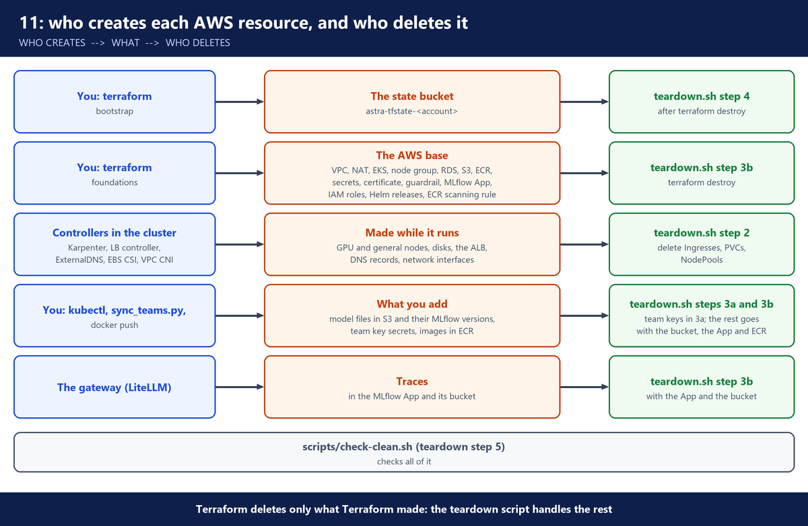
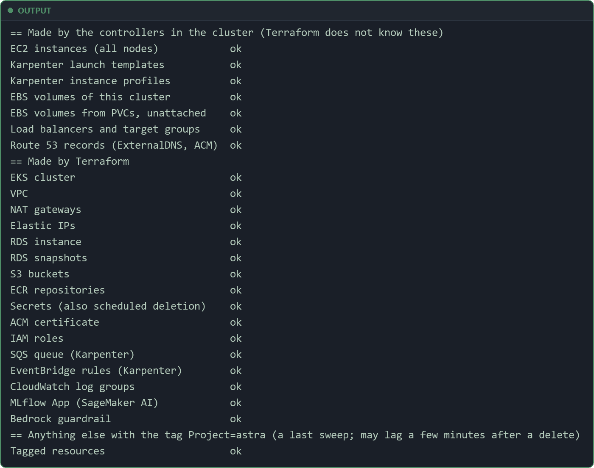

# 11. Everything in AWS and what it costs

This doc lists every AWS resource the build makes, who makes it, and who deletes it. Then it gives the price of each paid item and works out what an hour and a session cost.

---

## A. Why this doc exists

A platform team must answer two questions before go-live: what will this cost to run each month, and what does it create in the AWS account? Finance asks the first. Security and the cloud team ask the second: they review every resource, its tags and its owner.

This build has three makers of AWS resources: Terraform, the controllers inside the cluster, and you with commands. Terraform tracks only what Terraform made. So the inventory must cover all three, or some resources have no owner and no one sees their cost.

> **In this course:** you delete everything after each session (`12-teardown`), so this doc also says what removes each resource. A company keeps the platform running.

> **⚠️ GPU quota:** check it before you build (`03-foundations`, section C).

> **Note:** every price below is a list price times a size from the repo, not a bill. Typical times are in section J. Look at your own bill when you build.

---

## B. Architecture: who creates what, and who deletes it



- `terraform destroy` deletes only what is in Terraform's state.
- Terraform never sees what the controllers make. That is why `scripts/teardown.sh` deletes the Kubernetes objects first, while the controllers still run and can clean up.
- The teardown itself is explained in `12-teardown`.

---

## C. Made by Terraform

Terraform puts three tags on every resource it makes. Cost Explorer uses them (section L).

**File:** `terraform/foundations/versions.tf`

```hcl
  # Every resource carries these tags, so Cost Explorer can show what Astra costs.
  default_tags {
    tags = {
      Project   = var.name
      Stage     = "foundations"
      ManagedBy = "terraform"
    }
  }
```

- `Project = var.name` → `Project=astra` with the default name.
- Resources made by controllers do not get these default tags.

### Bootstrap (`terraform/bootstrap`)

- **S3 state bucket** `astra-tfstate-<account>`: holds the Terraform state for `terraform/foundations`. Versioning on, old versions kept 90 days, HTTPS only.
- Deleted by: `scripts/teardown.sh` step 4. It has `prevent_destroy`, so a plain `terraform destroy` refuses. The script asks you to type the bucket name, empties it, then deletes it.
- Checked by: `check-clean.sh`, line "S3 buckets".

### Network (VPC module, `network.tf`)

- **VPC** `10.0.0.0/16`.
- **3 private subnets** (one per zone): nodes, pods and the database.
- **3 public subnets**: they hold only the NAT gateway.
- **Internet gateway** and **route tables**.
- **One NAT gateway + one Elastic IP**: the nodes' way out to Docker Hub, GitHub's registry, Hugging Face and the public AWS APIs (such as Bedrock and the MLflow App). One NAT gateway is a lab choice. Production uses one per zone.
- **S3 gateway endpoint**: 💰 keeps the model weights out of the NAT data charge.
- Deleted by: `terraform destroy` (teardown step 3b).
- Checked by: `check-clean.sh`, lines "VPC", "network interfaces", "security groups", "NAT gateways", "Elastic IPs".

### Cluster (EKS module, `eks.tf`)

- **EKS cluster** `astra` and its **cluster IAM role**.
- **Managed node group `system`**: 2 x `m7i.large` (max 3), with a launch template and one 20 GiB gp3 root disk per node. The disk size comes from the node image (`amazon-eks-node-al2023-x86_64-standard-1.37-v20261031`), because the build does not set one. These nodes run Karpenter, Argo CD and the add-ons.
- **Node IAM role** for the system nodes.
- **Security groups**: the cluster security group, the node security group, and the primary security group that EKS itself creates. `database.tf` adds one more, `astra-rds`.
- **Access entries**: admin for the creator, plus any `admin_principal_arns`.
- **5 EKS add-ons**: `coredns`, `kube-proxy`, `vpc-cni`, `eks-pod-identity-agent`, `aws-ebs-csi-driver`. `vpc-cni` runs with `enableNetworkPolicy = "true"`, so the NetworkPolicy objects are enforced (`03-foundations`).
- **CloudWatch log group** `/aws/eks/astra/cluster`: only the audit log, kept 7 days.
- ✅ **No IRSA OIDC provider** (`enable_irsa = false`): pods get AWS roles through EKS Pod Identity instead.
- ✅ **No customer managed KMS key** (`create_kms_key = false`): EKS already encrypts all Kubernetes API data with an AWS owned key ([EKS envelope encryption](https://docs.aws.amazon.com/eks/latest/userguide/envelope-encryption.html)). Nothing to pay for, and nothing that waits days to be deleted.
- Deleted by: `terraform destroy` (teardown step 3b).
- Checked by: `check-clean.sh`, lines "EKS cluster", "IAM roles", "security groups", "CloudWatch log groups".

### Karpenter pieces (`karpenter.tf`)

- **Karpenter controller role**, linked with Pod Identity.
- **Karpenter node role** `astra-karpenter-node`, with an access entry so those nodes can join the cluster.
- **SQS queue** `Karpenter-astra`: the interruption queue (spot interruptions, instance stops, AWS Health events).
- **4 EventBridge rules** that feed the queue.
- Deleted by: `terraform destroy` (teardown step 3b).
- Checked by: `check-clean.sh`, lines "IAM roles", "SQS queue (Karpenter)" (it looks for `Karpenter-astra`), "EventBridge rules (Karpenter)".

### Pod Identity roles (`pod-identity.tf`)

The build makes 7 EKS Pod Identity roles:

- `model-loader`: write the models bucket, read `astra/hf-token`, find the MLflow App by name (`sagemaker:ListMlflowApps`), register model versions in it (`sagemaker:CallMlflowAppApi` on that one App), and write the run's evidence files to the MLflow bucket.
- `vllm`: read the models bucket.
- `litellm`: call the Bedrock guardrail (and an optional Bedrock fallback model), write traces to the MLflow App (`sagemaker:CallMlflowAppApi` on that one App), and write to the MLflow bucket.
- `aws-load-balancer-controller`: make the ALB.
- `external-dns`: write DNS records in your zone.
- `external-secrets`: read the `astra/` secrets.
- `ebs-csi`: make and delete EBS disks.
- Deleted by: `terraform destroy`. Checked by: `check-clean.sh`, line "IAM roles".

### Data, registry, secrets, certificate, guardrail

- **2 S3 buckets** (`storage.tf`), both with versioning, encryption and no public access:
  - `astra-models-<account>`: the model weights.
  - `astra-mlflow-<account>`: the artifact store of the MLflow App (below): the trace bodies and the loader runs' evidence files.
  - Both have `force_destroy = true`, so `terraform destroy` deletes them with the files in them. With the state bucket, the build has 3 buckets.
- **RDS PostgreSQL** `astra`: `db.t4g.micro`, 20 GB gp3, single-AZ, no automated backups, no final snapshot. LiteLLM keeps keys, teams and spend here. Plus a DB subnet group and the `astra-rds` security group.
- **Secrets Manager**: 6 secrets.
  - 5 that Terraform fills: `astra/rds/master`, `astra/rds/litellm`, `astra/litellm/master-key`, `astra/litellm/salt-key`, `astra/vllm/api-key`.
  - 1 that you may fill: `astra/hf-token`. It is optional: public models download without a token.
  - All have `recovery_window_in_days = 0`, so they are deleted at once, not after 7-30 days.
- **2 ECR repositories** (`ecr.tf`): `astra/litellm` for the gateway image and `astra/k8s-assistant` for the app image. Both have immutable tags, scan on push, a rule that keeps the last 10 images, and `force_delete = true`, so they go with their images.
- **ECR registry scanning configuration** (`ecr.tf`): one rule that scans every push to an `astra/*` repository. Without this rule, ECR scans nothing on push.

**File:** `terraform/foundations/ecr.tf` (part)

```hcl
# The account's registry scanning settings decide what ECR scans. With no rule there, ECR ignores
# scan_on_push on the repositories above. This rule scans
# every push to an astra/* repository (basic scanning: known CVEs in OS packages).
# ⚠️ This setting is account-wide: Terraform replaces any rules the account already has. In a shared
# account, add the rule in the console instead and delete this resource.
resource "aws_ecr_registry_scanning_configuration" "this" {
  scan_type = "BASIC"

  rule {
    scan_frequency = "SCAN_ON_PUSH"
    repository_filter {
      filter      = "${var.name}/*"
      filter_type = "WILDCARD"
    }
  }
}
```

- ⚠️ This is not a resource of the build alone. It is the setting of the whole account, one per account and region. Terraform replaces any rules the account already had, and `terraform destroy` does not put them back.
- `scan_type = "BASIC"` checks OS packages only, not Python packages (`10-production`, section H).
- **ACM certificate** for 3 names (`astra.`, `argocd.`, `grafana.` + your domain), plus its DNS validation records in your Route 53 zone.
- **Bedrock guardrail** `astra-guardrail` and one numbered version. LiteLLM calls it on prompts and answers.
- Deleted by: `terraform destroy` (teardown step 3b).
- Checked by: `check-clean.sh`, lines "S3 buckets", "RDS instance", "RDS snapshots", "Secrets (also scheduled deletion)", "ECR repositories", "ACM certificate", "Route 53 records (ExternalDNS, ACM)", "Bedrock guardrail". `check-clean.sh` does not check the registry scanning configuration.

### The MLflow App (`mlflow.tf`)

- **MLflow App** `astra` on Amazon SageMaker AI: a serverless MLflow server that AWS runs, with its metadata database (`03-foundations`). It holds the gateway's traces and the model registry.
- **IAM role** `astra-mlflow-app`: the App's own role. SageMaker uses it to read and write the artifacts, only in the bucket `astra-mlflow-<account>` (above).
- `model_registration_mode = "AutoModelRegistrationDisabled"`: MLflow does not copy model versions into SageMaker Model Registry.
- Deleted by: `terraform destroy` (teardown step 3b).
- Checked by: `check-clean.sh`, lines "MLflow App (SageMaker AI)", "IAM roles", "S3 buckets".

### Helm releases

- **Argo CD**, **Karpenter**, and the **root app** (`argocd-apps`), plus the cluster Secret for the GitOps Bridge. These live inside the cluster, not as AWS resources. They go with the cluster.
- The same is true for everything Argo CD then installs from Git.

---

## D. Made by the controllers in the cluster

Terraform does not know these. `scripts/teardown.sh` step 2 removes the Kubernetes objects behind them, and the controllers delete them.

### Karpenter

- **GPU nodes** (NodePool `gpu`): `g6e.xlarge`, or `g6e.2xlarge` / `g6e.4xlarge` when a zone is out of `g6e.xlarge`. Always on-demand.
  - 2 while serving. KEDA can add a third under load (`06-serving`).
  - 1 more during a canary or a rolling update.
  - At most 4: the NodePool limit `nvidia.com/gpu: 4`.
- **General nodes** (NodePool `general`): types `c`, `m` or `r`, generation 6 or newer, size `large` to `2xlarge`. Spot first when it is cheaper. How many depends on the add-ons and apps that do not fit on the system nodes.
- **Disks of each node**: the node class sets them.

**File:** `platform/karpenter/templates/ec2nodeclasses.yaml`

```yaml
  blockDeviceMappings:
    - deviceName: /dev/xvda             # Bottlerocket OS disk. The NVIDIA variant's image needs at least 6 GB
      ebs: {volumeSize: 8Gi, volumeType: gp3, encrypted: true}
    - deviceName: /dev/xvdb             # data disk: container images and the model cache
      ebs: {volumeSize: 200Gi, volumeType: gp3, iops: 6000, throughput: 500, encrypted: true}
```

- GPU nodes: an 8 GiB OS disk and a 200 GiB data disk with 6000 IOPS and 500 MB/s. A smaller OS disk makes GPU nodes fail to start with `InvalidBlockDeviceMapping`. 💰 gp3 includes 3000 IOPS and 125 MB/s for free. Above that you pay extra (section H).
- General nodes: a 4 GiB OS disk and a 50 GiB data disk, with the free gp3 baseline.
- **Launch templates** and **instance profiles**: Karpenter makes them for its node classes.
- Deleted by: teardown step 2d (delete NodePools, then EC2NodeClasses). Karpenter terminates the nodes. The disks go with the instances.
- Checked by: `check-clean.sh`, lines "EC2 instances (all nodes)", "Karpenter launch templates", "Karpenter instance profiles", "EBS volumes of this cluster".

### AWS Load Balancer Controller

- **One internal ALB** for all Ingresses with the group `astra-internal`: Argo CD, Grafana, the gateway.
- **Target groups**, one per Service behind the ALB, and **security groups** for the ALB.
- Deleted by: teardown step 2a (delete every Ingress).
- Checked by: `check-clean.sh`, line "Load balancers and target groups".

### ExternalDNS

- **A records** (alias to the ALB) and **TXT ownership records** in your Route 53 zone for `astra`, `argocd` and `grafana`.
- Deleted by: ExternalDNS, after the Ingresses are gone. Teardown step 2b waits up to 10 minutes for this.
- Checked by: `check-clean.sh`, line "Route 53 records (ExternalDNS, ACM)".

### EBS CSI driver

- **Prometheus disk**: 20 GiB gp3, for as long as monitoring runs.
- **Model loader disk**: 100 GiB gp3, only while the loader pod exists. It is deleted with the pod.
- Deleted by: teardown step 2c (delete the loader Job, the Prometheus objects, the StatefulSets, then every PVC).
- Checked by: `check-clean.sh`, line "EBS volumes from PVCs, unattached".

### VPC CNI

- **Network interfaces** for nodes and pods.
- Deleted by: with the nodes.
- Checked by: `check-clean.sh`, line "network interfaces".

---

## E. Made by you with commands

- **Model files in S3**: `kubectl apply -k model/` runs the loader Job. It writes about 31 GB per model revision to `s3://astra-models-<account>/<name>/<revision>/`, plus the scan report and `SHA256SUMS`. Deleted by: `terraform destroy` with the bucket (`force_destroy`).
- **Team key secrets** `astra/teams/<team>`: `gateway/sync_teams.py` writes one per team in `gateway/teams.yaml` (5 in the repo: hello-assistant, hr-assistant, support-bot, platform-loadtest, intern-sandbox; `08-k8s-assistant` adds k8s-assistant). Terraform does not know them. Deleted by: teardown step 3a, with `--force-delete-without-recovery`. Checked by: `check-clean.sh`, line "Secrets (also scheduled deletion)".
- **Images in ECR**: `docker push` of the gateway image to `astra/litellm` (`gateway/litellm/image`, `07-gateway`) and of the k8s-assistant image to `astra/k8s-assistant`. Deleted by: `terraform destroy` with the repositories (`force_delete`). Checked by: `check-clean.sh`, line "ECR repositories".
- **Traces**: the gateway writes them to the MLflow App, and their artifacts to `astra-mlflow-<account>`. Deleted by: `terraform destroy`, with the App and the bucket (`force_destroy`).
- **Model versions in MLflow**: the loader Job registers one version of `qwen3.8-27b` per revision in the MLflow App, with one run in the experiment `astra-model-loader` whose evidence files (`SHA256SUMS`, the scan report, the spec) go to `astra-mlflow-<account>`. Deleted by: `terraform destroy`, with the App and the bucket.

---

## F. Outside AWS

- **Hugging Face**: a free account and a read token for the model download. Delete by hand: revoke the token in your Hugging Face settings (Access Tokens). Not checked by `check-clean.sh`.
- **Route 53 hosted zone**: you own it already, and the build only adds records to it. Nobody deletes it.

---

## G. Check that nothing is left

`scripts/teardown.sh` runs this as its last step. Run it yourself any time, for example after a failed teardown or before you close a session.

```bash
# Your region and the domain you set in terraform.tfvars (your Route 53 zone).
bash scripts/check-clean.sh us-east-1 lab.example.com
```

- It prints one line per kind of resource: `ok`, or `LEFT:` with the names.
- Exit code 0 means nothing is left. Exit code 1 means something is listed.
- It looks for this build's names and its tag `Project=astra`. ⚠️ Anything else in your account whose name starts with `astra-`, or that carries the same tag, is listed too. Read each `LEFT` name before you delete it.
- Right after a teardown, some items can still be deleting. Wait 5 minutes and run it again.

`terraform destroy` of foundations takes about 12 minutes (`Destroy complete! Resources: 152 destroyed.`), then step 4 deletes the state bucket with all its object versions.

Example output of `check-clean.sh`, 5 minutes after the teardown:



- Every line shows `ok`: nothing from this build is left.
- ⚠️ The last sweep can still list a few deleted items for some minutes (a NAT gateway, a VPC endpoint, a security group): the tag list lags behind a delete. Check each one by its id. A NAT gateway in state `deleted`, or an id that no longer exists, is gone.


---

## H. Prices (us-east-1, on-demand, November 2026)

Prices read in November 2026 from AWS price data. The link on each line is the page to check. Prices change, so check again before you build.

- A month is 730 hours in AWS price examples, so this doc divides monthly prices by 730.

### Compute

- 💰 **EKS cluster**: $0.10 an hour in standard support ([EKS pricing](https://aws.amazon.com/eks/pricing/)). Kubernetes 1.37 is in standard support. A version in extended support costs $0.50 an hour.
- 💰 **`g6e.xlarge`** (4 vCPUs, 32 GiB, one NVIDIA L40S): $1.861 an hour ([EC2 on-demand pricing](https://aws.amazon.com/ec2/pricing/on-demand/)).
- 💰 **`g6e.2xlarge`** (8 vCPUs): $2.24208 an hour. **`g6e.4xlarge`** (16 vCPUs): $3.00424 an hour. Same source.
- 💰 **`m7i.large`** (system node): $0.1008 an hour. Same source.
- 💰 **General nodes**: the cheapest on-demand type the `general` NodePool allows is `c6a.large`, $0.0765 an hour. `m6a.xlarge` (4 vCPUs, 16 GiB, enough for the loader Job's 2 CPU and 8 GiB request) is $0.1728 an hour. Same source. Spot prices change all the time: check the [spot pricing page](https://aws.amazon.com/ec2/spot/pricing/).
- 💰 **RDS PostgreSQL `db.t4g.micro`, single-AZ**: $0.016 an hour ([RDS for PostgreSQL pricing](https://aws.amazon.com/rds/postgresql/pricing/)).

### Storage

- 💰 **EBS gp3**: $0.08 per GiB-month, $0.005 per IOPS-month above 3000, $40.96 per GiBps-month above 125 MB/s, which is $0.04 per MB/s-month ([EBS pricing](https://aws.amazon.com/ebs/pricing/)).
- 💰 **RDS gp3 storage, single-AZ**: $0.115 per GB-month. Same source as RDS.
- 💰 **S3 Standard**: $0.023 per GB-month for the first 50 TB. Requests: $0.005 per 1,000 PUT or LIST, $0.004 per 10,000 GET ([S3 pricing](https://aws.amazon.com/s3/pricing/)).
- 💰 **ECR**: $0.10 per GB-month of images ([ECR pricing](https://aws.amazon.com/ecr/pricing/)). Two repositories: the gateway image and the app image.

### Network

- 💰 **NAT gateway**: $0.045 an hour, plus $0.045 per GB it processes ([VPC pricing](https://aws.amazon.com/vpc/pricing/)).
- 💰 **Public IPv4 address**: $0.005 an hour, in use or idle. Same page. This build has one: the NAT gateway's Elastic IP. The nodes and the ALB are private, and the EKS public endpoint uses AWS's addresses.
- ✅ **S3 gateway endpoint**: no hourly charge and no data charge. Same page.
- 💰 **Application Load Balancer**: $0.0225 an hour, plus $0.008 per LCU-hour ([ELB pricing](https://aws.amazon.com/elasticloadbalancing/pricing/)). The LCU part depends on traffic, so the totals below leave it out. See it in CloudWatch, metric `ConsumedLCUs`.
- 💰 **Route 53**: $0.50 a month per hosted zone (first 25 zones), $0.40 per million standard queries. Queries to alias records are free ([Route 53 pricing](https://aws.amazon.com/route53/pricing/)). ExternalDNS makes the records for the ALB as alias records.

### Other services

- 💰 **Secrets Manager**: $0.40 per secret per month, prorated by the hour, plus $0.05 per 10,000 API calls ([Secrets Manager pricing](https://aws.amazon.com/secrets-manager/pricing/)).
- 💰 **CloudWatch Logs**: $0.50 per GB taken in, $0.03 per GB-month stored ([CloudWatch pricing](https://aws.amazon.com/cloudwatch/pricing/)). How many GB the audit log writes depends on cluster activity. See the stored bytes of the log group in the CloudWatch console.
- 💰 **Bedrock guardrail**: no charge for the guardrail or its version. You pay per use: $0.10 per 1,000 text units for the sensitive information filter, and $0.15 per 1,000 text units for denied topics ([Bedrock pricing](https://aws.amazon.com/bedrock/pricing/)). A text unit is up to 1,000 characters. This guardrail uses both. Example: one check of a 1,000-character prompt = 1 text unit x ($0.10 + $0.15) / 1,000 = $0.00025.
- ✅ 💰 **MLflow App (SageMaker AI, serverless)**: AWS says the serverless MLflow capability is "offered at no additional charge" ([AWS announcement, 2025-12-02](https://aws.amazon.com/about-aws/whats-new/2025/12/sagemaker-ai-serverless-mlflow-ai-development)). The [SageMaker AI pricing page](https://aws.amazon.com/sagemaker/ai/pricing/) does not list the MLflow App: it lists only the older MLflow tracking servers, which are paid per hour by size and per GB of metadata. So the App itself is counted at $0 here. You still pay for its bucket at S3 prices, and for the gateway's calls to it through the NAT gateway (per GB, small). Check the pricing page and your bill: the App shows under SageMaker.
- ✅ **ACM public certificate** (non-exportable, used by the ALB): no cost ([ACM pricing](https://aws.amazon.com/certificate-manager/pricing/)).
- 💰 **SQS**: the first 1 million requests a month are free, then $0.40 per million ([SQS pricing](https://aws.amazon.com/sqs/pricing/)). Karpenter reads the queue all the time. Check the request count on your bill.
- **EventBridge**: the pricing page lists "AWS management events" as free to take in ([EventBridge pricing](https://aws.amazon.com/eventbridge/pricing/)). The page does not say clearly whether the EC2 and Health events of Karpenter's rules count as that. Check the page and your bill.
- ✅ **No charge of their own**: the VPC, subnets, route tables, internet gateway, security groups, IAM roles, access entries, Pod Identity associations, launch templates and instance profiles.

---

## I. What one hour costs

Each line is a price from section H times a size from the repo. The ALB LCUs, NAT data, logs and API calls are left out here, and section J adds the large one-off items.

### Platform up, serving off

This is the state after `terraform apply` and the add-ons, with `apps.serving = false`. The number of general nodes depends on the add-ons. This example uses one `c6a.large` on demand.

- EKS cluster: $0.1000
- 2 system nodes: 2 x $0.1008 = $0.2016
- 1 general node (example): $0.0765
- NAT gateway: $0.0450
- 1 public IPv4 address: $0.0050
- ALB (hours only): $0.0225
- RDS instance: $0.0160
- RDS storage: 20 GB x $0.115 = $2.30 a month / 730 = $0.0032
- System node disks: 2 x 20 GiB = 40 GiB x $0.08 = $3.20 a month / 730 = $0.0044
- General node disks: 4 + 50 = 54 GiB x $0.08 = $4.32 a month / 730 = $0.0059
- Prometheus disk: 20 GiB x $0.08 = $1.60 a month / 730 = $0.0022
- 6 secrets: 6 x $0.40 = $2.40 a month / 730 = $0.0033
- MLflow App: $0 (section H). Its bucket holds only traces and the loader's evidence files, a few MB in a session, so it is left out.
- 💰 **Total: about $0.49 an hour** ($0.4856). The biggest parts are the 2 system nodes and the EKS cluster.

### Serving on

`apps.serving = true` adds 2 GPU nodes, each with its disks, and the model in S3.

- One GPU node's disks:
  - storage: 8 + 200 = 208 GiB x $0.08 = $16.64 a month
  - extra IOPS: (6000 - 3000) x $0.005 = $15.00 a month
  - extra throughput: (500 - 125) MB/s x $0.04 = $15.00 a month
  - together: $46.64 a month / 730 = $0.0639 an hour
- One GPU node with its disks: $1.861 + $0.0639 = $1.9249 an hour
- 2 GPU nodes: 2 x $1.9249 = $3.8498
- Model in S3: 31 GB x $0.023 = $0.713 a month / 730 = $0.0010
- 💰 **Total: $0.4856 + $3.8498 + $0.0010 = about $4.34 an hour** ($4.3364).
- ⚠️ 💰 **The GPU nodes are the biggest cost by far**: $3.85 of the $4.34, about 89%.
- If a zone gives `g6e.2xlarge` instead, that node costs $2.24208 + $0.0639 = $2.3060 an hour.

### During a canary or a rolling update

One more GPU node runs while the canary or the update runs (`09-operate`, section D).

- 💰 **Total: $4.3364 + $1.9249 = about $6.26 an hour** ($6.2613).
- The same is true when KEDA adds a third replica under load.
- The ceiling is 4 GPU nodes (the NodePool limit): $0.4856 + $0.0010 + 4 x $1.9249 = **about $8.19 an hour** with `g6e.xlarge`. Bigger sizes cost more.

### If it ran for a whole month

- Platform up, serving off: $0.4856 x 730 = about $354.49 a month.
- Serving on: $4.3364 x 730 = about $3,165.57 a month.
- If the platform runs all the time, this is the real monthly base. The GPU part alone is 2 x $1.861 x 730 = $2,717.06 a month (`09-operate`, section F).

---

## J. One session and the one-off charges

### One-off charges

These come once per build, not per hour.

- 💰 **Model download through the NAT gateway**: the loader Job takes about 31 GB from Hugging Face. 31 GB x $0.045 = **$1.40**. The teardown deletes the bucket, so every new build pays this again.
- 💰 **vLLM image through the NAT gateway**: each new GPU node pulls `vllm/vllm-openai:v0.32.0` from Docker Hub. The amd64 image is 9,205,727,079 bytes compressed, about 9.21 GB. 9.21 GB x $0.045 = **about $0.41 per GPU node**. Two serving nodes: about $0.83. A canary node: one more pull.
- ✅ **S3 traffic**: the upload by the loader and the reads by vLLM go through the free S3 gateway endpoint. Only the S3 requests are charged (section H).
- 💰 **The loader Job's node**: the Job asks for 2 CPU and 8 GiB, so Karpenter may start a general node for it, such as an `m6a.xlarge` at $0.1728 an hour, plus the 100 GiB disk: 100 x $0.08 = $8.00 a month / 730 = $0.0110 an hour. Together $0.1838 for each hour the Job runs. Spot costs less.
- 💰 **Other images**: the add-ons pull their images through the NAT gateway too. Their size is not measured here.
- 💰 **Secrets Manager**: prorated by the hour, already in section I. Each team secret adds $0.40 / 730 = $0.0005 an hour.
- 💰 **ECR**: $0.10 per GB-month of the images you push (the gateway image and the app image), for the hours they exist.
- 💰 **Route 53 hosted zone**: $0.50 a month. You pay it already, build or no build.

### One 3-hour session

Typical times: the EKS cluster about 11 minutes, RDS about 5 minutes and the MLflow App about 5 minutes (`03-foundations`). The loader Job runs 9 to 10 minutes (`05-model-pipeline`). The first GPU node can take about half an hour of retries when AWS has no free g6e in some zones. After a node is ready, vLLM loads the weights in about 5 minutes (`06-serving`). Your times will differ, so write down your own:

- Platform hours: from `terraform apply` of the foundations until `scripts/teardown.sh` ends.
- Serving hours: from `apps.serving = true` until the teardown deletes the serving app.
- Loader hours: how long the loader Job ran.

Then: platform hours x $0.4856 + serving hours x $3.8498 + model hours in S3 x $0.0010 + loader hours x $0.1838 + $1.40 (model download) + $0.41 per GPU node started.

Example only, not measured: 3 hours with the platform up, 1 hour of it serving, 2 GPU nodes started, loader time left out.

- Platform: 3 x $0.4856 = $1.4568
- Serving: 1 x $3.8498 = $3.8498
- Model in S3 for 3 hours: 3 x $0.0010 = $0.0030
- Model download: $1.3950
- 2 image pulls: 2 x $0.4145 = $0.8289
- 💰 **Total: about $7.53**, plus the loader node's hours, the ALB LCUs and the logs.

---

## K. What keeps costing after teardown

Run `scripts/check-clean.sh` (section G). If it lists something, this is what it costs while it stays:

- ⚠️ 💰 **A GPU instance**: $1.861 an hour or more. The worst one to leave.
- ⚠️ 💰 **The EKS cluster**: $0.10 an hour.
- ⚠️ 💰 **The NAT gateway and its Elastic IP**: $0.045 + $0.005 = $0.05 an hour. An Elastic IP alone still costs $0.005 an hour.
- ⚠️ 💰 **The ALB**: $0.0225 an hour.
- ⚠️ 💰 **The RDS instance**: $0.016 an hour, plus $2.30 a month for its storage.
- ⚠️ 💰 **A disk without an instance**: still billed. A GPU data disk: $46.00 a month (200 GiB with its extra IOPS and throughput). The loader disk: $8.00 a month. The Prometheus disk: $1.60 a month.
- ⚠️ 💰 **Secrets**: $0.40 a month each.
- 💰 **S3, ECR, log storage**: per GB-month (section H). Small, but they never stop. The MLflow bucket is one of them.
- ✅ **The MLflow App**: no charge of its own (section H), but it still blocks a clean rebuild with the same name, so delete it.
- ⚠️ **A SageMaker domain**, if you made one to see MLflow in the console (`03-foundations`). `check-clean.sh` does not check domains. Delete it by hand.
- ✅ **No charge while left**: IAM roles, security groups, launch templates, instance profiles, the guardrail, the certificate, and DNS records. They still block a clean rebuild, so delete them.

---

## L. How to keep the cost low

- ✅ 💰 **Tear down after each session**: `bash scripts/teardown.sh` (`12-teardown`). Then run `check-clean.sh` until it says nothing is left.

- ✅ 💰 **Turn serving on only when you need it**: in `terraform.tfvars`, set `apps = { serving = true, ... }` and run `terraform apply`. Set `serving = false` and apply again when you stop. The GPU nodes are the biggest cost. Karpenter removes an empty GPU node after 10 minutes.
- ✅ 💰 **Keep the canary short**: it adds one GPU node for as long as it runs.
- ✅ 💰 **Set an AWS Budgets alert**: in the console, Billing and Cost Management → Budgets → Create budget → Use a template → Monthly cost budget. Enter an amount and your email, then Create budget. Watching budgets and getting the alerts is free ([AWS Budgets pricing](https://aws.amazon.com/aws-cost-management/aws-budgets/pricing/)).
- ⚠️ **A budget alert is not a stop**: AWS Budgets updates a few times a day, and it deletes nothing. Teardown is still your job.
- ✅ **See the cost in Cost Explorer by the tag `Project=astra`**: first turn the tag on as a cost allocation tag (Billing and Cost Management → Cost allocation tags → select `Project` → Activate). It can take up to 24 hours to appear. Then in Cost Explorer, filter by Tag → `Project` → `astra`.
- ⚠️ **The tag filter misses part of the bill**: only Terraform resources carry `Project=astra`. Controller-made resources carry other tags: Karpenter nodes carry `Workload` (`llm-inference` or `general`) and `kubernetes.io/cluster/astra`, the ALB carries `elbv2.k8s.aws/cluster`, PVC disks carry `ebs.csi.aws.com/cluster`. Activate `Workload` too, or filter by service (EC2, ELB) for the rest.
