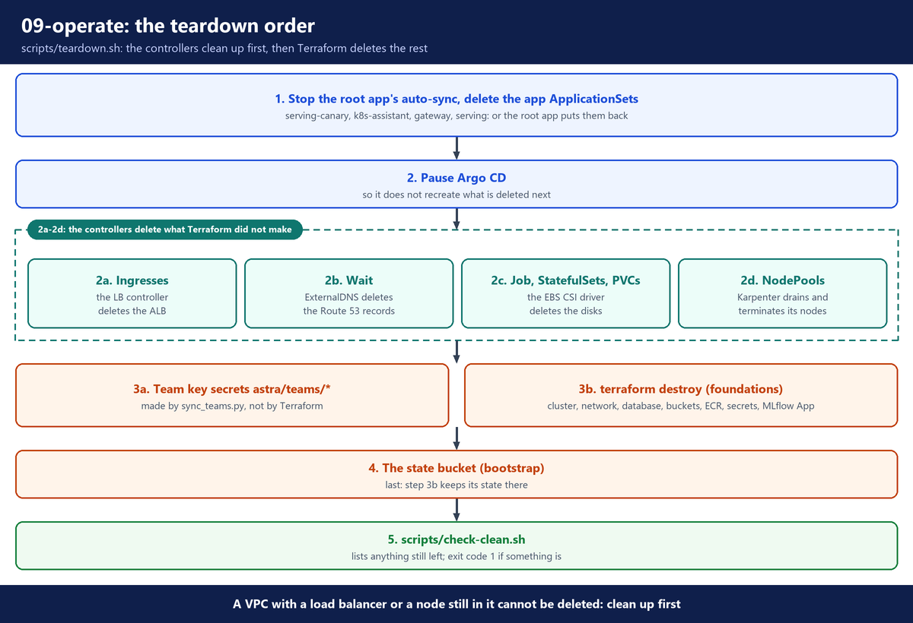

# 12. Teardown

**Repo folder:** `scripts/`

This stage deletes everything the build made, in the right order, and then checks that nothing from the build is left in the AWS account.

> **In this course:** delete everything after each session. The GPUs, the NAT gateway, the cluster and the database cost money every hour.

---

## A. Run the teardown

```bash
bash scripts/teardown.sh
```

Run it from the repository's main folder. It asks two questions: `terraform destroy` asks for `yes`, and the last step asks you to type the state bucket's name. Type the answers: piped answers do not work with Terraform on Windows. `AUTO_APPROVE=1 CONFIRM_BUCKET=<bucket name>` runs it without questions. An example of the full result is in `11-aws-inventory-and-cost`, section G.

Its last step runs `scripts/check-clean.sh`, which lists anything from the build still left in the account. To run that check again later by hand (section D), you need your region and domain. Note them before you start, because the Terraform outputs are gone after the destroy:

```bash
terraform -chdir=terraform/foundations output -raw region; echo
terraform -chdir=terraform/foundations output -raw domain; echo
```

---

## B. Why the order matters

Some AWS resources were not made by Terraform. Kubernetes controllers made them:

- The load balancer controller made the ALB.
- ExternalDNS made the DNS records in Route 53.
- The EBS CSI driver made the disks.
- Karpenter made the nodes.

Terraform does not know about them, so `terraform destroy` cannot delete them. Most of them also block it: AWS cannot delete a VPC that still has a load balancer or a node in it. So the controllers must clean up first, while they still run.



**File:** `scripts/teardown.sh` (step 1)

```bash
TF=terraform/foundations
REGION=$(terraform -chdir=$TF output -raw region)
ZONE_ID=$(terraform -chdir=$TF output -raw route53_zone_id)
DOMAIN=$(terraform -chdir=$TF output -raw domain)

echo "== 1. Argo CD apps"
# The root app "platform" applies everything under argocd/. Stop its auto-sync first, or it would
# put back each ApplicationSet we delete.
kubectl -n argocd patch application platform --type merge -p '{"spec":{"syncPolicy":{"automated":null}}}'
# The apps' Applications carry the Argo CD resources finalizer, so deleting the ApplicationSet also
# deletes the pods, Services and Ingresses they made.
for appset in serving-canary k8s-assistant gateway serving; do
  kubectl -n argocd delete applicationset "$appset" --ignore-not-found --wait=true
done
for app in serving-canary k8s-assistant gateway serving; do
  kubectl -n argocd wait --for=delete "application/$app" --timeout=15m 2>/dev/null || true
done
```

- It reads the region, the hosted zone id and the domain from the Terraform outputs first, while they still exist.
- **Stop the root app's auto-sync.** The root app `platform` applies every file under `argocd/` with self-heal. Without this patch, it would create each deleted ApplicationSet again from Git.
- Then it deletes the app ApplicationSets: a canary that may still exist, the app, the gateway and serving.
- The resources finalizer makes Argo CD delete the pods, Services and Ingresses of each app.
- The `wait` lines give each app up to 15 minutes to go.

**File:** `scripts/teardown.sh` (steps 2, 2a and 2b)

```bash
echo "== 2. Pause Argo CD, so it does not recreate what we delete next"
# The add-ons (load balancer controller, ExternalDNS, Karpenter, EBS CSI driver) keep running and do the cleanup.
kubectl -n argocd scale statefulset -l app.kubernetes.io/component=application-controller --replicas=0
kubectl -n argocd scale deployment -l app.kubernetes.io/component=applicationset-controller --replicas=0

echo "== 2a. Ingresses: the load balancer controller deletes the shared ALB"
kubectl delete ingress --all --all-namespaces --wait=true --timeout=10m
kubectl get svc -A -o jsonpath='{range .items[?(@.spec.type=="LoadBalancer")]}{.metadata.namespace}{" "}{.metadata.name}{"\n"}{end}' \
  | while read -r ns name; do kubectl -n "$ns" delete svc "$name" --wait=true; done

echo "== 2b. DNS: wait until ExternalDNS has deleted its records in $DOMAIN"
# ExternalDNS (policy sync) deletes a record after its Ingress is gone. It checks about once a minute.
# Terraform deletes the cluster next, and with it ExternalDNS, so wait here. Up to 10 minutes.
records() {
  aws route53 list-resource-record-sets --hosted-zone-id "$ZONE_ID" --output text \
    --query "ResourceRecordSets[?Type=='A' || Type=='AAAA' || Type=='CNAME'].Name" \
    | tr '\t' '\n' | grep -E "^(astra|argocd|grafana)\.${DOMAIN//./\\.}\.?$" || true
}
for _ in $(seq 60); do
  left=$(records)
  [ -z "$left" ] && break
  echo "   still there: $(echo "$left" | tr '\n' ' ')"
  sleep 10
done
[ -z "$(records)" ] || echo "   WARNING: records are left in $DOMAIN. Delete them in Route 53 after this script."
```

- **Pause Argo CD.** Scaling its two controllers to 0 stops self-heal. The add-on controllers keep running.
- **2a.** Deleting every Ingress makes the load balancer controller delete the shared ALB. Any Service of type `LoadBalancer` is deleted too.
- **2b.** ExternalDNS runs with `policy: sync`, so it deletes a record when its Ingress is gone. It checks about once a minute.
- Why wait: `terraform destroy` deletes the cluster, and ExternalDNS with it. A record that ExternalDNS has not deleted yet would stay in your hosted zone, pointing at a load balancer that no longer exists.
- `records()` lists the `A`, `AAAA` and `CNAME` records named `astra.`, `argocd.` or `grafana.` in your domain: the three host names on the internal ALB. `${DOMAIN//./\\.}` puts a `\` before each dot, so the dots match only a dot.
- The loop checks every 10 seconds, up to 60 times (10 minutes). If records are still there, it prints a warning and goes on. Then delete them by hand in Route 53.

**File:** `scripts/teardown.sh` (steps 2c and 2d)

```bash
echo "== 2c. Disks: the EBS CSI driver deletes the volumes behind the PVCs"
# A PVC is only deleted when no pod uses it, so first stop the StatefulSets and Jobs that hold them.
kubectl -n models delete job model-loader --ignore-not-found --wait=true
# The Prometheus operator would recreate its StatefulSets, so delete what it manages first.
kubectl delete prometheus,alertmanager --all --all-namespaces --ignore-not-found --wait=true
for ns in $(kubectl get pvc -A -o jsonpath='{.items[*].metadata.namespace}' | tr ' ' '\n' | sort -u); do
  kubectl -n "$ns" delete statefulset --all --wait=true
done
kubectl delete pvc --all --all-namespaces --wait=true --timeout=10m

echo "== 2d. Karpenter NodePools: Karpenter drains and terminates its nodes"
kubectl delete nodepools --all --wait=true --timeout=15m
until [ -z "$(kubectl get nodeclaims -o name 2>/dev/null)" ]; do
  echo "   waiting for Karpenter nodes to go:"; kubectl get nodeclaims --no-headers 2>/dev/null || true
  sleep 20
done
# EC2NodeClasses last: Karpenter then deletes the instance profiles it made.
# A left-over instance profile stops Terraform from deleting the node IAM role.
kubectl delete ec2nodeclasses --all --wait=true --timeout=5m
```

- **2c.** A PVC is deleted only when no pod uses it. So the model loader Job (`05-model-pipeline`) and the StatefulSets go first, then the PVCs. The EBS CSI driver then deletes the EBS volumes.
- The Prometheus operator (part of the monitoring add-on) keeps running, and it would create its StatefulSets again. So the script first deletes the `Prometheus` and `Alertmanager` objects the operator manages.
- **2d.** Deleting the NodePools makes Karpenter drain and terminate its nodes. The loop waits until no NodeClaim is left.
- EC2NodeClasses go last. Karpenter then deletes the instance profiles it made. A left-over profile would block Terraform from deleting the node IAM role.

**File:** `scripts/teardown.sh` (steps 3a, 3b and 4)

```bash
echo "== 3a. Team key secrets: sync_teams.py created them, so Terraform does not know them"
# Without --force-delete-without-recovery a deleted secret waits 7-30 days, and its name stays taken.
for id in $(aws secretsmanager list-secrets --region "$REGION" \
              --filters Key=name,Values=astra/teams/ --query 'SecretList[].Name' --output text); do
  echo "   deleting $id"
  aws secretsmanager delete-secret --region "$REGION" --secret-id "$id" --force-delete-without-recovery >/dev/null
done

echo "== 3b. terraform destroy: foundations (prints a plan and asks for yes)"
terraform -chdir=$TF destroy ${AUTO_APPROVE:+-auto-approve}

echo "== 4. The bootstrap state bucket"
# The bucket has prevent_destroy, so a plain terraform destroy refuses. That guard is on purpose:
# it holds the only record of what Terraform built. Delete it by hand, and only now.
BUCKET=$(terraform -chdir=terraform/bootstrap output -raw state_bucket)
answer=${CONFIRM_BUCKET:-}
[ -n "$answer" ] || read -r -p "Type the bucket name to delete it and every old state version ($BUCKET): " answer
[ "$answer" = "$BUCKET" ] || { echo "Not deleted."; exit 1; }
# In the current folder, not mktemp: on Windows, aws.exe cannot read a Git Bash /tmp path.
VERSIONS=.teardown-versions.json
# shellcheck disable=SC2016  # the backticks are a JMESPath literal for the AWS CLI, not a shell command
aws s3api list-object-versions --bucket "$BUCKET" --output json \
  --query '{Objects: [Versions, DeleteMarkers][][].{Key: Key, VersionId: VersionId}, Quiet: `true`}' > "$VERSIONS"
grep -q '"Key"' "$VERSIONS" && aws s3api delete-objects --bucket "$BUCKET" --delete "file://$VERSIONS"
rm -f "$VERSIONS"
aws s3api delete-bucket --bucket "$BUCKET"
# Terraform now sees the bucket is gone and removes the rest (bucket settings, backend.hcl).
terraform -chdir=terraform/bootstrap destroy ${AUTO_APPROVE:+-auto-approve}
```

- **Step 3a** deletes the team API key secrets `astra/teams/<team>`. `sync_teams.py` (`07-gateway`) made them, so Terraform does not know them and would leave them behind.
- `list-secrets` with the name filter `astra/teams/` finds them all.
- `--force-delete-without-recovery` deletes each secret at once. Without it, a deleted secret waits 7 to 30 days, and its name stays taken, so a rebuild could not use it.
- **Step 3b** deletes what `03-foundations` built: the cluster, the network, the database, the two buckets, the two ECR repositories, the secrets, and the MLflow App `astra` with all its traces.
- Lab settings make this quick. Both buckets (models and MLflow artifacts) have `force_destroy`, the ECR repositories have `force_delete` (they are deleted with their images, the gateway image too), the database has no final snapshot, and the secrets have no recovery window.
- ⚠️ The traces go with the App and its bucket: after the teardown they are gone.
- **Step 4** deletes the state bucket last. Step 3b keeps its state there, so the bucket must exist until step 3b ends.
- The bucket has `prevent_destroy`. So the script empties it by hand: every object version and delete marker (the bucket keeps old versions), then the bucket.
- You must type the bucket's name to confirm.

**File:** `scripts/teardown.sh` (step 5)

```bash
echo "== 5. Final check: is anything from this build left in the account?"
bash scripts/check-clean.sh "$REGION" "$DOMAIN"
```

- **Step 5** runs the cleanup check below, with the region and the domain the script read at the start.
- The teardown runs with `set -e`, so if the check finds a leftover, the script ends with exit code 1. Read the `LEFT` lines.

The full file is at `scripts/teardown.sh`.

---

## C. The final check: check-clean.sh

`terraform destroy` reports only on what Terraform made. It says nothing about the resources the controllers in the cluster made: nodes, disks, load balancers and DNS records. If one of the steps above went wrong, such a resource can stay behind, and it keeps costing money. `scripts/check-clean.sh` asks AWS directly, kind by kind, and prints one line per kind: `ok`, or `LEFT:` with the IDs it found.

- **Made by the controllers in the cluster** (Terraform cannot see these): EC2 instances, Karpenter launch templates and instance profiles, EBS volumes, load balancers and target groups, and the Route 53 records for `astra.`, `argocd.` and `grafana.`. 💰 A GPU node or a load balancer left behind costs money every hour.
- **Made by Terraform**, to confirm the destroy finished: the EKS cluster, the VPC (with its network interfaces and security groups, which usually block the VPC delete), the NAT gateway, the Elastic IPs, the RDS instance and its snapshots, the S3 buckets, the ECR repositories, the secrets, the certificate, the IAM roles, Karpenter's SQS queue and EventBridge rules, the EKS log groups, the MLflow App and the Bedrock guardrail.
- **A last sweep** lists anything else with the tag `Project=astra`. AWS's tag list can lag a few minutes behind a delete.
- The exit code is `0` when nothing is left, `1` when something is.
- ⚠️ The script hides AWS CLI errors (`2>/dev/null`). A check that fails, for example for lack of permission, prints `ok`. If a line looks wrong, run that command by hand.

The full file is at `scripts/check-clean.sh`.

---

## D. Validate

The last step of `teardown.sh` already ran `check-clean.sh`. Read its output. To run it again, use the region and the domain you noted before the teardown:

```bash
bash scripts/check-clean.sh us-east-1 <your domain>
echo "exit code: $?"
```

What to look for:

- Every line ends with `ok`, and the last line says that nothing from this build is left in the region. The exit code is `0`.
- A `LEFT:` line names a leftover, with its IDs or names. Right after the teardown, some items can still be deleting (a NAT gateway, a load balancer, the tag list): wait 5 minutes and run it again.
- If a line stays `LEFT`, delete that resource in the console or with the AWS CLI, then run the check again until every line shows `ok`.
- ⚠️ If your account runs other EKS clusters with Karpenter in this region, some checks can list their resources too: the unattached PVC disks, the roles that start with `KarpenterController` or `system-eks-node-group`, and the EventBridge rules that start with `Karpenter`. Check the names before you delete anything.
- The line `MLflow App (SageMaker AI)` shows `ok` once the App is deleted. While AWS is still deleting it, it shows `LEFT` with the App ARN.
