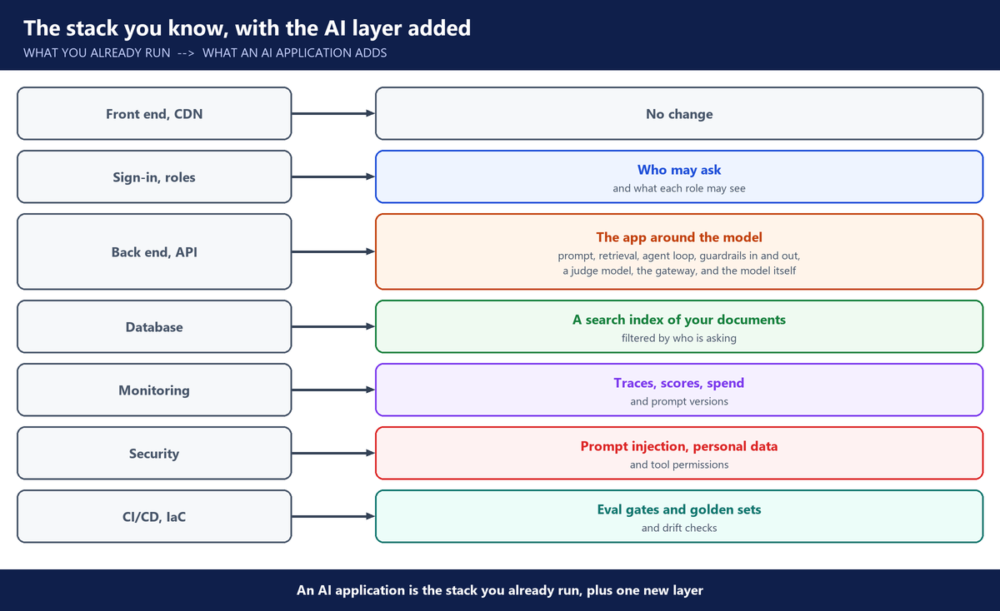
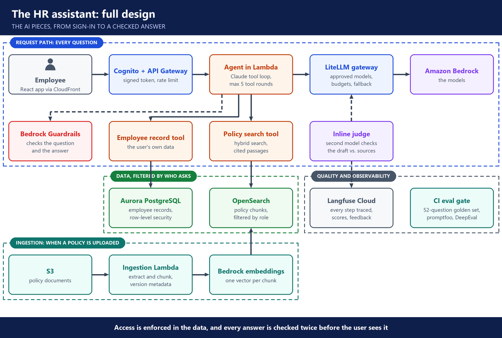
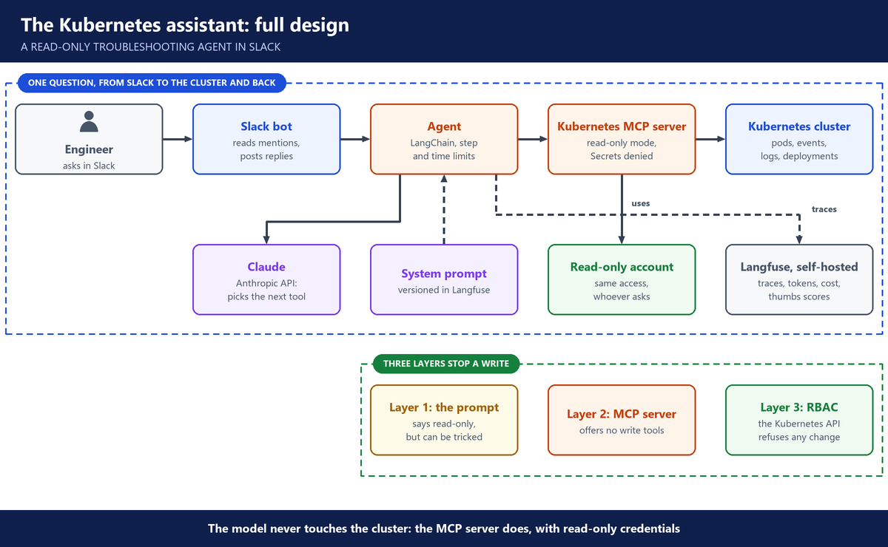

# 0. How to use these notes

**LLMOps for DevOps, Cloud and SRE Engineers · End of course**

One page of class notes per week: the key ideas, grouped by topic. Each page ends with the questions you should be able to answer, 100 in all, with the points from class that answer them. For a project question, the answer shows two angles: you built the whole system, or you owned a piece of a team project.

## A. The big picture

An AI application is the stack you already run, plus one new layer.

Every question about an AI system lands on one of these layers:

1. **The model:** where does it run, and which one is it?
2. **People access:** who can use the app, and how?
3. **The app around the model:** prompts, retrieval, agents.
4. **Data access:** what can the model see, for which user?
5. **Tool access:** what can an agent do?
6. **Control switches:** guardrails, gateway limits, prompt rollback.
7. **Answer quality:** how do you know an answer is right?
8. **Visibility:** what is it doing, and what does it cost?
9. **The platform underneath:** cloud, Kubernetes, Terraform, CI/CD.

---

## B. The 10 weeks

- **Week 1**: LLM foundations.
- **Week 2**: prompts, structured output, function calling.
- **Week 3**: a first AI app, from notebook to chat app.
- **Week 4**: RAG.
- **Week 5**: the HR policy assistant, locally and on AWS.
- **Week 6**: agents, MCP and the Kubernetes assistant.
- **Week 7**: the 10 stops: the OWASP Top 10 for LLM apps.
- **Week 8**: observability with self-hosted Langfuse.
- **Week 9**: CI/CD for the HR assistant.
- **Week 10**: running your own model on EKS.
- **Resume statements and presenting a project** (last page): resume lines for the AI and infrastructure pieces, and how to present a project.

---

## C. The projects

- **First AI app** (week 3): a chat app that calls several model providers, then a Slack bot in Docker.
- **HR policy assistant** (weeks 5 and 9): answers HR questions from policy documents, by role. Built locally, then on AWS, then given a full CI/CD pipeline.
- **Kubernetes assistant** (weeks 6 and 8): a read-only troubleshooting agent for a cluster, then traced with Langfuse.
- **AWS assistant** (homework after week 6): an agent that answers questions about an AWS account, such as billing.
- **Self-hosted model** (week 10): the design for serving our own model on GPU nodes in EKS.

---

## D. The HR assistant, end to end

- **Every question** passes sign-in at Cognito and API Gateway, then a guardrail check, before the agent sees it.
- **The agent** runs in Lambda and calls two tools. Policy search reads OpenSearch, filtered by the user's role. The record tool reads the employee's own data in Aurora, protected by row-level security.
- **Every model call** goes through the LiteLLM gateway to Bedrock. An inline judge checks the draft against the policy, and the guardrail checks the answer again before the employee sees it.
- **Ingestion** runs when a policy is uploaded to S3: it is chunked, embedded with Bedrock and indexed in OpenSearch.
- **Quality** is watched in two places: Langfuse traces every step, and the CI gate tests every release against the golden set.

---

## E. The Kubernetes assistant, end to end

- **An engineer asks in Slack.** The Slack bot passes the question to the agent.
- **The agent** asks Claude which tool to use next, within step and time limits. Its system prompt is versioned in Langfuse.
- **The Kubernetes MCP server** runs the tools. It is in read-only mode, Secrets are denied, and it reads the cluster with its own read-only account, whoever is asking.
- **Langfuse** traces each question: the tool calls, tokens, cost and thumbs scores.
- **Three layers stop a write:** the prompt, the MCP server and RBAC. The last one holds even if the first two fail.

---

## F. Course material

- [Course labs, weeks 1, 2 and RAG](https://github.com/utrains/llmops-course/)
- [Project 1 student briefing](https://docs.google.com/presentation/d/1DJ3NXVwI8LRxbgioW_fQMsco3g_FB8bu/edit) and [Project 1 code deck](https://docs.google.com/presentation/d/1r8siCusqGWpX8ay5RKa2GVLTdlZfm_97/edit), week 3
- [Local HR assistant](https://github.com/utrains/llmops-rag-prod), week 5
- [HR assistant on AWS](https://github.com/utrains/llmops-rag-aws), week 5
- [Kubernetes assistant](https://github.com/kserge2001/aws-k8s-ai-chat-assistant), week 6
- [Langfuse lab](https://github.com/utrains/langfuse-aws-k8s-agent), week 8
- [Astra deployment guide](https://github.com/utrains/llmops-course/tree/main/week08/docs), week 10
