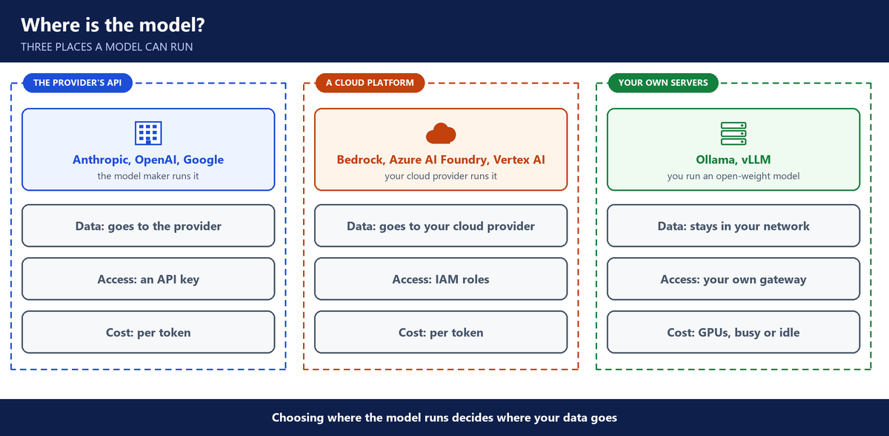
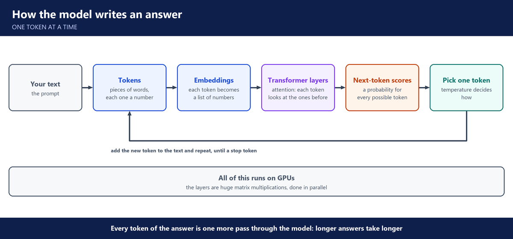

# 1. Week 1: LLM foundations

**Layers:** the model, the app around the model

**Course material:** [Week 1 lab](https://github.com/utrains/llmops-course/tree/main/week01)

## Why LLMOps

- AI apps fail in public. Google Bard gave a wrong fact about the James Webb telescope in its launch demo. A Chevrolet dealer's chatbot agreed to sell a car for one dollar.
- **AI application** = any app that makes an API call to an LLM. Many are invisible to users, for example a Jira ticket summary written by a model.
- **LLMOps** = deploying, operating, monitoring and maintaining LLM apps: safe, reliable, and within budget.
- Enterprise apps need secure access to the model, a backup model (multi-model routing), and evaluation to catch hallucinations.

---

## Where the model runs

- Three options: call the provider directly (Anthropic, OpenAI, Google), use a cloud platform that hosts models (AWS Bedrock, Azure, GCP), or self-host on your own servers or Kubernetes.
- The choice decides where company data goes. Compliance and data security usually push companies to a cloud platform or self-hosting.

---

## How an LLM works

It all started with a word. In the 1950s, researchers began calling their goal **artificial intelligence**: machines that could think. For decades, that meant writing rules by hand, and the rules always ran out.

Then came a different idea. Instead of writing the rules, let the machine learn them from data. That is **machine learning**. **Deep learning** pushed it further, with large networks of simple math units stacked in layers. Those networks were too heavy to train, until **GPUs**, built for video games, turned out to be perfect for the job. Their strength is doing huge amounts of matrix math in parallel.

In 2017, a team at Google published a paper with a bold title: **"Attention Is All You Need"**. It introduced the **transformer**, a design that reads a whole sentence at once and works out which words matter to each other. Every modern LLM is built on it. In late 2022, ChatGPT put one in everyone's hands, and companies started asking how to run these models safely. That question is LLMOps.

An **LLM** (large language model) is a deep learning model trained on huge amounts of text. What it learned is stored as **parameters**, billions of numbers. The Llama 3.2 model we ran in class has about 1 billion. The model is math over these numbers, not a library of stored text.

**So what happens when you ask it a question?** The model writes its answer one token at a time:

1. The text is split into **tokens**, pieces of words, each with a number.
2. Each token becomes an **embedding**, a list of numbers that stands for its meaning.
3. The **transformer layers** process them. **Attention** lets each token look at the tokens before it and weigh which ones matter.
4. The model gives a probability for every possible next token.
5. One token is picked. **Temperature** decides how: low picks the likeliest, higher allows less likely ones.
6. That token is added to the text, and the whole pass runs again, until the model writes a stop token.

The parameters are built once, by the provider, in **training**: first on huge amounts of text, then with examples and human feedback. Everything after that is **inference**, using the trained model on every request. Training is the provider's job. Running inference safely, at scale and within budget, is ours.

This also explains the model's biggest weakness. It always writes the likeliest next token, even when it has no good answer. It holds patterns, not checked facts, so a wrong answer sounds as sure as a right one. That is **hallucination**. And for all its fluency, an LLM is not AGI, a general intelligence. It predicts text.

---

## Using a model

- **Tokens** are how you pay and how you are limited. Long prompts and long answers cost more and take longer.
- **Context window** = the most tokens one request can hold, prompt and answer together.
- **Temperature** = how random the answer is. Low for facts, higher for creative text.
- **System prompt** = rules and boundaries for the model. **User prompt** = the question. Roles: system, user, assistant.
- The model is **stateless**: it remembers nothing. ChatGPT seems to remember because the app stores the history and sends it again.
- **Streaming** sends the answer token by token, so the user sees text at once.

---

## Which models exist

- **Frontier (closed-weight) models:** Claude, GPT, Gemini, used through an API.
- **Open-weight models:** Llama (Meta), Qwen (Alibaba) and millions more on Hugging Face. Ollama runs them on a laptop.
- Choose by task quality, context window, cost, and where your data is allowed to go.

---

## Questions you should be able to answer

**1. What is LLMOps, and how is it different from DevOps?**

Most of it is the DevOps work I already do: infrastructure as code, CI/CD, containers, access and monitoring. LLMOps adds what the model brings.

The answers change from run to run, so I can't just unit-test them: I need evals on real questions. Every call has a cost in tokens, so cost is something I watch per request. Prompts are part of the release, and a prompt change can break the app with no code change. And there is a new attack, prompt injection, that a normal web app doesn't have.

**2. What is a token, and why does it matter to you as an operator?**

A token is a piece of a word. Everything I run is counted in tokens: the price, the rate limits and the context window.

The model writes its answer one token at a time, so a long answer takes longer and costs more. When I size cost or latency for an AI feature, I start from how many tokens go in and come out per request.

**3. What is a context window?**

It's the most tokens one request can hold, the prompt and the answer together.

A bigger context costs more and is slower. So instead of pasting whole documents into the prompt, I retrieve only the few passages that matter. That's the reason RAG exists.

**4. What do temperature and the system prompt control?**

Temperature controls how random the answer is. For facts, policies and data extraction I keep it low. For drafting text it can be higher.

The system prompt is the set of rules the model gets on every call: its role, its limits, the format, and what it must refuse. It's the first control I have over the model's behaviour.

**5. Why do LLMs hallucinate, and how do you reduce it?**

The model predicts the most likely next token from patterns it learned. It has no list of checked facts, so when it doesn't know, it still writes something that sounds right.

I reduce it in layers. I give it the real documents through retrieval, ask it to cite the source, and let it say "not enough evidence" when the documents don't cover the question. Then I test it with a golden set of questions before every release.

**6. What is the difference between training and inference?**

Training builds the model once, at the provider, on huge amounts of data and GPUs. Inference is using the trained model, on every request.

My job is inference: serving the model, scaling it, keeping it safe and paying for it. We don't train models; we use pre-trained ones with our company's data.

**7. Where can a model run, and how do you choose?**

There are three options: call the provider's API directly, use a cloud platform like AWS Bedrock, or self-host an open model on our own GPUs.

The choice is mostly about data. With the provider's API, prompts leave to that provider. With Bedrock, they stay with our cloud provider, under IAM and the compliance we already have. Self-hosting keeps them in our own network but means we run the GPUs. For most companies, compliance points to a cloud platform first.

**8. What is the difference between closed and open-weight models?**

Closed, or frontier, models like Claude, GPT and Gemini are used only through an API. I can't download them.

Open-weight models like Llama and Qwen can be downloaded from Hugging Face and run on our own hardware, from a laptop with Ollama to GPU nodes in Kubernetes. That gives control over data and cost, but we run everything ourselves.

**9. How would you give a chat app memory, when the model itself is stateless?**

The model doesn't remember anything between calls, so I keep the memory outside it, in a database.

Every chat gets a session ID. When a user sends a message, the back end looks up that session and pulls the recent messages. It sends them to the model with the system prompt and the new question. When the answer comes back, it saves the question and the answer to that session.

For the history I'd use Postgres or DynamoDB, and Redis if it has to be very fast. Because the state is in the database, any server can take the next message, so the back end scales out easily.

Long chats get expensive and can hit the context window, so I send only the last few messages and summarise the older ones. The history also holds personal data, so it gets access control, encryption and a retention period.

In our HR assistant, each conversation was saved in Postgres for that user, and Langfuse showed every conversation as one session.

**10. Users get different answers to the same question. Why, and what do you do?**

The model doesn't look up an answer. It picks each next token from a list of probabilities, so two runs can take different paths and give different wording, sometimes different facts.

For anything factual, like policies, I set the temperature low, keep the system prompt fixed, and ground the answer in retrieved documents. Even then the wording varies a little, so my tests check the facts and the meaning of an answer, not the exact text.
