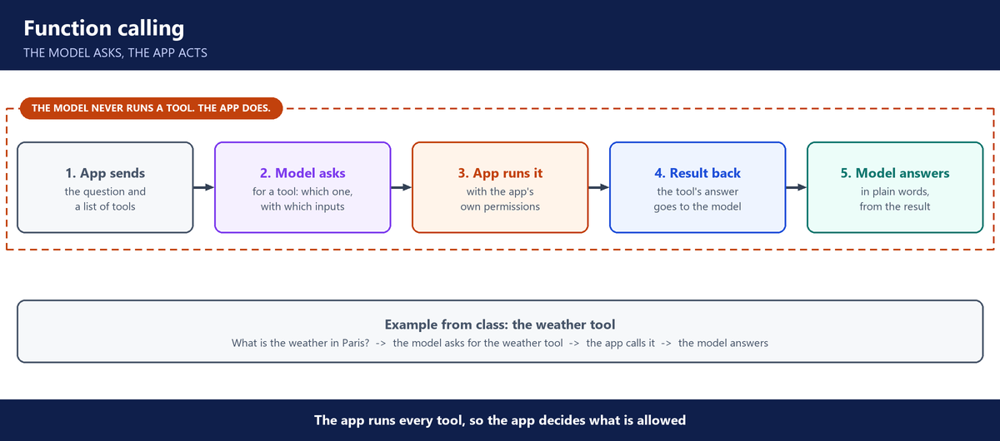

# 2. Week 2: Prompts, structured output, function calling

**Layers:** the app around the model, control switches

**Course material:** [Week 2 lab](https://github.com/utrains/llmops-course/tree/main/week02)

## Controlling the model with the system prompt

- A production system prompt has five parts: **instructions**, **context**, **constraints**, **examples**, and an **escape hatch** (permission to say "I don't know").
- Bad prompts cause real incidents. Air Canada's chatbot promised a refund the airline did not offer, and the airline was held responsible.
- Prompt techniques: **few-shot** (show examples of good answers), **chain of thought** (reason step by step), **self-critique** (check and fix its own draft). Used in class for ticket classification and password-policy questions.
- The API is stateless, so the app sends the conversation history on every call. Long history means more tokens.

---

## Structured output

- Other systems cannot read a paragraph. In production the model must answer in **JSON** with known fields, so microservices can use it.
- **Pydantic** validates the JSON: right fields, right types. Always validate before using the data.

---

## Function calling

- A **tool** is a normal Python function: list Kubernetes pods, look up the weather, query AWS.
- The model only asks for a tool, with its inputs. The app (or a framework such as LangChain) runs it and sends the result back.
- This is what lets AI reach databases, APIs and clusters. It also means the app's permissions decide what is safe.
- **MCP**, first look: ready-made servers that wire common tools to a model, instead of writing each tool by hand.
- Agents that call tools in a loop can loop forever and burn tokens. Limits and monitoring are needed.

---

## Models and keys

- Local open models (Llama) for testing. Frontier models (Claude) for quality, paid per token.
- API keys come from Anthropic, OpenRouter, or a cloud platform such as Bedrock, Azure AI Foundry or Vertex AI. One platform key can reach many models.
- Keys live in an environment file or a secret store, never in Git.

---

## Running prompts like DevOps

- **Prompts are code:** version them, review changes, know which one is live.
- Monitor token spend and set alerts, the same way you monitor any service.

---

## Questions you should be able to answer

**11. What goes into a production system prompt?**

Five parts: instructions for the task, the context it needs, the constraints it must respect, a few examples of good answers, and an escape hatch.

Together they keep the model on task and stop it from inventing answers. I keep the system prompt in version control, because changing it changes how the app behaves.

**12. What is an escape hatch, and why does it matter?**

It's an instruction that lets the model say it doesn't know, or that the information is missing.

Without it, the model guesses, and a guess sounds exactly like a fact. With it, our assistant answers "not enough evidence" instead of inventing a policy.

**13. When do you use few-shot, chain of thought or self-critique?**

Few-shot when I want the model to copy a pattern: I show it a few examples, like how to classify support tickets. Chain of thought when the task needs reasoning: I ask it to work through the steps before answering. Self-critique when the output must be checked: it reviews its own draft and fixes it.

In class we used them on ticket classification and on password-policy questions.

**14. Why does production need structured output, and how do you trust it?**

Other systems need data, not paragraphs. An API, a database or a ticketing tool expects JSON with known fields, so the model has to answer in exactly that format.

I define the schema first, as a Pydantic model with each field and its type, and ask the model for output in that schema. Then I validate the reply in code. If it fails, I retry once with the error. If it fails again, I return a clear error instead of passing bad data on.

**15. Walk me through a function call.**

The app sends the question to the model with a list of tools, each with a name, a description and its inputs. The model doesn't answer yet: it replies with a tool call, which tool and with which inputs. The app runs that tool, for example listing the pods in a namespace, and sends the result back. Then the model writes the final answer from that result.

**16. Who runs the tool, and why does that matter for security?**

The app, or a framework like LangChain, runs it. The model only asks.

That's where I put the limits. Only tools on an approved list can be called. The app checks every input before running it, for example that the namespace is one we allow. And the tool runs with its own limited credentials, like a read-only role, so even a tricked model can't do more than that role allows.

**17. What is MCP?**

The Model Context Protocol is an open standard for connecting AI apps to tools. An MCP server offers ready-made tools, for Kubernetes, Jira or GitHub for example, and any agent that speaks MCP can use them.

It saves us from writing and wiring every tool by hand. We used the Kubernetes MCP server for our Kubernetes assistant.

**18. How do you manage API keys for an LLM app?**

Never in the code, never in Git and never in the browser. Only the back end holds a key.

In a lab, the key sits in an environment file that Git ignores. In production, it sits in a secret manager like AWS Secrets Manager, and the back end reads it at start-up through its IAM role. On Bedrock I don't need a key at all: the IAM role is the permission.

I give each app or team its own key, so a leaked key can be revoked alone, and I rotate them. Later, the gateway gives each team a virtual key and keeps the real provider keys to itself.

**19. Why treat prompts as code?**

Because a prompt change can break the app with no code change at all. So prompts are versioned, reviewed in a pull request and tested before release, and I always know which version is live. Later we moved the system prompt into Langfuse, so we could switch versions and roll back without a deploy.
