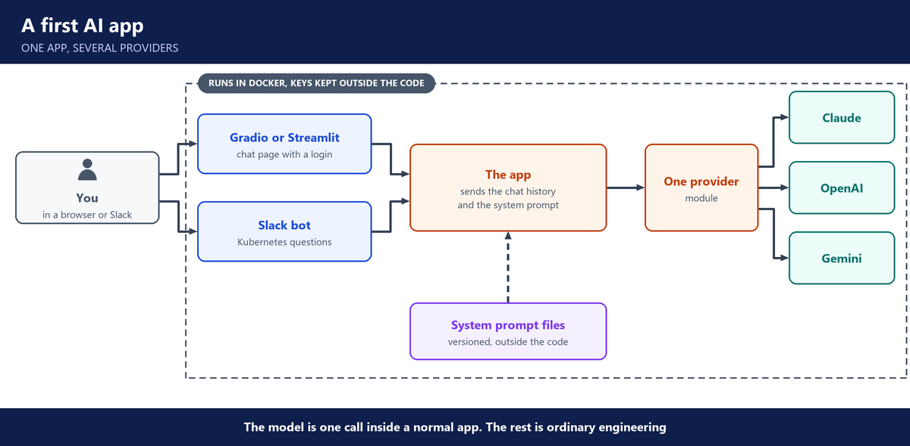

# 3. Week 3: A first AI app, from notebook to chat app

**Layers:** the app around the model, the platform underneath

**Course material:** [Project 1 student briefing](https://docs.google.com/presentation/d/1DJ3NXVwI8LRxbgioW_fQMsco3g_FB8bu/edit) · [Project 1 code deck](https://docs.google.com/presentation/d/1r8siCusqGWpX8ay5RKa2GVLTdlZfm_97/edit)

## From notebook to application

- Notebooks are for trying things. A real app is organized code in a project, with settings and keys outside the code.
- Companies build **one app with several entry points** (web page, Slack), not a separate tool for each.
- Through a cloud platform such as Bedrock, one key can reach many models.
- The AI call is a small part of the code. The rest is ordinary engineering.

---

## Choosing and calling models

- Pick a model by testing it on your task. On the same 7-word puzzle, Sonnet answered correctly and small models such as GPT-5.4 Nano failed.
- Small models are cheap and fast, but weak at reasoning.
- Use **streaming**, so the user is not left waiting in silence.
- **Memory is an illusion:** the model is stateless, and the app wires the conversation history back in.
- **A provider module:** one function per provider (Anthropic, OpenAI), so the app can switch or combine models.

---

## The user interface

- **Gradio** gave a quick chat page with history. It can be shared through Hugging Face and protected with a username and password.
- **Streamlit** gave a chatbot for Utrains, shaped by its system prompt.
- The **system prompt is the product:** persona, role, limits and tone. It was written with the help of another model, then moved out of the code into versioned files.
- A cleaning-service chatbot showed one app reused for a new business by changing only the prompt.

---

## Slack and Docker

- A **Slack bot** for Kubernetes questions. Slack tokens and scopes decide what the bot can read and write.
- The app was packaged in **Docker**, ready to deploy.

---

## What production still needs

- Cost control, session management, audit logs and monitoring.
- Scaling (for example horizontally on Kubernetes) and CI/CD.
- When the data no longer fits in a system prompt, you need retrieval: next came RAG.

---

## Questions you should be able to answer

**20. How would you choose a model for a task?**

I test the candidates on the same real task, then compare quality, cost and speed. In class we gave several models the same word puzzle. Sonnet solved it, and small cheap models failed.

So I start with the cheapest model that passes our tests, and move up only where the tests show I need to.

**21. Why do you stream answers?**

The model writes one token at a time, so a long answer can take many seconds. Streaming shows the text as it's written, so the user sees the answer start right away instead of waiting in silence.

**22. A chat gets slower and more expensive the longer it runs. Why, and what do you do?**

Because the model is stateless, every new message sends the whole history again. So each turn sends more tokens than the last, which costs more and takes longer.

I send only the last few messages and summarise the older ones. And I keep an eye on tokens per session, so one long chat doesn't surprise us on the bill.

**23. How do you make an app able to switch model providers?**

I put every provider behind the same function, with one implementation for Anthropic and one for OpenAI. The rest of the app only calls that function, so changing the model is one change in one place.

At company scale, a model gateway does the same job for every app at once.

**24. Where should the system prompt live?**

Not inside the code. I keep it in its own versioned files, so it can be reviewed and changed safely, like configuration. Later in the course we moved it into Langfuse, so we could change it without redeploying.

**25. Why build one app with several entry points?**

Users reach the same assistant from different places: a web page, Slack, other tools. If it's one app behind them, there's one place for the prompts, the access rules, the logs and the cost. In class our first app had both a chat page and a Slack bot on the same code.

**26. You have a working chatbot prototype. What does it need before real users rely on it?**

Sign-in, so we know who is asking. Cost control and limits. Proper session handling for the chat history. Audit logs and monitoring. A way to scale. And a CI/CD pipeline with tests, so every change is checked before it ships.

Built it: I took our first chatbot from a Gradio page to something deployable. I moved the prompts out of the code, connected it to Slack, and packaged it in Docker. Then we listed what was still missing for production, which is what the rest of the course built.

**27. How do you connect a chatbot to Slack safely?**

I give the bot only the scopes it needs, for example reading mentions and writing replies, nothing more. Its tokens go in a secret store, not in the code. That way, if the bot is misused, it can only do those two things.
