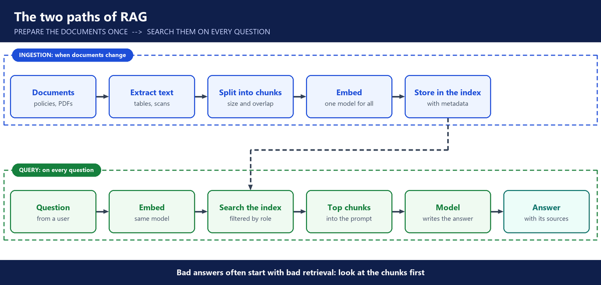

# 4. Week 4: RAG

**Layers:** the app around the model, data access

**Course material:** [RAG labs](https://github.com/utrains/llmops-course/tree/main/week03)

## Why RAG

- An HR chatbot on a plain LLM fails for four reasons. Company data is **private**. The model's training has a **cut-off date**. It **hallucinates**. And a prompt cannot hold every document (**context window**).
- **RAG** (retrieval-augmented generation): at question time, find the right passages in your own documents and give them to the model. The answer is restricted to that context.
- Use cases: HR policies, SRE runbooks, compliance documents. The business value is speed, for example an HR answer in seconds instead of a day by email.
- **RAG or fine-tuning:** fine-tuning means retraining a model on company data. It is costly and needs ML infrastructure. RAG suits facts that change.

---

## Preparing the data

- Before chunking: clean unstructured PDFs, handle images, and remove outdated content. For large data sets this takes months. It is data engineering work.
- Bad data gives bad answers. No tool cleans data well without someone who understands it.

---

## The RAG pipeline

- **Indexing** (when documents change): load, chunk, embed, store.
- **Retrieval** (on every question): embed the question, search, put the top chunks in the prompt, answer.

- **Chunking:** split documents into small pieces. By tokens, recursively, or by meaning (semantic). **Overlap** between chunks keeps meaning that crosses a boundary.
- **Embeddings:** numbers that stand for meaning. OpenAI's model gives 1,536 numbers per chunk. Other models: Voyage AI, BERT.
- Use the **same embedding model** for documents and questions, or the search does not work.
- **Keyword search** matches exact words. **Vector (semantic) search** matches meaning. Production often combines both (**hybrid**).
- Retrieval can also read structured data from SQL databases.

---

## Storing and protecting the data

- **Vector databases:** Bedrock Knowledge Bases, Pinecone, pgvector, ChromaDB. Bedrock reads directly from S3.
- **Metadata** on each chunk (source, section, page, version, date) lets you filter and cite.
- **Access control lives in the app code**, not in the model: filter the search by the user's role.
- **Escape hatch:** when the context has no answer, say "not enough evidence". It is the defence against hallucination.

---

## In the lab

- LangChain loaded and split a PDF, OpenAI embedded the chunks into ChromaDB, hybrid search retrieved them, Claude answered.
- "20 days of annual leave" was answered from the handbook. Parental leave first got "not enough evidence": the search returned too few results, so the passage never reached the model. Returning more results fixed it.
- A Bedrock Knowledge Base does all of this as a managed service, and can read from Confluence and SharePoint. Production document extraction belongs in managed services.

---

## Questions you should be able to answer

**28. Why use RAG instead of a plain model?**

A plain model fails on company questions for four reasons. It has never seen our private data. Its training stops at a cut-off date. It hallucinates. And a prompt can't hold every policy we have.

With RAG, at question time, I find the right passages in our own documents and give them to the model. The answer comes from our policies, with the source cited.

**29. RAG or fine-tuning: how do you choose?**

For company facts I choose RAG. Facts change, they need a source, and access must depend on who is asking. RAG handles all three, and an update is just re-indexing a document.

Fine-tuning retrains the model on our data. It's costly, needs ML infrastructure, and is better for changing style or a narrow skill. For an HR or runbook assistant, RAG is the right tool.

**30. Walk me through a RAG pipeline.**

There are two parts. Indexing runs when documents change. I load the documents and split them into chunks. Then I turn each chunk into an embedding and store it in a vector database, with metadata like the source and version.

Retrieval runs on every question. I embed the question with the same model and search for the closest chunks. The top ones go into the prompt, and the model answers with its sources.

**31. How do you chunk documents?**

I split them by tokens, recursively by structure, or by meaning, with some overlap between chunks so a sentence that crosses a boundary isn't lost.

There is no perfect size. Too small loses context, too big adds noise. So I test chunk sizes against real questions and keep the one that retrieves the right passages.

**32. What is an embedding, and why must documents and questions use the same model?**

An embedding is a list of numbers that stands for the meaning of a text. OpenAI's model, for example, gives 1,536 numbers per chunk. Similar meanings end up close together, which is what makes search by meaning work.

Each embedding model places text in its own space. If the documents and the questions use different models, the numbers can't be compared and the search returns nonsense. If I change the embedding model, I re-embed everything.

**33. Keyword, semantic or hybrid search: what is the difference?**

Keyword search matches exact words, which is great for policy numbers or error codes. Semantic search matches meaning, so "time off" finds "annual leave". Hybrid search combines both, and that's what we used in class and what most production systems use.

**34. How do you stop users from seeing documents they should not see?**

I enforce it in the search, before anything reaches the model.

At ingestion, every chunk gets metadata saying who may read it. At question time, the back end reads the user's role from their verified sign-in token and adds it as a filter to the search. The search only returns chunks that role is allowed to see.

I never rely on the prompt to hide data. Whatever reaches the model can reach the user.

**35. Tell me about a time your RAG app gave a wrong answer. What did you do?**

In our HR assistant, I asked about parental leave while testing it. The policy was in the documents, but the assistant answered that there was not enough evidence.

I checked what the search actually sent to the model. The search returned only a few top-ranked chunks, and the parental leave passage ranked just below the cut-off. So it never reached the model, and the model was right to refuse.

I raised the number of results the search returns, and the answer came back with its source. Then that question went into the golden set, so every release is tested against it.

That's my general rule: look at what was retrieved before blaming the model. If the right chunk is missing, check the number of results, the filters and the chunking. If it's there and the answer is still wrong, check the prompt and the model.

**36. How do you reduce hallucination in a RAG app?**

I tell the model to answer only from the retrieved passages and to cite them. And I give it an escape hatch: when the documents don't cover the question, it says "not enough evidence". In our assistant, that's exactly what it said about parental leave until the search was fixed, which is better than inventing a policy.

**37. Which vector store would you choose?**

If the company already runs Postgres, I start with pgvector: no new system to operate. On AWS, a Bedrock Knowledge Base gives a managed option that reads straight from S3, and OpenSearch scales further. Pinecone is a managed service outside the cloud account. In class we used ChromaDB locally, pgvector for the local HR assistant and OpenSearch on AWS.

**38. Why does data preparation matter so much?**

Because bad data gives bad answers, however good the model is. Before chunking, PDFs have to be cleaned, images handled, and outdated policies removed, or the assistant will cite an old rule.

On a big document set that takes months, and it's data engineering work. I make sure it's planned and owned before we promise anyone a chatbot.
