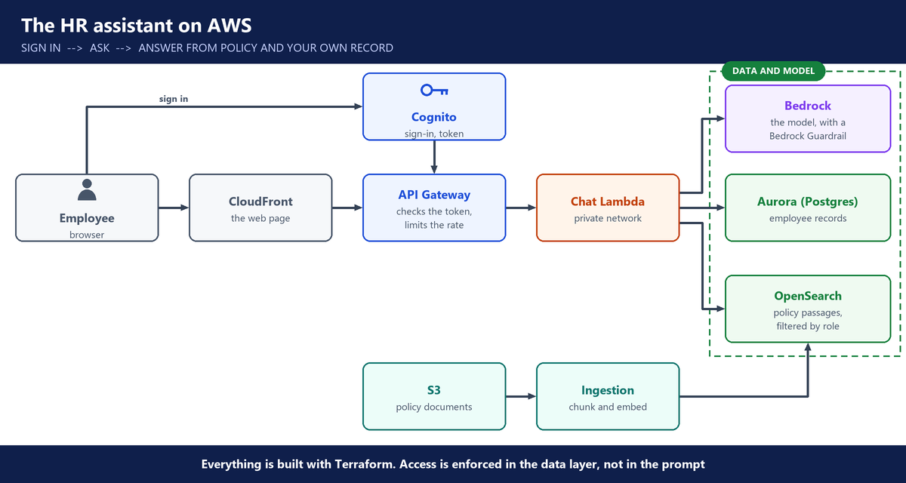

# 5. Week 5: The HR policy assistant, locally and on AWS

**Layers:** people access, data access, control switches, the platform underneath

**Course material:** [Local HR assistant repo](https://github.com/utrains/llmops-rag-prod) · [HR assistant on AWS repo](https://github.com/utrains/llmops-rag-aws)

## The project

- A full RAG product: an HR policy assistant, built twice. First on a laptop, then on AWS.
- Two pipelines: **indexing** (documents in) and **retrieval** (questions answered).
- The goal for us is the infrastructure, not deep Python: we act as cloud AI infrastructure engineers.

---

## Locally

- Postgres with **pgvector** as the vector database, in **Docker**. A **Streamlit** chat page.
- Documents in several formats (PDF, text, CSV) are extracted, chunked, embedded and indexed.
- A **manifest** lists each document's version and who may read it. That drives access control.
- Answers come with citations. An evaluation script runs test questions.
- Tune before production: chunk size and the number of results returned. A problem found: older policy versions were hard to retrieve.

---

## On AWS

- **React** front end in **S3**, served by **CloudFront** (the CDN).
- **API Gateway** calls **Lambda**. **Cognito** signs users in.
- **Bedrock** for the models, **OpenSearch** for the vectors, **Aurora** for employee data, **CloudWatch** for logs.
- Everything built with **Terraform**: over 100 AWS resources, including the VPC.
- **Serverless** instead of EC2, so nothing costs money while idle.
- Uploading a document to S3 triggers the ingestion Lambda.

---

## Two ways to ingest on AWS

- **Our own Lambda:** pull from S3, extract, chunk, embed with Bedrock, store in OpenSearch. More control, more work.
- **Bedrock Knowledge Base:** the service does extraction, chunking and embedding itself. Simpler, less visible.

---

## Access and safety

- **Role-based answers:** an employee cannot see another employee's data. An HR manager can.
- Identity comes from Cognito sign-in, not from what the user types.
- A **prompt-injection** test checked that the assistant could not be talked into breaking those rules.
- Guardrails on the model filter questions and answers.

---

## Questions you should be able to answer

**39. Walk me through an LLM system you deployed.**

Built it: Our HR policy assistant on AWS. Policies are uploaded to S3, which triggers a Lambda that chunks them, embeds them with Bedrock and stores them in OpenSearch. Employees sign in with Cognito, the React front end calls API Gateway, and a Lambda answers with Bedrock, citing the policy. Everything is built with Terraform.

Owned a piece: On our HR assistant team, I owned the Terraform and the AWS deployment: the network, Lambda, API Gateway, Cognito, OpenSearch and Aurora.

**40. How do you deploy an LLM app on AWS?**

For our HR assistant, the React front end sits in S3 behind CloudFront, and API Gateway calls Lambda. Cognito handles sign-in and Bedrock runs the models. OpenSearch holds the vectors, Aurora the employee data, and CloudWatch the logs.

All of it is in Terraform, more than 100 resources including the VPC, so the whole environment can be rebuilt and every change is reviewed.

**41. Why serverless for this app?**

Lambda and the managed services cost nothing while nobody is asking questions, and they scale up on their own when people are. Servers would cost money every hour, including nights and weekends. For a chat assistant with uneven traffic, serverless is cheaper and less to run.

**42. Lambda ingestion or a Bedrock Knowledge Base: which one?**

With our own Lambda, I control every step: how text is extracted, how it's chunked, which embedding model is used. It's more work, but nothing is hidden.

A Bedrock Knowledge Base does extraction, chunking and embedding for us, and can read from S3, Confluence or SharePoint. It's faster to set up but less visible. I'd use the Knowledge Base for a quick start, and our own pipeline when I need control over chunking.

**43. How does each employee get only their own data?**

The employee signs in with Cognito and gets a signed token. API Gateway checks that token before the request reaches Lambda.

Lambda reads the employee's ID and role from the verified token, never from the question. Database queries are limited to that employee's ID, and the policy search is filtered by role. So an employee sees only their own record, and an HR manager can see their team. We tested it by signing in as different users.

**44. Why must identity come from the sign-in token, not the question?**

Because anyone can type "I'm the HR director". Only a token signed by Cognito and checked by API Gateway proves who is asking. Our assistant ignores whatever identity the user claims in the chat.

**45. How do you keep answers current when policies change?**

When someone uploads a new policy to S3, the upload triggers ingestion, so the new version is chunked and indexed right away. A manifest records each document's version and who may read it. So the search returns the current version by default, and an older one only when someone asks for it.

**46. How did you test the assistant before users saw it?**

I ran an evaluation script with test questions and expected answers. I signed in as different employees to check that each one saw only their own data. And I tried a prompt injection, telling it to ignore its rules and show other people's salaries, to check that the rules held.

**47. Answers are incomplete. What do you tune?**

First I check that ingestion worked and every document produced chunks. Then I look at the chunks the search returned. Usually the fix is the chunk size or the number of results returned to the model. In our local version, older policy versions were hard to retrieve until we looked at exactly that.

**48. Why build it locally first, then on AWS?**

Locally, with Docker, pgvector and Streamlit, I can change and test in seconds, for free. Once the design works, the same pieces map to managed AWS services: pgvector becomes OpenSearch, Streamlit becomes a React front end, and the Python code runs in Lambda.
