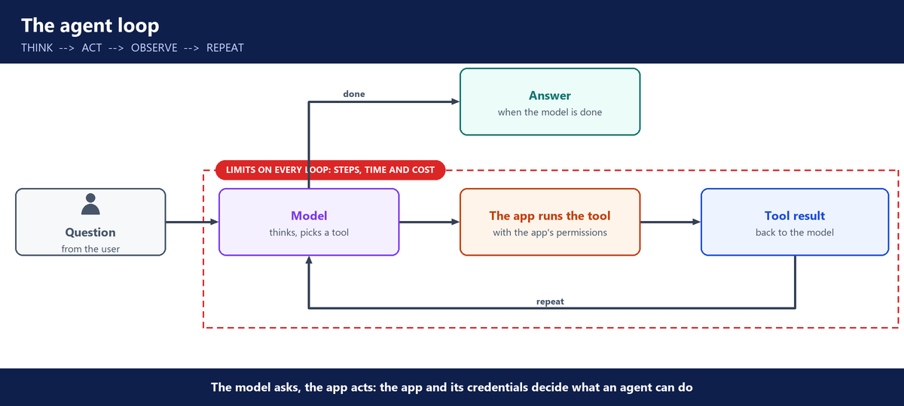
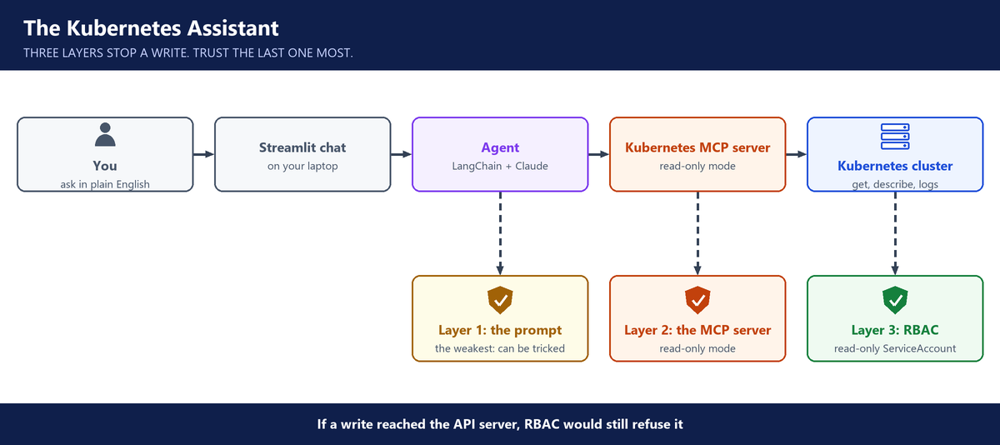

# 6. Week 6: Agents, MCP and the Kubernetes assistant

**Layers:** the app around the model, tool access, control switches

**Course material:** [Kubernetes assistant repo](https://github.com/kserge2001/aws-k8s-ai-chat-assistant)

## What an agent is

- A chatbot answers. A RAG app answers from documents. An **agent** takes actions through tools.
- **Workflow:** your code decides the steps. **Agent:** the model decides the next step itself.
- An agent = an LLM (the brain) + memory + tools. Tools are Python functions. The framework runs them; the model never runs code itself.
- The model picks a tool from its **description**, so a clear description matters. One question can trigger several tool calls in a row.

---

## Risks and limits

- Infinite loops that burn tokens, prompt injection, and runaway cost.
- Limit steps, time and spend. Compare what the agent saves with what its tokens cost.
- Companies keep agents **read-only** or non-destructive for now: no unapproved changes in production.

---

## MCP

- **MCP** (Model Context Protocol): an open standard for connecting AI to tools such as Jira, GitHub and Kubernetes.
- An MCP server gives an agent ready-made tools, instead of wiring each function by hand.

---

## In class

- A LangChain agent with three tools: web search, stock price and weather.
- A demo AWS chatbot: list S3 buckets and EC2 instances and read billing, in one conversation.

---

## The Kubernetes assistant

- A Streamlit chat page, a LangChain agent, and the **Kubernetes MCP server** for its tools.
- It connects with a **read-only ServiceAccount**, not personal credentials, and has **no access to Secrets**. Safe to share with many users.
- Settings in one place: MCP address, namespace, system prompt, model.
- The MCP server ran on the laptop. It can also run inside the cluster.
- It diagnosed broken banking, e-commerce and delivery apps: image pull failures, CrashLoopBackOff, probe problems. You still need Kubernetes knowledge to judge its answer.

- Homework: the same pattern for AWS (billing, resources, recent changes), Jira and GitHub.

---

## Questions you should be able to answer

**49. What is the difference between a chatbot, a RAG app and an agent?**

A chatbot answers from what the model knows. A RAG app answers from our documents. An agent acts: it uses tools to look things up or do work, and decides its own next step. Our HR assistant is RAG. Our Kubernetes assistant is an agent.

**50. Workflow or agent: when do you use each?**

If I know the steps, I write a workflow: my code decides each step and the model fills in one part. If the steps depend on what it finds, like troubleshooting a pod, I use an agent and let the model decide. Agents cost more and are harder to test, so I don't use one where a workflow will do.

**51. How does an agent decide which tool to use?**

From each tool's name and description. The model reads them and picks the one that fits the question, then may call another based on the result. So I write tool descriptions carefully: a vague description leads to the wrong tool.

**52. How do you stop an agent from doing something dangerous?**

I give it the fewest tools it needs, read-only by default. The limit that really holds is the permission on its credentials: our Kubernetes assistant uses a read-only ServiceAccount, so it physically can't delete anything. Any change has to go to a person. And I cap its steps, time and spend.

**53. An agent loops forever and burns money. How do you prevent it?**

I set hard limits per question: a maximum number of steps, a time limit and a token budget. I also stop it when it calls the same tool with the same inputs again, because that's a loop. Then I watch the traces for agents that keep hitting those limits.

**54. What is MCP, and what does it mean for a platform team?**

MCP, the Model Context Protocol, is an open standard for connecting agents to tools such as Jira, GitHub and Kubernetes. An MCP server offers the tools, and any agent that speaks MCP can use them.

For the platform team it means control. Only approved MCP servers are allowed. Each one runs with its own limited credentials, like the read-only ServiceAccount of our Kubernetes assistant. And every tool call is logged, so you can see what each agent did.

**55. Tell me about the Kubernetes assistant.**

We built it for the question every platform team hears all day: why is this pod failing? It's a read-only agent that reads the cluster through the Kubernetes MCP server and explains the cause, such as an image pull error or CrashLoopBackOff.

It connects with a read-only ServiceAccount and has no access to Secrets, so many people can use it and a tricked model still can't change anything.

Built it: I built the whole assistant: the chat page, the agent and the MCP connection.

Owned a piece: I owned its access setup: the read-only ServiceAccount and the kubeconfig it uses.

**56. Why a read-only ServiceAccount instead of your own credentials?**

My own credentials can probably delete things. The ServiceAccount can only read, and it has no access to Secrets. So I can share the assistant with the whole team, and even if someone tricks the model, the Kubernetes API refuses any change.

**57. Where should the MCP server run?**

In class it ran on the laptop, which is fine for one person. For a shared team tool I'd run it inside the cluster, close to what it reads, with its own ServiceAccount and logs.

**58. How would you build an AWS assistant for billing questions?**

With the same pattern as the Kubernetes one: an agent with AWS tools. One tool reads the bill by service from Cost Explorer, others list resources across regions. I'd give it a read-only IAM role, so the role itself blocks any change, and have it ask the user before anything that would modify the account.
