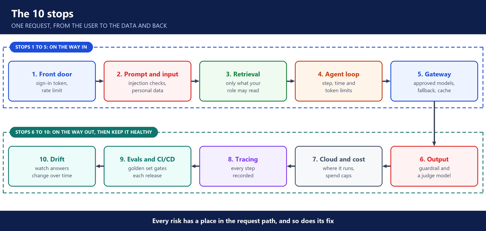

# 7. Week 7: The 10 stops: the OWASP Top 10 for LLM apps

**Layers:** all of them, seen as risks

## Why this week

- Anyone can build an AI prototype. The LLMOps engineer makes it safe in production.
- AI apps are a black box: a wrong answer can look like a success, and nothing raises an alarm.
- AI is an extra layer on an existing app, for example scoring resumes against a job description. The company is responsible for what it outputs.
- An agent is riskier than a RAG app: it runs longer and can do more damage.

---

## The 10 stops

Follow one request from the user to the data and back. At each stop, ask what can go wrong and what stops it. Use several layers of defence: one is never enough.

1. **Front door:** a signed sign-in token (JWT) proves who is asking.
2. **Prompt and input:** prompt injection comes straight from the user or hides inside a document. Tag data so it is never read as instructions. Guardrails detect and redact personal data. A human approves anything sensitive (an approval step could have stopped Air Canada's wrong refund promise).
3. **Retrieval:** return only what the user's role may read.
4. **Agent loop:** budgets on steps, time and tokens, no repeated calls, read-only tools, and a human before destructive actions. Prevents excessive agency and runaway cost.
5. **Gateway:** a fallback model when the main one fails, and caching (Redis, or a semantic cache for similar questions) to save cost. Our apps did not have a gateway yet.
6. **Output:** filter and check the answer before it reaches the user, with a guardrail or a judge model.
7. **Cloud and cost:** Lambda for jobs under 15 minutes, ECS or EKS for longer ones. GPU nodes on Kubernetes when data must stay private. Watch compliance and spend.
8. **Tracing:** see how every answer was produced. Langfuse was chosen for this.
9. **Evals and CI/CD:** a golden set (test questions with expected answers) checked by promptfoo, DeepEval and a judge model on every change. Gates as strict as the app is critical: strict for the HR assistant, lighter for an internal tool.
10. **Drift:** quality, answer length and error rate change over time, for example when a new policy brings new questions. Keep prompts versioned in Langfuse, with rollback and A/B tests.

---

## Debugging and roles

- The 5-step loop: monitor, trace, reproduce, add a regression test, update the eval gate.
- The roles: domain experts know the content, implementation engineers build the app, platform engineers take it to production.

---

## The OWASP Top 10 for LLM Applications

- The public list behind these stops: prompt injection, sensitive information disclosure, supply chain, data and model poisoning, and improper output handling.
- Then excessive agency, system prompt leakage, vector and embedding weaknesses, misinformation, and unbounded consumption.
- A gap review against it: the HR assistant was in good shape. The Kubernetes assistant still needed per-user access and drift detection.

---

## Questions you should be able to answer

**59. What is prompt injection, and how do you defend against it?**

It's text that tricks the model into ignoring its rules. It can come from the user typing "ignore your instructions", or hide inside a document or a log the model reads.

There's no single fix, so I defend in layers. A guardrail checks the input. Retrieved text is marked as data, never as instructions. The tools have only the permissions they need. And anything sensitive needs a human to approve it. In our HR assistant we tested exactly this with a fake request for everyone's salaries.

**60. What is in the OWASP Top 10 for LLM applications?**

It's the public list of the main risks for apps built on models. The first five are prompt injection, sensitive information disclosure, supply chain, data and model poisoning, and improper output handling. The other five are excessive agency, system prompt leakage, vector and embedding weaknesses, misinformation, and unbounded consumption.

In class we placed each one at a stop along the request, from sign-in to drift, and reviewed our two apps against it.

**61. How do you stop sensitive data from leaking?**

At three points. The search only returns what the user's role may see. A guardrail detects and redacts personal data in the question and in the answer. And no secrets ever go into a prompt, because a determined user can get the model to reveal its prompt.

**62. Where do guardrails go?**

On both sides of the model. Before the model call, the question goes through a guardrail that checks for injection, harmful content and personal data. After the call, the answer goes through it again before the user sees it.

If something is blocked, the app returns a safe message instead of the model's text. We used Bedrock Guardrails, which can do both and redact things like Social Security numbers.

**63. What is excessive agency?**

It's an agent with more power than its job needs: too many tools, write access it doesn't need, no limits. I fix it by giving it read-only tools, setting step and spend budgets, and requiring a human for anything destructive.

**64. Why put a model gateway in front of the models?**

So every app calls one place instead of calling models directly. The gateway holds the list of approved models and the order to try them in.

If the main model errors or times out, the gateway retries, then sends the request to a fallback model, so the app stays up. Because every call passes through it, it's also where I set team keys, budgets, rate limits and caching.

**65. How does caching save cost, and what is the risk?**

If a question was already answered, the cache returns the stored answer without calling the model, so it's free and instant. A semantic cache also matches questions that mean the same thing but are worded differently.

The risk is that a semantic cache matches two questions that look alike but aren't, and returns the wrong answer. Worse, it could hand one user an answer built from another user's data.

So I keep the cache separate per user or per team, require a very close match, and let entries expire, so old policy answers don't linger.

**66. Lambda, ECS or EKS for an AI app?**

Lambda for short work, under its 15-minute limit, like our HR assistant's chat and ingestion. ECS or EKS for long-running services. EKS with GPU nodes when we run our own model.

**67. What is an LLM judge, and when do you use it?**

It's a second model that checks an answer: is it supported by the sources, is it relevant, are the facts right. I use it in the test pipeline to score releases, and for critical apps also in the request path, where it checks each answer before the user sees it. Our HR assistant did both.

**68. What is drift in an AI app?**

It's when the answers slowly change with no new release: quality drops, answers get longer, errors rise. New policies, new kinds of questions or a model update can cause it.

I catch it by saving a baseline and comparing the live numbers against it on a schedule: answer length, response time, error rate and quality scores. Evidently can do that comparison. When something moves for good, I add the new kinds of questions to the golden set.

**69. How do you debug a bad answer?**

Five steps. I notice it in monitoring or in user feedback. I open the trace and see each step. I reproduce the problem. I add it to the tests as a regression case. Then I update the eval gate, so the same mistake can't ship again.

**70. How strict should the eval gates be?**

As strict as the app is critical. For our HR assistant, which answers questions about pay and leave, a full golden set gates every release. For an internal read-only tool like the Kubernetes assistant, lighter checks and monitoring are enough.
