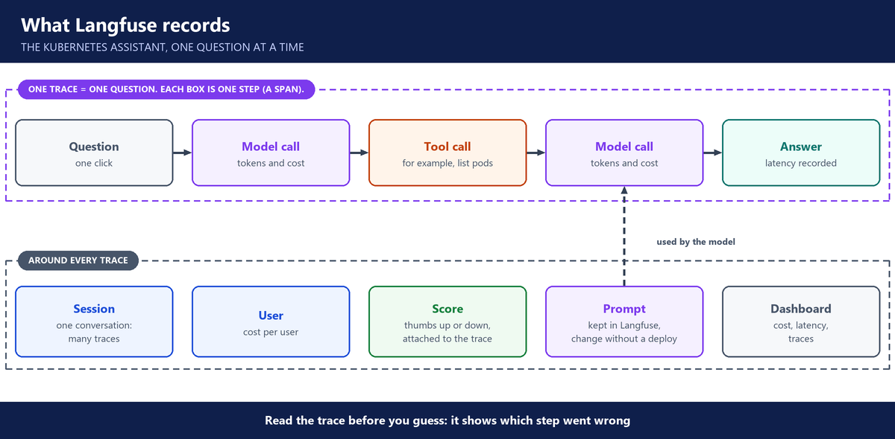

# 8. Week 8: Observability with self-hosted Langfuse

**Layers:** visibility, answer quality, control switches

**Course material:** [Langfuse lab repo](https://github.com/utrains/langfuse-aws-k8s-agent)

## Why AI needs its own observability

- A normal app is deterministic: same input, same output. An AI app is not, and its failures are silent.
- CloudWatch still watches the infrastructure. It cannot show why the model gave an answer.
- Observability means following the journey from the user's question to the answer, and collecting real user feedback.

---

## Langfuse

- An open-source platform for LLM apps. We self-hosted it on the laptop with Docker Compose: Postgres, Redis, ClickHouse and MinIO behind it.
- Set up an organization, a project and an API key. Add model definitions with their prices (Claude Haiku, Claude Sonnet), so every call shows its cost.
- One callback in the agent is enough to start sending traces.

---

## What it records

- **Trace:** one question, from click to answer. **Span:** one step inside it, such as a model call or a tool call. **Session:** one whole conversation.
- Each trace shows the tool calls, the tokens and the cost. One question cost 12 cents because it used many tokens: monitoring is how you avoid surprise bills.
- **Users** and **sessions** show cost per user.
- **Scores:** thumbs up and down from users, to find the answers people did not like.
- **Prompts in Langfuse:** the system prompt is stored and versioned there, so it can change without redeploying the app.
- **Dashboard:** cost, latency and traces in one place.
- **Datasets and experiments:** run fixed questions through the agent to test a change. Good traces become test cases. (Homework, with alerts.)

---

## Around it

- LangChain builds a simple agent. LangGraph builds an agent as a graph of steps.
- Some companies allow AI troubleshooting only with a read-only kubeconfig, and no outside MCP servers.
- Chinese or US models, and models from Hugging Face run inside Kubernetes: the model choice is also a security and compliance choice.

---

## Questions you should be able to answer

**71. What do you monitor in an LLM app?**

For every request: latency, tokens, cost, which model and which prompt version, and any errors. Across the app: error rates and spend per day.

But healthy metrics don't tell me an answer was right, so I also track quality: user feedback and scores on the traces.

**72. Why is CloudWatch not enough for an AI app?**

CloudWatch tells me the infrastructure is healthy. It can't tell me which tools the agent called, what the model saw, or why it gave a wrong answer. An AI app can return a confident wrong answer with a 200 status and no alarm. That's why we added Langfuse next to CloudWatch, not instead of it.

**73. What is the difference between a trace, a span and a session?**

A trace is one question, from the click to the answer. A span is one step inside it, like a model call or a tool call. A session is the whole conversation, many traces from the same chat.

**74. How do you trace an LLM request end to end?**

Built it: I connected our Kubernetes assistant to a self-hosted Langfuse. Each question became a trace showing every model call and tool call, with the tokens and the cost of each step.

Owned a piece: On our team, I owned the Langfuse setup and the dashboard.

**75. How do you find which user is driving the cost?**

I record the user and the session on every trace, and I set each model's price in Langfuse, so every call shows its cost. Then the dashboard shows cost per user. In class, one question alone cost 12 cents because of how many tokens it used, which is exactly what this view exposes.

**76. How do you collect user feedback, and what do you do with it?**

I put a thumbs up and down under each answer, and the app stores each vote as a score on that answer's trace in Langfuse. So every vote is linked to exactly what happened.

Then I review the thumbs-down answers regularly. I open the trace, find the cause, like missing retrieval or a weak prompt, and fix it. The question goes into the golden set, so the fix is tested on every release.

**77. How do you change a prompt without redeploying, and roll it back?**

I moved the system prompt out of the code into Langfuse, where every change becomes a new version and one version carries the production label.

At runtime the app asks Langfuse for the prompt by name and label, and caches it briefly. To change the live prompt, I move the label to a new version. To roll back, I move it back. No new build and no deploy.

**78. Self-hosted or cloud Langfuse?**

Traces contain real questions and answers, so where they live matters. Self-hosted keeps them on our own infrastructure, which we did for the Kubernetes assistant. The cloud version is less to run, and we used it for the HR assistant pipeline. The choice comes down to data rules and how much we want to operate ourselves.

**79. How do traces become tests?**

When I find a trace with a bad answer, or a good one that matters, I add that question to a dataset with the expected behaviour. Langfuse experiments then run the whole dataset against a change, so I can see whether the new prompt or model is better or worse before it ships.
