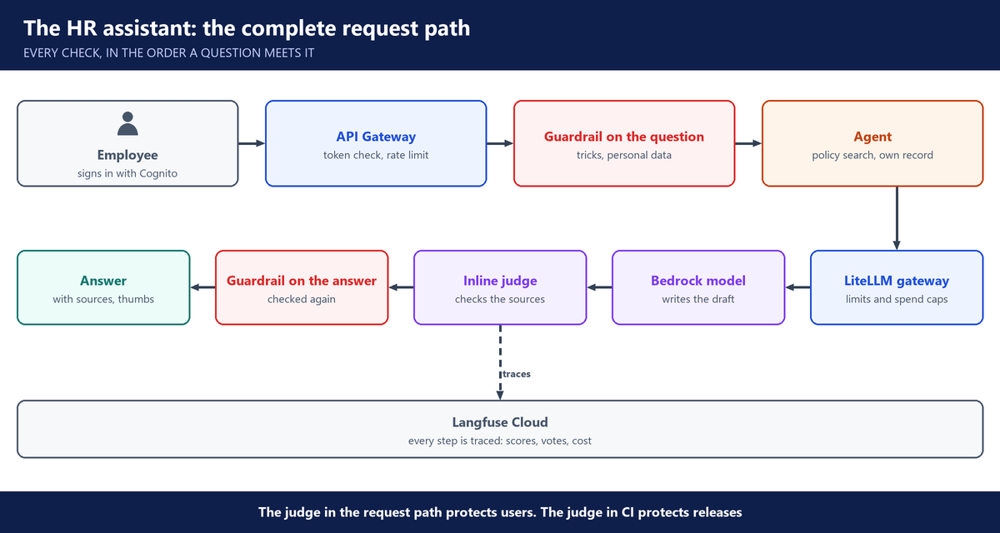

# 9. Week 9: CI/CD for the HR assistant

**Layers:** answer quality, control switches, visibility, the platform underneath

## The full lifecycle

- From prototype to production: build, test, deploy, watch, improve. The focus is the platform, not training models.
- The industry uses pre-trained models with company data (RAG). Training your own model from scratch is rarely the job.
- AI platform engineers run the platform the models live on: Kubernetes, GPU node groups, Argo CD, external DNS.

---

## The model gateway: LiteLLM

- Controls which models and tools can be used, sets budgets and token limits per team, routes requests and falls back to another model.
- Its admin page shows logs and cost per request. The master key gives admin access.
- **LiteLLM and Langfuse do different jobs:** the gateway controls access and limits; Langfuse traces, scores and versions prompts.

---

## The app around the model

- The HR assistant: React front end, Python back end on Lambda.
- A web application firewall, Cognito sign-in and CloudFront in front.
- **Inline judge:** a second model checks each answer against the policy before the employee sees it.
- **Langfuse Cloud** holds the traces and the users' feedback.
- One setup script with Terraform builds the whole environment.

---

## The pipeline in GitHub Actions

- **Before merge:** code scanning for Python and React, secret scanning, pre-commit hooks and push protection.
- **Access to AWS:** OIDC. GitHub proves who it is and gets short-lived credentials, so no AWS keys are stored.
- **Deploy:** the front end to S3, the back end to Lambda.
- **Stages:** checks, then a candidate release from the main branch, then a production handoff, then a release tag.
- **Environments:** only main can deploy to staging. Production needs a reviewer's approval. Secrets are masked.

---

## The quality gate

- The golden set is asked through the live app, not only in unit tests.
- Each question is asked **twice**, to check consistency. promptfoo and DeepEval score accuracy, consistency and toxicity.
- 52 test questions ran, with P95 response time and the model's grades.
- One failure stops the release. Breaking the tool-call limit made the gate fail, as it should.
- Drift is watched over time with Evidently.

---

## Questions you should be able to answer

**80. How is CI/CD different for an LLM app?**

All the normal checks still run: code scanning, unit tests, build and deploy. On top, there's an eval gate: after deploying to staging, the pipeline asks a golden set of questions through the live app and scores the answers. A prompt change can break answers with no code change, so that gate runs on every change.

**81. How do you know a change didn't break the app?**

Every merge to main deploys a candidate release to staging. The pipeline asks it all the test questions through the real app, 52 in our HR assistant, and promptfoo and DeepEval score accuracy, consistency and toxicity. If one answer fails, the release stops there.

**82. Why ask each test question twice?**

Because the model can give different answers to the same question. If it passes once and fails once, it was right by luck. Asking twice checks that the answer is consistent.

**83. What does the gateway do that Langfuse doesn't, and the other way round?**

LiteLLM controls access: which models a team can use, their budgets and token limits, routing and fallback. Langfuse observes: traces, scores, user feedback and prompt versions. One stops bad things happening, the other shows me what happened.

**84. The model provider goes down. What do users see?**

Ideally nothing. In LiteLLM I list a fallback model for each main model, with retries and a timeout.

When the main model fails or is too slow, the gateway sends the same request to the fallback, and the user still gets an answer. I test the fallback on purpose before a real outage, and watch the gateway logs to see how often it's used.

**85. How do you control LLM cost?**

I measure first. The gateway logs the tokens and cost of every request per team key, and Langfuse shows cost per trace and per user.

Then I act on it. Each team gets a budget and token limits in the gateway. I trim long prompts and old chat history, cap the answer length, cache repeated questions, and use a smaller model wherever the tests show quality holds.

**86. How does the pipeline deploy to AWS without storing AWS keys?**

With OIDC. AWS is set up to trust GitHub as an identity provider, through an IAM role that accepts only our repository, and only the branch or environment we choose.

When the pipeline runs, GitHub gives it a signed token. AWS checks it and hands back short-lived credentials for that role, valid for that run only. There are no long-lived AWS keys in GitHub at all.

**87. How do you keep secrets out of the repository?**

Before anything lands: pre-commit hooks, secret scanning and push protection block a commit that contains a key. Inside the pipeline, secrets are stored in GitHub, masked in the logs, and scoped to the environment that needs them.

**88. How do you gate a production release?**

Only the main branch can deploy to staging. The candidate has to pass the full test set there. Then promotion to production needs a reviewer's approval, and the release that passed gets a version tag, so we always know exactly what is running.

**89. What is the difference between the inline judge and the evals in CI?**

The inline judge runs on every live answer and checks it against the policy before the employee sees it. It protects users. The evals in CI run on a release before it ships. They protect releases. Our HR assistant has both.

**90. Tell me about the CI/CD pipeline you built.**

Owned a piece: On our HR assistant, I owned the GitHub Actions pipeline. It scans code and secrets, reaches AWS with OIDC, and deploys a candidate to staging. It asks 52 test questions through the live app, and production needs a reviewer.

Built it: I built our HR assistant end to end, from the gateway to the pipeline. The LiteLLM gateway sets budgets and a fallback model, an inline judge checks every answer, Langfuse Cloud keeps the traces, and the pipeline tests every release before it ships.
