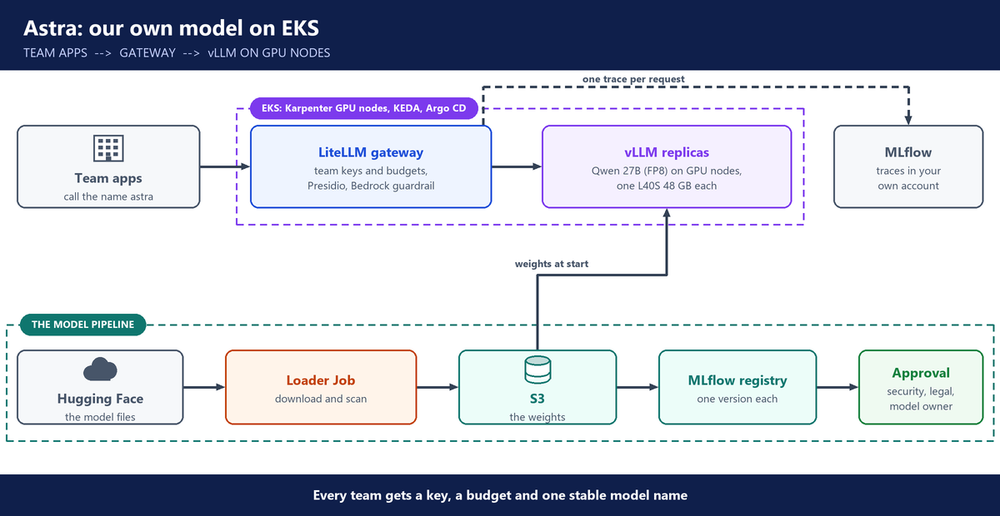

# 10. Week 10: Running your own model on EKS

**Layers:** the model, the platform underneath, control switches

**Course material:** [Astra deployment guide](https://github.com/utrains/llmops-course/tree/main/week08/docs)

Taught as a design, not built in class: GPU nodes are costly and AWS limits GPU capacity. The full guide is in the Astra workspace.

## Why self-host

- Three ways to use a model: a cloud platform (AWS), a vendor's API, or self-hosting. Self-hosting is a core job of AI platform engineers.
- Reasons: data privacy and compliance, domain-specific models (fine-tuned for law or medicine), and cost when a company makes millions of calls.
- Start from existing open-source models on Hugging Face, never from scratch. Start with a pilot.

---

## Choosing the model and the GPU

- Choose by parameter count, the GPU it needs, its context window and its license.
- Qwen 27B needs about 27 GB of memory, so one 48 GB L40S GPU fits it.
- GPUs are expensive (about 7.50 US dollars an hour was the figure in class), so someone must watch for idle GPUs.

---

## The platform, in stages

- **Stage 1, Terraform:** a VPC across 3 availability zones, and EKS with a system node group and a GPU node group.
- **Stage 2, Argo CD add-ons:** External Secrets, the load balancer controller, Karpenter to add GPU nodes, and Kyverno for policies.
- **Model pipeline:** a Kubernetes job downloads the model from Hugging Face, scans it, uploads it to S3 and registers it in MLflow.
- **Serving:** vLLM, installed with Helm, loads the model on the GPU nodes in two availability zones.
- **Scaling:** CPU-based autoscaling (HPA) does not fit GPUs. KEDA scales vLLM on waiting requests instead.

---

## Around the model

- **LiteLLM gateway:** team keys and access control.
- **Cost per team:** the model is free, but the GPUs are not. The gateway counts tokens, and the GPU cost becomes a price per token for each team. Budgets live in a database and Redis.
- **Presidio** as a guardrail for personal data.
- Prompting still matters with your own model: zero-shot, few-shot and generation settings.

---

## Observability

- **MLflow** is where the platform's traces live: a managed MLflow App on SageMaker, inside the company's own AWS account.
- The gateway sends MLflow one trace per request: the prompt, with personal data masked by Presidio, the answer, the team, the user, tokens, cost and latency.
- The traces hold company text, so keeping them in the company's own account matters more than anything else here. That is why this platform uses MLflow, where the other projects used Langfuse.
- MLflow is also the **model registry**: every model version that passes the pipeline is registered there, and serving uses the approved version.
- **Prometheus and Grafana** watch the serving side: waiting requests, GPU use, time to first token, and spend by team from the gateway.

---

## Questions you should be able to answer

**91. Why would a company self-host a model?**

Three reasons. The data can't leave the company. The company wants a model tuned for its own domain, like law or medicine. Or the volume is so high that running GPUs is cheaper than paying per token. The cost is that we run the GPUs, the scaling and the upgrades ourselves, so I'd start with a small pilot.

**92. How do you size a GPU for a model?**

I start from the memory the model needs. Qwen 27B needs about 27 GB, so one 48 GB L40S GPU holds it, with room left for the requests in flight. A bigger model, or many long requests, would need a bigger GPU or several.

To choose the model, I look at its size, the GPU it needs, its context window and its license. Then I test it on our own questions. I always start from an existing model on Hugging Face.

**93. How do you observe a self-hosted model platform?**

In two layers. For each request, the gateway sends a trace to MLflow, which we run as a managed MLflow App in our own AWS account. Each trace holds the prompt, with personal data masked by Presidio, the answer, the team, the user, tokens, cost and latency.

For the serving side, Prometheus and Grafana show waiting requests, GPU use and time to first token, and the gateway's spend by team.

I chose MLflow there because the traces contain company text and must stay in our own account. MLflow is also our model registry, so the same place shows which model version is serving.

**94. How do you autoscale model servers?**

Not on CPU. A GPU server can be overloaded while its CPU looks idle, so CPU-based autoscaling scales at the wrong time. KEDA scales vLLM on the number of requests waiting, and Karpenter adds GPU nodes when new pods need them.

**95. How do model files get to the GPU nodes safely?**

Through a model pipeline. A Kubernetes job downloads the model from Hugging Face, scans the files, uploads them to S3 and registers that version in MLflow. The servers only load versions that went through that pipeline.

**96. How do you charge teams for a model that is free?**

The model is free, but the GPUs aren't. I take the monthly cost of the GPU nodes and divide it by the tokens all teams used, which gives an internal price per token.

Each team calls the model through the gateway with its own key, so the gateway counts each team's tokens. Tokens times the price is each team's share. Budgets live in a database and Redis, so a team that hits its limit is refused.

**97. Why do GPUs need special cost attention?**

A GPU node costs money every hour, busy or idle, and far more than a normal node. So I keep only the minimum replicas users need, and let Karpenter remove GPU nodes with nothing running. I alert when GPU use stays low, and shut down dev and test copies nobody is using.

**98. What does vLLM do?**

It's the server that runs the model on the GPU and exposes it as an API. Its value is efficiency: it packs many requests onto the same GPU at once, so the expensive hardware stays busy instead of serving one user at a time.

**99. How do you build the platform repeatably?**

In two stages. Terraform builds the VPC across three availability zones and the EKS cluster, with a system node group and a GPU node group. Then Argo CD installs everything else from Git: External Secrets, the load balancer controller, Karpenter and Kyverno, and the model server itself through Helm.

**100. Tell me about the self-hosted platform design.**

I worked through the design of a platform to serve Qwen 27B on our own GPU nodes in EKS. Terraform builds the network and the cluster, Argo CD installs the add-ons, and vLLM serves the model.

Teams reach it through a LiteLLM gateway, with their own keys and budgets, and Presidio masks personal data. A model pipeline downloads, scans and registers each model before it serves.

We didn't run it in class because GPU nodes are costly and AWS limits GPU capacity. In a company, the first step would be a small pilot.
